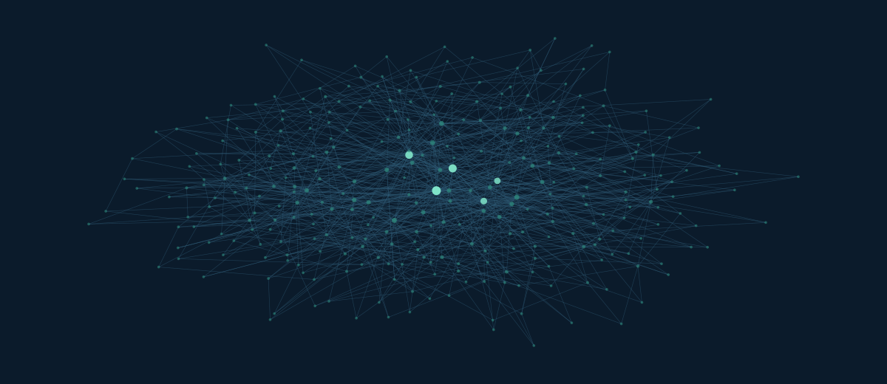

# ODIN-Sim

### Opinion Dynamics with Intelligent-agent Networks

**面向研究的仿真平台，用于研究智能体网络中意见的形成、交互与演化。**


**建模 · 仿真 · 分析**

<br>



<sub>上图是一张真实的 Barabási–Albert 网络，由
`odin_sim.topology.build_network(n=320, seed=20261028, kind="ba")` 生成、
经 `scripts/render_hero_network.py` 布局。它不是示意图——每个节点与每条边
都来自平台自身的输出。</sub>

<br>

[English](README.md) · 简体中文

[概览](#概览) · [架构](#架构) · [快速开始](#快速开始) · [实验与可复现性](#实验与可复现性) · [路线图](#路线图)

---

## 概览

ODIN-Sim 是 **ODIN —— Opinion Dynamics with Intelligent-agent Networks**
（智能体网络意见动力学）研究计划的仿真平台。该计划关注：嵌入在网络中的智能体
之间相互作用时，意见如何演化。

平台提供的基础设施，用于对网络结构、智能体状态、交互机制与意见动力学模型
进行计算实验的构建、执行与分析。它被有意设计成**不**绑定于某一种动力学模型
或某一种智能体实现。

### 研究工作流

**建模 → 配置 → 仿真 → 分析 → 复现**

| 能力 | 在本项目中的含义 | 状态 |
|---|---|---|
| 网络建模 | `ba` / `er` / `ring` / `ws` / `sbm`，可选立场同配重连 | 可用（见[假设登记](docs/topology-assumptions.md)） |
| 意见动力学 | 由引擎执行已注册的模型；平台不写死任何一种模型 | 通过 G3 baseline 适配器可用 |
| 智能体接入 | 为外部智能体实现提供显式接口 | **计划中**——尚未实现 |
| 实验管理 | 配置、随机种子、运行元信息 | 可用：在配置 × 种子上做批量扫描，产物幂等可续跑 |
| 结果分析 | 跨条件聚合、置信区间、静态图、时间序列演化曲线 | 已可用（`analyze` / `plot` / `curves` 子命令；画图需 `[analysis]` 可选组） |
| 可复现性 | 针对参考数据集的逐位回归、环境与代码快照 | 可用且已验证 |

<sub>能力只有在实现并验证之后才标记为可用。标记为"计划中"的，不应假定已存在。</sub>

### 项目生态

ODIN 把研究建模与执行基础设施分开：

| 项目 | 职责 |
|---|---|
| **ODIN-Sim** | 仿真基础设施：网络、执行、实验管理、指标、分析 |
| **odin-agents** | 智能体实现：行为、决策、记忆、交互策略 |

两个项目各自独立维护，通过显式接口通信。ODIN-Sim 在**运行期只读加载**
`odin-agents` 的 G3 baseline：不把源码复制进动力学内核，也不修改
`odin-agents` 的任何文件。

> **边界说明**：本仓库不包含 odin-agents 的模型、参数与研究结论。
> 相关内容仅保留在本地 `docs/internal/`（不入库），两个项目的资料互不混用。

---

## 架构

```text
                          ODIN-Sim
                              |
        +---------------------+---------------------+
        |                     |                     |
     Networks             Dynamics              Metrics
   topology/             model/protocol        model/registry
   ba er ring ws sbm     DynamicsModel         Metric
        |                     |                     |
        +---------------------+---------------------+
                              |
                    Simulation Engine
                    engine/runner.py
                    (分发 · 计时 · 产物组装)
                              |
                    Experiment Runner
                    experiments/（sweep）
                              |
              +---------------+---------------+
              |                               |
        Data & Metrics                  Run Metadata
        RunOutput                   reproducibility.py
        traj_hash / network_hash    commit · 依赖 · 配置
        results.csv · manifest.json
              |                               |
              +---------------+---------------+
                              |
                     Analysis & Plots        [可用]
```

分层规则是单向的：引擎只依赖**协议**（`model/protocol.py`），不依赖任何具体
模型。模型与指标通过显式注册表解析，同名重复注册直接报错——因此一次实验不会
在无人察觉的情况下跑在错误的实现上。

单次运行遵循同一条路径，模型是状态的唯一写入者：

```text
RunRequest ──► engine.run_once ──► DynamicsModel.run ──► RunOutput ──► Metric.compute
```

---

## 快速开始

### 环境要求

- Python `>=3.12,<3.14`（在 3.13.14 上开发与验证）
- NumPy（数值核心）；`uv` 用于环境管理
- 可选：`odin-agents` 的 G3 baseline —— **仅**在运行或回归 G3 模型时需要

### 安装

```bash
git clone https://github.com/ipengfei1994/odin-sim.git
cd odin-sim

uv venv --python 3.13
uv sync --extra dev
```

### 生成一张网络

这一步不需要任何外部项目：

```python
from odin_sim.topology import build_network

net = build_network(n=500, seed=7, kind="ws")   # 或：ba, er, ring, sbm
print(net["hash"], net["n_edges"], net["deg"].mean())
```

### 跑一次仿真

需要 G3 baseline，在运行期只读加载：

```bash
export ODIN_BASELINE_ROOT=/path/to/odin-agents/baseline
```

```python
from odin_sim.engine import run_once
from odin_sim.model import DYNAMICS
from odin_sim.model.protocol import RunRequest

model = DYNAMICS.get("g3-baseline-v1")
record = run_once(model, RunRequest(
    mode="cross", placement="hub", beta_gov=0.20, tau=60, seed=7,
))
print(record.traj_hash, record.network_hash)
```

### 跑一次批量实验（sweep）

```bash
uv run python -m odin_sim.cli sweep --config configs/sweep_example.json \
    --out results/example --dry-run          # 只展开，不执行
uv run python -m odin_sim.cli sweep --config configs/sweep_example.json \
    --out results/example --metrics all
```

运行按 `run_id`（规格内容哈希）寻址，重复执行同一 sweep 会跳过已完成的运行，
因此长扫描可以中断后续跑。

### 验证可复现性

```bash
uv run pytest -q

uv run python -m odin_sim.cli verify-baseline \
    --data $ODIN_BASELINE_ROOT/data/g3_grid_runs.csv --scenario polarized

uv run python -m odin_sim.cli verify-metrics \
    --data $ODIN_BASELINE_ROOT/data/g3_grid_runs.csv --scenario polarized
```

---

## 实验与可复现性

可复现性是设计要求，不是事后补充。每一次运行都应当能从显式输入被标识并重复。

| 要素 | 处理方式 |
|---|---|
| 配置 | `RunRequest` 携带 mode、placement、dose、warm-up、scenario、seed 与参数覆盖——无隐式状态 |
| 随机数 | 自管理的 `SeedSequence` 派生生成器；不触碰全局 RNG |
| 标识符 | `config_id = "{mode}_{placement}_b{beta:03d}_t{tau:02d}"` |
| 指纹 | `traj_hash = sha1(round(traj, 10))[:16]`，`network_hash = sha1(src+dst)[:16]` |
| 环境 | `odin-sim info` 记录 commit、dirty 标记、Python、平台与依赖版本 |
| 回归 | 266 条已记录运行被重算并**逐字段**比对 |

### 当前验证状态

| 检查项 | 范围 | 结果 |
|---|---|---|
| 轨迹指纹 | 266 次运行，`traj_hash` + `network_hash` | 266 / 266 一致，0 不一致 |
| 指标等价性 | 266 次运行 × 25 个字段 | 266 / 266 一致，0 不一致 |
| 拓扑一致性 | `ba` / `er` / `ring` 对参考实现 | 跨种子、跨同配参数逐位一致 |
| 注入安全性 | 用平台拓扑注入后运行参考实现 | 轨迹指纹不变 |
| 测试 | 单元 + 回归 | 40 passed |

在 Windows 11、Python 3.13.14、NumPy 2.3.4 上验证。NumPy 被锁定，因为网络生成
与初始条件依赖 PCG64 随机流；放宽锁定需要一次尚未开展的跨版本研究。

<sub>这些结果只说明平台能够**复现**参考实现，不构成关于意见动力学的科学结论。</sub>

---

## 路线图

**已可用**

- [x] 核心配置与运行接口（`RunRequest` / `RunOutput`）
- [x] 网络生成：`ba`、`er`、`ring`、`ws`、`sbm`
- [x] 协议层，以及模型 / 拓扑 / 指标的显式注册表
- [x] 执行引擎（分发、计时、产物组装）
- [x] 批量实验运行器：在配置 × 种子上做扫描
- [x] 结构化结果存储（`manifest.json`、`results.csv`），支持断点续跑
- [x] 受控随机种子与运行元信息快照
- [x] 自动化测试与逐位 baseline 回归
- [x] 通过只读运行期适配器接入 G3 baseline
- [x] 面向已存储结果的分析层：跨条件聚合与置信区间（`analyze`）
- [x] 需要同种子对照的指标，其对照配对机制（可配置 `ControlSpec`）
- [x] 结果静态图：带置信带的曲线、分组柱状、相图热图（`plot`）
- [x] 逐时间步序列落盘与带置信带的演化曲线（`curves`）

**计划中**

- [ ] 面向 `odin-agents` 的公开接入接口
- [ ] 平台原生的意见动力学模型（目前只有适配器）
- [ ] 逐步执行，使外部智能体能在每一步行动
- [ ] 在优化任何热点之前先做性能剖析
- [ ] 交互式实验可视化
      需要先与课题组确定摘要口径

路线图是暂定的，会随研究需求清晰化而调整。

---

## 文档

设计说明与验证记录见 [`docs/`](docs)：

| 文档 | 内容 |
|---|---|
| [`docs/README.md`](docs/README.md) | 文档分层：哪些随仓库发布，哪些不发布及原因 |
| [`docs/architecture-v1.md`](docs/architecture-v1.md) | 架构方案 v1（草案） |
| [`docs/topology-assumptions.md`](docs/topology-assumptions.md) | `ws` / `sbm` 假设的参数与随机数约定——待确认 |
| [`docs/experiments.md`](docs/experiments.md) | 实验层：配置 schema、`run_id` 规则、存储决策与限制 |

---

## 参与贡献

贡献应优先考虑科学正确性、接口清晰、可测试性与可复现性。对模型、数据格式或
公开接口的重大变更，请先讨论设计方案再实施。

## 引用

待项目形成稳定的文献引用后补充引用信息。

## 许可证

按 [MIT License](LICENSE) 发布。

---

**ODIN-Sim**
*建模网络。研究动力学。复现实验。*
