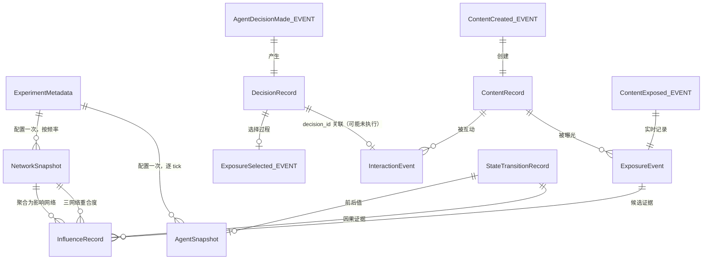

# Data Schema v1.0

**ODIN Experiment Specification v1.0 · 配套文档（数据字典 / 网络 Schema）**

| 项 | 内容 |
|---|---|
| 状态 | 待研究者评审（规格，非实现） |
| 日期 | 2026-11-08 |
| 主规范 | [`experiment-specification-v1.md`](experiment-specification-v1.md) §3、§7 |
| 映射表 | [`metric-data-mapping.md`](metric-data-mapping.md) |
| 本次边界 | 仅文档；未修改 `src/`，未新增运行时依赖 |

---

## 0. 字段表约定（8 个必填属性）

每个对象的每个字段必须给出：

| 属性 | 取值 |
|---|---|
| `字段名称` | snake_case，全库唯一（对象内唯一） |
| `数据类型` | `str / int / float / bool / enum / list[T] / dict / vector[D] / ISO8601 / ULID / ref` |
| `是否必需` | `是` / `否` / `条件必需`（注明条件） |
| `字段含义` | 语义，不写实现细节 |
| `数据来源` | 产生该字段的模块或上游事件 |
| `生成时机` | 具体 tick / 事件 / 阶段 |
| `是否允许为空` | `否` / `是（须注明原因）`；空值不得用 0 / false 冒充 |
| `是否持久化` | `是` / `否（可推导）` / `是（实时，不可重建）` |

> **TBD 纪律**：字段若依赖未锁定的科学定义（如 `sentiment` 的标注体系），在「字段含义」中标注 `TBD (Q-xx)`；这不影响字段的结构约束，但禁止用该字段产出数值型指标。

---

## 1. 九类核心对象字段表

### 1.1 `AgentSnapshot`

每 tick 的 Agent 全量状态。**S-1 分离的核心载体**：真实观点与投影观点是两个独立字段。

| 字段名称 | 类型 | 必需 | 含义 | 数据来源 | 生成时机 | 可空 | 持久化 |
|---|---|---|---|---|---|---|---|
| `snapshot_id` | ULID | 是 | 快照唯一 ID | Recorder | 每 tick | 否 | 是 |
| `simulation_id` / `experiment_id` | str | 是 | 归属标识 | Engine / Experiment | 运行开始 | 否 | 是 |
| `tick` | int | 是 | 仿真逻辑时间 | Engine | 每 tick | 否 | 是 |
| `timestamp` | ISO8601 | 是 | 墙钟时间，**仅审计，不参与计算** | Recorder | 每 tick | 否 | 是 |
| `agent_id` | str | 是 | Agent 稳定标识 | Registry | 运行开始 | 否 | 是 |
| `agent_type` | enum{rule, llm, hybrid} | 是 | 类型（V-zero / p_AI 需要） | `agent_population_config` | 运行开始 | 否 | 是 |
| `opinion_true[D]` | vector[float] | 是 | **引擎持有的真实意见状态**；值域与范数 TBD (Q-42) | DynamicsModel step | 每 tick | 否 | 是 |
| `opinion_projected[D]` | vector[float] | 条件必需 | **文本投影器推断的观点**；无投影能力时显式置 null 并记原因，不得回填 `opinion_true` | Text Projection Adapter | 有生成文本时 | 是（须注明 `projection_unavailable_reason`） | 是（实时） |
| `projector_ref` | ref → `ProjectionRecord` | 条件必需 | 投影器 ID / 版本 / 文本哈希的引用 | Projection Adapter | 同 `opinion_projected` | 是 | 是 |
| `persona_vector` | vector[float] | 否 | 人格画像（V-persona-convergence 需要；口径 TBD Q-11） | ODIN-Agents | 运行开始 / 变更时 | 是 | 是 |
| `group_label` | str | 条件必需 | 阵营/群体标签；3A 同质性、3C 属性同配需要；**划分口径未定 (Q-12)** | `community_partition_result` / 配置 | 划分时 | 是 | 是 |
| `affect_state` | vector[float] | 否 | 情感状态（M4-Daff 需要；量表 TBD Q-04） | Agent / 投影器 | 每 tick | 是 | 是 |
| `belief_state` | dict | 否 | 事实信念状态（G-Cost2 需要；ground truth TBD Q-29） | ODIN-Agents | 每 tick | 是 | 是 |
| `sentiment_state` | float / enum | 否 | 当前情绪倾向（3C-sentiment；标注体系 TBD Q-20） | 投影器 / 标注 | 每 tick | 是 | 是 |
| `session_id` | str | 条件必需 | 会话标识（3C-activity-duration；会话定义 TBD Q-21） | Engine | 会话事件 | 是 | 是 |
| `is_active` | bool | 是 | 本 tick 是否参与 | Engine | 每 tick | 否 | 是 |
| `llm_backend_id` | str | 条件必需 | 底座标识（`agent_type=llm` 时） | `model_metadata` | 运行开始 / 变更 | 是 | 是 |
| `random_seed_context` | dict | 条件必需 | 本 tick 涉及该 Agent 的 RNG 流 ID 与抽样序号 | Engine | 抽样时 | 是 | 是（实时） |
| `schema_version` | str | 是 | 结构版本 | 常量 | 每 tick | 否 | 是 |

### 1.2 `ContentRecord`

| 字段名称 | 类型 | 必需 | 含义 | 数据来源 | 生成时机 | 可空 | 持久化 |
|---|---|---|---|---|---|---|---|
| `content_id` | ULID | 是 | 内容唯一 ID（3B 级联主键） | Engine | `ContentCreated` | 否 | 是 |
| `simulation_id` / `experiment_id` | str | 是 | 归属 | Engine | 同上 | 否 | 是 |
| `author_agent_id` | str | 是 | 作者 | `AgentDecisionMade` | `ContentCreated` | 否 | 是 |
| `created_tick` / `published_tick` | int | 是 | 创建 / 进入分发的 tick | Engine | 对应事件 | 否 | 是 |
| `text` | str | 是 | **原文**（LLM 非确定，事后无法重生成） | Agent 生成 | `ContentCreated` | 否 | **是（实时）** |
| `text_hash` | str | 是 | 原文内容哈希（去重与投影追溯） | Recorder | `ContentCreated` | 否 | 是 |
| `parent_content_id` | ref | 否 | 被转发/评论的原内容（3B 级联树必需） | `InteractionCreated` | 转发时 | 是 | 是 |
| `topic_id` / `issue_dims[D]` | str / vector | 否 | 议题与维度对齐（ρ_obs 需要；议题对定义 TBD Q-05） | 配置 / 投影器 | `ContentCreated` | 是 | 是 |
| `fact_label` | enum / float | 否 | 事实标签（G-Cost2；ground truth TBD Q-29） | 外部标注 | 抽检/校准 | 是 | 是 |
| `sentiment` / `sentiment_projected` | float / enum | 否 | 人工/投影情感标注，**分列**（S-1 精神） | 标注 / 投影器 | 标注时 | 是 | 是 |
| `distribution_candidate_set_id` | ref | 条件必需 | 分发候选集 ID（A_ij 依据） | `ContentPublished` | 分发时 | 是 | **是（实时）** |
| `rank_position` | int | 否 | 在信息流中的排序位置（少数意见可见度需要） | `ContentPublished` | 分发时 | 是 | **是（实时）** |
| `content_status` | enum{created, published, suppressed, removed} | 是 | 生命周期状态 | Engine | 事件驱动 | 否 | 是 |
| `schema_version` | str | 是 | 结构版本 | 常量 | 创建时 | 否 | 是 |

### 1.3 `ExposureEvent`

> **v2：暴露是过程量，事后无法重建。** 全部字段必须在发生时落盘。

| 字段名称 | 类型 | 必需 | 含义 | 数据来源 | 生成时机 | 可空 | 持久化 |
|---|---|---|---|---|---|---|---|
| `exposure_id` | ULID | 是 | 曝光记录 ID | Recorder | `ContentExposed` | 否 | **是（实时）** |
| `event_id` / `simulation_id` / `experiment_id` | str | 是 | 事件信封引用与归属 | Event System | 同上 | 否 | 是 |
| `tick` / `timestamp` | int / ISO8601 | 是 | 逻辑时间 / 审计时间 | Engine | 同上 | 否 | 是 |
| `content_id` | ref → `ContentRecord` | 是 | 被曝光内容 | `ContentPublished` | 同上 | 否 | 是 |
| `source_agent_id` / `target_agent_id` | str | 是 | 内容作者 / 看到者 | Engine | 同上 | 否 | 是 |
| `stage` | enum{delivered, in_viewport, viewed_ge_1s} | 是 | 曝光阶段；「≥1 秒」口径 TBD (Q-22) | 视口判定 | 同上 | 否 | **是（实时）** |
| `visible_duration` | float | 条件必需 | 可见时长（`stage≥in_viewport` 时） | 视口判定 | 同上 | 是 | **是（实时）** |
| `candidate_set_id` / `rank_position` | ref / int | 是 | 分发候选集与排序（A_ij 依据） | `ContentPublished` | 同上 | 否 | **是（实时）** |
| `voluntary` | bool | 是 | 是否自愿选择接触（Levy vs Bail 口径，Q-26） | `ExposureSelected` / 配置 | 同上 | 否 | 是 |
| `decision_id` | ref → `DecisionRecord` | 否 | 关联的选择决策 | `ExposureSelected` | 同上 | 是 | 是 |
| `random_seed_context` | dict | 条件必需 | 分发/视口抽样所用随机流 | Engine | 抽样时 | 是 | **是（实时）** |
| `schema_version` | str | 是 | 结构版本 | 常量 | 同上 | 否 | 是 |

### 1.4 `InteractionEvent`

**S-2 分离的执行侧载体**：只有引擎实际执行的行为才写入本表。

| 字段名称 | 类型 | 必需 | 含义 | 数据来源 | 生成时机 | 可空 | 持久化 |
|---|---|---|---|---|---|---|---|
| `interaction_id` | ULID | 是 | 互动 ID | Engine | `InteractionCreated` | 否 | 是 |
| `event_id` / `simulation_id` / `experiment_id` | str | 是 | 信封引用与归属 | Event System | 同上 | 否 | 是 |
| `tick` / `timestamp` | int / ISO8601 | 是 | 时间 | Engine | 同上 | 否 | 是 |
| `actor_agent_id` / `target_agent_id` | str / str | 是 / 否 | 执行方 / 接收方；无接收方时记 null 且注明 | Engine | 同上 | 接收方可空 | 是 |
| `action_type` | enum{post, noop, comment, like, reshare} | 是 | v2 五类动作；**`noop` 必须显式落盘** | Engine 执行结果 | 同上 | 否 | 是 |
| `content_id` | ref | 条件必需 | 目标内容（`post` 时为新内容 ID） | `ContentCreated` | 同上 | 是 | 是 |
| `parent_interaction_id` | ref | 否 | 转发链的父互动（3B 级联树） | `InteractionCreated` | 转发时 | 是 | 是 |
| `decision_id` | ref → `DecisionRecord` | 是 | **关联意图**（S-2） | `AgentDecisionMade` | 同上 | 否 | 是 |
| `execution_status` | enum{executed, rejected, degraded, clipped} | 是 | 引擎裁决结果 | Engine | 同上 | 否 | 是 |
| `reject_reason` | str | 否 | 拒绝/降级原因码 | Engine | 非 executed 时 | 是 | 是 |
| `executed_payload` | dict（强类型） | 否 | 实际生效的动作参数（可能已被裁剪） | Engine | 同上 | 是 | 是 |
| `schema_version` | str | 是 | 结构版本 | 常量 | 同上 | 否 | 是 |

### 1.5 `DecisionRecord`

**S-2 分离的意图侧载体**：记录 Agent 产生但可能未被执行的行为。

| 字段名称 | 类型 | 必需 | 含义 | 数据来源 | 生成时机 | 可空 | 持久化 |
|---|---|---|---|---|---|---|---|
| `decision_id` | ULID | 是 | 决策 ID（与 `InteractionEvent.decision_id` 对应） | Adapter | `AgentDecisionMade` | 否 | **是（实时，不可重建）** |
| `event_id` / `simulation_id` / `experiment_id` | str | 是 | 信封与归属 | Event System | 同上 | 否 | 是 |
| `tick` / `timestamp` | int / ISO8601 | 是 | 时间 | Engine | 同上 | 否 | 是 |
| `agent_id` | str | 是 | 决策主体 | Adapter | 同上 | 否 | 是 |
| `observation_hash` | str | 是 | 输入观测快照哈希（复现与审计） | Engine | 同上 | 否 | 是 |
| `intended_action` | 强类型 Action | 是 | **行为意图** | ODIN-Agents `batch_decide` | 执行前 | 否 | **是（实时）** |
| `alternatives` | list[Action] | 否 | 候选动作集合（选择性接触度需要） | ODIN-Agents | 同上 | 是 | **是（实时）** |
| `confidence` | float | 否 | 置信度（口径 TBD） | ODIN-Agents | 同上 | 是 | 是 |
| `exposure_candidate_set_id` | ref | 否 | 本次选择所面对的候选集 | `ContentPublished` | 选择时 | 是 | **是（实时）** |
| `llm_call_metadata` | dict | 条件必需 | 底座、版本、温度 T、prompt 模板哈希、token 数、缓存命中（`agent_type=llm`） | LLM Adapter | 每次调用 | 是 | **是（实时）** |
| `random_seed_context` | dict | 条件必需 | 决策所用随机流 | Engine / Adapter | 抽样时 | 是 | **是（实时）** |
| `schema_version` | str | 是 | 结构版本 | 常量 | 同上 | 否 | 是 |

### 1.6 `StateTransitionRecord`

影响网络因果认定的唯一状态侧证据。

| 字段名称 | 类型 | 必需 | 含义 | 数据来源 | 生成时机 | 可空 | 持久化 |
|---|---|---|---|---|---|---|---|
| `state_transition_id` | ULID | 是 | 状态变化 ID | Engine | `AgentStateChanged` / `OpinionChanged` | 否 | 是 |
| `event_id` / `simulation_id` / `experiment_id` | str | 是 | 信封与归属 | Event System | 同上 | 否 | 是 |
| `tick` / `timestamp` | int / ISO8601 | 是 | 时间 | Engine | 同上 | 否 | 是 |
| `agent_id` | str | 是 | 变化的主体 | Engine | 同上 | 否 | 是 |
| `field` | enum{opinion, affect, belief, stance, persona} | 是 | 变化的状态字段 | DynamicsModel | 同上 | 否 | 是 |
| `old_value` / `new_value` | vector / scalar | 是 | 前后值（**必须同时记录**） | DynamicsModel | 同上 | 否 | 是 |
| `delta_norm` | float | 条件必需 | 变化量（范数 TBD Q-42） | DynamicsModel | 意见类变化 | 是 | 是 |
| `trigger_event_refs[]` | list[ref] | 是 | 触发该变化的事件 ID 列表（不可变引用） | DynamicsModel step | 同上 | 否 | **是（实时）** |
| `mechanism_tag` | str | 是 | **已知因果机制标识**；未知时写 `unknown`（决定 `known_causal` 边） | DynamicsModel 登记 | 同上 | 否 | **是（实时）** |
| `cause_type` | enum{known_mechanism, intervention, adversary, unknown} | 是 | 归因大类 | DynamicsModel | 同上 | 否 | 是 |
| `schema_version` | str | 是 | 结构版本 | 常量 | 同上 | 否 | 是 |

### 1.7 `NetworkSnapshot`

四张图（潜在 / 暴露 / 影响 / 互动）共用一个结构，用 `network_type` 区分但**分别存储**。

| 字段名称 | 类型 | 必需 | 含义 | 数据来源 | 生成时机 | 可空 | 持久化 |
|---|---|---|---|---|---|---|---|
| `snapshot_id` | ULID | 是 | 快照 ID | Recorder | 按频率采样 | 否 | 是 |
| `simulation_id` / `experiment_id` | str | 是 | 归属 | Engine | 运行开始 | 否 | 是 |
| `tick` | int | 是 | 快照时间（三网络比较必须同 tick） | Engine | 采样时 | 否 | 是 |
| `network_type` | enum{potential, exposure, influence, interaction} | 是 | **四张图类型标识** | 配置 | 同上 | 否 | 是 |
| `node_id_space` | list[str] | 是 | 节点集（三网络重合度计算前必须一致） | Registry | 同上 | 否 | 是 |
| `edges[]` | list[Edge] | 是 | 边表：`src, dst, weight, edge_type, effective_tick, expired_tick, evidence_refs[], method_id` | 对应事件 / 构建器 | 同上 | 否 | 是 |
| `edge_count` / `n_edges` | int | 是 | 边数（自描述，避免读全表） | 构建器 | 同上 | 否 | 是 |
| `build_method_id` | str | 是 | 构建方法 ID + 版本（跨研究可比性） | 配置 | 同上 | 否 | 是 |
| `community_partition_method` | str | 条件必需 | 社区划分口径（v2 methods 声明 1，Q-12） | 配置 | 3A / 影响 3A 的图 | 是 | 是 |
| `community_partition_ref` | ref | 否 | 划分结果引用 | `MetricRecorded` | 划分时 | 是 | 是 |
| `hash` | str | 是 | 边表内容哈希（沿用现有 `network_hash` 纪律） | Recorder | 同上 | 否 | 是 |
| `schema_version` | str | 是 | 结构版本 | 常量 | 同上 | 否 | 是 |

**当前仓库差距**：`src/odin_sim/model/protocol.py::Network` 已有 `src/dst/deg/n_edges/hash/extra`，但 manifest 只写 `network_hash`（字符串），**边表未持久化**。本对象是 3A 全组与 3D 部分指标的阻塞项。

### 1.8 `InfluenceRecord`

> **因果认定硬约束（主规范 §7.5）**：不得仅凭观点相关或时间先后自动认定为因果影响。

| 字段名称 | 类型 | 必需 | 含义 | 数据来源 | 生成时机 | 可空 | 持久化 |
|---|---|---|---|---|---|---|---|
| `influence_id` | ULID | 是 | 影响记录 ID | 构建器 | 事后构建 | 否 | 是 |
| `simulation_id` / `experiment_id` | str | 是 | 归属 | Experiment | 同上 | 否 | 是 |
| `src_agent_id` / `dst_agent_id` | str | 是 | 影响源 / 受影响者 | 证据推导 | 同上 | 否 | 是 |
| `edge_type` | enum{known_causal, candidate, inferred} | 是 | 三类影响关系（主规范 §7.5） | 认定逻辑 | 同上 | 否 | 是 |
| `method_id` | str | 是 | 认定方法 ID + 版本（`known_mechanism:<model>:<ver>` 或推断方法 ID） | 配置 / 模型登记 | 同上 | 否 | 是 |
| `evidence_refs[]` | list[ref] | 是 | 证据事件 ID（`ExposureEvent` / `StateTransitionRecord` / 机制登记） | Event Store | 同上 | 否 | 是 |
| `confounds[]` | list[str] | 否 | 已知混杂（`candidate` 边必填说明） | 认定逻辑 | 同上 | 是 | 是 |
| `estimate` / `confidence_interval` | float / tuple | 否 | 推断量（`inferred` 边） | 推断方法 | 同上 | 是 | 是 |
| `valid_from_tick` / `valid_to_tick` | int | 是 | 有效区间 | 证据时间 | 同上 | 否 | 是 |
| `schema_version` | str | 是 | 结构版本 | 常量 | 同上 | 否 | 是 |

**非法边判定**：`edge_type` / `method_id` / `evidence_refs` 任一缺失 → 构建器拒绝该边并写 `skipped_metrics`。仅相关、仅时序、仅扩散广度、仅存在暴露边，均**不得**生成记录。

### 1.9 `ExperimentMetadata`

| 字段名称 | 类型 | 必需 | 含义 | 数据来源 | 生成时机 | 可空 | 持久化 |
|---|---|---|---|---|---|---|---|
| `experiment_id` | str | 是 | 实验 ID | Experiment | 开始 | 否 | 是（`manifest.json`） |
| `config_version` | str | 是 | 配置 schema 版本 | 配置 | 开始 | 否 | 是 |
| `config_snapshot` | dict | 是 | 完整配置快照 | `ExperimentConfig` | 开始 | 否 | 是 |
| `config_fingerprint` | str | 是 | 内容哈希（沿用 `reproducibility.config_fingerprint`） | 配置 | 开始 | 否 | 是 |
| `random_seed` / `seed_derivation` | int / dict | 是 | 主种子与派生路径 | 配置 | 开始 | 否 | 是 |
| `simulation_steps` | int | 是 | 步数 | 配置 | 开始 | 否 | 是 |
| `sampling_interval` | dict | 是 | `structural_k`（Q-37）、state / behavior / exposure 频率 | 配置 | 开始 | 否 | 是 |
| `population_size` | int | 是 | 群体规模（有限尺寸标定 Q-44） | 配置 | 开始 | 否 | 是 |
| `network_topology` | dict | 是 | 拓扑类型与参数 | 配置 | 开始 | 否 | 是 |
| `agent_population_config` | dict | 是 | 类型混合、`p_AI`、`bias_injection_config` | 配置 | 开始 | 否 | 是 |
| `agent_policy_config` | dict | 是 | L0/L1/L2、权限集、超时降级 | 配置 | 开始 | 否 | 是 |
| `opinion_dynamics_config` | dict | 是 | `model_id`、ε、d、参数 | 配置 | 开始 | 否 | 是 |
| `recommendation_policy` | dict | 是 | 策略 ID、`alpha_personalization`、候选/排序规则 | 配置 | 开始 | 否 | 是 |
| `content_generation_config` | dict | 是 | 生成策略、话术库、judge、文本留存 | 配置 | 开始 | 否 | 是 |
| `intervention_config` | dict | 是 | `pi_omega/pi_tau/pi_kappa`、对照、伦理标记 | 配置 | 开始 | 否 | 是 |
| `metrics_config` | dict | 是 | 启用指标、定义版本、阈值版本 | 配置 | 开始 | 否 | 是 |
| `model_metadata` | dict | 是 | 底座、版本、温度 T、prompt 模板哈希 | ODIN-Agents / 配置 | 开始 + 每次变更 | 否 | 是 |
| `projector_version` | str | 条件必需 | 投影器版本（有 LLM/文本时） | Projection Adapter | 开始 | 是 | 是 |
| `community_partition_method` | str | 是 | 社区划分口径（v2 methods 声明 1） | 配置 | 开始 | 否 | 是 |
| `metric_definition_versions` | dict | 是 | `metric_id → definition_version` | 指标扩展层 | 开始 | 否 | 是 |
| `threshold_version` | str | 条件必需 | 达标线版本（未锁定时写 `unlocked`） | 配置 | 开始 | 是 | 是 |
| `reproducibility_level` | enum{bitwise, statistical, not_reproducible} | 是 | LLM 参与时须显式标注（Q-41） | Experiment | 结束 | 否 | 是 |
| `environment` | dict | 是 | git commit / dirty / Python / 平台 / 依赖（缺失写 `unknown`，不静默省略） | `reproducibility.snapshot()` | 开始 | 否 | 是 |
| `status` / `skipped_metrics` | enum / list | 是 | 成功或失败；跳过指标及原因 | Recorder | 结束 | 否 | 是 |
| `created_at` | ISO8601 | 是 | 创建时间（审计） | Recorder | 结束 | 否 | 是 |

---

## 2. 辅助记录对象（映射表引用的补充对象）

| 对象 | 关键字段 | 数据来源 | 生成时机 | 持久化 |
|---|---|---|---|---|
| `ProjectionRecord` | `projection_id, text_hash, projector_id, projector_version, projected_value[D], confidence, retest_batch_id` | Text Projection Adapter | 每次投影调用 | 是（实时） |
| `HumanAnnotationRecord` | `annotation_id, target_ref, value, annotator_id, round, agreement_flag` | 人工标注（仿真外部） | 校准/抽检 | 是（外部导入） |
| `IsolationProbeRecord` | `probe_id, agent_id, prompt, response, backend_id, prompt_version` | 隔离探针 | 任何交互之前 | 是 |
| `community_partition_result` | `partition_id, method, node_to_community, tick, version` | 划分器 | 3A 每 k 轮 + 实验级一次 | 是 |
| `SweepResult` / `phase_diagram` | `sweep_fingerprint, axes, seeds, results_ref, phase_matrix` | `experiments.runner` / `analysis` | sweep 结束 | 是（现有 `results.csv`） |
| `trajectory.npz` | `traj[N,T,D], is_adv, is_gov, params` | `RunOutput` | 运行结束（`store_trajectory=true`） | 是（现有可选产物） |

---

## 3. 三条分离硬约束（字段级验收）

| 编号 | 约束 | 字段级要求 | 验收测试 |
|---|---|---|---|
| **S-1** | Agent 内部真实观点与文本投影器推断的观点必须分别记录 | `AgentSnapshot.opinion_true` 与 `opinion_projected` 独立；`projector_ref` 必须可追溯；禁止用投影值回填真值；二者之差是 V-Π / V-bias 的观测对象 | T-DATA/1、T-L1/1、T-L1/3 |
| **S-2** | Agent 产生的行为意图与仿真引擎实际执行的行为必须分别记录 | `DecisionRecord.intended_action` 与 `InteractionEvent.executed_action` 以 `decision_id` 关联；`execution_status` 保留 rejected / degraded / clipped；被引擎拒绝的意图不得进入参与量 | T-DATA/2、T-3C/2 |
| **S-3** | 潜在关系、实际曝光关系、影响推断关系必须分别记录 | 三张独立 `NetworkSnapshot`（`network_type` 各异）；`InfluenceRecord.edge_type` 三分类；潜在边 ≠ 曝光边 ≠ 影响边 | T-DATA/3、T-3D/1、T-3D/4 |

---

## 4. 网络 Schema 补充（四张图的字段差异）

主规范 §7 定义语义；此处给出 `edges[]` 的字段差异，供实现时做类型约束。

| 边字段 | Potential | Exposure | Influence | Interaction |
|---|---|---|---|---|
| `src` / `dst` | 必填（有向） | 必填（有向） | 必填（有向） | 必填（有向） |
| `weight` | 关注强度（可二值） | **必填**：曝光次数 / 可见时长 | 证据强度或置信度（口径 TBD） | 互动次数 |
| `edge_type` | `subscription` / `topology` | `delivered` / `in_viewport` / `viewed_ge_1s` | `known_causal` / `candidate` / `inferred` | `post` / `comment` / `like` / `reshare` |
| `effective_tick` / `expired_tick` | 区间有效 | 逐 tick 瞬时（`expired_tick` = 同 tick） | 证据区间 | 逐 tick / 窗口 |
| `evidence_refs[]` | 可空（结构性边） | **必填**：`exposure_id` | **必填**：状态变化 + 机制/推断证据 | 可空 |
| `method_id` | 拓扑生成方法 | 视口判定方法 | **必填**：认定方法 ID | 互动聚合方法 |
| 数据来源事件 | `NetworkEdgeAdded/Removed` | `ContentExposed` | `OpinionChanged` + 机制登记 | `InteractionCreated` |
| 更新机制 | 事件驱动增量 + 快照 | 每 tick 由事件重建，历史快照不可变 | 事后一次性构建 | 每 tick 累积 |

> ④ Interaction Graph 不是 v2 §3D 三网络之一，而是 §3C-2 明确要求的独立有向图；列为第四张图，避免把「互动」误并入「潜在」或「暴露」。

---

## 5. 对象关系图

---

## 6. 与当前仓库产物的对应（事实核对）

| 本规范对象 | 当前产物 | 状态 |
|---|---|---|
| `ExperimentMetadata` | `runs/<run_id>/manifest.json`（`spec / model / result / environment / metrics / skipped_metrics / role / control_*`） | **部分存在**：缺配置版本、模型/底座元数据、投影器版本、社区划分口径、指标定义版本、复现等级 |
| `trajectory.npz` / `timeseries.csv` | 已存在 | 可承载 L2 状态层原始数据 |
| `NetworkSnapshot` | `network_hash`（仅哈希字符串） | **缺边表** |
| `AgentSnapshot` / `ContentRecord` / `ExposureEvent` / `InteractionEvent` / `DecisionRecord` / `StateTransitionRecord` / `InfluenceRecord` | 无 | **全部缺失** |
| `SweepResult` | `results.csv` + `sweep_manifest.json` | 已存在 |

> 本次工作**未创建任何运行时数据结构、未修改 `src/`**。以上均为规格。

---

## 7. 实现验收清单（供后续开发对照，本次不执行）

1. 九类核心对象的每个字段均满足 8 属性定义；未知字段一律拒绝。
2. S-1 / S-2 / S-3 三条分离通过 T-DATA/1–3。
3. 每 tick 的 `AgentSnapshot` 覆盖全体 Agent；三张 `NetworkSnapshot` 的 `node_id_space` 一致。
4. `InfluenceRecord` 无 `edge_type` / `method_id` / `evidence_refs` 的边被拒绝并写 `skipped_metrics`。
5. 所有「实时，不可重建」字段在事件发生时落盘，无事后反推路径。
6. 老产物缺新增字段时读取器返回 `unknown`，不静默补 0 / false。

---

*文档结束 · 状态：待研究者评审 · 未进行任何代码实现*
