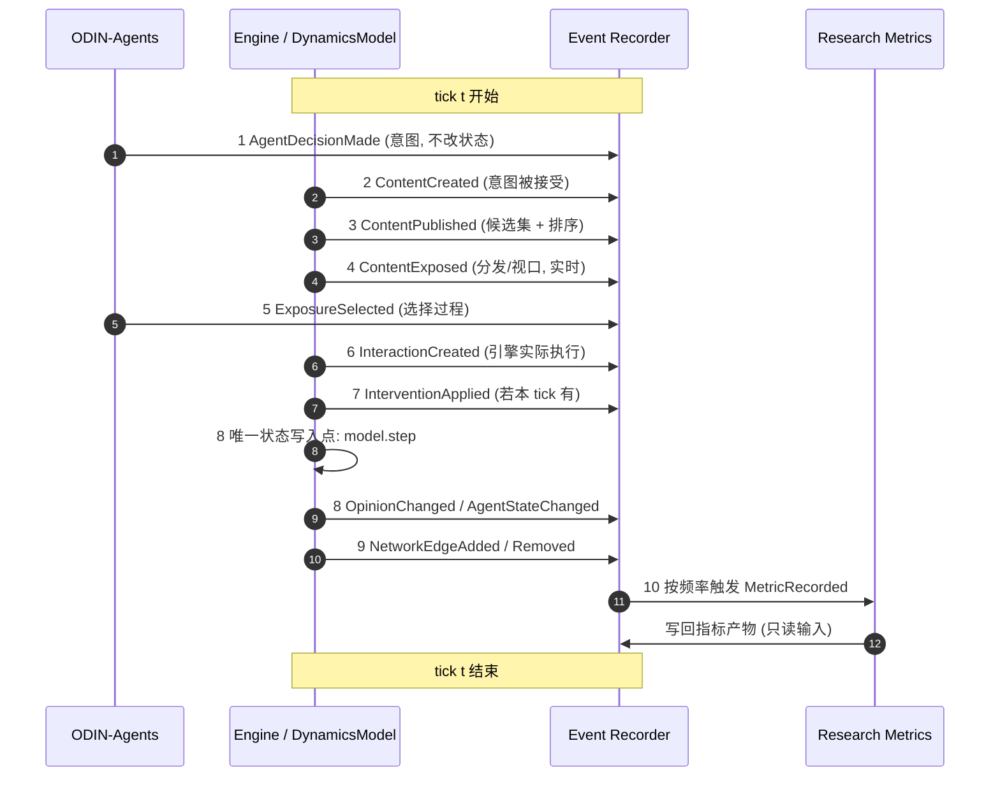

# Event Schema v1.0

**ODIN Experiment Specification v1.0 · 配套文档（事件规范）**

| 项 | 内容 |
|---|---|
| 状态 | 待研究者评审（规格，非实现） |
| 日期 | 2026-11-08 |
| 主规范 | [`experiment-specification-v1.md`](experiment-specification-v1.md) §4 |
| 数据对象 | [`data-schema.md`](data-schema.md) |
| 本次边界 | 仅文档；未修改 `src/`，未新增运行时依赖 |

---

## 1. 设计原则

1. **强类型，不是无约束的通用 JSON 字典。** 每种 `event_type` 对应一个具名、字段固定、带必填校验与 `schema_version` 的 payload 类型；未知字段一律拒绝（沿用 `SweepSpec.from_dict` 的「未知字段报错」纪律）。
2. **事件只记录事实，不写状态。** 唯一状态写入方是仿真引擎 / 已注册的 `DynamicsModel`。
3. **事件不可变、可排序、可回放。** `event_id` 采用 ULID（字典序即时间序）；事件流追加写，不覆盖。
4. **`tick` 是唯一计算时间轴**，`timestamp` 仅用于审计，禁止进入任何指标公式。
5. **事后无法重建的事实必须在发生时落盘**：曝光与选择过程、行为意图、事件时序、随机种子上下文、分发候选集与排序、原文与投影输出、状态变化前后值与机制标签。
6. **引用用不可变 ID**，禁止用数组下标、行号或对象内存地址。

---

## 2. 统一事件信封（所有 12 类事件共有）

```ts
interface EventEnvelope<T extends EventType, P> {
  event_id: ULID;              // 必需，全局唯一、可排序
  event_type: T;               // 必需，判别器 discriminator
  simulation_id: string;       // 必需，一次引擎运行实例
  experiment_id: string;       // 必需，所属实验 / sweep
  agent_id: string | null;     // 适用时；网络级/实验级事件为 null
  tick: int;                   // 必需，>= 0，仿真逻辑时间
  timestamp: ISO8601;          // 必需，UTC，仅审计
  payload: P;                  // 必需，强类型，由 event_type 决定
  random_seed_context: SeedContext | null;  // 适用时
}
```

| 字段 | 类型 | 必需 | 含义 | 可空 | 持久化 |
|---|---|---|---|---|---|
| `event_id` | ULID | 是 | 全局唯一、按时间可排序 | 否 | 是 |
| `event_type` | `EventType` enum | 是 | 12 种之一，见 §3 | 否 | 是 |
| `simulation_id` | str | 是 | 运行实例 | 否 | 是 |
| `experiment_id` | str | 是 | 实验 / sweep | 否 | 是 |
| `agent_id` | str \| null | 适用时 | 主体 Agent；`NetworkEdgeAdded` 等为 null | 是 | 是 |
| `tick` | int ≥ 0 | 是 | 逻辑时间 | 否 | 是 |
| `timestamp` | ISO8601 UTC | 是 | 墙钟时间，**不参与计算** | 否 | 是 |
| `payload` | 强类型对象 | 是 | 见 §4 | 否 | 是 |
| `random_seed_context` | `SeedContext` \| null | 适用时 | RNG 流 ID、抽样序号、种子派生路径 | 是 | **是（实时）** |

```ts
interface SeedContext {
  stream_id: string;       // 派生流 ID（不依赖全局随机源）
  draw_index: int;         // 该流内第几次抽样
  seed_derivation: string; // 从 master_seed 派生的路径
}
```

---

## 3. 事件类型注册表

| # | `event_type` | 类别 | 是否现有 | 关联数据对象 |
|---|---|---|---|---|
| 1 | `ContentCreated` | 内容 | 无 | `ContentRecord` |
| 2 | `ContentPublished` | 内容 / 分发 | 无 | `ContentRecord`, `ExposureEvent` |
| 3 | `ContentExposed` | 曝光 | 无 | `ExposureEvent` |
| 4 | `ExposureSelected` | 选择过程 | 无 | `DecisionRecord`, `ExposureEvent` |
| 5 | `InteractionCreated` | 行为执行 | 无 | `InteractionEvent` |
| 6 | `AgentDecisionMade` | 意图 | 无 | `DecisionRecord` |
| 7 | `AgentStateChanged` | 状态 | 无 | `StateTransitionRecord` |
| 8 | `OpinionChanged` | 状态（特化） | 无 | `StateTransitionRecord` |
| 9 | `NetworkEdgeAdded` | 网络 | 无 | `NetworkSnapshot` |
| 10 | `NetworkEdgeRemoved` | 网络 | 无 | `NetworkSnapshot` |
| 11 | `InterventionApplied` | 治理 | 无 | `InfluenceRecord`, `StateTransitionRecord` |
| 12 | `MetricRecorded` | 指标 | 无 | `metrics.json` |

> **当前仓库事实**：`src/odin_sim/` 下无任何 `*Event` 类，无 `events/` 目录；现有 `DynamicsModel` 为整段轨迹型（`capabilities.stepwise=False`）。以上 12 类全部是**规格**，不是现状。

扩展规则：新增事件类型必须注册 `event_type` + payload 类型 + `schema_version`，并在 `EventType` 枚举中显式列出；禁止用 `CustomEvent` 之类的通配类型绕过约束。

---

## 4. 强类型 payload 定义

以下用 TypeScript 风格描述字段与类型；实现可用 `pydantic` / `dataclass` / JSON Schema 等价表达，但**字段集合与必填性不得放宽**。

### 4.1 `ContentCreated`

```ts
{
  schema_version: "1.0";
  content_id: ULID;
  author_agent_id: string;
  text: string;
  text_hash: string;
  parent_content_id: ULID | null;     // 转发/评论时必填
  topic_id: string | null;
  issue_dims: float[] | null;
  created_at_tick: int;
  decision_id: ULID;                  // 指向产生该内容的意图
}
```
约束：`text` 原文必须落盘（LLM 非确定，事后无法重生成）；`text_hash` 与原文内容一致；`decision_id` 必须存在对应的 `AgentDecisionMade`。

### 4.2 `ContentPublished`

```ts
{
  schema_version: "1.0";
  content_id: ULID;
  published_tick: int;
  distribution_candidate_set_id: ULID;  // A_ij 的依据
  candidate_content_ids: ULID[];        // 本次分发的候选集（选择过程可选项）
  rank_position: int;
  policy_id: string;                    // recommendation_policy.policy_id
  alpha_personalization: float | null;  // 带命名空间，避免与说服学习率混淆（Q-31）
}
```
约束：`candidate_content_ids` 必须完整落盘——算法内部状态事后不可见；该字段是 `3D-selective-exposure` 与 `3D-E-ij` 的 A 项依据。

### 4.3 `ContentExposed`

```ts
{
  schema_version: "1.0";
  exposure_id: ULID;
  content_id: ULID;
  source_agent_id: string;
  target_agent_id: string;
  stage: "delivered" | "in_viewport" | "viewed_ge_1s";
  visible_duration: float | null;      // stage >= in_viewport 时必填
  candidate_set_id: ULID;
  rank_position: int;
  voluntary: boolean;                  // 自愿选择 vs 强制推送（Levy vs Bail）
  decision_id: ULID | null;
}
```
约束：**实时落盘，禁止事后反推**；`stage` 三阶段区分「分发到信息流」与「进入视口可见 ≥1 秒」（口径 Q-22）；`voluntary` 必须显式，不得默认。

### 4.4 `ExposureSelected`

```ts
{
  schema_version: "1.0";
  decision_id: ULID;
  target_agent_id: string;
  candidate_set_id: ULID;
  offered_content_ids: ULID[];         // 可选项集合
  selected_content_ids: ULID[];        // 实际选择
  rejected_content_ids: ULID[];        // 明确拒绝
  voluntary: boolean;
  selection_rule: string | null;       // 规则 / 策略标识
}
```
约束：v2 方法论警告要求**记录选择过程本身**，不能只记最终暴露量；`offered/selected/rejected` 三者必须自洽（并集 = offered，selected ∩ rejected = ∅）。

### 4.5 `InteractionCreated`

```ts
{
  schema_version: "1.0";
  interaction_id: ULID;
  decision_id: ULID;                   // S-2：关联意图
  action_type: "post" | "noop" | "comment" | "like" | "reshare";
  actor_agent_id: string;
  target_agent_id: string | null;
  content_id: ULID | null;
  parent_interaction_id: ULID | null;  // 3B 级联树
  execution_status: "executed" | "rejected" | "degraded" | "clipped";
  reject_reason: string | null;
  executed_payload: ActionPayload | null;
}
```
约束：只有引擎**实际执行**的行为才写本事件；`noop` 必须显式产生，不得以空记录表示；`rejected/degraded/clipped` 也必须记录（用于 S-2 与诊断），但不得计入参与量。

### 4.6 `AgentDecisionMade`

```ts
{
  schema_version: "1.0";
  decision_id: ULID;
  agent_id: string;
  observation_hash: string;
  intended_action: ActionPayload;      // S-2：意图，不是执行结果
  alternatives: ActionPayload[];
  confidence: float | null;
  exposure_candidate_set_id: ULID | null;
  llm_call_metadata: {
    backend_id: string; version: string; temperature: float;
    prompt_template_hash: string; token_count: int; cache_hit: boolean;
  } | null;
}
```
约束：**执行前**产生；被拒绝或降级的意图在事后状态中不可见，必须实时落盘；`llm_call_metadata` 用于 `V-model-drift`、`P-ctrl-T`、多底座比较。

### 4.7 `AgentStateChanged`

```ts
{
  schema_version: "1.0";
  state_transition_id: ULID;
  agent_id: string;
  field: "opinion" | "affect" | "belief" | "stance" | "persona";
  old_value: Scalar | Vector;
  new_value: Scalar | Vector;
  cause_event_refs: ULID[];
  mechanism_tag: string;               // 未知写 "unknown"
  cause_type: "known_mechanism" | "intervention" | "adversary" | "unknown";
}
```

### 4.8 `OpinionChanged`（`AgentStateChanged` 的特化）

```ts
{
  schema_version: "1.0";
  state_transition_id: ULID;
  agent_id: string;
  opinion_before: float[];             // D 维
  opinion_after: float[];
  delta_norm: float | null;            // 范数定义 TBD (Q-42)
  trigger_event_refs: ULID[];
  mechanism_tag: string;               // 决定 known_causal 边
}
```
约束：`mechanism_tag` 为已知因果机制标识时，才可生成 `known_causal` 影响边；`unknown` 最多生成 `candidate`，且必须附 `confounds`（主规范 §7.5）。

### 4.9 / 4.10 `NetworkEdgeAdded` / `NetworkEdgeRemoved`

```ts
// Added
{
  schema_version: "1.0";
  network_type: "potential" | "exposure" | "influence" | "interaction";
  src: string; dst: string;
  weight: float | null;
  edge_type: string;                   // 依 network_type 取枚举，见 data-schema.md §4
  effective_tick: int;
  evidence_refs: ULID[];               // influence 边必填
  method_id: string | null;            // influence 边必填
  reason: string;
}
// Removed
{
  schema_version: "1.0";
  network_type: "potential" | "exposure" | "influence" | "interaction";
  src: string; dst: string;
  effective_tick: int;
  reason: string;
}
```
约束：三网络的边事件必须带 `network_type`，**禁止三张图共用一条未标注的边流**；`influence` 边缺 `evidence_refs` 或 `method_id` 时拒绝（T-3D/4）。

### 4.11 `InterventionApplied`

```ts
{
  schema_version: "1.0";
  intervention_id: ULID;
  pi_omega: int;                       // 介入频率（每 k 轮）——带命名空间
  pi_tau: "hub" | "bridge" | "periphery" | "random";   // 目标节点（v2 定义）
  pi_kappa: "neutralize" | "empathy" | "fact_check" | "cross_cutting"; // 话术策略
  target_agent_ids: string[];
  script_id: string;
  applied_tick: int;
  outcome: "applied" | "rejected" | "degraded";
  control_group: string | null;        // no_intervention / random_script
}
```
约束：`pi_tau` / `pi_kappa` 是 v2 治理层定义，**不得与 G3 baseline 的 `tau`（预热步数）/ `kappa`（跨维耦合）混用**（Q-31）；`outcome` 必须记录，被拒绝的干预也须留痕。

### 4.12 `MetricRecorded`

```ts
{
  schema_version: "1.0";
  metric_id: string;                   // 主规范第 2 章 75 个 ID 之一
  value: Scalar | Vector | Matrix | null;  // 跳过时为 null
  definition_version: string;
  threshold_version: string | null;    // 未锁定写 "unlocked"
  input_refs: ULID[];                  // 可追溯输入对象/事件 ID
  tick: int;
  computation_module: string;
  n_seeds: int;
  skipped_reason: string | null;       // TBD / 缺对照 / 缺 params / 阈值未锁定
}
```
约束：`value=null` 时 `skipped_reason` 必填；`input_refs` 为空的指标值视为不可复现；`threshold_version="unlocked"` 时禁止输出 `pass/fail`（第 13 章 T-L4/6、T-L4/10）。

---

## 5. 事件发生顺序

### 5.1 单 tick 顺序（规范）



**顺序纪律**：
- `AgentDecisionMade` 必须在 `InteractionCreated` 之前（S-2 的前提）。
- `ContentExposed` 必须在 `ExposureSelected` 之前（先有可选项，才有选择）。
- `OpinionChanged` 必须在 `model.step` 之后（记录事实，不触发状态）。
- `MetricRecorded` 必须在该 tick 全部状态与事件写入之后。
- `update_order` 配置必须写进 manifest（沿用 `architecture-v1.md` Q-R6：更新顺序影响模型含义，必须固化）。

### 5.2 跨 tick 与实验级顺序

1. `ExperimentMetadata`（实验开始）→ 隔离探针（V-bias，任何交互之前）→ 主循环 → 实验结束快照。
2. 3A 结构采样每 k tick 一次；3C / 3D 每 tick 全量；3B 事件驱动按 `content_id` 聚合。
3. 影响网络与相变检验在实验结束后构建/计算，但**其证据事件必须实时留存**。
4. 对照运行先于主运行执行（沿用 `expand_sweep` 的 `controls + linked` 顺序）。

---

## 6. 状态变更责任矩阵

| 动作 | ODIN-Agents | Engine / DynamicsModel | Event Recorder | Research Metrics |
|---|---|---|---|---|
| 产生行为意图 | **负责** | 接收 | 记录 | — |
| 接受 / 拒绝 / 裁剪意图 | — | **负责** | 记录 `execution_status` | — |
| 决定更新顺序与冲突消解 | — | **负责** | 记录 `update_order` | — |
| 写 `opinion_true` / 写图 / 写曝光 | **禁止** | **唯一写入方** | 只记录 | **禁止** |
| 写事件（记录事实） | — | 触发 | **负责** | — |
| 计算指标 | — | — | — | **负责（只读）** |
| 重跑仿真以算指标 | — | — | — | **禁止** |
| 失败降级（超时 → NOOP） | 声明 | 裁决 | **记录**（不得静默） | — |

---

## 7. 事件引用关系（不可变 ID）

| 引用 | 从 → 到 | 约束 |
|---|---|---|
| `InteractionCreated.decision_id` | → `AgentDecisionMade.decision_id` | 必须存在；S-2 关联 |
| `ContentCreated.decision_id` | → `AgentDecisionMade.decision_id` | 必须存在 |
| `ContentExposed.content_id` | → `ContentPublished.content_id` | 必须存在 |
| `ExposureSelected.candidate_set_id` | → `ContentPublished.distribution_candidate_set_id` | 必须存在 |
| `InteractionCreated.parent_interaction_id` | → `InteractionCreated.interaction_id` | 3B 级联树；断链标 `incomplete` |
| `OpinionChanged.trigger_event_refs[]` | → 任意 `event_id` | 影响网络因果证据 |
| `NetworkEdgeAdded.evidence_refs[]`（influence） | → `ExposureEvent` / `StateTransitionRecord` / 机制登记 | 缺则边非法 |
| `MetricRecorded.input_refs[]` | → 任意对象 / 事件 ID | 缺则指标值不可复现 |

**禁止**：用数组下标、CSV 行号、字典遍历顺序、内存地址作为引用；跨 run 引用必须带 `simulation_id`。

---

## 8. 校验与拒绝规则

| 编号 | 规则 | 违反时的行为 |
|---|---|---|
| V-1 | `payload` 字段名与 `event_type` 注册的类型完全一致，未知字段拒绝 | 抛错，不静默丢弃 |
| V-2 | 所有 `ref` 字段可解析到已存在对象 | 抛错或写 `status=error` 的 manifest |
| V-3 | `tick` 单调不减；同 tick 内 `event_id` 字典序即发生序 | 乱序事件拒绝写入 |
| V-4 | `random_seed_context` 在涉及抽样的事件中必填 | 缺失则拒绝（复现性不可重建） |
| V-5 | 「实时，不可重建」字段不得为空且不得事后回填 | 缺失则整条运行判失败，不补值 |
| V-6 | `influence` 边缺 `evidence_refs` / `method_id` | 拒绝该边并写 `skipped_metrics` |
| V-7 | `MetricRecorded` 的 `value=null` 必须有 `skipped_reason` | 拒绝写入 |
| V-8 | `schema_version` 必填；读取器遇到未知版本 | 返回 `unknown`，不猜测字段 |

---

## 9. 存储与回放

- 事件流追加写为 `events.jsonl` / `events.parquet`（规格，本次未创建），按 `schema_version` 可回放。
- 事件流**不可变**；修正以新事件 + 引用表达，不覆盖历史。
- 快照与派生表可由事件流重算，但重算结果必须携带来源事件流哈希。
- 同种子两次运行的事件流必须逐条一致（第 13 章 T-REPRO/2）。
- 老产物无事件流时，读取器显式报「缺事件流」，不得用轨迹近似伪造（将违反 3B/3C/3D 的数据来源约束）。

---

## 10. 与当前仓库的关系（事实）

| 现有能力 | 可复用点 |
|---|---|
| `storage/manifest.py` 的 `skipped_metrics` 机制 | 事件校验失败、TBD 指标跳过时复用，不另造一套 |
| `reproducibility.config_fingerprint` / `snapshot()` | `experiment_id`、配置快照、环境指纹 |
| `experiments/spec.py::expand_sweep` 的确定性展开与对照先行 | 跨 run 事件顺序与配对 |
| `verification.py` 的逐字符哈希比对纪律 | 事件流复现测试 T-REPRO/2 |
| `analysis` 不 import `engine` 的分层规则 | 指标层只读事件流，禁止重跑仿真 |

| 缺失 | 说明 |
|---|---|
| `events/` 模块、12 类事件类型 | 当前 `src/odin_sim/` 无事件系统 |
| 逐步驱动 `stepwise` 模型 | `ModelCapabilities.stepwise=False`，引擎只调 `run()` |
| Agent 决策接口 | 无 `agents/` 目录；`AgentDecisionMade` 无生产者 |

---

## 11. 验收清单（供后续开发对照，本次不执行）

1. 12 类事件均有具名 payload 类型，无 `dict` 通配；未知字段被拒绝（T-DATA/1–4 相关）。
2. 单 tick 顺序与 §5.1 一致；`update_order` 写入 manifest。
3. S-1 / S-2 / S-3 三条分离在事件层成立（尤其 `ExposureSelected` 与 `DecisionRecord` 的存在）。
4. 所有「实时，不可重建」字段在发生时落盘。
5. 影响网络边不因相关/时序自动生成（T-3D/4）。
6. 同种子事件流逐条一致（T-REPRO/2）。
7. 本次工作未创建任何事件类、未修改 `src/`。

---

*文档结束 · 状态：待研究者评审 · 未进行任何代码实现*
