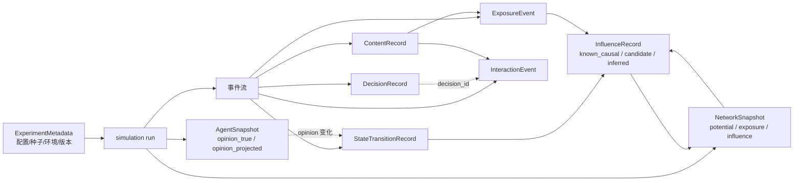
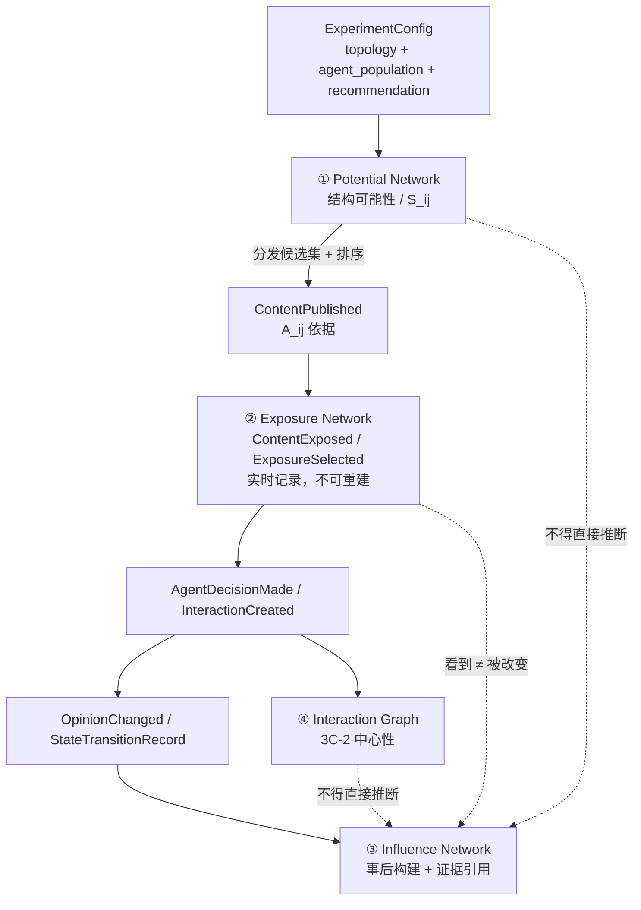
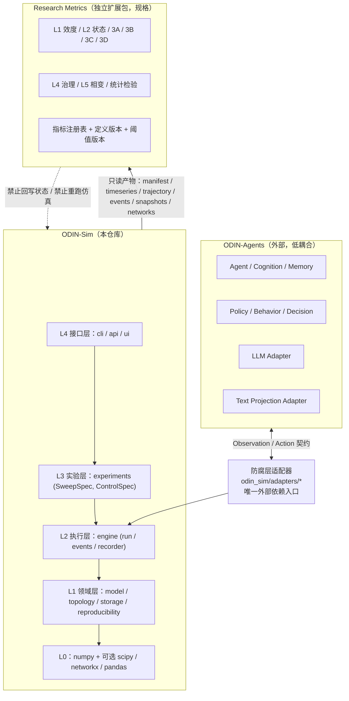
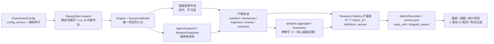

# ODIN Experiment Specification v1.0

**Research Metrics → Simulation Data → Engineering Specification**

| 项 | 内容 |
|---|---|
| 文档状态 | **待研究者评审**（未实现、未验证、未锁定阈值） |
| 版本 | v1.0 |
| 日期 | 2026-11-08 |
| 适用课题 | 生成式 Agents 在线社交媒体舆情网络研究 |
| 唯一研究依据 | 《实验指标体系 v2》（odin-agents 项目提供的外部研究资料，含第三层网络指标细化版） |
| 适用仓库 | ODIN-Sim（本仓库）为仿真侧；ODIN-Agents 为智能体侧；研究指标层为独立扩展 |
| 本次工作边界 | **仅代码阅读、指标分析、文档编写**；未修改 `src/`，未新增运行时依赖，未重构模块 |

> **引用约定**：本规范中不出现本机绝对路径。外部研究资料一律以《实验指标体系 v2》§章节号引用；外部项目位置按 `docs/README.md` 约定使用占位符或环境变量。

---

## 0. 文档目的与执行纪律

### 0.1 目的

把《实验指标体系 v2》的研究指标口径，转写为**可执行、可验证、可采集**的工程规范：明确每个指标需要什么原始数据、由什么事件产生、在什么时机落盘、由哪个模块计算、用什么测试判定其正确。本规范**不定义新的科学指标、不新增科学结论、不锁定任何建议阈值**。

### 0.2 五条硬纪律（贯穿全部文档）

| 编号 | 纪律 | 落地方式 |
|---|---|---|
| D-1 | 严格保留 v2 的指标分类、术语、公式、研究假设、引用说明、待确认事项 | 第 1 章逐条转写；第 2 章 `source_or_reference` 全部回指 v2 章节 |
| D-2 | 建议阈值不得升级为已验证的科学标准 | 所有阈值标注「**建议值 · 需在规格中锁定 · 未验证**」；见第 14 章 Open Questions |
| D-3 | v2 未给出公式或计算口径的指标一律标 TBD | `mathematical_definition: "TBD"` / `computation_method: "TBD"`，不得自行补写 |
| D-4 | 每个指标必须有数据来源；缺失数据显式分类标记 | 第 11 章与 `metric-data-mapping.md` 全量映射，四类缺口强制标注 |
| D-5 | 研究指标不写死进仿真引擎核心 | 第 12 章仓库职责与最小改造方案；指标层以独立扩展包/模块实现 |

### 0.3 本次工作未做的事（供评审核对）

- 未修改 `src/` 下任何文件。
- 未新增任何运行时依赖（`pyproject.toml` 未改）。
- 未重构现有模块、未新增 Python 模块。
- 未运行仿真、未生成实验数据、未声称任何测试通过。
- 未在 v2 之外补充任何公式、阈值或文献数值。

---

## 1. 术语、元规则与必须保留的原文口径

本章是《实验指标体系 v2》非指标内容的**规范转写**，不含新增定义。保留目的是防止下游实现「只搬指标名字、丢掉使用条件」。

### 1.1 三条元规则（v2 使用前必读）

| 编号 | 元规则 | 工程含义 |
|---|---|---|
| R-1 | **极化不是一个指标，是五个不同现象**：意见分歧、碎片化、双极化、议题极化、情感极化。必须分别测量意见分布、网络社区、群体间情感距离，不能只依赖一个「极化指数」 | 禁止把单一标量注册为 `polarization`；指标字典按现象分列，跨现象比较需显式对齐 |
| R-2 | **「极化」至少有三种互不等价定义**：双峰化、簇间距离扩大、簇内同质化；不同定义可给出相反结论 | 任何报告极化的产物必须携带 `definition_id`（Q-07），否则判为不合格产物 |
| R-3 | **分歧 ≠ 极化**：平均两两距离 `D = 2/(N(N−1))·Σ_{i<j} |x_i − x_j|`，但分歧大不代表存在两个阵营 | `M0-D` 只作分歧度量，禁止作为双极化证据 |

### 1.2 必须随共识结论一并报告的机制声明（v2 第二层「必须写进方法的坑」）

> 共识 / 集中、双峰极化、多群碎片化三类结果中，**「共识不必然意味着事实正确，也不必然意味着社会过程健康」**，它可能来自有效信息交换，也可能来自模型共同偏置或从众压力。因此**报共识时必须同时报达成机制**。

工程落地：`M10-phase-consensus` 的产出必须携带 `consensus_mechanism_evidence`（可由零模型对照、偏误注入因子、暴露/影响记录推导）；缺失时该指标标记为 `incomplete`，不得省略字段。

### 1.3 三条方法论警告（v2 原文口径，不得弱化）

| 编号 | 警告 | 影响的指标 |
|---|---|---|
| W-1 | 信息传播模型（独立级联 / 线性阈值 / 传染病模型）与意见动力学**不等同**：一条信息可以传得很广却不改变任何人的意见；一次没有广泛转发的深聊也可能显著改变少数关键人物 | 3B 全组、状态层 M₁–M₄；两组证据必须分别报告并显式检验耦合关系 |
| W-2 | 不要用扩散广度推断意见改变 | 同上；`metric-data-mapping.md` 中禁止把 3B 事件直接映射到 `OpinionChanged` |
| W-3 | 「有连接」≠「会发生影响」；关注 ≠ 看到，看到 ≠ 会信 | 3D 全组、三网络规范第 7 章 |

### 1.4 两条写进 methods 的必要声明（v2 原文）

1. **模块度与同配系数依赖社区划分口径。** Piao 2026 用的是「按左右阵营 + 中立按连接强度分配」的先验划分，与 Louvain 等算法输出**不可直接比较**；跨研究对比前必须对齐划分方式。→ 落为 `community_partition_method` 必填配置字段（见 `experiment-config-schema.md`）。
2. **不要用扩散广度推断意见改变。** 扩散组（3B）与状态层序参量（M₁–M₄）是两套独立证据，需要分别报告并显式检验二者的耦合关系——该检验本身即为一个可写发现点。→ 落为 `3B_STATE_COUPLING` 验证项（第 13 章 T-3B/9）。

### 1.5 引用纪律（v2 原文，逐条保留）

| 来源 | v2 标注的引用限制 |
|---|---|
| Piao 2026 | arXiv v2 全文，正式版 PDF 未获取 |
| La Gatta 2026 | HT'26 五页短文，样本量与结论强度有限 |
| Li 2025（EAAI） | 知识库仅有摘要与部分指标定义，方法细节不可展开 |
| Piccardi 2025、Stray 2026、Brady 2025、Santos 2021、Centola 2018、Di Ciocco 2025 | **二手转述**，具体数值需回原文核对 |
| 各层达标线（↓≥10%、↓≥0.3SD、≤M*×1.2、ICC≥0.7 等） | **「建议，需在规格中锁定」，属待确认阈值** |
| 3B「级联规模 / 扩散深度 / 扩散宽度」 | 基于引文的**指标提议**；「转发放大系数」在知识库中**无出处，口径需自行定义并说明** |
| 巨簇幂律指数 −3.5±0.3 | Holme & Newman 2006，经 Castellano 2009 综述 Fig.22 转引，**非社交媒体平台数据**，仅作形态参照，不能当作平台基线 |
| Chuang et al. 2024 | v2 中为转述：LLM Agent 有强「求真偏置」，默认趋向准确信息与科学共识，除非人为注入确认偏误否则不出现碎片化；**「偏误注入」本身是实验因子，不是背景设定** |
| 主题 E / 概念总纲 / 主题 C / 主题 D / 入门笔记 | v2 内部资料编号，非公开文献 |

> **工程落地约束**：表中标注为二手转述的数值，在研究者确认前**不得**写入第 13 章任何测试的期望值，也不得作为验收依据；确认项见 Q-39。引用限制本身作为 `limitations` 字段随相关指标一同落盘。

### 1.6 配套统计规范（v2 建议值，全部标注为待锁定）

| 项 | v2 建议值 | 规范状态 |
|---|---|---|
| 重复次数 | 每参数点 100 次（Li 2025 口径）或 ≥10–25 次（视成本） | 建议值 · 未锁定；见 Q-38 |
| 显著性检验 | Mann-Whitney U test + FDR 多重假设校正 | 建议值 · 未锁定 |
| 效应量 | Cohen's d 与置信区间 | 建议值 · 未锁定 |
| 无差异结论 | 预注册并报 BF01 以支持「无差异」 | 建议值 · 未锁定 |
| 量表精度 | ≥11 点（小效应会被粗量表压成零） | 建议值 · 未锁定；见 Q-38 |
| 效应量量级提醒 | 单次干预普遍 2–4 个百分点（d≈0.2–0.3）；声称「一次对话大幅改变立场」应先怀疑测量 | 解释性提醒，非阈值 |

> 与本仓库现状的关系：`analysis/aggregate.py` 已实现跨种子均值 / std / 95% CI（正态近似，装 scipy 自动切 t 区间）与布尔量发生率聚合；**尚未实现** Mann-Whitney U、FDR、Cohen's d、BF01。这些属研究指标扩展层，不修改核心 `analysis` 模块（见第 12 章）。

### 1.7 v2「落地：最小采集表」与采集频率（原文口径，逐条保留）

**最小采集表**：效度 3 个（ICC、隔离基线偏置量、零模型相图可比性）；状态 3 个（BC、K、S₁）；网络 12 个（3A：模块度 Q、同配系数、跨社区边比例；3B：级联规模、扩散深度、转发放大系数；3C：动作类型分频「发/评/赞/转 × 执行/接收」、PageRank + 入出度、情绪极性；3D：E_ij 四项分解 S/A/U/组合、三网络重合度、选择性接触度）；治理 1 组（π 三元组下的 M₁ 位移 + Cost 三项）。

| 组 | v2 规定的采集频率 | 工程落地（第 9 章详述） |
|---|---|---|
| 3A 结构组 | **每 k 轮采样** | `sampling_interval_k` 配置；k 值未给 → Q-37 |
| 3B 扩散组 | **事件驱动，每条内容独立记录** | `ContentCreated` / `ContentPublished` / `InteractionCreated` 事件流，按 `content_id` 聚合 |
| 3C 行为/参与组 | **每轮全量** | 每 tick 写 `AgentSnapshot`（投影）与 `InteractionEvent`（全量） |
| 3D 暴露/影响分离组 | **每轮全量（暴露是过程量，事后无法重建）** | `ExposureEvent` + `ExposureSelected` 必须在发生时落盘，禁止事后反推 |

**其他层频率**：v2 未规定，本规范按计算需求在第 9 章定义，并标注为「工程推导，非 v2 原文」，不与 v2 口径混淆。

---

## 2. 指标字典（Metric Dictionary）

### 2.1 统一字段定义（14 字段，每个指标必填，缺项写 `TBD` 并注明原因）

| # | 字段 | 类型 | 约定 |
|---|---|---|---|
| 1 | `metric_id` | string | 全库唯一稳定标识；v2 原有编号（如 `V-Π`、`M1-BC`）原样保留 |
| 2 | `name` | string | v2 中文术语，不改写、不合并 |
| 3 | `layer` | enum | `L1-validity` / `L2-state` / `L3A-structure` / `L3B-diffusion` / `L3C-behavior` / `L3D-exposure` / `L4-governance` / `L5-phase` |
| 4 | `description` | string | v2 用途/含义的转写，不含新增科学判断 |
| 5 | `mathematical_definition` | string | v2 给出的公式或口径原文；**未给出一律 `TBD`** |
| 6 | `input_data` | list[string] | 数据字典对象 ID（见 `data-schema.md`） |
| 7 | `computation_method` | string | 算法/步骤；v2 未给 → `TBD` |
| 8 | `aggregation_method` | string | 跨 tick / 跨种子 / 跨群体的聚合口径 |
| 9 | `collection_frequency` | string | 原始数据采集时机；严格服从 v2 §1.7 |
| 10 | `output_type` | string | 标量 / 向量 / 分布 / 图 / 标签 / 矩阵 及值域 |
| 11 | `applicable_conditions` | string | 前置条件、依赖配置、禁用条件 |
| 12 | `limitations` | string | v2 已声明的坑 + 工程已知限制 |
| 13 | `validation_method` | string | 对应第 13 章测试编号 |
| 14 | `source_or_reference` | string | 《实验指标体系 v2》章节 + v2 标注的文献/引用限制 |
| + | `implementation_status` | enum | 工程状态，见 §2.2（第 15 个字段，为工程附加，不替代上述 14 项） |

> **TBD 纪律**：`TBD` 表示该科学定义需研究者确认，**不是待开发排期**。所有 TBD 项在第 14 章 Open Questions 中有对应编号；实现层遇到 `TBD` 必须拒绝产出数值并写 `skipped_metrics` 原因，沿用本仓库 `storage/manifest.py` 已有的 `skipped_metrics` 机制。

### 2.2 `implementation_status` 枚举（基于仓库现状，非推测）

| 状态 | 含义 | 判定依据（当前仓库事实） |
|---|---|---|
| `derivable_existing` | 可由现有已落盘产物直接推导，无需新增采集 | 产物：`runs/<run_id>/manifest.json`、`timeseries.csv`、可选 `trajectory.npz`、`results.csv` |
| `needs_persisted_network` | 运行时存在但**未落盘**的数据需持久化 | `Network`（`src/odin_sim/model/protocol.py`）在内存中有 `src/dst/deg`，manifest 仅存 `network_hash` 字符串 |
| `needs_event_system` | 需事件系统与内容/曝光/决策数据结构 | 仓库无任何 `*Event` 类，`src/odin_sim/` 下无 `agents/`、`events/`、`content/` 目录 |
| `needs_agent_capability` | 需 ODIN-Agents 侧能力或投影器 | 当前 `DynamicsModel` 为整段轨迹型（`capabilities.stepwise=False`），无 Agent 决策接口 |
| `needs_external_instrument` | 需仿真外部的人工标注 / 校准 / 多底座流程 | ICC 人工标注子集、事实准确率 ground truth 等 |
| `needs_scan_capability` | 需参数扫描 + 多种子 + 群体规模扫描的组合能力 | 现有 `SweepSpec` 支持轴扫描与多种子，但 `population_size` 不是扫描轴、无 N 序列有限尺寸标定 |
| `needs_sim_capability_pairing` | 需成对 / 成组的仿真能力（零模型配对、双对照组、正反扫描等），现有能力不足以表达 | `ControlSpec` 只支持「一条主运行 → 一条对照」的单一变换，无双对照组、无正反扫描路径概念 |

> 状态可用 `+` 连接表示多重依赖（如 `needs_event_system + needs_agent_capability`）。所有状态均为**当前仓库事实判定**，不是实现承诺；本次工作未实现其中任何一项。

### 2.3 指标总数与覆盖口径

本字典共 **75 个 `metric_id`**：L1 = 8、L2 = 13、L3A = 8、L3B = 6、L3C = 15、L3D = 7、L4 = 7、L5 = 11。覆盖 v2 全部指标条目，并额外收录 v2 中「规则三引用的分歧度量 D」「3C 外部效度检验点」「三个相区标签」「六个控制参数」——这些在 v2 中是显式列出的对象，为不遗漏而纳入字典，均标注其性质（配置对象 / 检验点 / 分类标签），不冒充独立科学指标。

---

### 2.4 Layer 1｜效度指标（准入门槛，8 项）

> v2 原文定位：**「不做则后续全部不可信」**。效度层是后续所有层的准入条件，不得与结果层并列汇报。

> **组织重构说明（2026-11-08，导航注记，不改字典）**：`validity-layer-v2.md` 把本层重排为「段 0 研究定位声明 / 段 1 三项准入门槛 / 段 2 效度风险双轨治理 / 段 3 门控」，并给 Q-08~Q-11 决策卡与 A/B/C/D 证据分级。**该稿仅重构组织与登记外部候选，未改动下方 8 个 `metric_id` 的任何字段**；43 条 TBD 数学定义、75 个 `metric_id`、阈值建议值状态全部保持不变。未经研究者书面签字，其中的外部公式一律不得回写 `mathematical_definition`。

```yaml
# ---- L1 效度层 ----
- metric_id: "V-Π"
  name: "投影器重测信度（ICC）"
  layer: "L1-validity"
  description: "同一文本重复投影的一致性；v2 通过标准：同一文本重复投影 ICC ≥ 0.7，人工标注子集一致率 ≥ 0.8；失败对策为换投影方案 A→B→C"
  mathematical_definition: "TBD — v2 未给出 ICC 型号与计算公式；仅给出通过标准 ICC ≥ 0.7 与人工标注一致率 ≥ 0.8（建议值 · 需在规格中锁定 · 未验证）"
  input_data: ["ProjectionRecord", "HumanAnnotationRecord", "ExperimentMetadata.model_metadata"]
  computation_method: "TBD — ICC 型号（ICC(1,1)/ICC(2,1)/ICC(3,k)）、重复次数、评分者数量、文本抽样均待确认（Q-08）"
  aggregation_method: "TBD"
  collection_frequency: "校准阶段：投影器版本变更时、每批文本重测时；非逐 tick"
  output_type: "scalar[0,1] + pass/fail + 人工标注一致率 scalar[0,1]"
  applicable_conditions: "必须存在文本投影器（ODIN-Agents / Text Projection Adapter）与人工标注子集；规则节点-only 实验不适用"
  limitations: "v2 明确通过标准属建议值；ICC 型号未定会使跨研究比较无效；人工标注子集本身需一致性检验"
  validation_method: "T-L1/1 重测一致性；T-L1/2 阈值判定不升级"
  source_or_reference: "《实验指标体系 v2》§第一层 表 V-Π；§文献出处与引用纪律（达标线为待确认阈值）"
  implementation_status: "needs_agent_capability + needs_external_instrument"

- metric_id: "V-bias"
  name: "隔离基线偏置量"
  layer: "L1-validity"
  description: "单独询问时 Agent 意见分布与先验一致；偏置量可测量。v2 失败对策：换底座或改 prompt"
  mathematical_definition: "TBD — v2 仅给出「与先验一致」的定性要求与「偏置量可测量」，未给先验分布形式、距离度量或偏置量公式"
  input_data: ["AgentSnapshot.opinion_true", "AgentSnapshot.opinion_projected", "ExperimentMetadata.initial_opinion_distribution", "IsolationProbeRecord"]
  computation_method: "TBD — 需先定义隔离询问协议（无网络、无历史、单次询问）与先验分布（Q-09）"
  aggregation_method: "TBD"
  collection_frequency: "实验开始前隔离探针阶段，每个 Agent 一次；底座/prompt 变更时重测"
  output_type: "distribution + scalar bias（口径待定）"
  applicable_conditions: "隔离探针必须在任何交互之前执行；投影观点与真实观点须分别记录"
  limitations: "Chuang 2024 转述：LLM 有强求真偏置；偏误注入是实验因子不是背景设定；本指标必须按底座与 prompt 版本分层报告"
  validation_method: "T-L1/3 隔离探针先验一致性"
  source_or_reference: "《实验指标体系 v2》§第一层 表 V-bias；§第一层「为什么这一层必须放在最前面」（Chuang et al. 2024 转述）"
  implementation_status: "needs_agent_capability"

- metric_id: "V-zero"
  name: "零模型可比性"
  layer: "L1-validity"
  description: "规则节点与 LLM 节点相图可比（至少形状可比）；v2 失败对策：说明 LLM 节点带来额外机制，需单列"
  mathematical_definition: "TBD — v2 未给出「形状可比」的判据（曲线相似度？极值点位置？相区边界？）"
  input_data: ["ExperimentMetadata", "NetworkSnapshot", "AgentSnapshot", "SweepResult.phase_diagram"]
  computation_method: "TBD — 需定义零模型（规则节点）与 LLM 节点在相同参数网格下的相图及形状比较准则（Q-10）"
  aggregation_method: "按参数网格逐点比较，跨种子聚合（口径 TBD）"
  collection_frequency: "每个参数点一次（成对运行：规则节点 / LLM 节点，同种子）"
  output_type: "comparison result + 相图（矩阵）"
  applicable_conditions: "必须存在规则节点零模型实现；两种节点类型须在相同拓扑、相同种子、相同参数网格下运行"
  limitations: "v2 明确：不可比时必须说明额外机制并单列，不得强行合并解释"
  validation_method: "T-L1/4 零模型配对运行"
  source_or_reference: "《实验指标体系 v2》§第一层 表 V-zero；§落地最小采集表（效度 3 个）"
  implementation_status: "needs_sim_capability_pairing"

- metric_id: "V-persona-convergence"
  name: "平均人格收敛"
  layer: "L1-validity"
  description: "v2 效度风险：多轮交互后 Agent 向训练分布均值收敛，压平多样性、伪造「共识」"
  mathematical_definition: "TBD — v2 仅描述现象，未给人格向量、收敛度量或阈值"
  input_data: ["AgentSnapshot.persona_vector", "AgentSnapshot.opinion_true", "ProjectionRecord"]
  computation_method: "TBD"
  aggregation_method: "TBD"
  collection_frequency: "每轮全量或每 k 轮采样（待确认；建议与 AgentSnapshot 同频）"
  output_type: "TBD（标量或时序曲线）"
  applicable_conditions: "需 Agent 暴露人格画像向量（ODIN-Agents 能力）"
  limitations: "v2 定位为「写 limitations 时直接引用」的效度风险，未要求指标化；是否纳入计算需研究者确认（Q-11）"
  validation_method: "T-L1/5 效度风险记录完整性"
  source_or_reference: "《实验指标体系 v2》§第一层「配套的效度风险指标」"
  implementation_status: "needs_agent_capability"

- metric_id: "V-micro-macro-gap"
  name: "微观—宏观效度鸿沟"
  layer: "L1-validity"
  description: "v2 效度风险指标（配套清单），指个体行为效度与群体结果效度之间的落差"
  mathematical_definition: "TBD — v2 未给定义"
  input_data: ["DecisionRecord", "AgentSnapshot", "StateTransitionRecord", "metric outputs (L2)"]
  computation_method: "TBD"
  aggregation_method: "TBD"
  collection_frequency: "实验结束后分析（需逐决策与逐状态记录）"
  output_type: "TBD"
  applicable_conditions: "需同时具备微观决策记录与宏观序参量时序"
  limitations: "v2 定位为效度风险清单项，未要求指标化；是否纳入计算需研究者确认（Q-11）"
  validation_method: "T-L1/5"
  source_or_reference: "《实验指标体系 v2》§第一层「配套的效度风险指标」"
  implementation_status: "needs_event_system"

- metric_id: "V-fluency-fallacy"
  name: "流畅性谬误"
  layer: "L1-validity"
  description: "v2 效度风险指标（配套清单）：以生成文本的流畅度替代行为/意见效度"
  mathematical_definition: "TBD — v2 未给定义"
  input_data: ["ContentRecord", "ProjectionRecord", "HumanAnnotationRecord"]
  computation_method: "TBD"
  aggregation_method: "TBD"
  collection_frequency: "校准/抽检阶段"
  output_type: "TBD"
  applicable_conditions: "需生成文本与人工效度标注"
  limitations: "v2 定位为效度风险清单项；指标化方式待确认（Q-11）"
  validation_method: "T-L1/5"
  source_or_reference: "《实验指标体系 v2》§第一层「配套的效度风险指标」"
  implementation_status: "needs_agent_capability + needs_external_instrument"

- metric_id: "V-physics-washing"
  name: "物理洗白"
  layer: "L1-validity"
  description: "v2 效度风险：借用相变术语而不补齐相变四要素。第五层原文：「若题目保留『相变』，此层必须补齐，否则属『物理洗白』」"
  mathematical_definition: "TBD — v2 给出的是四要素清单（序参量、控制参数、临界点与普适性、有限尺寸标定），不是公式"
  input_data: ["ExperimentMetadata", "L5 全部指标", "SweepResult"]
  computation_method: "合规性检查：四要素是否齐备 + v2 §第五层判断标准（参数扫描 + 多随机种子 + 群体规模扫描 + 涨落分析 + 路径比较 + 有限尺寸分析）"
  aggregation_method: "布尔合取（六项全部满足才为 false）"
  collection_frequency: "每次宣称相变前检查一次"
  output_type: "boolean + 缺失要素清单"
  applicable_conditions: "仅当研究宣称使用「相变」术语时强制"
  limitations: "v2 明确：「不能看到一张极化曲线陡变就宣布找到相变」；方法适用性取决于具体模型，不能机械套用；受噪声、外部冲击、样本长度影响"
  validation_method: "T-L5/6 相变四要素齐备性检查"
  source_or_reference: "《实验指标体系 v2》§第一层「配套的效度风险指标」；§第五层 开头与「判断标准」"
  implementation_status: "needs_scan_capability"

- metric_id: "V-model-drift"
  name: "模型版本漂移"
  layer: "L1-validity"
  description: "v2 效度风险：LLM 底座/版本变化导致结果不可比"
  mathematical_definition: "TBD — v2 未给定义"
  input_data: ["ExperimentMetadata.model_metadata", "DecisionRecord.llm_call_metadata"]
  computation_method: "TBD；工程侧强制记录底座名、版本、温度、prompt 模板哈希、调用时间戳"
  aggregation_method: "按底座/版本分层报告，禁止跨版本合并"
  collection_frequency: "每次 LLM 调用（事件级）+ 实验级快照"
  output_type: "metadata + 分层标记"
  applicable_conditions: "所有含 LLM 节点的实验"
  limitations: "LLM 即使固定种子也不保证输出一致；manifest 必须显式标注复现等级（本仓库 `architecture-v1.md` §11 已记录该风险）"
  validation_method: "T-L1/6 模型元数据完整性 + 跨版本禁止合并"
  source_or_reference: "《实验指标体系 v2》§第一层「配套的效度风险指标」"
  implementation_status: "needs_agent_capability"
```

### 2.5 Layer 2｜状态层：序参量（13 项）

> v2 标准序参量四元组 **M = (BC, K, S₁, D_aff)**，另有 M₅ ρ_obs、可选 NODE 四指标组、相区判定与规则三的分歧度量 D。

```yaml
# ---- L2 状态层 ----
- metric_id: "M0-D"
  name: "平均两两距离 D（分歧度量）"
  layer: "L2-state"
  description: "v2 元规则三引用的分歧度量；性质：非独立科学指标，为完整性收录，禁止作为双极化证据"
  mathematical_definition: "D = 2/(N(N−1)) · Σ_{i<j} |x_i − x_j|  （v2 原文公式；|·| 的范数定义在多维情形下 TBD）"
  input_data: ["AgentSnapshot.opinion_true", "trajectory.npz"]
  computation_method: "对全体 Agent 意见两两求距离取平均；多维情形的范数选择待确认（Q-01）"
  aggregation_method: "逐 tick 标量；跨种子取均值 + CI（复用 analysis.aggregate 约定）"
  collection_frequency: "每轮全量（意见向量）；可由已落盘轨迹事后重算"
  output_type: "scalar ≥ 0（时序）"
  applicable_conditions: "意见向量维度与值域须一致"
  limitations: "v2 规则三：分歧大不代表存在两个阵营；规则二：不同极化定义可给出相反结论"
  validation_method: "T-L2/1 手算小规模用例；T-L2/2 分歧与双峰脱钩"
  source_or_reference: "《实验指标体系 v2》§使用前必读 规则三"
  implementation_status: "derivable_existing"

- metric_id: "M1-BC"
  name: "BC 双峰系数"
  layer: "L2-state"
  description: "分布双峰程度，用于议题极化；v2 标准序参量四元组之一（M₁）"
  mathematical_definition: "TBD — v2 给出判据「> 5/9 ≈ 0.555 判双峰」与实测锚点「本课题 HK 基线中，双峰系数 BC 在两簇平台期恰≈1.0」，但未给出 BC 的计算公式、分箱口径或估计方法"
  input_data: ["AgentSnapshot.opinion_true", "trajectory.npz"]
  computation_method: "TBD — 需研究者给出 BC 定义（是否为 Sarle 双峰系数 / 峰数检验 / KDE 峰检测），分箱数、核带宽、值域归一化均待确认（Q-01）"
  aggregation_method: "逐 tick 标量；跨种子取均值 + CI"
  collection_frequency: "每轮全量（意见分布）；可由已落盘轨迹事后重算"
  output_type: "scalar（v2 锚点提示值域可能到 1.0）+ 双峰布尔判定"
  applicable_conditions: "意见为一维投影或多维降维后的一维量；分箱口径须写进配置"
  limitations: "5/9 为 v2 转述的判据，非本平台验证标准；BC 与 K、S₁ 不可互相替代；HK 基线锚点≈1.0 属本课题既往实测，非通用常数"
  validation_method: "T-L2/3 人工构造双峰/单峰/多峰分布"
  source_or_reference: "《实验指标体系 v2》§第二层 表 M₁（出处：主题E）；§第二层「BC 有实测锚点」；§落地最小采集表（状态 3 个）"
  implementation_status: "derivable_existing（公式 TBD，实现被阻塞）"

- metric_id: "M2-K"
  name: "K 稳态簇数"
  layer: "L2-state"
  description: "稳定意见簇数量，用于碎片化；v2 标准序参量四元组之一（M₂）。Li 2025（EAAI）：意见簇数能弥补标准差在刻画分布上的不足（如「极化时标准差大但意见集中」）"
  mathematical_definition: "TBD — v2 给出判定口径「K=1 表示共识，K=2 表示极化，值越大越碎片化」，值域 [0, n]；未给聚类算法、距离度量、稳态判定窗口"
  input_data: ["AgentSnapshot.opinion_true", "trajectory.npz", "ExperimentMetadata.opinion_dynamics_config"]
  computation_method: "TBD — 需定义簇的判定（连通分量 / 阈值聚类 / 模型特定规则）、距离度量、稳态窗口与最小簇尺寸（Q-02）"
  aggregation_method: "终态标量（稳态窗口内取值）；跨种子取中位数/众数（口径 TBD）"
  collection_frequency: "每轮全量（意见向量）；可由已落盘轨迹事后重算"
  output_type: "int [0, n]"
  applicable_conditions: "需明确意见空间距离定义；与 M3-S1 必须共用同一簇划分（Q-03）"
  limitations: "v2 引用限制：Li 2025（EAAI）知识库仅有摘要与部分指标定义，方法细节不可展开；K 只是一类极化定义（碎片化）"
  validation_method: "T-L2/4 人工构造 1/2/多簇；T-L2/5 与 M3-S1 划分一致性"
  source_or_reference: "《实验指标体系 v2》§第二层 表 M₂ 与「K 的判定口径」（Li 2025 EAAI）；§文献出处与引用纪律"
  implementation_status: "derivable_existing（算法 TBD，实现被阻塞）"

- metric_id: "M3-S1"
  name: "S₁ 最大簇占比"
  layer: "L2-state"
  description: "最大簇占全体比例，用于主导集团强度；v2 标准序参量四元组之一（M₃）"
  mathematical_definition: "S₁ = |C_max| / N（按 v2 文字口径转写；簇定义依赖 M2-K，簇划分算法 TBD）"
  input_data: ["M2-K 的簇标签", "AgentSnapshot.opinion_true"]
  computation_method: "取最大簇成员数除以 Agent 总数；簇划分算法 TBD"
  aggregation_method: "逐 tick 标量；跨种子取均值 + CI"
  collection_frequency: "与 M2-K 同频"
  output_type: "scalar [0,1]"
  applicable_conditions: "必须与 M2-K 使用同一簇划分结果，否则 S₁ 与 K 不自洽"
  limitations: "对簇划分算法敏感；与模块度 Q、同质性指数是不同层次的量，不可互推"
  validation_method: "T-L2/5；T-L2/6 边界（全同 / 全分离）"
  source_or_reference: "《实验指标体系 v2》§第二层 表 M₃（出处：主题E）；§落地最小采集表（状态 3 个）"
  implementation_status: "derivable_existing（依赖 M2-K 的 TBD）"

- metric_id: "M4-Daff"
  name: "D_aff 情感温度计距离"
  layer: "L2-state"
  description: "群体间情感距离，用于情感极化；v2 标准序参量四元组之一（M₄）"
  mathematical_definition: "TBD — v2 未给公式、量表、群体划分方式与距离定义"
  input_data: ["AgentSnapshot.affect_state", "ContentRecord.sentiment", "community_partition_result", "HumanAnnotationRecord"]
  computation_method: "TBD — 情感温度计（feeling thermometer）量表点数、群体标签来源、群体间距离（均值差 / 分布距离）均待确认（Q-04）"
  aggregation_method: "TBD"
  collection_frequency: "每轮全量（情感状态）；情感标注可事后计算，但原始文本必须实时留存"
  output_type: "scalar 或 matrix（群体对）"
  applicable_conditions: "需群体划分口径与情感量表；v2 配套统计规范要求量表精度 ≥11 点（建议值）"
  limitations: "群体划分依赖社区/阵营口径，与 3A 模块度口径必须对齐（v2 methods 声明 1）"
  validation_method: "T-L2/7 构造已知群体情感分布"
  source_or_reference: "《实验指标体系 v2》§第二层 表 M₄（出处：主题E）"
  implementation_status: "needs_event_system + needs_agent_capability"

- metric_id: "M5-rho-obs"
  name: "ρ_obs 议题间实测相关"
  layer: "L2-state"
  description: "议题间实际相关系数，用于多维对齐度；v2 标准序参量之一（M₅）"
  mathematical_definition: "TBD — v2 未指定 Pearson / Spearman / 偏相关，也未定义「议题对」的构成"
  input_data: ["AgentSnapshot.opinion_true", "ExperimentMetadata.initial_opinion_distribution"]
  computation_method: "TBD — 相关系数类型与议题维度配对方式待确认（Q-05）"
  aggregation_method: "逐 tick 矩阵；稳态取终值"
  collection_frequency: "每轮全量（多维意见向量）；可由轨迹事后重算"
  output_type: "matrix[d×d] 或 scalar（指定议题对）"
  applicable_conditions: "意见维度 d ≥ 2；需区分配置中的设定相关 ρ（控制参数）与实测 ρ_obs"
  limitations: "实测相关不等于配置相关；与第五层控制参数 `P-ctrl-rho` 必须命名空间隔离"
  validation_method: "T-L2/8 构造已知相关系数矩阵"
  source_or_reference: "《实验指标体系 v2》§第二层 表 M₅（出处：主题E）"
  implementation_status: "derivable_existing（系数类型 TBD）"

- metric_id: "M6-NODEdiff"
  name: "NODEdiff"
  layer: "L2-state"
  description: "v2 可选状态指标（Li 2025 四指标组）；原文仅列名称，未给定义"
  mathematical_definition: "TBD — v2 未给定义"
  input_data: ["TBD（v2 未指明；按名称推测需节点级意见差异数据，但不作为定义）"]
  computation_method: "TBD"
  aggregation_method: "TBD"
  collection_frequency: "TBD"
  output_type: "TBD"
  applicable_conditions: "TBD"
  limitations: "v2 引用限制：Li 2025（EAAI）知识库仅有摘要与部分指标定义，方法细节不可展开；严禁按名称臆造公式（Q-06）"
  validation_method: "T-L2/9 TBD 项不得产出数值"
  source_or_reference: "《实验指标体系 v2》§第二层「可选状态指标」（Li 2025 四指标组）"
  implementation_status: "needs_external_instrument（需 Li 2025 原文口径）"

- metric_id: "M7-NODEconv"
  name: "NODEconv"
  layer: "L2-state"
  description: "v2 可选状态指标（Li 2025 四指标组）；原文仅列名称，未给定义"
  mathematical_definition: "TBD — v2 未给定义"
  input_data: ["TBD"]
  computation_method: "TBD"
  aggregation_method: "TBD"
  collection_frequency: "TBD"
  output_type: "TBD"
  applicable_conditions: "TBD"
  limitations: "同 M6-NODEdiff；引用限制见 v2 §文献出处与引用纪律（Q-06）"
  validation_method: "T-L2/9"
  source_or_reference: "《实验指标体系 v2》§第二层「可选状态指标」"
  implementation_status: "needs_external_instrument"

- metric_id: "M8-NodeSD"
  name: "NodeSD（NODESD）"
  layer: "L2-state"
  description: "v2 可选状态指标（Li 2025 四指标组）；v2 唯一给出公式的 NODE 指标：分类节点终值的标准差之和"
  mathematical_definition: "NodeSD = Σ_{s∈S} √[ Σ_i (x_i(T) − x̄(T))² / (n−1) ]  （v2 原文公式；S 为分类节点集合，其定义 v2 未给）"
  input_data: ["AgentSnapshot.opinion_true", "分类节点集合 S（来源 TBD）", "trajectory.npz"]
  computation_method: "按 v2 公式对每个分类节点集合求终值标准差后求和；S 的划分依据、x̄(T) 的求平均范围、n 的取值待确认（Q-06）"
  aggregation_method: "终态标量；跨种子取均值 + CI"
  collection_frequency: "终态（T 时刻）意见向量，可由轨迹事后重算"
  output_type: "scalar ≥ 0"
  applicable_conditions: "需先定义分类节点集合 S；与 M2-K 的簇划分是否共用待确认"
  limitations: "公式中 S、n、x̄(T) 的作用域未明确；v2 引用限制同 Li 2025"
  validation_method: "T-L2/10 手工构造分类节点终值"
  source_or_reference: "《实验指标体系 v2》§第二层「可选状态指标」NodeSD 公式"
  implementation_status: "derivable_existing（S 定义 TBD）"

- metric_id: "M9-NODEclus"
  name: "NODEclus"
  layer: "L2-state"
  description: "v2 可选状态指标（Li 2025 四指标组）；原文仅列名称，未给定义"
  mathematical_definition: "TBD — v2 未给定义"
  input_data: ["TBD"]
  computation_method: "TBD"
  aggregation_method: "TBD"
  collection_frequency: "TBD"
  output_type: "TBD"
  applicable_conditions: "TBD"
  limitations: "同 M6-NODEdiff；严禁按名称臆造公式（Q-06）"
  validation_method: "T-L2/9"
  source_or_reference: "《实验指标体系 v2》§第二层「可选状态指标」"
  implementation_status: "needs_external_instrument"

- metric_id: "M10-phase-consensus"
  name: "共识相"
  layer: "L2-state"
  description: "v2 相区判定三分之一：共识相 ←→ 临界区 ←→ 深极化相。性质：分类标签，不是连续标量"
  mathematical_definition: "TBD — v2 未给相区判定阈值或判据"
  input_data: ["M1-BC", "M2-K", "M3-S1", "M0-D", "ExperimentMetadata"]
  computation_method: "TBD — 相区边界、判定变量组合、稳态窗口待确认（Q-07）"
  aggregation_method: "每次运行一个终态标签；跨种子报标签分布（不取平均）"
  collection_frequency: "终态判定；中间每轮可记录标签用于相区轨迹"
  output_type: "enum {consensus, critical, deep_polarization} + consensus_mechanism_evidence（强制）"
  applicable_conditions: "必须同时报达成机制（v2 §第二层「必须写进方法的坑」，见 §1.2）"
  limitations: "共识不必然意味着事实正确或社会过程健康；机制证据缺失时输出 incomplete"
  validation_method: "T-L2/11 三类相区构造与机制字段完整性"
  source_or_reference: "《实验指标体系 v2》§第二层「相区判定」与「⚠️ 必须写进方法的坑」"
  implementation_status: "derivable_existing（判据 TBD）"

- metric_id: "M11-phase-critical"
  name: "临界区"
  layer: "L2-state"
  description: "v2 相区判定三分之一；性质：分类标签"
  mathematical_definition: "TBD — v2 未给判据"
  input_data: ["M1-BC", "M2-K", "M3-S1", "P-chi", "P-binder"]
  computation_method: "TBD — 与第五层临界点判定的关系待确认（Q-07、Q-43）"
  aggregation_method: "每次运行一个终态标签；跨种子报标签分布"
  collection_frequency: "终态判定"
  output_type: "enum {consensus, critical, deep_polarization}"
  applicable_conditions: "与 M10/M12 互斥且完备（三标签覆盖全部结果）"
  limitations: "不得由单条陡变曲线直接认定（v2 §第五层判断标准）；与第五层相变检验是不同证据"
  validation_method: "T-L2/11；T-L5/6"
  source_or_reference: "《实验指标体系 v2》§第二层「相区判定」；§第五层「判断标准」"
  implementation_status: "derivable_existing（判据 TBD）"

- metric_id: "M12-phase-deep-polarization"
  name: "深极化相"
  layer: "L2-state"
  description: "v2 相区判定三分之一；性质：分类标签"
  mathematical_definition: "TBD — v2 未给判据"
  input_data: ["M1-BC", "M2-K", "M3-S1", "M0-D"]
  computation_method: "TBD — 相区边界待确认（Q-07）"
  aggregation_method: "每次运行一个终态标签；跨种子报标签分布"
  collection_frequency: "终态判定"
  output_type: "enum {consensus, critical, deep_polarization}"
  applicable_conditions: "与 M10/M11 互斥且完备"
  limitations: "v2 规则一：须区分意见分歧、碎片化、双极化、议题极化、情感极化，不得用单一标签概括"
  validation_method: "T-L2/11"
  source_or_reference: "《实验指标体系 v2》§第二层「相区判定」；§使用前必读 规则一"
  implementation_status: "derivable_existing（判据 TBD）"
```


### 2.6 Layer 3A｜结构组：谁和谁相连（8 项）

> v2 架构说明：第三层拆成 3A 结构组、3B 扩散组（平台侧）、3C 行为/参与组（平台侧）、3D 暴露-影响分离组。
> **Piao 2026 的有效做法**（v2 原文）：非中立 agent 自然分成左右两个社区，中立 agent 按与哪一组连接更强再分配，然后基于这个划分计算模块度——衡量的是「对立社区的分裂强度及其互联程度」，而不是机械的社区发现算法输出。

```yaml
# ---- L3A 结构组 ----
- metric_id: "3A-Q"
  name: "模块度 Q"
  layer: "L3A-structure"
  description: "节点归社区后相对随机网络的聚类程度，值越高结构越分明；用于阵营分化强度"
  mathematical_definition: "TBD — v2 给出口径描述但未写出 Newman-Girvan 模块度公式，也未指定社区划分算法、零模型（配置模型）与有向/加权版本"
  input_data: ["NetworkSnapshot (potential or interaction graph)", "community_partition_result"]
  computation_method: "TBD — 社区划分口径为首要待定项；v2 methods 声明 1 明确 Piao 先验划分与 Louvain 输出不可直接比较（Q-12）"
  aggregation_method: "每个采样 tick 一个标量；跨种子取均值 + CI"
  collection_frequency: "3A：每 k 轮采样（k 值未给 → Q-31）；底层边表需可重建到该 tick"
  output_type: "scalar（通常 [-0.5, 1]；v2 未给值域，不锁定）"
  applicable_conditions: "必须把 community_partition_method 写进实验配置并在产物中回写；跨研究比较前必须对齐划分方式"
  limitations: "**依赖社区划分口径**（v2 methods 声明 1）；与同质性指数互补但不等价；不能替代意见分布类指标"
  validation_method: "T-3A/1 已知社区结构；T-3A/2 划分口径必须显式"
  source_or_reference: "《实验指标体系 v2》§3A 表；§3A「Piao 2026 的有效做法」；§两条写进 methods 的必要声明 1"
  implementation_status: "needs_persisted_network"

- metric_id: "3A-assortativity"
  name: "同配系数"
  layer: "L3A-structure"
  description: "度相近 / 属性相近节点相连的程度；用于阵营化"
  mathematical_definition: "TBD — v2 未指定是度同配、属性同配还是意见同配，也未给公式"
  input_data: ["NetworkSnapshot", "AgentSnapshot.group_label", "community_partition_result"]
  computation_method: "TBD — 同配类型与系数定义（Pearson 相关系数 on degree / 属性混合矩阵）待确认（Q-12）"
  aggregation_method: "每个采样 tick 一个标量；跨种子取均值 + CI"
  collection_frequency: "3A：每 k 轮采样"
  output_type: "scalar [-1, 1]（v2 未给值域，按常规定义备注，不锁定）"
  applicable_conditions: "属性同配需群体标签；度同配仅需边表"
  limitations: "v2 methods 声明 1：依赖社区/属性划分口径；度同配与属性同配不可混报"
  validation_method: "T-3A/3 构造同配 / 异配网络"
  source_or_reference: "《实验指标体系 v2》§3A 表；§落地最小采集表（网络 12 个）"
  implementation_status: "needs_persisted_network"

- metric_id: "3A-homophily"
  name: "同质性指数"
  layer: "L3A-structure"
  description: "同阵营连边占比；与模块度互补"
  mathematical_definition: "同阵营连边数 / 总边数（按 v2 文字口径转写；「阵营」标签来源与自环/多重边处理 TBD）"
  input_data: ["NetworkSnapshot", "AgentSnapshot.group_label"]
  computation_method: "按阵营标签统计同阵营边占比；阵营标签定义与先验划分方式待确认（Q-12）"
  aggregation_method: "每个采样 tick 一个标量；跨种子取均值 + CI"
  collection_frequency: "3A：每 k 轮采样"
  output_type: "scalar [0,1]"
  applicable_conditions: "每个节点必须有阵营标签；标签缺失时须显式报缺失，不得默认归入多数阵营"
  limitations: "与模块度 Q 互补但不等价；受阵营标签口径影响"
  validation_method: "T-3A/4 构造已知同阵营边比例"
  source_or_reference: "《实验指标体系 v2》§3A 表"
  implementation_status: "needs_persisted_network"

- metric_id: "3A-community-count"
  name: "社区数"
  layer: "L3A-structure"
  description: "社区划分数量，用于结构分裂度；v2 表中与「跨社区边比例」同行，本规范按任务清单拆为两个 metric_id"
  mathematical_definition: "TBD — v2 未给社区发现算法或最小社区尺寸"
  input_data: ["NetworkSnapshot", "community_partition_result"]
  computation_method: "TBD — 与 3A-Q 共用社区划分结果（Q-12）"
  aggregation_method: "每个采样 tick 一个整数；跨种子报分布"
  collection_frequency: "3A：每 k 轮采样"
  output_type: "int ≥ 1"
  applicable_conditions: "与 3A-Q 必须共用同一划分，否则不自洽"
  limitations: "算法输出数量不等于阵营数量（v2 §3A Piao 做法）"
  validation_method: "T-3A/1；T-3A/5 与 3A-Q 划分一致性"
  source_or_reference: "《实验指标体系 v2》§3A 表「社区数 / 跨社区边比例」"
  implementation_status: "needs_persisted_network"

- metric_id: "3A-cross-edge-ratio"
  name: "跨社区边比例"
  layer: "L3A-structure"
  description: "跨社区连边占比，用于结构分裂度"
  mathematical_definition: "跨社区边数 / 总边数（按 v2 文字口径转写；有向边计数方向 TBD）"
  input_data: ["NetworkSnapshot", "community_partition_result"]
  computation_method: "按社区标签统计跨社区边占比；与 3A-Q 共用划分"
  aggregation_method: "每个采样 tick 一个标量；跨种子取均值 + CI"
  collection_frequency: "3A：每 k 轮采样"
  output_type: "scalar [0,1]"
  applicable_conditions: "与 3A-Q 共用划分；本仓库 `topology/model.py` 已有 `extra.cross_edge_ratio` 运行时字段，但未持久化到 manifest"
  limitations: "依赖社区划分口径；v2 methods 声明 1"
  validation_method: "T-3A/4；T-3A/5"
  source_or_reference: "《实验指标体系 v2》§3A 表；§落地最小采集表（网络 12 个）"
  implementation_status: "needs_persisted_network"

- metric_id: "3A-APL"
  name: "平均路径长度"
  layer: "L3A-structure"
  description: "任意两节点的平均跳数；用于信息可达性"
  mathematical_definition: "TBD — v2 未指定是否只在最大连通分量上计算、不连通对如何处理、有向图如何取最短路"
  input_data: ["NetworkSnapshot"]
  computation_method: "TBD — 连通性处理与有向/无向口径待确认（Q-13）"
  aggregation_method: "每个采样 tick 一个标量；跨种子取均值 + CI"
  collection_frequency: "3A：每 k 轮采样"
  output_type: "scalar ≥ 0（不连通时须显式标记 undefined）"
  applicable_conditions: "需完整边表；不连通图上禁止静默丢弃不可达对"
  limitations: "与信息实际可达性不等价（v2 元规则：有连接 ≠ 会发生影响）"
  validation_method: "T-3A/6 构造已知直径的图；T-3A/7 不连通图不得静默处理"
  source_or_reference: "《实验指标体系 v2》§3A 表"
  implementation_status: "needs_persisted_network"

- metric_id: "3A-degree-dist"
  name: "度分布"
  layer: "L3A-structure"
  description: "节点的度分布形态；用于拓扑类型识别"
  mathematical_definition: "TBD — v2 未指定输出形式（直方图 / 经验分布 / 拟合参数）与入度/出度区分"
  input_data: ["NetworkSnapshot"]
  computation_method: "统计度序列；分箱与拟合口径待确认"
  aggregation_method: "每个采样 tick 一个分布；跨种子可报均值分布或典型参数（口径 TBD）"
  collection_frequency: "3A：每 k 轮采样"
  output_type: "distribution / histogram / fitted parameters"
  applicable_conditions: "有向图需分别给入度/出度分布"
  limitations: "分布形态识别不等于拓扑生成模型确认；需与 ExperimentMetadata.network_topology 交叉核对"
  validation_method: "T-3A/8 构造 ER / BA 已知度分布"
  source_or_reference: "《实验指标体系 v2》§3A 表"
  implementation_status: "needs_persisted_network"

- metric_id: "3A-neighbor-opinion-corr"
  name: "邻居意见相关指数"
  layer: "L3A-structure"
  description: "相邻节点意见的相关性；用于局部趋同"
  mathematical_definition: "TBD — v2 未指定相关系数类型、是否按边加权、是否与零模型比较"
  input_data: ["NetworkSnapshot", "AgentSnapshot.opinion_true"]
  computation_method: "TBD — 需定义边对集合、权重与相关口径（Q-14）"
  aggregation_method: "每个采样 tick 一个标量；跨种子取均值 + CI"
  collection_frequency: "3A：每 k 轮采样（意见向量需与边表同一 tick 对齐）"
  output_type: "scalar [-1, 1]"
  applicable_conditions: "边表与意见状态必须在同一 tick；禁止跨 tick 拼接"
  limitations: "相关不代表影响（因果约束见第 7 章）；受同质性重连与意见动力学共同作用"
  validation_method: "T-3A/9 构造已知邻居相关的图"
  source_or_reference: "《实验指标体系 v2》§3A 表"
  implementation_status: "needs_persisted_network"
```

### 2.7 Layer 3B｜扩散组（平台侧）：信息怎么传开（6 项）

> v2 元规则（§第三层开头）：信息传播模型与意见动力学不等同；3B 全组与状态层序参量是两套独立证据（W-1 / W-2）。
> v2 引用纪律：3B「级联规模 / 扩散深度 / 扩散宽度」为基于引文的**指标提议**；「转发放大系数」在知识库中**无出处，口径需自行定义并说明**。

```yaml
# ---- L3B 扩散组 ----
- metric_id: "3B-cascade-size"
  name: "级联规模"
  layer: "L3B-diffusion"
  description: "单条内容引发的转发反应链长度与总覆盖节点数（v2 原文含两个量）；依据 Tu & Neumann WWW'22 病毒式营销框架"
  mathematical_definition: "TBD — v2 未说明「链长度」与「总覆盖节点数」是复合指标还是两个独立输出，也未给去重口径"
  input_data: ["ContentRecord", "InteractionEvent (action=reshare)", "ContentPublished", "ExposureEvent"]
  computation_method: "以 content_id 为根构建转发树/图并统计覆盖节点；去重、循环转发、多源转发处理待确认（Q-15）"
  aggregation_method: "每条内容一个记录；跨内容报分布；跨种子聚合"
  collection_frequency: "3B：事件驱动，每条内容独立记录"
  output_type: "int (unique nodes) + int (chain length) 或复合结构（口径 TBD）"
  applicable_conditions: "每条转发必须携带 parent_content_id / parent_interaction_id 以重建级联"
  limitations: "v2 引用纪律：属基于引文的指标提议；**不得用扩散广度推断意见改变**（W-2）"
  validation_method: "T-3B/1 构造已知转发树；T-3B/9 3B 与状态层解耦"
  source_or_reference: "《实验指标体系 v2》§3B 表（Tu & Neumann WWW'22）；§文献出处与引用纪律；§落地最小采集表"
  implementation_status: "needs_event_system"

- metric_id: "3B-depth"
  name: "扩散深度"
  layer: "L3B-diffusion"
  description: "从源点到最远转发者的跳数；依据 Fan et al. 2020「crowd vs hubs」扩散模式"
  mathematical_definition: "级联树上根到叶的最大跳数（按 v2 文字口径转写；多路径/重发口径 TBD）"
  input_data: ["ContentRecord", "InteractionEvent (action=reshare)"]
  computation_method: "在转发树上求最大深度；树构建规则待确认（Q-15）"
  aggregation_method: "每条内容一个整数；跨内容报分布"
  collection_frequency: "3B：事件驱动，每条内容独立记录"
  output_type: "int ≥ 0"
  applicable_conditions: "需完整 parent 引用链；引用链断裂时须标记 incomplete 而非丢弃"
  limitations: "v2 引用纪律：属指标提议；与意见改变无关（W-2）"
  validation_method: "T-3B/1"
  source_or_reference: "《实验指标体系 v2》§3B 表（Fan et al. 2020）；§文献出处与引用纪律"
  implementation_status: "needs_event_system"

- metric_id: "3B-width"
  name: "扩散宽度"
  layer: "L3B-diffusion"
  description: "单层最大转发者数量；依据 Fan et al. 2020"
  mathematical_definition: "max_d |{转发者 : depth = d}|（按 v2 文字口径转写；层级定义依赖 3B-depth）"
  input_data: ["ContentRecord", "InteractionEvent (action=reshare)"]
  computation_method: "按级联树逐层计数取最大；树构建规则待确认"
  aggregation_method: "每条内容一个整数；跨内容报分布"
  collection_frequency: "3B：事件驱动，每条内容独立记录"
  output_type: "int ≥ 0"
  applicable_conditions: "与 3B-depth 共用同一棵树"
  limitations: "v2 引用纪律：属指标提议；与意见改变无关（W-2）"
  validation_method: "T-3B/1"
  source_or_reference: "《实验指标体系 v2》§3B 表；§文献出处与引用纪律"
  implementation_status: "needs_event_system"

- metric_id: "3B-amplification"
  name: "转发放大系数"
  layer: "L3B-diffusion"
  description: "v2 给出两个候选口径：① 单条内容被转发次数 / 其可见基数；② 转发者中新增暴露节点的比例。v2 明确标注「知识库无出处，需自定口径」"
  mathematical_definition: "TBD — 两种候选口径并存且不等价，v2 未选定；「可见基数」定义亦未给"
  input_data: ["ContentRecord", "ExposureEvent", "InteractionEvent (action=reshare)"]
  computation_method: "TBD — 必须先由研究者选定口径并说明；实现层不得默认选其一（Q-16）"
  aggregation_method: "TBD"
  collection_frequency: "3B：事件驱动，每条内容独立记录"
  output_type: "TBD（scalar ≥ 0）"
  applicable_conditions: "需先锁定 Q-16；在此之前禁止产出该指标数值"
  limitations: "**v2 明确无出处，口径需自行定义并说明**；不得把自定口径写成文献标准"
  validation_method: "T-3B/2 口径未锁定时必须跳过；T-3B/3 两种口径分别构造用例"
  source_or_reference: "《实验指标体系 v2》§3B 表「转发放大系数」；§文献出处与引用纪律；§落地最小采集表"
  implementation_status: "needs_event_system"

- metric_id: "3B-giant-cluster-threshold"
  name: "巨簇形成阈值"
  layer: "L3B-diffusion"
  description: "意见簇尺寸分布何时出现幂律；依据 Castellano 2009 Fig.22，参照指数 −3.5±0.3（Holme & Newman 2006）"
  mathematical_definition: "TBD — v2 给出参照指数 −3.5±0.3，但未给幂律拟合方法、阈值判定准则或「何时出现」的判据"
  input_data: ["M2-K 的簇尺寸分布", "control parameter sweep results", "ExperimentMetadata"]
  computation_method: "TBD — 幂律拟合（MLE / 最小二乘 / KS 检验）与阈值定义待确认（Q-17）"
  aggregation_method: "跨参数点、跨种子、跨群体规模（有限尺寸标定关联）"
  collection_frequency: "参数扫描的每个点；簇尺寸分布需逐 tick 或终态采样（口径 TBD）"
  output_type: "scalar (critical point) + fit diagnostics"
  applicable_conditions: "需簇尺寸分布与参数扫描；仅作形态参照"
  limitations: "**v2 引用纪律：−3.5±0.3 是 Holme & Newman 2006 共演化网络结果，经 Castellano 2009 综述 Fig.22 转引，不是社交媒体平台数据，可作形态参照但不能当作平台基线**"
  validation_method: "T-3B/4 已知幂律分布拟合；T-3B/5 禁止把参照值当平台基线"
  source_or_reference: "《实验指标体系 v2》§3B 表（Castellano 2009 Fig.22）；§3B「⚠️ 引用纪律」；§文献出处与引用纪律"
  implementation_status: "needs_scan_capability"

- metric_id: "3B-audience-structure"
  name: "受众结构"
  layer: "L3B-diffusion"
  description: "扩散覆盖的社区构成（单社区内 vs 跨社区）；与 3A 联用"
  mathematical_definition: "TBD — v2 未给构成度量（社区标签直方图 / 熵 / 跨社区覆盖比例）"
  input_data: ["ExposureEvent", "ContentRecord", "community_partition_result", "NetworkSnapshot"]
  computation_method: "TBD — 需与 3A 共用社区划分口径（Q-12、Q-18）"
  aggregation_method: "每条内容一个分布；跨内容聚合"
  collection_frequency: "3B：事件驱动；社区划分按 3A 的每 k 轮采样结果对齐"
  output_type: "distribution over communities + cross-community flag"
  applicable_conditions: "暴露记录与社区标签的时间对齐需显式处理（跨 tick 社区标签变化）"
  limitations: "与 3A 划分口径绑定；覆盖不等于阅读、更不等于影响（W-3）"
  validation_method: "T-3B/6 构造单社区 / 跨社区覆盖"
  source_or_reference: "《实验指标体系 v2》§3B 表"
  implementation_status: "needs_event_system + needs_persisted_network"
```

### 2.8 Layer 3C｜行为 / 参与组（平台侧）：谁在动、怎么动（15 项）

> v2 三组维度：3C-1 活动维度（动作类型枚举 + 执行/接收分离）、3C-2 拓扑维度（有向互动图 + 四项中心性）、3C-3 情感维度。
> v2 平台参与度三分解（Piccardi 2025, Science）：活动频率与时长、参与量、参与率。
> v2 测量口径借鉴：记录**每个进入视口并保持可见 ≥1 秒**的帖子，以及所有点赞/转发交互。

```yaml
# ---- L3C 行为/参与组 ----
- metric_id: "3C-post"
  name: "发新内容"
  layer: "L3C-behavior"
  description: "v2 动作类型枚举之一：agent 在模拟环境中执行/接收的动作频率与类型"
  mathematical_definition: "count(action=post) 按 agent × tick 计；执行与接收必须分列（v2 3C-1 口径）"
  input_data: ["InteractionEvent", "ContentRecord", "DecisionRecord"]
  computation_method: "按 action_type 分频；执行侧与接收侧分别计数"
  aggregation_method: "每轮全量；跨 agent 求和 / 分布；跨种子取均值 + CI"
  collection_frequency: "3C：每轮全量"
  output_type: "int per agent per tick（执行 / 接收两列）"
  applicable_conditions: "必须与 3C-action-split 同时产出"
  limitations: "只计主动行为会漏掉被动暴露（v2 3C-1 注）"
  validation_method: "T-3C/1 构造已知动作序列；T-3C/2 执行/接收分列"
  source_or_reference: "《实验指标体系 v2》§3C-1 活动维度；§落地最小采集表（动作类型分频）"
  implementation_status: "needs_event_system"

- metric_id: "3C-noop"
  name: "不互动"
  layer: "L3C-behavior"
  description: "v2 动作类型枚举之一；显式记录「未行动」而非缺失"
  mathematical_definition: "count(action=noop) 按 agent × tick 计；执行与接收分列"
  input_data: ["InteractionEvent", "DecisionRecord", "ExposureEvent"]
  computation_method: "按 action_type 分频；**noop 必须显式落盘，禁止以空记录表示**"
  aggregation_method: "每轮全量"
  collection_frequency: "3C：每轮全量"
  output_type: "int per agent per tick（执行 / 接收两列）"
  applicable_conditions: "需区分「有曝光但选择不互动」与「无曝光」；后者是不同语义，不得合并"
  limitations: "空记录与显式 noop 混淆会使参与率分母错误"
  validation_method: "T-3C/1；T-3C/3 无曝光与不互动分离"
  source_or_reference: "《实验指标体系 v2》§3C-1 活动维度"
  implementation_status: "needs_event_system"

- metric_id: "3C-comment"
  name: "评论"
  layer: "L3C-behavior"
  description: "v2 动作类型枚举之一"
  mathematical_definition: "count(action=comment) 按 agent × tick 计；执行与接收分列"
  input_data: ["InteractionEvent", "ContentRecord", "DecisionRecord"]
  computation_method: "按 action_type 分频"
  aggregation_method: "每轮全量"
  collection_frequency: "3C：每轮全量"
  output_type: "int per agent per tick（执行 / 接收两列）"
  applicable_conditions: "评论文本需关联 ContentRecord 或 InteractionEvent.payload"
  limitations: "评论属于互动边，进 3C-2 有向图"
  validation_method: "T-3C/1；T-3C/2"
  source_or_reference: "《实验指标体系 v2》§3C-1 活动维度"
  implementation_status: "needs_event_system"

- metric_id: "3C-like"
  name: "点赞"
  layer: "L3C-behavior"
  description: "v2 动作类型枚举之一"
  mathematical_definition: "count(action=like) 按 agent × tick 计；执行与接收分列"
  input_data: ["InteractionEvent", "DecisionRecord"]
  computation_method: "按 action_type 分频"
  aggregation_method: "每轮全量"
  collection_frequency: "3C：每轮全量"
  output_type: "int per agent per tick（执行 / 接收两列）"
  applicable_conditions: "点赞是 3C-2 有向互动图的一条边"
  limitations: "参与率分子按 v2 定义为「点赞或转发量」，需去重口径"
  validation_method: "T-3C/1；T-3C/4 参与率分子去重"
  source_or_reference: "《实验指标体系 v2》§3C-1；§3C 平台参与度三分解"
  implementation_status: "needs_event_system"

- metric_id: "3C-reshare"
  name: "转发"
  layer: "L3C-behavior"
  description: "v2 动作类型枚举之一；同时是 3B 级联树的构建依据"
  mathematical_definition: "count(action=reshare) 按 agent × tick 计；执行与接收分列"
  input_data: ["InteractionEvent", "ContentRecord", "DecisionRecord"]
  computation_method: "按 action_type 分频；转发事件必须携带 parent 引用以服务 3B"
  aggregation_method: "每轮全量"
  collection_frequency: "3C：每轮全量（同时进入 3B 事件流，不重复落盘两份）"
  output_type: "int per agent per tick（执行 / 接收两列）"
  applicable_conditions: "转发事件需同时满足 3B 的 parent_content_id 要求"
  limitations: "与 3B 共用事件，禁止为两个指标各存一份互相矛盾的数据"
  validation_method: "T-3C/1；T-3B/1"
  source_or_reference: "《实验指标体系 v2》§3C-1；§3B 表"
  implementation_status: "needs_event_system"

- metric_id: "3C-action-split"
  name: "执行行为与接收行为分离"
  layer: "L3C-behavior"
  description: "v2 3C-1 强制口径：「执行」与「接收」必须分开计——只计主动行为会漏掉被动暴露。性质：结构性口径约束，不是独立科学指标"
  mathematical_definition: "对每个 agent×tick×action_type 输出二元组 (n_executed, n_received)；接收侧定义为以该 agent 为目标的互动或曝光"
  input_data: ["InteractionEvent", "ExposureEvent", "DecisionRecord"]
  computation_method: "按 actor_id / target_id 分别聚合；意图与执行分离见第 5 章"
  aggregation_method: "每轮全量矩阵"
  collection_frequency: "3C：每轮全量"
  output_type: "matrix [agent × action_type × {executed, received}]"
  applicable_conditions: "每条互动事件必须同时可解析出执行方与接收方；无接收方时 received 记 0 且注明"
  limitations: "接收行为与 3D 暴露事件有重叠，须共用同一份 ExposureEvent，禁止双份计数"
  validation_method: "T-3C/2；T-3D/7 与暴露事件一致性"
  source_or_reference: "《实验指标体系 v2》§3C-1 注；§落地最小采集表（发/评/赞/转 × 执行/接收）"
  implementation_status: "needs_event_system"

- metric_id: "3C-pagerank"
  name: "PageRank"
  layer: "L3C-behavior"
  description: "v2 3C-2：构建有向图，边代表 agent 之间的互动（评论、点赞、转发），对每个 agent 计算四项中心性之一"
  mathematical_definition: "TBD — v2 未给阻尼因子、权重方案、悬挂节点处理"
  input_data: ["InteractionEvent", "NetworkSnapshot (interaction graph)"]
  computation_method: "在有向互动图上计算；参数与迭代收敛准则待确认（Q-19）"
  aggregation_method: "每轮全量向量；跨种子可取均值"
  collection_frequency: "3C：每轮全量"
  output_type: "vector[N]（每 agent 一个标量）"
  applicable_conditions: "互动图为有向图；与潜在网络 / 暴露网络 / 影响网络必须分开（第 7 章）"
  limitations: "中心性高不等于影响大（W-3）；立场转变者呈低中心性（v2 外部效度检验点）"
  validation_method: "T-3C/5 构造已知有向互动图"
  source_or_reference: "《实验指标体系 v2》§3C-2 拓扑维度；§落地最小采集表（PageRank + 入出度）"
  implementation_status: "needs_event_system"

- metric_id: "3C-betweenness"
  name: "介数中心性"
  layer: "L3C-behavior"
  description: "v2 3C-2 四项中心性之一"
  mathematical_definition: "TBD — v2 未给最短路径口径、加权方式、归一化"
  input_data: ["InteractionEvent", "NetworkSnapshot (interaction graph)"]
  computation_method: "在有向互动图上计算；归一化与不连通处理待确认（Q-19）"
  aggregation_method: "每轮全量向量"
  collection_frequency: "3C：每轮全量"
  output_type: "vector[N]"
  applicable_conditions: "与 PageRank 共用同一互动图"
  limitations: "同 3C-pagerank"
  validation_method: "T-3C/5"
  source_or_reference: "《实验指标体系 v2》§3C-2 拓扑维度"
  implementation_status: "needs_event_system"

- metric_id: "3C-in-degree"
  name: "入度"
  layer: "L3C-behavior"
  description: "v2 3C-2 四项中心性之一；接收侧互动边计数"
  mathematical_definition: "in_degree(i) = |{e : e.target = i}|（互动图，按边或按权重计 TBD）"
  input_data: ["InteractionEvent"]
  computation_method: "统计指向该 agent 的互动边；多重互动是否合并待确认"
  aggregation_method: "每轮全量向量"
  collection_frequency: "3C：每轮全量"
  output_type: "vector[N] int"
  applicable_conditions: "与 3C-action-split 的 received 列可交叉校验"
  limitations: "入度不等于曝光量（潜在边 ≠ 实际曝光）"
  validation_method: "T-3C/5；T-3C/6 与 received 列一致性"
  source_or_reference: "《实验指标体系 v2》§3C-2；§落地最小采集表"
  implementation_status: "needs_event_system"

- metric_id: "3C-out-degree"
  name: "出度"
  layer: "L3C-behavior"
  description: "v2 3C-2 四项中心性之一；执行侧互动边计数"
  mathematical_definition: "out_degree(i) = |{e : e.source = i}|（互动图，按边或按权重计 TBD）"
  input_data: ["InteractionEvent"]
  computation_method: "统计由该 agent 发出的互动边"
  aggregation_method: "每轮全量向量"
  collection_frequency: "3C：每轮全量"
  output_type: "vector[N] int"
  applicable_conditions: "与 3C-action-split 的 executed 列可交叉校验"
  limitations: "出度不等于影响范围"
  validation_method: "T-3C/5；T-3C/6"
  source_or_reference: "《实验指标体系 v2》§3C-2；§落地最小采集表"
  implementation_status: "needs_event_system"

- metric_id: "3C-sentiment"
  name: "情绪倾向（含情绪基调）"
  layer: "L3C-behavior"
  description: "v2 3C-3 情感维度：分析 agent 生成内容中的情感倾向与情绪基调"
  mathematical_definition: "TBD — v2 未给情感标注体系、极性/基调的区分、量表精度与聚合方式"
  input_data: ["ContentRecord.text", "ContentRecord.sentiment", "ProjectionRecord", "HumanAnnotationRecord"]
  computation_method: "TBD — 情感倾向与情绪基调是两个分量还是一个复合量待确认（Q-20）"
  aggregation_method: "每轮全量（按 agent / 按内容）；跨种子聚合"
  collection_frequency: "3C：每轮全量；原始文本必须实时留存，标注可事后计算"
  output_type: "scalar / categorical / vector（口径 TBD）"
  applicable_conditions: "需 Text Projection Adapter 或人工标注；量表精度建议 ≥11 点（v2 建议值）"
  limitations: "情感标注本身需 V-Π 信度支撑；立场转变者情绪表达更极化（外部效度检验点）"
  validation_method: "T-3C/7 构造已知情感标注内容"
  source_or_reference: "《实验指标体系 v2》§3C-3 情感维度；§落地最小采集表（情绪极性）"
  implementation_status: "needs_event_system + needs_agent_capability"

- metric_id: "3C-activity-duration"
  name: "活动频率与时长"
  layer: "L3C-behavior"
  description: "v2 平台参与度三分解之一（Piccardi 2025, Science）：会话数、平台停留时间"
  mathematical_definition: "TBD — v2 给出「会话数、平台停留时间」，未给会话切分规则与时长单位换算"
  input_data: ["InteractionEvent", "ExposureEvent", "AgentSnapshot.session_id"]
  computation_method: "TBD — 会话定义（连续 tick / 时间窗 / 登录登出事件）待确认（Q-21）"
  aggregation_method: "每轮全量；跨 agent 分布"
  collection_frequency: "3C：每轮全量"
  output_type: "vector (sessions) + vector (duration)"
  applicable_conditions: "仿真内时间（tick）与平台时间（秒）的映射需写进配置"
  limitations: "v2 引用纪律：Piccardi 2025 为二手转述，具体数值需回原文核对"
  validation_method: "T-3C/8 构造已知会话与停留时长"
  source_or_reference: "《实验指标体系 v2》§3C 平台参与度三分解（Piccardi 2025, Science）；§文献出处与引用纪律"
  implementation_status: "needs_event_system"

- metric_id: "3C-engagement-volume"
  name: "参与量（Engagement volume）"
  layer: "L3C-behavior"
  description: "v2 平台参与度三分解之二：浏览、点赞、转发的绝对数量"
  mathematical_definition: "按 action_type 分别计绝对数量；浏览量口径依赖「进入视口并保持可见 ≥1 秒」（v2 测量口径借鉴）"
  input_data: ["ExposureEvent", "InteractionEvent", "ContentRecord"]
  computation_method: "按类型计数；视口可见 ≥1 秒的判定需在仿真中定义（Q-22）"
  aggregation_method: "每轮全量；跨 agent / 跨内容求和"
  collection_frequency: "3C：每轮全量；曝光过程量必须实时记录（3D 约束）"
  output_type: "int（分类计：浏览 / 点赞 / 转发）"
  applicable_conditions: "曝光记录必须区分「分发到信息流」与「进入视口可见 ≥1 秒」"
  limitations: "v2 测量口径为「可借鉴」，不是已验证标准；Piccardi 2025 为二手转述"
  validation_method: "T-3C/9 构造订阅/分发/使用量数据"
  source_or_reference: "《实验指标体系 v2》§3C 平台参与度三分解与「测量口径可借鉴」"
  implementation_status: "needs_event_system"

- metric_id: "3C-engagement-rate"
  name: "参与率（Engagement rate）"
  layer: "L3C-behavior"
  description: "v2 平台参与度三分解之三：点赞或转发量 / 浏览量的比率"
  mathematical_definition: "参与率 = (点赞量 + 转发量) / 浏览量  （v2 表内定义；分子去重、分母口径 TBD）"
  input_data: ["InteractionEvent", "ExposureEvent"]
  computation_method: "按 v2 定义求比；分子是否去重、浏览量是否含重复曝光待确认（Q-22）"
  aggregation_method: "每轮全量；跨种子取均值 + CI（比例量 CI 需裁到 [0,1]，沿用 analysis.timeseries 约定）"
  collection_frequency: "3C：每轮全量"
  output_type: "scalar [0,1]（分子 > 分母时须报错而非裁剪）"
  applicable_conditions: "分母为 0 时必须报 undefined，不得填 0"
  limitations: "分子分母必须来自同一采集口径；跨口径相除会产生伪比率"
  validation_method: "T-3C/4；T-3C/9；T-3C/10 分母为 0 处理"
  source_or_reference: "《实验指标体系 v2》§3C 平台参与度三分解"
  implementation_status: "needs_event_system"

- metric_id: "3C-external-validity"
  name: "立场转变者特征检验点（外部效度）"
  layer: "L3C-behavior"
  description: "v2 外部效度检验点：La Gatta et al. 2026（1000 个两党 Agent、Llama 3 70B、10 轮）发现立场转变者呈现低活跃度、低中心性、情绪表达更极化，与真人实证定性一致。性质：检验点，为完整性收录"
  mathematical_definition: "TBD — v2 未给「立场转变」的判定阈值与三组特征的检验方法"
  input_data: ["StateTransitionRecord", "AgentSnapshot", "InteractionEvent", "3C-pagerank", "3C-in-degree", "3C-sentiment", "3C-activity-duration"]
  computation_method: "TBD — 转变者定义与对照检验方式待确认（Q-23）"
  aggregation_method: "跨 agent 分组比较（转变者 vs 未转变者）"
  collection_frequency: "实验结束后分析；所需原始数据每轮全量"
  output_type: "comparison result（三组特征）"
  applicable_conditions: "需可判定立场转变的状态转移记录"
  limitations: "**v2 引用纪律：La Gatta 2026 为 HT'26 五页短文，样本量与结论强度有限**；属定性一致，不是定量基线"
  validation_method: "T-3C/11 构造已知转变者与特征"
  source_or_reference: "《实验指标体系 v2》§3C-3「外部效度检验点」（La Gatta et al. 2026）；§文献出处与引用纪律"
  implementation_status: "needs_event_system + needs_agent_capability"
```


### 2.9 Layer 3D｜暴露-影响分离组：区分「看到」与「被改变」（7 项）

> v2 原文：「有连接」≠「会发生影响」。你关注了某人，不等于你看到了他的帖子；看到了，不等于你会信。
> **三个网络必须分开测量**：潜在网络（谁能接触到谁）、暴露网络（谁实际看到了谁的信息）、影响网络（谁的意见真的改变了谁）。三网络的完整工程定义见第 7 章。
> **方法论警告（v2 原文）**：Levy 2021 的实验设计中被试可以自行决定是否接触内容（与 Bail 2018 强制关注、要求关闭时间线算法形成对照），Levy 明确指出这正是两者结论不同的原因。因此 3D 组**必须同时记录「选择过程」本身**——即选择性暴露/接触度，不能只记录最终暴露量。

```yaml
# ---- L3D 暴露-影响分离组 ----
- metric_id: "3D-potential-network"
  name: "潜在网络"
  layer: "L3D-exposure"
  description: "谁能接触到谁；三网络之一。性质：网络对象型指标，完整 schema 见第 7 章与 data-schema.md"
  mathematical_definition: "边 (i,j) 存在当且仅当 i 具备接触 j 所发布内容的结构性可能（对应 E_ij 中的 S_ij 订阅项）；具体建边规则见第 7 章"
  input_data: ["NetworkSnapshot (potential)", "NetworkEdgeAdded", "NetworkEdgeRemoved", "ExperimentMetadata.recommendation_policy"]
  computation_method: "由订阅/关注关系与拓扑生成；边的生命周期与更新机制见第 7 章"
  aggregation_method: "每轮全量快照 + 增量边事件"
  collection_frequency: "3D：每轮全量"
  output_type: "directed graph (edge list) + tick"
  applicable_conditions: "必须与暴露网络、影响网络分别存储，禁止共用一张可变图"
  limitations: "潜在边不代表分发、更不代表曝光；v2 W-3"
  validation_method: "T-3D/1 三网络独立性与重合度"
  source_or_reference: "《实验指标体系 v2》§3D 开头；§落地最小采集表（三网络重合度）"
  implementation_status: "needs_persisted_network + needs_event_system"

- metric_id: "3D-exposure-network"
  name: "暴露网络"
  layer: "L3D-exposure"
  description: "谁实际看到了谁的信息；三网络之一；v2 明确「暴露是过程量，事后无法重建」"
  mathematical_definition: "边 (i,j,w,t) 表示在 tick t，i 实际看到 j 的内容，权重 w 为曝光次数/时长（权重口径 TBD）"
  input_data: ["ExposureEvent", "ContentPublished", "ExposureSelected", "NetworkSnapshot (exposure)"]
  computation_method: "由 ExposureEvent 聚合；须区分「分发到信息流」与「进入视口可见 ≥1 秒」"
  aggregation_method: "每轮全量快照（由该轮事件推导，但事件必须实时落盘）"
  collection_frequency: "3D：每轮全量；**事件在发生时立即记录，禁止事后反推**"
  output_type: "directed weighted temporal graph"
  applicable_conditions: "每条 ExposureEvent 必须携带 content_id、source_agent_id、target_agent_id、tick、曝光阶段"
  limitations: "看到不等于会信（W-3）；选择过程必须单独记录，不能只存最终暴露量"
  validation_method: "T-3D/2 构造订阅/分发/使用量数据；T-3D/7 事件与快照一致性"
  source_or_reference: "《实验指标体系 v2》§3D 开头；§落地最小采集表（采集频率 3D）"
  implementation_status: "needs_event_system"

- metric_id: "3D-influence-network"
  name: "影响网络"
  layer: "L3D-exposure"
  description: "谁的意见真的改变了谁；三网络之一。**因果认定约束见第 7 章 §7.5：不得仅凭观点相关或时间先后自动认定为因果影响**"
  mathematical_definition: "TBD — v2 未给影响的判定条件与边权重定义；本规范只允许三类边（known_causal / candidate / inferred），见第 7 章"
  input_data: ["StateTransitionRecord", "OpinionChanged", "ExposureEvent", "InfluenceRecord", "DecisionRecord"]
  computation_method: "TBD — 推断方法与置信度口径待确认（Q-24）；任何推断边必须携带 method 与 evidence_refs"
  aggregation_method: "实验结束后构建；逐事件证据必须实时留存"
  collection_frequency: "证据事件实时记录（每轮全量状态变化）；网络本身事后构建"
  output_type: "directed typed graph (edge_type ∈ {known_causal, candidate, inferred})"
  applicable_conditions: "必须有已知因果机制登记或显式声明的推断方法；无证据时边不得存在"
  limitations: "相关 ≠ 因果；时序先后 ≠ 影响；扩散广度 ≠ 意见改变（W-1/W-2/W-3）"
  validation_method: "T-3D/3 已知因果注入；T-3D/4 仅相关/时序不得产生边"
  source_or_reference: "《实验指标体系 v2》§3D 开头；§元规则（信息传播与意见动力学不等同）"
  implementation_status: "needs_event_system + needs_agent_capability"

- metric_id: "3D-E-ij"
  name: "E_ij 暴露分解（S · A · U）"
  layer: "L3D-exposure"
  description: "Levy 2021（AER）的暴露分解公式；v2 唯一给出完整公式的 3D 指标"
  mathematical_definition: "E_ij = S_ij · A_ij · U_i  （v2 原文公式）。E_ij = 暴露；S_ij = 个体 i 是否订阅了媒体 j（订阅）；A_ij = 在订阅前提下媒体 j 在 i 信息流中的占比（算法分发）；U_i = i 总暴露帖子数（使用量）"
  input_data: ["NetworkSnapshot (potential) → S_ij", "ExposureEvent / 推荐分发日志 → A_ij", "ExposureEvent 计数 → U_i", "ContentRecord"]
  computation_method: "按 v2 公式逐 (i,j) 计算；三项在仿真中的对应实体与 A_ij 的归一化分母待确认（Q-25）"
  aggregation_method: "每轮全量矩阵；跨 (i,j) 可聚合为分布"
  collection_frequency: "3D：每轮全量（S 可由潜在网络推导，A 与 U 的过程量必须实时记录）"
  output_type: "matrix[N × M] + 三个分量矩阵"
  applicable_conditions: "S、A、U 必须来自同一 tick、同一采集口径；A_ij 为「订阅前提下」的条件占比"
  limitations: "v2 方法论警告：Levy 与 Bail 结论差异源于是否允许自行选择接触；**必须同时记录选择性接触度**"
  validation_method: "T-3D/2；T-3D/5 三项乘积恒等校验"
  source_or_reference: "《实验指标体系 v2》§3D「Levy 2021（AER）的暴露分解公式」；§落地最小采集表（E_ij 四项分解 S/A/U/组合）"
  implementation_status: "needs_event_system"

- metric_id: "3D-delta-E"
  name: "ΔE 缺口分解"
  layer: "L3D-exposure"
  description: "v2：ΔE = 订阅项 + 算法项 + 使用量项 + 组合项"
  mathematical_definition: "ΔE = 订阅项 + 算法项 + 使用量项 + 组合项  （v2 原文分解结构；各分项的具体计算方法 TBD）"
  input_data: ["3D-E-ij 的三分量（两组对照条件）", "ExperimentMetadata.recommendation_policy", "NetworkSnapshot (potential)"]
  computation_method: "TBD — 分解方法（序贯替换 / Shapley / 全因子组合）、对照条件定义待确认（Q-25）"
  aggregation_method: "每对对照条件一组四项分解"
  collection_frequency: "按 3D：每轮全量（原始量）；分解本身可事后计算"
  output_type: "4 scalars (subscription, algorithmic, usage, interaction) + 残差"
  applicable_conditions: "必须存在两组可比条件（如算法开/关、订阅变化）；同种子配对"
  limitations: "分项对分解顺序敏感；口径未锁定前不得产出分解数值"
  validation_method: "T-3D/6 四项之和 = ΔE；T-3D/2 构造订阅/分发/使用量数据"
  source_or_reference: "《实验指标体系 v2》§3D「缺口分解」；§落地最小采集表"
  implementation_status: "needs_event_system + needs_external_instrument"

- metric_id: "3D-selective-exposure"
  name: "选择性接触度"
  layer: "L3D-exposure"
  description: "v2 方法论强制项：必须记录「选择过程」本身（选择性暴露/接触度），不能只记录最终暴露量；Levy 2021 vs Bail 2018 的结论差异归因于此"
  mathematical_definition: "TBD — v2 未给定义或公式"
  input_data: ["ExposureSelected", "ExposureEvent", "DecisionRecord", "AgentSnapshot.opinion_true", "ContentRecord"]
  computation_method: "TBD — 需定义「可选项集合」「选择」「自愿 vs 强制暴露」的编码方式（Q-26）"
  aggregation_method: "TBD"
  collection_frequency: "3D：每轮全量；**选择事件必须在发生时记录（事后无法重建）**"
  output_type: "TBD（scalar / distribution）"
  applicable_conditions: "实验配置必须显式声明暴露是自愿选择还是强制推送（disclosure / forced_exposure 标志）"
  limitations: "v2 明确：只记最终暴露量会重演 Bail 2018 与 Levy 2021 的口径冲突"
  validation_method: "T-3D/7 选择事件不可重建性；T-3D/8 自愿 vs 强制配置分层"
  source_or_reference: "《实验指标体系 v2》§3D「方法论警告」；§落地最小采集表（选择性接触度）"
  implementation_status: "needs_event_system + needs_agent_capability"

- metric_id: "3D-network-overlap"
  name: "三网络重合度"
  layer: "L3D-exposure"
  description: "潜在网络、暴露网络、影响网络的重合程度；v2 最小采集表列为 3D 必采项"
  mathematical_definition: "TBD — v2 未指定重合度量（Jaccard / 边集交并 / 加权重合 / 节点级重合）"
  input_data: ["NetworkSnapshot (potential)", "NetworkSnapshot (exposure)", "NetworkSnapshot (influence)"]
  computation_method: "TBD — 度量与边类型处理（known_causal 与 inferred 是否合并）待确认（Q-27）"
  aggregation_method: "每轮全量（三网络同一 tick 对齐）；跨种子聚合"
  collection_frequency: "3D：每轮全量"
  output_type: "pairwise scalars 或 matrix"
  applicable_conditions: "三张图必须同 tick、同节点集；影响网络为事后构建时需标明其时间语义"
  limitations: "重合度高不等于因果成立；与 W-3 一致"
  validation_method: "T-3D/1；T-3D/9 边集重合手算"
  source_or_reference: "《实验指标体系 v2》§3D 三个网络必须分开测量；§落地最小采集表（三网络重合度）"
  implementation_status: "needs_persisted_network + needs_event_system"
```

### 2.10 Layer 4｜治理层：干预指标与代价指标（7 项）

> v2 干预变量三元组 **π = (ω, τ, κ)**：ω = 介入频率（每 k 轮）、τ = 目标节点（中心/桥/边缘/随机）、κ = 话术策略（舆情中和/共情渐进/事实核查/跨立场接触）。
> v2 原注：「代价不是可选项」；并引用 Piccardi 2025（降权敌意内容使外群体感受升温约 2 度，N=1256）、Stray 2026（桥接排序未显著降低情感极化且降低使用量）；「**并非所有极化都该消解**」——当一方立场本身是种族主义、恐同或性别歧视时，去极化不是合理目标。
> **⚠️ 符号冲突（重要）**：v2 的 `τ`（目标节点）/`κ`（话术策略）/`α`（推荐个性化）与 ODIN-Sim 现有 G3 baseline 的 `τ`（预热步数）/`κ`（跨维耦合系数）/`α`（说服学习率）同名异义。见第 14 章 Q-31 与 `experiment-config-schema.md`。

```yaml
# ---- L4 治理层 ----
- metric_id: "G-pi"
  name: "干预变量 π = (ω, τ, κ)"
  layer: "L4-governance"
  description: "v2 干预变量三元组；性质：实验因子（配置对象），不是计算指标，为完整性收录。ω = 介入频率（每 k 轮）、τ = 目标节点（中心/桥/边缘/随机）、κ = 话术策略（舆情中和/共情渐进/事实核查/跨立场接触）"
  mathematical_definition: "π = (ω, τ, κ)  （v2 原文定义；三元组各分量的取值域由 v2 枚举给出）"
  input_data: ["ExperimentMetadata.intervention_config", "InterventionApplied", "DecisionRecord"]
  computation_method: "配置读取 + 每次 InterventionApplied 事件回写实际生效值（含被拒绝/降级的干预）"
  aggregation_method: "每次干预一条记录；按 π 分组聚合结果指标"
  collection_frequency: "每次干预事件（事件驱动）+ 实验级配置快照"
  output_type: "tuple (ω: int, τ: enum, κ: enum) + 事件序列"
  applicable_conditions: "必须与现有 G3 的 tau/kappa 命名空间隔离；配置中使用带前缀的字段（见 experiment-config-schema.md）"
  limitations: "v2 达标线均标注「建议值，需在规格中锁定」；伦理边界见 Q-32"
  validation_method: "T-L4/1 π 枚举合法性；T-L4/2 命名空间隔离"
  source_or_reference: "《实验指标体系 v2》§第四层 开头；§落地最小采集表（治理 1 组）"
  implementation_status: "needs_event_system"

- metric_id: "G-Cost1"
  name: "Cost_1 参与度"
  layer: "L4-governance"
  description: "v2 代价指标之一：发帖/互动量；「代价不是可选项」"
  mathematical_definition: "发帖量 + 互动量（按 v2 文字口径转写；是否取相对基线变化率 TBD）"
  input_data: ["InteractionEvent", "ContentRecord", "3C-engagement-volume"]
  computation_method: "按 v2 口径计数；与无干预对照的配对方式待确认（Q-28）"
  aggregation_method: "每轮全量；跨种子取均值 + CI；L3 判据用相对下降百分比"
  collection_frequency: "3C：每轮全量（复用，不重复落盘）"
  output_type: "int / scalar ratio"
  applicable_conditions: "需同种子无干预对照（可复用现有 ControlSpec 机制）"
  limitations: "Stray 2026 报告桥接排序降低使用量（v2 二手转述，数值需回原文核对）；参与度下降的允许幅度 X% 未定义"
  validation_method: "T-L4/3 构造已知发帖/互动量"
  source_or_reference: "《实验指标体系 v2》§第四层 代价指标表；§第四层 表下注"
  implementation_status: "needs_event_system"

- metric_id: "G-Cost2"
  name: "Cost_2 事实准确率"
  layer: "L4-governance"
  description: "v2 代价指标之二：不低于基线"
  mathematical_definition: "TBD — v2 未给「事实准确率」的计算口径、判定对象（内容 / 信念 / 意见）与 ground truth 来源"
  input_data: ["ContentRecord", "HumanAnnotationRecord", "AgentSnapshot.belief_state", "ExperimentMetadata"]
  computation_method: "TBD — 事实核查标注体系与 ground truth 待确认（Q-29）"
  aggregation_method: "TBD；必须与基线同口径比较"
  collection_frequency: "标注可事后计算；原始内容文本必须实时留存"
  output_type: "scalar [0,1] + 与基线的差"
  applicable_conditions: "需外部事实标注或可判定的合成事实集"
  limitations: "「不低于基线」是 v2 的定性要求，未给容差；不得把模型生成内容自评当作事实准确率"
  validation_method: "T-L4/4 构造已知事实标签"
  source_or_reference: "《实验指标体系 v2》§第四层 代价指标表"
  implementation_status: "needs_external_instrument + needs_agent_capability"

- metric_id: "G-Cost3"
  name: "Cost_3 少数意见可见度"
  layer: "L4-governance"
  description: "v2 代价指标之三：不压制非极端的少数意见"
  mathematical_definition: "TBD — v2 未给「可见度」「少数意见」「非极端」的定义"
  input_data: ["ContentRecord", "ExposureEvent", "AgentSnapshot.opinion_true", "community_partition_result"]
  computation_method: "TBD — 少数群体识别、可见度度量（曝光份额 / 排序位置 / 触达率）待确认（Q-30）"
  aggregation_method: "TBD"
  collection_frequency: "3D：每轮全量（曝光过程量实时记录）"
  output_type: "TBD"
  applicable_conditions: "需先定义少数意见并显式声明伦理边界（并非所有极化都该消解）"
  limitations: "与 3D 选择性接触度、推荐策略强耦合；口径未锁定前不得产出数值"
  validation_method: "T-L4/5 构造已知少数意见与曝光份额"
  source_or_reference: "《实验指标体系 v2》§第四层 代价指标表与表下注"
  implementation_status: "needs_event_system"

- metric_id: "G-L1"
  name: "L1 有效性"
  layer: "L4-governance"
  description: "v2 有效性三层判据之一：序参量位移。达标线：议题极化 ↓≥10%（对标 Piao NCB −11.8%）；情感极化 ↓≥0.3 SD"
  mathematical_definition: "判据文字见 description；**所有达标线为 v2 标注的「建议，需在规格中锁定」，属待确认阈值，不是已验证的科学标准**。序参量位移的计算口径（相对基线 / 绝对差 / 稳态窗口）TBD"
  input_data: ["M1-BC / M4-Daff 等状态层序参量", "ControlSpec 配对对照运行", "ExperimentMetadata.intervention_config"]
  computation_method: "TBD — 需先锁定达标线、序参量选择、位移口径（Q-33）"
  aggregation_method: "跨种子比较（需配对）"
  collection_frequency: "与所依赖的状态层指标同频"
  output_type: "boolean (pass/fail) + 位移量 + 阈值版本"
  applicable_conditions: "必须报所采用的阈值版本；未锁定阈值时只报位移量，不得报 pass/fail"
  limitations: "↓≥10% 对标 Piao NCB −11.8%（v2 中 Piao 2026 为 arXiv v2 全文，正式版未获取）；−11.8% 是单一研究结果，不是通用标准"
  validation_method: "T-L4/6 阈值未锁定时不得输出 pass/fail；T-L4/7 配对位移计算"
  source_or_reference: "《实验指标体系 v2》§第四层 有效性三层判据表（标注「建议值，需在规格中锁定」）；§文献出处与引用纪律"
  implementation_status: "needs_external_instrument + needs_sim_capability_pairing"

- metric_id: "G-L2"
  name: "L2 鲁棒性"
  layer: "L4-governance"
  description: "v2：换底座（≥2）、换拓扑、换攻击策略；全部偏移下 M∞ ≤ M*×1.2，且优于「无干预」与「随机话术」两个对照组"
  mathematical_definition: "判据文字见 description；M∞、M* 的定义 v2 未给；≤M*×1.2 为**建议值，需在规格中锁定，属待确认阈值**"
  input_data: ["ExperimentMetadata.model_metadata", "ExperimentMetadata.network_topology", "adversarial policy config", "L2 序参量", "ControlSpec (no-intervention, random-script)"]
  computation_method: "TBD — M∞/M* 定义、偏移集合、两个对照组的构造待确认（Q-34）"
  aggregation_method: "布尔合取（全部偏移 + 两个对照全部通过）"
  collection_frequency: "跨底座 / 跨拓扑 / 跨攻击策略的成组实验"
  output_type: "boolean + 逐偏移明细"
  applicable_conditions: "至少需要 2 个 LLM 底座、多种拓扑、多种攻击策略、2 个对照组"
  limitations: "需多底座比较（Q-35）；LLM 非确定性下的复现等级须写入 manifest"
  validation_method: "T-L4/8 多底座配置合法性；T-L4/9 两个对照组必须存在"
  source_or_reference: "《实验指标体系 v2》§第四层 有效性三层判据表；§文献出处与引用纪律"
  implementation_status: "needs_external_instrument + needs_sim_capability_pairing"

- metric_id: "G-L3"
  name: "L3 代价"
  layer: "L4-governance"
  description: "v2：参与度下降 ≤X%；准确率不低于基线；不压制少数意见"
  mathematical_definition: "三项合取；**X 未定义**（v2 原文即写 ≤X%），其余两项为定性要求"
  input_data: ["G-Cost1", "G-Cost2", "G-Cost3"]
  computation_method: "TBD — X 值与三项判定口径待确认（Q-28、Q-29、Q-30、Q-33）"
  aggregation_method: "布尔合取"
  collection_frequency: "与三个 Cost 指标同频"
  output_type: "boolean + 三项明细"
  applicable_conditions: "三项缺一不可（v2「代价指标三项，缺一不可」）"
  limitations: "X 未给出，本规范不代填任何数值；准确率与少数意见口径本身 TBD"
  validation_method: "T-L4/10 X 未定义时不得输出 pass/fail；T-L4/3、T-L4/4、T-L4/5"
  source_or_reference: "《实验指标体系 v2》§第四层 有效性三层判据表；§第四层 代价指标表"
  implementation_status: "needs_external_instrument"
```

### 2.11 Layer 5（可选）｜相变检验指标（11 项）

> v2 原文：**「若题目保留『相变』，此层必须补齐，否则属『物理洗白』」**。相变四要素缺一不可：序参量、控制参数、临界点与普适性、有限尺寸标定。
> 判断标准（v2 原文）：不能「看到一张极化曲线陡变就宣布找到相变」，需要**参数扫描 + 多随机种子 + 群体规模扫描 + 涨落分析 + 路径比较 + 有限尺寸分析**。同时注意这些方法「适用性取决于具体模型，不能机械套用」，且会受噪声、外部冲击、样本长度影响。

```yaml
# ---- L5 相变检验层 ----
- metric_id: "P-chi"
  name: "磁化率 χ（序参量涨落）"
  layer: "L5-phase"
  description: "峰值定位临界点"
  mathematical_definition: "TBD — v2 未给出 χ 与序参量方差的关系式、N 归一化方式与所取序参量（M 四元组中的哪一个）"
  input_data: ["L2 序参量时序", "SweepResult (参数扫描)", "ExperimentMetadata.random_seed"]
  computation_method: "TBD — 涨落计算口径、 ensembling、峰值定位方法待确认（Q-36）"
  aggregation_method: "跨种子涨落；按控制参数逐点"
  collection_frequency: "每个参数点的序参量时序（每轮全量）"
  output_type: "scalar per control-parameter point + peak location"
  applicable_conditions: "需要多种子重复与参数扫描"
  limitations: "v2：方法适用性取决于具体模型，不能机械套用；受噪声、外部冲击、样本长度影响"
  validation_method: "T-L5/1 构造已知峰值；T-L5/6 四要素齐备性"
  source_or_reference: "《实验指标体系 v2》§第五层 表；§第五层 判断标准"
  implementation_status: "needs_scan_capability"

- metric_id: "P-binder"
  name: "Binder 累积量"
  layer: "L5-phase"
  description: "判连续/不连续相变，不同 N 曲线交点定临界点"
  mathematical_definition: "TBD — v2 未给出 Binder 累积量公式与所用序参量矩"
  input_data: ["L2 序参量时序", "population_size sweep", "SweepResult"]
  computation_method: "TBD — 公式与交点判定待确认（Q-36）"
  aggregation_method: "跨 N 曲线求交点"
  collection_frequency: "每个 (参数点, N) 组合"
  output_type: "scalar per (parameter, N) + crossing point"
  applicable_conditions: "**必须扫描群体规模 N**（当前 SweepSpec 无 population_size 扫描轴）"
  limitations: "v2 判断标准与适用性警告同上；有限尺寸效应需显式标定"
  validation_method: "T-L5/2 构造已知交点；T-L5/6"
  source_or_reference: "《实验指标体系 v2》§第五层 表；§第五层 相变四要素"
  implementation_status: "needs_scan_capability"

- metric_id: "P-Tconv"
  name: "收敛时间 T_conv"
  layer: "L5-phase"
  description: "探测临界慢化"
  mathematical_definition: "TBD — v2 未给收敛判据（阈值、稳态窗口、最大步数截断）"
  input_data: ["L2 序参量时序", "StateTransitionRecord", "ExperimentMetadata.simulation_steps"]
  computation_method: "TBD — 收敛判定与删失（censored）处理待确认（Q-36）"
  aggregation_method: "每次运行一个标量；跨种子取中位数 + CI"
  collection_frequency: "每轮全量（序参量时序）"
  output_type: "int (tick) + censored flag"
  applicable_conditions: "达到最大步数仍未收敛必须标 censored，不得记为 T_conv = max_steps"
  limitations: "临界慢化与有限尺寸、噪声相关；v2 适用性警告"
  validation_method: "T-L5/3 构造已知收敛时刻；T-L5/4 删失处理"
  source_or_reference: "《实验指标体系 v2》§第五层 表"
  implementation_status: "needs_scan_capability"

- metric_id: "P-data-collapse"
  name: "数据坍缩"
  layer: "L5-phase"
  description: "按标度变量重标度后不同 N 曲线是否重合"
  mathematical_definition: "TBD — v2 未给标度变量、临界指数与重合优度判据"
  input_data: ["population_size sweep", "control parameter sweep", "L2 序参量", "P-binder / P-chi 的临界点估计"]
  computation_method: "TBD — 标度函数形式与重合度量待确认（Q-36）"
  aggregation_method: "跨 N 曲线比较"
  collection_frequency: "每个 (参数点, N) 组合"
  output_type: "collapse quality scalar + 标度参数"
  applicable_conditions: "需先估计临界点与临界指数；需群体规模扫描"
  limitations: "重合可由调参人为达成，须预注册标度形式；v2 适用性警告"
  validation_method: "T-L5/5 构造可坍缩 / 不可坍缩数据；T-L5/6"
  source_or_reference: "《实验指标体系 v2》§第五层 表；§第五层 相变四要素（临界点与普适性、有限尺寸标定）"
  implementation_status: "needs_scan_capability"

- metric_id: "P-hysteresis"
  name: "迟滞检验"
  layer: "L5-phase"
  description: "正反向扫描是否走不同路径（极化形成后能否回到原状态）"
  mathematical_definition: "TBD — v2 未给路径差度量、扫描步长与判定准则"
  input_data: ["forward scan results", "reverse scan results", "ExperimentMetadata"]
  computation_method: "TBD — 正反向参数扫描协议与迟滞面积/路径差定义待确认（Q-36）"
  aggregation_method: "成对扫描比较"
  collection_frequency: "每个参数点（正反两个方向）"
  output_type: "scalar (loop area / path difference) + boolean"
  applicable_conditions: "需可回退的参数扫描路径与相同种子集合"
  limitations: "路径依赖也可能来自非遍历或有限步数，须排除；v2 适用性警告"
  validation_method: "T-L5/6；T-L5/7 正反扫描路径记录完整性"
  source_or_reference: "《实验指标体系 v2》§第五层 表；§第五层 判断标准（路径比较）"
  implementation_status: "needs_scan_capability"

# ---- L5 控制参数（配置对象，非计算指标；v2 控制参数清单逐项收录）----
- metric_id: "P-ctrl-epsilon"
  name: "控制参数 ε（置信阈值）"
  layer: "L5-phase"
  description: "v2 控制参数清单：经典是 ε。性质：配置对象，为完整性收录"
  mathematical_definition: "配置标量；其进入动力学更新方程的形式属模型实现细节（本规范不定义）"
  input_data: ["ExperimentMetadata.opinion_dynamics_config"]
  computation_method: "配置读取 + 扫描轴展开"
  aggregation_method: "按 ε 分组"
  collection_frequency: "实验级快照（配置）+ 每个扫描点"
  output_type: "float (config)"
  applicable_conditions: "与 ODIN-Sim 现有 HK 类模型的 ε 语义一致（需与模型注册表元数据核对）"
  limitations: "v2 未给 ε 的扫描范围"
  validation_method: "T-L5/8 配置可追溯"
  source_or_reference: "《实验指标体系 v2》§第五层 控制参数清单"
  implementation_status: "derivable_existing（作为配置字段）"

- metric_id: "P-ctrl-rho"
  name: "控制参数 ρ（议题相关）"
  layer: "L5-phase"
  description: "v2 控制参数清单扩展项"
  mathematical_definition: "配置标量 / 相关矩阵；与 M5-rho-obs（实测相关）必须区分"
  input_data: ["ExperimentMetadata.initial_opinion_distribution"]
  computation_method: "配置读取 + 扫描轴展开"
  aggregation_method: "按 ρ 分组"
  collection_frequency: "实验级快照"
  output_type: "float / matrix (config)"
  applicable_conditions: "需区分设定相关 ρ 与实测相关 ρ_obs"
  limitations: "与 G3 baseline 的 ρ=0.6 语义一致，但与 M5-rho-obs 不是同一个量"
  validation_method: "T-L5/8；T-L2/8"
  source_or_reference: "《实验指标体系 v2》§第五层 控制参数清单"
  implementation_status: "derivable_existing（作为配置字段）"

- metric_id: "P-ctrl-d"
  name: "控制参数 d（维度数）"
  layer: "L5-phase"
  description: "v2 控制参数清单扩展项"
  mathematical_definition: "配置整数"
  input_data: ["ExperimentMetadata.opinion_dynamics_config"]
  computation_method: "配置读取 + 扫描轴展开"
  aggregation_method: "按 d 分组"
  collection_frequency: "实验级快照"
  output_type: "int (config)"
  applicable_conditions: "当前 `ModelCapabilities.multi_dim` 已声明多维能力；需核对模型实际支持的 d 上限"
  limitations: "v2 未给 d 的扫描范围"
  validation_method: "T-L5/8"
  source_or_reference: "《实验指标体系 v2》§第五层 控制参数清单"
  implementation_status: "derivable_existing（作为配置字段）"

- metric_id: "P-ctrl-pAI"
  name: "控制参数 p_AI（AI 节点比例）"
  layer: "L5-phase"
  description: "v2 控制参数清单扩展项"
  mathematical_definition: "配置标量 [0,1]"
  input_data: ["ExperimentMetadata.agent_population_config"]
  computation_method: "配置读取 + 扫描轴展开"
  aggregation_method: "按 p_AI 分组"
  collection_frequency: "实验级快照"
  output_type: "float (config)"
  applicable_conditions: "需 Agent 类型混合配置（规则节点 / LLM 节点），与 V-zero 零模型配对相关"
  limitations: "当前 `SweepSpec` 的扫描轴不含 agent_population_config（见 experiment-config-schema.md）"
  validation_method: "T-L5/8；T-L1/4"
  source_or_reference: "《实验指标体系 v2》§第五层 控制参数清单"
  implementation_status: "needs_agent_capability"

- metric_id: "P-ctrl-alpha"
  name: "控制参数 α（推荐个性化）"
  layer: "L5-phase"
  description: "v2 控制参数清单扩展项。**⚠️ 与 G3 baseline 的 α（说服学习率）同名异义**"
  mathematical_definition: "配置标量；个性化强度的数学形式属推荐策略实现细节（本规范不定义）"
  input_data: ["ExperimentMetadata.recommendation_policy"]
  computation_method: "配置读取 + 扫描轴展开"
  aggregation_method: "按 α 分组"
  collection_frequency: "实验级快照"
  output_type: "float (config)"
  applicable_conditions: "必须使用带命名空间的配置键，与说服学习率隔离（Q-31）"
  limitations: "与 3D 的 A_ij（算法分发占比）相关但不等同"
  validation_method: "T-L5/8；T-L4/2 命名空间隔离"
  source_or_reference: "《实验指标体系 v2》§第五层 控制参数清单"
  implementation_status: "needs_sim_capability_pairing"

- metric_id: "P-ctrl-T"
  name: "控制参数 T（LLM 温度）"
  layer: "L5-phase"
  description: "v2 控制参数清单扩展项"
  mathematical_definition: "配置标量"
  input_data: ["ExperimentMetadata.model_metadata", "DecisionRecord.llm_call_metadata"]
  computation_method: "配置读取 + 每次 LLM 调用回写实际取值"
  aggregation_method: "按 T 分层报告，禁止跨 T 合并"
  collection_frequency: "实验级快照 + 每次 LLM 调用"
  output_type: "float (config / actual)"
  applicable_conditions: "需 ODIN-Agents 侧 LLM Adapter 暴露实际采样参数"
  limitations: "LLM 非确定性：固定种子也不保证输出一致，manifest 需标注复现等级"
  validation_method: "T-L5/8；T-L1/6"
  source_or_reference: "《实验指标体系 v2》§第五层 控制参数清单"
  implementation_status: "needs_agent_capability"
```

### 2.12 字典完整性自检

| 层 | v2 / 任务清单要求 | 本字典 metric_id 数 | 覆盖 |
|---|---|---|---|
| L1 效度 | V-Π、V-bias、V-zero、平均人格收敛、微观—宏观效度鸿沟、流畅性谬误、物理洗白、模型版本漂移 | 8 | 完整 |
| L2 状态 | BC、K、S₁、D_aff、ρ_obs、NODEdiff、NODEconv、NodeSD、NODEclus、共识相、临界区、深极化相 | 12（+ 规则三 D = 13） | 完整 |
| 3A 结构 | Q、同配、同质性、社区数、跨社区边比、平均路径长度、度分布、邻居意见相关 | 8 | 完整 |
| 3B 扩散 | 级联规模、深度、宽度、转发放大系数、巨簇阈值、受众结构 | 6 | 完整 |
| 3C 行为 | 5 类动作、执行/接收分离、PageRank、介数、入度、出度、情绪倾向、活动频率与时长、参与量、参与率 | 14（+ 外部效度检验点 = 15） | 完整 |
| 3D 暴露 | 潜在/暴露/影响网络、E_ij、ΔE、选择性接触度、三网络重合度 | 7 | 完整 |
| L4 治理 | π、Cost_1/2/3、L1/L2/L3 | 7 | 完整 |
| L5 相变 | χ、Binder、T_conv、数据坍缩、迟滞、ε/ρ/d/p_AI/α/T | 5 + 6 = 11 | 完整 |
| **合计** | | **75** | **75/75** |

> 非指标内容（三条元规则、极化三定义与五现象、统计规范、两条 methods 声明、引用纪律、最小采集表、采集频率、相变四要素、效度层前置说明）已在第 1 章与本节逐条保留，不计入 75 个 metric_id。


> **章节导航 ↔ 任务要求对照**（供评审核对，全部要求均已落章）
>
> | 任务要求的规范 | 本规范章节 |
> |---|---|
> | 1 指标字典 | 第 2 章 |
> | 2 数据字典 | 第 3 章 + `data-schema.md` |
> | 3 事件规范 | 第 4 章 + `event-schema.md` |
> | 4 网络数据规范 | 第 7 章 + `data-schema.md` |
> | 5 Agent 数据规范 | 第 5 章 |
> | 6 实验配置规范 | 第 6 章 + `experiment-config-schema.md` |
> | 7 数据采集与记录规范 | 第 9 章 |
> | 8 指标计算规范 | 第 8 章 |
> | 9 验证与测试规范 | 第 13 章 |
> | 指标与原始数据映射（任务第七部分） | 第 11 章 + `metric-data-mapping.md` |
> | 工程架构与仓库职责（任务第八部分） | 第 12 章 |
> | Open Questions | 第 14 章 |

---

## 3. 数据字典（Data Dictionary）

### 3.1 反向推导原则

从指标 `input_data` 反推必须记录的原始数据。**只记录无法可靠推导的量**：

| 可事后推导（不必逐条落盘） | 必须在发生时记录（事后无法重建） |
|---|---|
| 度分布、PageRank、介数（可由边表重算） | 曝光事件、选择过程、事件时序 |
| 参与率、模块度、级联深度（可由事件流重算） | Agent 行为意图（意图被拒绝/降级后不可见） |
| 状态层序参量（可由 `trajectory.npz` 重算） | 投影器输入原文与投影结果（LLM 非确定） |
| 跨种子均值 / CI（可由 `results.csv` 重算） | 推荐分发候选集与排序（算法内部状态） |
| 三网络重合度（可由三张快照重算） | 随机种子上下文（每次抽样调用点） |

### 3.2 九类核心数据对象（摘要）

每个对象必须包含 **8 个属性**：`字段名称 / 数据类型 / 是否必需 / 字段含义 / 数据来源 / 生成时机 / 是否允许为空 / 是否需要持久化`。完整字段级定义见 `data-schema.md`；本节给出对象职责与生成时机总表。

| # | 对象 | 职责 | 数据来源 | 生成时机 | 持久化 |
|---|---|---|---|---|---|
| 1 | `AgentSnapshot` | 每 tick 的 Agent 全量状态：真实观点、投影观点、人格/群体标签、情感状态、会话 | 仿真状态 + Text Projection Adapter | 每轮全量（3C/3D 要求） | 是（列式 / NPZ） |
| 2 | `ContentRecord` | 一条内容的完整生命周期记录：作者、文本、父内容、事实标签、主题/议题、情感标注 | Agent 决策 → 引擎执行 | `ContentCreated` 时创建，`ContentPublished` 时补全 | 是 |
| 3 | `ExposureEvent` | 一次「看到」：谁、看到谁的哪条内容、处于哪个曝光阶段、是否进入视口 ≥1 秒 | 推荐策略分发 + 视口判定 | 分发/视口事件发生的当 tick | **是（实时，不可重建）** |
| 4 | `InteractionEvent` | 一次实际执行的互动（发/评/赞/转/noop），含执行方、接收方、目标内容 | 引擎执行结果 | 互动被实际执行的当 tick | 是 |
| 5 | `DecisionRecord` | Agent 的**行为意图**与依据：候选动作、选中动作、置信度、LLM 调用元数据 | ODIN-Agents `batch_decide` 返回 | `AgentDecisionMade` 时（执行前） | **是（实时，不可重建）** |
| 6 | `StateTransitionRecord` | 一次意见/情感/立场状态变化：前值、后值、触发事件引用、变化归因标记 | 动力学模型 step | `OpinionChanged` / `AgentStateChanged` 时 | 是 |
| 7 | `NetworkSnapshot` | 某一 tick 的三张网络快照（潜在 / 暴露 / 影响）及社区划分结果 | 边事件 + 图构建器 | 3A 每 k 轮；3D 每轮全量 | 是 |
| 8 | `InfluenceRecord` | 一条影响关系的**证据与认定等级**：known_causal / candidate / inferred | 已知机制登记 + 事后推断 | 事后构建；证据事件实时留存 | 是 |
| 9 | `ExperimentMetadata` | 实验级元信息：配置快照、种子、环境、模型/底座版本、指标版本、复现等级 | `reproducibility.snapshot()` + 配置 | 实验开始 / 结束各一次 | 是（`manifest.json`） |

### 3.3 三条分离硬约束（不可合并、不可互相推导）

| 编号 | 约束 | 落地字段 | 违反后果 |
|---|---|---|---|
| S-1 | **Agent 内部真实观点与文本投影器推断的观点必须分别记录** | `AgentSnapshot.opinion_true` ≠ `AgentSnapshot.opinion_projected`；`ProjectionRecord` 独立保存原文、投影器版本、输入哈希 | V-Π、V-bias 无法计算；把投影误差误当意见变化；「流畅性谬误」 |
| S-2 | **Agent 产生的行为意图与仿真引擎实际执行的行为必须分别记录** | `DecisionRecord.intended_action` ≠ `InteractionEvent.executed_action`；两者以 `decision_id` 关联，并保留 `execution_status`（executed / rejected / degraded / clipped） | 把被引擎拒绝的意图计入参与量；3C 执行/接收分离失真；无法诊断降级 |
| S-3 | **潜在关系、实际曝光关系、影响推断关系必须分别记录** | `NetworkSnapshot.network_type ∈ {potential, exposure, influence}`，三张独立存储；`InfluenceRecord.edge_type` 三分类 | 把「有连接」当「看到」、把「看到」当「被改变」（W-3）；3D 全组失效 |

> 三条约束同时是 `data-schema.md` 与 `event-schema.md` 的验收项，对应第 13 章 T-DATA/1–3。

### 3.4 辅助记录对象（字典 `input_data` 中引用到的补充对象）

指标字典中出现的以下对象不在九类核心对象内，本规范补充定义其最小语义，避免映射表出现悬空引用：

| 对象 | 最小语义 | 生成时机 | 对应事件 |
|---|---|---|---|
| `ProjectionRecord` | 一次文本→观点/情感投影：输入文本哈希、投影器 ID/版本、输出值、置信度、重测批次号 | 投影调用时 | `MetricRecorded`（投影类）或校准流程 |
| `HumanAnnotationRecord` | 人工标注子集：标注对象 ID、标注值、标注者、轮次、一致性标记 | 校准/抽检阶段（仿真外部） | 无（外部导入） |
| `IsolationProbeRecord` | 隔离探针：Agent、询问内容、回答、当时的底座/prompt 版本 | 任何交互之前的隔离阶段 | `AgentDecisionMade`（probe 子类型） |
| `community_partition_result` | 社区划分结果：算法/先验口径标识、节点→社区映射、划分版本 | 3A 每个采样 tick + 实验级一次 | `MetricRecorded` |
| `SweepResult` / `phase_diagram` | 参数扫描汇总与相图（`results.csv` + 聚合产物） | sweep 结束 | `MetricRecorded` |
| `trajectory.npz` | 整条意见轨迹（当前 `store_trajectory=true` 时的可选产物） | 运行结束 | 无（产物文件） |

### 3.5 对象关系



---

## 4. 事件规范（Event Schema）

完整强类型定义、字段表与时序图见 `event-schema.md`。本节给出契约要点。

### 4.1 统一事件信封（所有事件共有，9 字段）

| 字段 | 类型 | 必需 | 含义 |
|---|---|---|---|
| `event_id` | ULID/UUID string | 是 | 全局唯一、可排序 |
| `event_type` | enum（12 种 + 扩展） | 是 | 判别器（discriminator） |
| `simulation_id` | string | 是 | 一次引擎运行实例 |
| `experiment_id` | string | 是 | 所属实验 / sweep |
| `agent_id` | string \| null | 适用时 | 主体 Agent；网络级/实验级事件为 null |
| `tick` | int ≥ 0 | 是 | 仿真逻辑时间 |
| `timestamp` | ISO-8601 UTC | 是 | 墙钟时间（仅用于审计，**不参与任何计算**） |
| `payload` | **强类型对象** | 是 | 由 `event_type` 决定 schema，见 §4.2 |
| `random_seed_context` | object \| null | 适用时 | 该事件涉及的 RNG 流 ID、抽取值序号、种子派生路径 |

**强类型约束**：`payload` 不得设计为无类型约束的通用 `dict`。每种 `event_type` 对应一个具名、带字段类型与必填校验的 payload 类型；未知字段一律拒绝（沿用 `SweepSpec.from_dict` 的「未知字段报错」纪律）；`payload` 携带 `schema_version`，事件流按版本可回放。

### 4.2 12 类事件与 payload 摘要

| # | event_type | payload 关键字段 | 触发位置 |
|---|---|---|---|
| 1 | `ContentCreated` | `content_id, author_agent_id, text, text_hash, parent_content_id, topic_id, created_at_tick` | Agent 意图被接受后 |
| 2 | `ContentPublished` | `content_id, published_tick, distribution_candidate_set_id, rank_position` | 内容进入分发 |
| 3 | `ContentExposed` | `exposure_id, content_id, source_agent_id, target_agent_id, stage ∈ {delivered, in_viewport, viewed_ge_1s}, visible_duration` | 分发 / 视口判定 |
| 4 | `ExposureSelected` | `decision_id, target_agent_id, candidate_set_id, selected_content_ids, rejected_content_ids, voluntary: bool` | Agent 选择是否接触 |
| 5 | `InteractionCreated` | `interaction_id, decision_id, action_type ∈ {post, noop, comment, like, reshare}, actor_agent_id, target_agent_id, content_id, parent_interaction_id` | 引擎实际执行互动 |
| 6 | `AgentDecisionMade` | `decision_id, agent_id, observation_hash, intended_action, alternatives, confidence, llm_call_metadata` | `batch_decide` 返回后、执行前 |
| 7 | `AgentStateChanged` | `state_transition_id, agent_id, field, old_value, new_value, cause_event_refs[]` | 任一状态字段变化 |
| 8 | `OpinionChanged` | `state_transition_id, agent_id, opinion_before[D], opinion_after[D], delta_norm, trigger_event_refs[], mechanism_tag` | 意见向量变化（`AgentStateChanged` 的特化） |
| 9 | `NetworkEdgeAdded` | `network_type, src, dst, weight, edge_type, effective_tick, reason` | 三网络任一增边 |
| 10 | `NetworkEdgeRemoved` | `network_type, src, dst, effective_tick, reason` | 三网络任一删边 |
| 11 | `InterventionApplied` | `intervention_id, pi_omega, pi_tau, pi_kappa, target_agent_ids, script_id, applied_tick, outcome ∈ {applied, rejected, degraded}` | 治理干预 |
| 12 | `MetricRecorded` | `metric_id, value, definition_version, input_refs[], tick, computation_module` | 指标计算完成 |

### 4.3 发生顺序与状态变更责任

**唯一状态写入方是仿真引擎 / 已注册的动力学模型**；Agent 只返回意图，事件只记录事实，指标只读。

```text
[tick t 开始]
  1. AgentDecisionMade        （Agent 产出意图，写 DecisionRecord，不改状态）
  2. ContentCreated           （意图中的发新内容被接受）
  3. ContentPublished         （引擎确定分发候选集与排序，记录 A_ij 依据）
  4. ContentExposed           （分发 / 视口，实时记录，不可重建）
  5. ExposureSelected         （Agent 选择是否接触；记录「选择过程」本身）
  6. InteractionCreated       （引擎执行互动；写 InteractionEvent，与 intent 分离）
  7. InterventionApplied      （治理注入，若本 tick 有）
  8. OpinionChanged / AgentStateChanged （模型 step 写状态，事件记录前后值）
  9. NetworkEdgeAdded / Removed （图变换，由引擎裁决）
 10. MetricRecorded           （按采样频率计算并落盘）
[tick t 结束]
```

| 责任项 | 归属 |
|---|---|
| 产生意图 | ODIN-Agents（经防腐层适配器） |
| 接受/拒绝/裁剪意图、决定执行顺序 | **ODIN-Sim 引擎** |
| 写意见状态、写图、写曝光 | **ODIN-Sim 引擎 / DynamicsModel** |
| 写事件（记录事实） | ODIN-Sim Event Recorder（事件不写状态） |
| 计算指标 | 研究指标扩展层（只读事件与快照） |
| 冲突消解 | 引擎按 `update_order` 配置执行，顺序写进 manifest（沿用 `architecture-v1.md` Q-R6 决议） |

**引用关系**：`InteractionCreated.decision_id → AgentDecisionMade.decision_id`；`ContentExposed.content_id → ContentPublished.content_id`；`OpinionChanged.trigger_event_refs[] → 任意事件 event_id`；`InfluenceRecord.evidence_refs[] → ExposureEvent / StateTransitionRecord / 已知机制登记`。所有引用为不可变 ID，禁止用数组下标或行号。

---

## 5. Agent 数据规范（Agent Schema）

### 5.1 归属边界

按项目指令与 `docs/architecture-v1.md §2`，Agent 定义、认知、记忆、策略、决策、LLM 适配、Text Projection Adapter 属于 **ODIN-Agents**；ODIN-Sim 只持有意见状态、只对协议编程、只接收 Action，**不得 import odin-agents**，且 odin-agents 缺失时平台仍须能完整运行。

### 5.2 两组分离（S-1 / S-2 的 Agent 侧落地）

| 分离 | 字段 | 说明 |
|---|---|---|
| 真实观点 vs 投影观点 | `opinion_true` / `opinion_projected` | 前者是引擎持有的状态真值；后者是 Text Projection Adapter 从生成文本推断的值，必须带 `projector_id` + `projector_version` + `text_hash`。**二者之差是 V-Π / V-bias 的观测对象，不是噪声，不得覆盖或回填** |
| 意图 vs 执行 | `DecisionRecord.intended_action` / `InteractionEvent.executed_action` | 引擎可能因权限、越界、预算、冲突而 reject / degrade / clip；必须保留 `execution_status` 与原因码 |

### 5.3 Agent 能力分级与对应数据可得性

沿用 `architecture-v1.md §2.3` 的 L0/L1/L2 分级（该分级为**架构草案，当前仓库未实现任何 Agent 接口**）：

| 层级 | 实现 | `DecisionRecord` 可得性 | 复现性 |
|---|---|---|---|
| L0 | 平台内置规则策略（纯 numpy 向量化） | 可批量生成，字段完整 | 同种子逐位可复现 |
| L1 | odin-agents 进程内 / 本地服务 | 需适配器回传 | 依赖其确定性 |
| L2 | LLM 驱动 | 需记录 `llm_call_metadata`（底座、版本、温度 T、prompt 模板哈希、token 数、缓存命中） | **固定种子不保证输出一致**，manifest 须标注复现等级（Q-41） |

### 5.4 接口契约（当前状态：规格，非实现）

```
Observation (Sim → Agent，不可变快照)
  agent_id, tick, opinion_true[D], visible_content_ids[], neighbors[]
  candidate_exposure_set_id, global_summary?, history_window?
  random_seed_context

Action (Agent → Sim)
  decision_id, kind ∈ {POST, NOOP, COMMENT, LIKE, RESHARE, SELECT_EXPOSURE, ...}
  payload, confidence, llm_call_metadata
```

**执行规则**：Agent 只返回 Action，永不直接修改 `OpinionState` 或 Graph；Action 如何作用于状态由已注册 `DynamicsModel` 解释；平台可限制 Action 权限集合；适配器必须实现超时、失败降级（退化为 NOOP 并**记录**）与调用计数。

> **当前仓库事实**：`src/odin_sim/model/protocol.py` 中 `DynamicsModel` 只有 `run(request) -> RunOutput`，`ModelCapabilities.stepwise=False`，`src/odin_sim/` 下无 `agents/` 目录。上述契约是**规格**，不是现状。最小改造见第 12 章。

### 5.5 Agent 类型混合配置所需字段

为支持 V-zero（规则节点 vs LLM 节点）、`p_AI` 扫描与多底座比较，`agent_population_config` 至少需表达：每类 Agent 的数量或比例、`agent_type ∈ {rule, llm, hybrid}`、`model_backend_id`、`persona_source`、`bias_injection_config`（**偏误注入是实验因子，不是背景设定**，v2 §第一层）。详见 `experiment-config-schema.md`。

---

## 6. 实验配置规范（Experiment Configuration）

完整字段 schema、扫描/配对/多底座示例与版本管理见 `experiment-config-schema.md`。本节给出契约要点。

### 6.1 `ExperimentConfig` 必备字段（任务清单逐项）

| 字段 | 类型 | 对应 v2 需求 | 当前仓库状态 |
|---|---|---|---|
| `population_size` | int / list[int]（扫描轴） | 多群体规模、有限尺寸标定 | **缺**（`RunRequest` 无 N，`SweepSpec` 无该轴） |
| `network_topology` | object（`kind, params, seed, homophily, signs`） | 多种拓扑 | 部分（`PlatformTopology` 支持 ba/er/ring/ws/sbm；未持久化边表） |
| `initial_opinion_distribution` | object（`type, params, dims, rho, domain`） | 初始分布 / ρ / d | 部分（现有由模型内部解析，`RunOutput.params` 回写） |
| `agent_population_config` | object（类型混合、`p_AI`、`bias_injection`） | 多种 Agent 类型、零模型 | **缺** |
| `agent_policy_config` | object（L0/L1/L2、权限集、超时/降级） | 多种 Agent 策略 | **缺** |
| `opinion_dynamics_config` | object（`model_id, epsilon, d, params`） | 动力学模型配置 | 部分（`model` 注册名 + `param_overrides`） |
| `recommendation_policy` | object（`policy_id, alpha_personalization, candidate_rule, ranking_rule`） | 推荐策略、算法分发 A_ij | **缺** |
| `content_generation_config` | object（生成策略、话术库、judge、文本留存） | 内容生成 | **缺** |
| `intervention_config` | object（`pi_omega, pi_tau, pi_kappa`、对照、伦理标记） | π 三元组、治理 | 部分（现有 `mode/beta_gov/tau` 为 G3 概念） |
| `random_seed` | int + 派生策略 | 多随机种子、复现 | **已有**（`SweepSpec.seeds` + `RunSpec.run_id`） |
| `simulation_steps` | int | 步数 | 部分（模型内部） |
| `sampling_interval` | object（`structural_k, state, behavior, exposure`） | 3A 每 k 轮、3C/3D 每轮 | **缺** |
| `metrics_config` | object（启用指标、定义版本、阈值版本） | 指标计算 | 部分（`metrics` 名称列表 + `skipped_metrics`） |
| `model_metadata` | object（底座、版本、温度、prompt 哈希） | 不同 LLM 底座比较、版本漂移 | **缺**（`environment` 只有依赖与 git） |

### 6.2 必须支持的实验形态

| 形态 | 表达方式 | 现有机制可否承载 |
|---|---|---|
| 多种网络拓扑 | `network_topology.kind` 作为扫描轴 | 需扩展（现有 `axes` 只允许 `RUN_FIELDS` 与 `param_overrides.*`） |
| 多种 Agent 类型 | `agent_population_config` 组合 | 否 |
| 多种推荐策略 | `recommendation_policy.policy_id` 作为扫描轴 | 否 |
| 参数扫描 | `axes` 笛卡尔积 | **已有**（`SweepSpec.axes`） |
| 多随机种子 | `seeds` 列表 / `{start,count,step}` | **已有** |
| 配对实验 | `paired: {same_seed: true, pairing_key}` | 部分（`ControlSpec` 同种子配对） |
| 对照组 | `controls: [no_intervention, random_script]` | 部分（`ControlSpec` 只支持一条派生对照，**不支持双对照组**） |
| 多群体规模 | `population_size` 作为扫描轴 | 否（有限尺寸标定阻塞） |
| 不同 LLM 底座比较 | `model_metadata.backend_id` 作为扫描轴 + 分层报告 | 否 |

### 6.3 版本管理与复现要求

1. `config_version` 必填；未知字段一律报错（沿用 `SweepSpec.from_dict`）。
2. `run_id` 继续采用内容寻址（现有 `sha1(canonical(RunSpec))[:16]`），**只由决定数值的字段构成**；角色、对照组标注、指标版本不得进入 run_id。
3. `metric_definition_version` 与 `threshold_version` 必须写入 manifest；同一 `metric_id` 的不同定义版本产物可共存，不得互相覆盖。
4. 每个产物须能回答：配置快照、种子派生路径、模型/底座版本、投影器版本、社区划分口径、指标定义版本、环境指纹（`reproducibility.snapshot()` 已采集 git/deps/platform，缺失写 `unknown`，不得静默省略）。
5. LLM 参与时显式标注 `reproducibility_level ∈ {bitwise, statistical, not_reproducible}`，不得默认声称逐位复现（Q-41）。
6. 阈值未锁定时，产物只报位移量/观测量，不报 `pass/fail`（第 8 章）。


---

## 7. 网络数据规范（Network Schema）：三种网络 + 互动图

### 7.1 总原则

v2 §3D 要求三个网络**必须分开测量**。本规范进一步要求：三张图与 3C-2 的互动图**分别存储、分别版本化、分别标注时间语义**，禁止用一张可变图加类型字段隐式复用。任何跨图比较（如三网络重合度）必须在同一 `tick`、同一节点集上进行。

### 7.2 四张图的完整定义

| 属性 | ① Potential Network（潜在网络） | ② Exposure Network（暴露网络） | ③ Influence Network（影响网络） | ④ Interaction Graph（3C-2 互动图） |
|---|---|---|---|---|
| **节点语义** | 全体 Agent（含规则节点与 LLM 节点） | 全体 Agent | 全体 Agent | 全体 Agent |
| **边语义** | `i → j`：i 具备接触 j 所发布内容的**结构性可能**（订阅/关注/拓扑邻接），对应 `E_ij` 的 `S_ij` | `i → j`：在 tick t，i **实际看到** j 的内容 | `i → j`：i 的意见**真的被** j 改变（因果断言，见 §7.5） | `i → j`：i 对 j 的内容执行了评论/点赞/转发 |
| **有向 / 无向** | **有向**（关注关系不对称） | **有向**（谁看到谁的内容） | **有向**（影响方向） | **有向**（v2 3C-2 明确「构建有向图」） |
| **是否加权** | 可加权（关注强度 / 拓扑权重）；默认二值 | **加权**：曝光次数、可见时长；须区分 `delivered / in_viewport / viewed_ge_1s` | 加权为「证据强度/置信度」，非影响幅度（口径 TBD） | 可加权（互动次数） |
| **边生命周期** | `effective_tick` 起至 `removed_tick`；由 `NetworkEdgeAdded/Removed` 维护 | **逐 tick 瞬时边**（曝光是过程量）；每 tick 由 `ExposureEvent` 重建，历史快照不可变 | 事后构建；每条边携带 `evidence_refs[]` 与 `valid_from_tick` | 逐 tick 累积或窗口化（口径写进配置） |
| **时间属性** | 区间有效 `[t_start, t_end)` | 点时刻 `tick` + 墙钟 `timestamp` | `tick` 区间 + 证据事件时间 | `tick` |
| **数据来源** | `network_topology` + `agent_population_config` + 订阅关系 + `NetworkEdgeAdded/Removed` | `ContentPublished` + `ContentExposed` + `ExposureSelected` | `StateTransitionRecord` + `OpinionChanged` + `ExposureEvent` + 已知因果机制登记 + `InfluenceRecord` | `InteractionCreated` |
| **构建方法** | 拓扑生成器（现有 `PlatformTopology`）+ 订阅规则；**边表必须持久化**（当前只有 `network_hash`） | 按 `(target_agent_id, source_agent_id, tick)` 聚合 `ContentExposed`；只在 `viewed_ge_1s` 阶段计入「见」（口径 Q-22） | 见 §7.5 三分类；**不得由相关或时序自动生成** | 按 `(actor_id, target_id, tick)` 聚合互动事件 |
| **更新机制** | 事件驱动增量 + 每轮全量快照（3D 要求） | 每轮全量（3D）；事件实时落盘 | 实验结束后一次性构建，可重算但必须保留方法版本 | 每轮全量（3C） |
| **可计算指标** | 3A 全组（Q、同配、同质性、社区数、跨社区边比、APL、度分布、邻居意见相关）；`S_ij` | `A_ij`、`U_i`、`E_ij`、ΔE、选择性接触度、受众结构 | 3D 三网络重合度、影响边分布；**不得用于推断扩散广度** | 3C-2 全组（PageRank、介数、入度、出度）；3B 级联树 |
| **对应 v2** | §3D「三个网络必须分开测量」 | 同左 + §3D「暴露是过程量，事后无法重建」 | 同左 + W-1/W-2/W-3 | §3C-2 拓扑维度 |

> **注意**：④ 互动图不是 v2 §3D 三网络之一，而是 §3C-2 明确要求的独立有向图。本规范把它列为第四张图，避免把「互动」误并入「潜在」或「暴露」。

### 7.3 存储与版本

- 每个 `NetworkSnapshot` 必须携带 `network_type`、`tick`、`schema_version`、`node_id_space`、`build_method_id`、`community_partition_method`。
- 三张图的 `node_id_space` 必须一致，否则重合度不得计算。
- 社区划分结果与图分开存储；`3A-Q`、`3A-assortativity`、`3A-community-count`、`3A-cross-edge-ratio`、`3B-audience-structure` 必须共用同一个 `community_partition_result` 实例（v2 methods 声明 1）。

### 7.4 更新与因果顺序



### 7.5 因果认定：三类影响关系（**规范强制**）

> **Influence Network 的边不能仅凭两个 Agent 的观点相关或时间先后自动认定为因果影响。** 相关 ≠ 因果；时序先后 ≠ 影响；扩散广度 ≠ 意见改变（v2 W-1/W-2/W-3、§3D）。

| 边类型 `edge_type` | 定义 | 允许的证据 | 是否可写入网络 |
|---|---|---|---|
| `known_causal` | 仿真中由**已登记的已知因果机制**直接产生：例如动力学模型在 step 中因 j 的消息显式更新了 i 的意见，且引擎记录了该次更新的来源 | 模型 step 的归因记录 + `OpinionChanged.mechanism_tag` + `trigger_event_refs[]` 指向具体消息/干预事件；`method_id = known_mechanism:<model_id>:<version>` | 是，最高等级 |
| `candidate` | 存在时间上先行的**暴露**且随后出现意见变化，但机制归因未确认 | `ExposureEvent` + `StateTransitionRecord` 时间邻接 + 已排除其他已登记机制的说明；必须标注 `confounds[]` | 是，但**不得称为因果**，不得进入因果结论 |
| `inferred` | 基于观测数据用统计/因果推断方法估计的影响关系 | 明确声明的推断方法 ID、假设清单、估计量、置信区间、所用数据版本；`evidence_refs[]` 完整 | 是，但必须标注 `inferred` 且与方法版本绑定 |

**禁止规则**：

1. 仅凭 `corr(x_i, x_j)` 高、或仅凭 i 的意见变化发生在 j 之后，不得生成任何影响边。
2. 仅凭 3B 级联规模大、或仅凭 3D 暴露网络有边，不得生成影响边。
3. `inferred` 边不得与 `known_causal` 边合并统计后宣称「验证了因果机制」。
4. 每条影响边必须携带 `edge_type`、`method_id`、`evidence_refs[]`；缺任一字段视为非法边，构建器必须拒绝并写入 `skipped_metrics`（Q-24）。

---

## 8. 指标计算规范（Metric Computation）

### 8.1 分层职责（研究指标不进核心）

| 层 | 职责 | 允许依赖 | 禁止 |
|---|---|---|---|
| **ODIN-Sim 核心** | 事件/快照采集、轨迹、种子、manifest、聚合与 CI 基础设施 | numpy（+ 可选 scipy/networkx） | 实现任何本课题专属指标公式；import 研究扩展包 |
| **研究指标扩展层**（独立模块/包，如 `odin_research_metrics`） | 75 个 `metric_id` 的定义、版本、计算、TBD 判定 | 核心产物（只读）+ networkx/scipy/pandas | 回写仿真状态；修改 `src/odin_sim/` 核心模块 |
| **ODIN-Agents** | 决策、文本、投影器、LLM 适配 | 自身 | 直接写 `OpinionState` / Graph |

指标层以**注册表 + 定义版本**实现：同一 `metric_id` 可有 `definition_version`，产物记录所用版本；禁止用覆盖方式升级定义（沿用 `model/registry.py` 的「重复注册报错」纪律）。

### 8.2 TBD 处理（不得产出伪数值）

1. `mathematical_definition: TBD` 或 `computation_method: TBD` 的指标，计算模块**必须拒绝产出数值**，写入 `skipped_metrics`：`{"name": metric_id, "reason": "scientific definition TBD (Q-xx)", "definition_version": ...}`。
2. 阈值未锁定（Q-33）时，治理层只输出位移量/观测量，**不输出 `pass/fail`**。
3. 依赖的对照缺失时，沿用现有 `ControlSpec` / `_control_skip_reason` 机制显式跳过，不得退化为绝对值判定。
4. 缺 `params` 时沿用现有做法：跳过并记录（见 `experiments/runner.py::_execute`）。
5. 不得用插值、默认值、零填充补缺失；不得把「未计算」写成 0。

### 8.3 计算输入契约

- 指标只读事件流、`AgentSnapshot`、`NetworkSnapshot`、`trajectory.npz`、`ExperimentMetadata`；**不得重跑仿真**（沿用 `analysis` 不得 import `engine` 的依赖规则）。
- 所有时间对齐以 `tick` 为准，`timestamp` 仅用于审计。
- 跨 tick 拼接必须显式声明窗口；3A 的边表与意见向量必须同 tick。

### 8.4 聚合与统计口径（复用现有基础设施）

| 需求 | 现有能力 | 扩展归属 |
|---|---|---|
| 跨种子均值 / std / 95% CI（比例量裁剪到 [0,1]） | `analysis/aggregate.py`、`analysis/timeseries.py` **已实现** | 复用，不重写 |
| 逐点曲线 + CI 带 | `analysis/timeseries.py` **已实现** | 复用 |
| 布尔量发生率聚合 | `analysis/aggregate.py` **已实现** | 复用 |
| Mann-Whitney U + FDR、Cohen's d + CI、BF01 | **未实现** | 研究指标扩展层（v2 建议值，未锁定） |
| n 驱动渲染规则 | 前端已有硬规则 | **必须保持**：`n≥2` 画 CI 带；`n==1` 挂 `n=1 · no 95% CI · not usable for inference`；`n==0` 显示原因 |
| 角色过滤 | `analyze`/`plot`/`curves` 默认只看 `role=main` | **必须保持**：对照是配对基线，混入会造成伪重复与 CI 虚假收窄 |

### 8.5 计算产物

每个 `MetricRecorded` 事件 / 指标产物必须携带：`metric_id`、`definition_version`、`threshold_version`（若适用）、`value + output_type`、`input_refs[]`（可追溯的输入对象/事件 ID）、`tick`、`computation_module + version`、`n_seeds`、`skipped_reason`（若跳过）。缺失 `input_refs` 的指标值视为不可复现，不得进入论文图表。

---

## 9. 数据采集与记录规范（Data Collection）

### 9.1 v2 规定的频率（**强制，不得更改**）

| 组 | v2 频率 | 本规范落盘动作 | 实时性 |
|---|---|---|---|
| 3A 结构组 | **每 k 轮采样** | 每 k tick 写一次 `NetworkSnapshot`（潜在 / 互动图）+ `community_partition_result`；边事件仍逐条实时记录以便重建 | 快照可按时采样；**边变更事件必须实时** |
| 3B 扩散组 | **事件驱动，每条内容独立记录** | 以 `content_id` 为主键聚合 `ContentCreated/Published/Exposed/InteractionCreated`；每条内容一条级联记录 | **实时** |
| 3C 行为/参与组 | **每轮全量** | 每 tick 写 `AgentSnapshot`（全量）+ 全部 `InteractionEvent` + 显式 `noop` | **实时** |
| 3D 暴露/影响分离组 | **每轮全量**（暴露是过程量，事后无法重建） | 每 tick 写三张 `NetworkSnapshot`；`ExposureEvent` / `ExposureSelected` 在发生时立即落盘 | **实时，最高优先级** |

> `k` 值 v2 未给（Q-37）；在研究者确认前，`sampling_interval.structural_k` 为**必填项且无默认值**——平台不代研究猜配置（沿用 `SweepSpec` 的显式种子纪律）。

### 9.2 其他层的采集频率（**工程推导，非 v2 原文**）

| 层 | 频率 | 理由 |
|---|---|---|
| L1 效度 | 校准/探针阶段 + 模型版本变更时；不逐 tick | 投影器重测、隔离探针、零模型配对均属实验级流程 |
| L2 状态 | 每轮全量（意见向量）→ 可落入 `trajectory.npz` / `timeseries.csv` | 序参量、相区、相变涨落需完整时序；当前 `timeseries.csv` 已逐 tick 写序列 |
| L4 治理 | 干预事件驱动（π 记录）+ Cost 复用 3C/3D 每轮全量 | 避免为治理重复保存参与度数据 |
| L5 相变 | 每参数点 × 每 N × 每种子：序参量时序 + 正反扫描路径 | 涨落分析、有限尺寸标定需要完整曲线而非末值 |
| 统计规范 | 实验结束后跨种子聚合 | 可由 `results.csv` 重算 |

### 9.3 实时记录 vs 事后计算

**必须实时（发生时）记录**：

1. `ExposureEvent` 各阶段（分发 / 进视口 / 可见 ≥1 秒）——事后无法重建。
2. `ExposureSelected` 选择过程——v2 方法论警告：只记最终暴露量会重演 Bail 2018 / Levy 2021 口径冲突。
3. `AgentDecisionMade` 行为意图——被拒绝/降级的意图在事后状态中不可见。
4. 事件时序与 `random_seed_context`——顺序与随机流不可反推。
5. 推荐分发候选集与排序位置（A_ij 依据）——算法内部状态事后不可见。
6. 内容原文与 `text_hash`——LLM 生成非确定，事后无法重生成。
7. 投影器输入/输出与版本——同上。
8. 状态变化前后值与 `mechanism_tag`——影响网络因果认定的唯一依据。

**可事后计算（不必逐条落盘）**：3A 七项结构指标、3B 级联规模/深度/宽度、3C 四项中心性与参与率、L2 全部序参量与相区标签、3D 三网络重合度、L5 全部相变工具量、跨种子统计量与图。

### 9.4 避免重复保存（可推导数据不落两份）

| 不重复保存 | 由谁推导 |
|---|---|
| PageRank / 介数 / 入出度 | 由 `InteractionCreated` 边表重算 |
| 级联规模 / 深度 / 宽度 | 由带 `parent_*` 引用的转发事件重算 |
| 参与率 / 参与量分解 | 由 `ExposureEvent` + `InteractionEvent` 重算 |
| 三网络重合度 | 由三张 `NetworkSnapshot` 重算 |
| 状态层序参量 | 由 `trajectory.npz` / `timeseries.csv` 重算 |
| 跨种子 CI | 由 `results.csv` 重算 |

> 特别地：`3C-reshare` 与 `3B-*`、`3C-action-split` 与 `3C-in/out-degree`、3C 接收侧与 3D 曝光事件共用同一份原始事件；**禁止为不同指标各存一份可能互相矛盾的数据**（对应第 13 章 T-DATA/4）。

### 9.5 采集完整性校验（每轮）

每 tick 结束时 Recorder 断言：`AgentSnapshot` 覆盖全体 Agent；`opinion_true` 与 `opinion_projected` 分别非空或显式标注不可用；每条 `InteractionEvent` 有 `decision_id`；每条 `ExposureEvent` 有 `content_id` 与 `stage`；三张 `NetworkSnapshot` 的 `node_id_space` 一致。断言失败写 `status=error` 的 manifest，不静默补值。

---

## 10. 数据存储与产物布局规范

### 10.1 当前仓库产物（事实）

`storage/layout.py` 与 `storage/manifest.py` 已定义：`sweep_manifest.json`、`results.csv`、`runs/<run_id>/manifest.json`、`timeseries.csv`、`final_state.npz`、`trajectory.npz`（可选）。`manifest.json` 含 `manifest_version / run_id / status / spec / model / result / metrics / skipped_metrics / artifacts / environment / role / control_*`。

### 10.2 建议扩展（**规格，本次未实现**）

```text
<out_root>/
├── sweep_manifest.json            （现有，追加 config_version / metric_definition_versions）
├── results.csv                    （现有）
└── runs/<run_id>/
    ├── manifest.json              （现有，追加 reproducibility_level / projector_version /
    │                               community_partition_method / collected_streams）
    ├── timeseries.csv             （现有）
    ├── trajectory.npz             （现有，可选）
    ├── events.parquet|jsonl       （新增：强类型事件流，按 schema_version 可回放）
    ├── snapshots/                 （新增：AgentSnapshot 列式/NPZ，按 tick 分片）
    ├── networks/                  （新增：potential / exposure / influence / interaction
    │                               各一张，按 tick + network_type 命名）
    ├── content/                   （新增：ContentRecord + 原文引用）
    └── metrics.json               （新增：metric_id / definition_version / input_refs）
```

### 10.3 存储纪律

1. **不修改 `src/`**：以上为规格，落地顺序见第 15 章；本次工作未创建任何运行时文件。
2. 产物自描述：拿到一个 run 目录不看代码即可知配置、种子、版本、采集流与跳过原因（沿用现有 manifest 设计）。
3. 失败也落盘（`status=error` + 错误信息），不留空目录。
4. 事件流追加写、不可变；快照与派生表可重算，但重算结果必须携带来源哈希。
5. 老产物缺新增字段时读取器返回 `unknown`，不得静默默认为 0 / false。


---

## 11. 指标与原始数据映射（摘要）

完整的 **Metric → Required Data → Required Events → Collection Frequency → Computation Module → Validation Test** 全量映射表（75 行）见 `metric-data-mapping.md`。本节给出映射契约与状态分布。

### 11.1 映射行格式

| 列 | 说明 |
|---|---|
| `metric_id` | 与第 2 章字典一致（75 行，一一对应，不缺不重） |
| `Required Data` | 数据字典对象 ID（第 3 章） |
| `Required Events` | 事件类型（第 4 章）；「无」表示由快照/轨迹推导 |
| `Collection Frequency` | 严格服从 v2 §1.7；其他层标注「工程推导」 |
| `Computation Module` | 研究指标扩展层模块名（规格，未实现） |
| `Validation Test` | 第 13 章测试编号 |
| `Data Status` | `SUPPORTED` / `PARTIAL` / 四类缺口标记 |

### 11.2 四类缺口标记（任务要求，强制显式）

| 标记 | 含义 | 出现条件 |
|---|---|---|
| `Missing Data` | 计算所需原始数据在当前产物中完全不存在 | 如 `ExposureEvent`、`ContentRecord`、`DecisionRecord` |
| `Required New Event` | 需要在事件体系中新增事件类型或 payload 字段 | 如 `ExposureSelected`、`InterventionApplied` |
| `Required Agent Capability` | 需 ODIN-Agents 侧能力 | 如投影器、人格向量、LLM 元数据、行为意图 |
| `Required Simulation Capability` | 需 ODIN-Sim 侧新能力 | 如三网络持久化、逐步驱动、推荐分发、N 扫描、双对照组 |

### 11.3 状态分布（详见 `metric-data-mapping.md` §统计）

| 状态 | 数量 | 说明 |
|---|---|---|
| `SUPPORTED`（现有数据充分） | 3 | 纯配置对象：P-ctrl-epsilon、P-ctrl-rho、P-ctrl-d |
| `PARTIAL`（数据已在，科学定义阻塞） | 9 | L2 状态层：轨迹/序列已落盘，但公式、算法或判据 TBD |
| 四类缺口 | 63 | 3A/3B/3C/3D、L1、L4、L5 主体及 3 个控制参数 |

> **重要**：`derivable_existing` 不等于「可以立刻算」。上述 9 条 PARTIAL 指标的数据已在（轨迹/序列），但**科学定义 TBD**（Q-01~Q-07、Q-36、Q-42），实现被阻塞；按第 8 章 §8.2，这些指标当前只能返回 `skipped_metrics`。配置类的 3 条可直接记录，但不构成「指标计算」。

---

## 12. 工程架构与仓库职责

### 12.1 三栏归属（不得越界）

| ODIN-Sim（本仓库） | ODIN-Agents（外部项目） | Research Metrics（独立模块 / 扩展包） |
|---|---|---|
| Simulation Runtime（`engine/`） | Agent（`agent` 定义） | 极化指标（BC、K、S₁、D_aff、ρ_obs、NODE 组） |
| Network（`topology/`、`NetworkSnapshot`） | Cognition（认知） | 网络分析指标（3A 全组、3C-2 中心性） |
| Event System（事件流、Recorder） | Memory（记忆） | 扩散指标（3B 全组） |
| Experiment Recorder（`experiments/`、manifest） | Policy（策略） | 效度指标（L1 全组） |
| Data Store（`storage/`） | Behavior（行为） | 治理指标（L4 全组） |
| Metrics **Infrastructure**（注册表、版本、CI 聚合、skipped 机制） | Decision（决策） | 相变分析指标（L5 全组） |
| Analysis **Infrastructure**（aggregate / timeseries / figures） | LLM Adapter | 统计检验（U test、FDR、Cohen's d、BF01） |
| Reproducibility（`reproducibility.py`、种子、指纹） | Text Projection Adapter | 指标定义版本与阈值版本 |

**关键区分**：ODIN-Sim 提供「指标基础设施」，Research Metrics 提供「指标定义」。把本课题的 BC、模块度、E_ij 公式写进 `src/odin_sim/` 核心代码，即为越界（违反项目指令 §3「不将某一种意见动力学模型写死在平台架构中」与 D-5）。

### 12.2 架构与依赖



### 12.3 数据流（从配置到论文图表）



### 12.4 当前实现盘点（**事实，不是推测**）

| 能力 | 现状 | 证据 |
|---|---|---|
| 模型注册表 `DYNAMICS` / `TOPOLOGY` / `METRICS` | 已实现，重复注册报错 | `model/registry.py` |
| 动力学模型协议 | **整段轨迹型**：`run(request) -> RunOutput`；`ModelCapabilities.stepwise=False` | `model/protocol.py` |
| 拓扑生成 | ba / er / ring / ws / sbm；`Network` 含 `src/dst/deg/hash/extra` | `topology/model.py`、`topology/generators.py` |
| **网络边表持久化** | **无**：manifest 只存 `network_hash` 字符串 | `storage/manifest.py`、`results/*/runs/*/manifest.json` |
| 实验配置 | `SweepSpec`（base/axes/seeds/control/store_trajectory/on_error）；轴仅限 `RUN_FIELDS` 与 `param_overrides.*` | `experiments/spec.py` |
| 配对对照 | `ControlSpec` 一条主运行 → 一条派生对照，同种子 | `experiments/spec.py`、`docs/experiments.md` |
| 已注册指标 | 仅 8 个：`g3.*` 4 个 + `ref.*` 4 个（extreme / joint / backfire / alert_lead） | `model/adapters/g3.py`、`reference.py` |
| 指标跳过机制 | `skipped_metrics` 已实现（缺对照 / 缺 params / 自指） | `experiments/runner.py`、`storage/manifest.py` |
| 时间序列 | 每次运行写 `timeseries.csv`（`step, ord_*, all_*`），末值与 manifest 精确相等 | `storage/manifest.py`、`analysis/timeseries.py` |
| 聚合与 CI | 跨种子均值/std/CI、布尔发生率、角色过滤、比例量 CI 裁剪 | `analysis/aggregate.py`、`analysis/timeseries.py` |
| 复现 | 种子显式、`run_id` 内容寻址、环境快照（git/deps/platform，缺失写 `unknown`）、失败也落盘 | `reproducibility.py`、`experiments/spec.py` |
| **事件系统 / Agent 接口 / 内容 / 曝光 / 三网络 / 推荐策略 / 干预调度** | **全部不存在** | `find src -name "*.py"` 无 `agents/`、`events/`、`content/`；无 `*Event` 类 |
| 统计检验（U / FDR / d / BF01） | 未实现 | `analysis/` 仅有 numpy 聚合 |
| `population_size` 扫描轴 | 无（阻塞 L5 有限尺寸标定） | `experiments/spec.py::RUN_FIELDS` |

> 结论：**当前平台的强项是「可复现的整段轨迹实验 + 聚合分析」，而《实验指标体系 v2》的主体（在线社交媒体舆情网络）需要的是「逐步事件驱动 + 内容/曝光/决策记录 + 三网络」**。二者不是加几个指标函数的差距，是执行模型的差距。最小改造必须承认这一点。

### 12.5 最小改造方案（**建议，待评审；本次不实施**）

| 阶段 | 内容 | 前置 | 验收 | 是否触碰核心 `src/` |
|---|---|---|---|---|
| **S0 科学定义对齐** | 回答第 14 章 Q-01~Q-44，锁定 BC/K/相区/转发放大系数/ΔE/影响因果/阈值版本/符号命名空间；确定哪些 L1 风险项要指标化 | 研究者评审本规范 | 形成 `metric-definitions-v1.md`（指标定义版本表），TBD 项有明确归属 | 否（文档） |
| **S1 配置与产物契约** | 新增 `ExperimentConfig` 版本化 schema（第 6 章）、`config_version`/`metric_definition_version`/`reproducibility_level` 写入 manifest；`population_size` 作为扫描轴；`community_partition_method` 必填 | S0 | 现有 `SweepSpec` 可读取新配置且不破坏既有 G3 回归；配置未知字段报错 | 是（最小扩字段，不改既有语义） |
| **S2 事件与记录层** | 新建独立 `events/` 模块（强类型 12 事件 + Recorder）；`AgentDecisionMade` / `ContentExposed` / `ExposureSelected` / `InteractionCreated` 实时落盘；实现 S-1/S-2/S-3 三条分离 | S1 | 第 13 章 T-DATA/1–4 全通过；同种子事件流逐条一致 | 是（**新增模块，不重构既有**） |
| **S3 三网络与逐步执行** | 持久化 `NetworkSnapshot` 四张图；提供可选 `stepwise` 模型接口（保留整段 `run` 路径供 G3 回归）；接入推荐分发候选集记录 | S2 | 三网络独立且 node_id_space 一致；G3 基线指纹回归不回归 | 是（新增能力，`stepwise=False` 模型行为不变） |
| **S4 研究指标扩展包** | 在**独立包**实现 75 个 `metric_id` 中已锁定定义的部分；TBD 项一律 `skipped_metrics`；复用 `analysis.aggregate` / `timeseries`；统计检验放扩展包 | S0 + S2/S3 | 每个已实现指标有第 13 章对应测试；`input_refs` 完整；n 驱动渲染规则不变 | 否（核心不改） |
| **S5 L4/L5 能力** | 双对照组、多底座分层、正反扫描、N 序列有限尺寸标定、多随机种子重复与预注册统计 | S3 + S4 + 外部标注 | L1/L2/L3 可给出带阈值版本的结论；相变四要素齐备 | 部分（实验层扩展） |

**排序理由**：S0 是硬阻塞（不锁定科学定义，写出来的指标就是伪数值）；S2 之前不碰指标计算（无事件就无 3B/3C/3D 数据源）；S3 的 `stepwise` 采用**并存而非替换**，才能保住既有 G3 指纹回归；S4 放独立包是为了满足项目指令「不把特定研究课题写死在引擎核心」。

**明确不建议**：为赶进度把 3B/3C/3D 指标用轨迹近似凑出来；把 `ControlSpec` 改成内置「无治理」口径；用 `network_hash` 反推边表；把建议阈值写进代码常量。


---

## 13. 验证与测试规范（Validation & Testing）

### 13.1 通用判定纪律

1. 所有测试使用**人工构造的已知输入**，断言精确值或精确集合；不允许「看起来合理」的容差式放行。
2. `TBD` 项的正确行为是**拒绝产出数值 + 写 `skipped_metrics`**，测试必须断言这一点（T-L2/9、T-3B/2、T-L4/6、T-L4/10）。
3. 复现类测试要求**逐位一致**（沿用 `verification.py` 的 `traj_hash` / `network_hash` 逐字符比对纪律），不允许「近似相等」。
4. 测试不得修改期望值来让用例通过；未通过的项如实记录为已知限制。
5. 本次工作**未运行任何测试、未生成实验数据**；下表是规范，不是测试结果。

### 13.2 测试目录（输入 / 预期结果 / 判定标准）

| 编号 | 输入 | 预期结果 | 判定标准 |
|---|---|---|---|
| **T-DATA/1** | 同一 Agent 同时有 `opinion_true` 与 `opinion_projected` | 两字段独立存储且均可追溯 | 修改投影值不改变意见状态真值；`ProjectionRecord` 含 `projector_id/version/text_hash` |
| **T-DATA/2** | 一条被引擎拒绝的意图 + 一条被执行的意图 | `DecisionRecord` 两条；`InteractionEvent` 仅一条 | `execution_status` 正确；参与量只计已执行那条 |
| **T-DATA/3** | 同一 tick 的三张网络 | 三份独立快照，`network_type` 各异 | 删除潜在边不影响暴露/影响网络；`node_id_space` 一致 |
| **T-DATA/4** | 一组转发事件同时被 3B 与 3C 消费 | 两个指标读数自洽 | 3C 转发计数 = 3B 级联树边数；无第二份事件副本 |
| **T-REPRO/1** | 同配置 + 同随机种子，跨进程重跑两次 | `traj_hash`、`network_hash` 逐字符相同 | 全部产物逐位一致；`executed=0, skipped=N`（续跑） |
| **T-REPRO/2** | 同一事件流重放两次 | `event_id` 序列、payload、顺序完全一致 | 逐条 JSON 规范化后哈希相等 |
| **T-STAT/1** | n = 0 / 1 / 2 的三种聚合结果 | n≥2 有 CI 带；n=1 标注 `n=1 · no 95% CI · not usable for inference`；n=0 显示原因 | 渲染层不出现无依据的 CI；默认只聚合 `role=main` |
| **T-L1/1** | 同一文本重复投影 3 轮 | ICC 与人工一致率可计算 | 投影器版本变更时结果分层；不得跨版本合并 |
| **T-L1/2** | 阈值 ICC≥0.7、≥0.8 未锁定 | 只报观测值，不报 pass/fail | 输出中不存在布尔达标字段 |
| **T-L1/3** | 隔离探针（无网络、无历史） | 每个 Agent 一条 `IsolationProbeRecord` | 探针在任何交互事件之前；底座/prompt 版本回写 |
| **T-L1/4** | 规则节点 vs LLM 节点、同种子、同参数网格 | 两组相图成对产出 | 缺任一侧时 `V-zero` 标 `incomplete`，不生成可比结论 |
| **T-L1/5** | 五个效度风险项 | 全部在 limitations 中有条目 | 未指标化项标注「风险清单项，未计算」，不得冒充指标 |
| **T-L1/6** | 两次不同底座的 LLM 调用 | `model_metadata` 完整且分层 | 缺底座/版本/T/prompt 哈希即判失败；禁止跨底座合并聚合 |
| **T-L2/1** | N=4，意见 {0,0,1,1} | D = 2/(4·3)·Σ|x_i−x_j| = 8/12 = 2/3 | 精确等于手算值 |
| **T-L2/2** | 大分歧但单峰均匀分布 vs 小分歧双峰分布 | D 高不推出双极化 | 输出携带 `definition_id`；无 BC/K 时不得标「极化」 |
| **T-L2/3** | 人工构造单峰 / 双峰 / 三峰分布 | 定义锁定后 BC 单调反映双峰程度 | 与手算基准一致；`5/9` 仅作判据且标注来源 |
| **T-L2/4** | 构造 1 / 2 / 4 个意见簇 | K = 1 / 2 / 4 | 与构造值精确一致；`K=1` 标共识、`K=2` 标极化 |
| **T-L2/5** | 同一簇划分分别算 K 与 S₁ | 两者引用同一 `partition_id` | `partition_id` 不同时构建器报错 |
| **T-L2/6** | 全体意见相同 / 每个 Agent 自成一簇 | S₁ = 1 / 1/n | 边界精确 |
| **T-L2/7** | 两群体情感温度计已知分布 | D_aff 等于构造的群体间距离 | 与量表定义一致；群体划分口径回写 |
| **T-L2/8** | 构造相关系数为 0.6 的二维意见 | ρ_obs ≈ 0.6；配置 ρ 与 ρ_obs 分列 | 两者不得互相覆盖；系数类型已声明 |
| **T-L2/9** | 请求任一 `mathematical_definition: TBD` 的指标 | 无数值输出 | `skipped_metrics` 含 Q 编号与定义版本 |
| **T-L2/10** | 2 个分类节点集合、已知终值 | NodeSD 等于手算标准差之和 | 精确一致；S 的划分来源已声明 |
| **T-L2/11** | 构造共识 / 临界 / 深极化三组终态 | 三个标签互斥且完备 | 共识相必须携带 `consensus_mechanism_evidence`，否则 `incomplete` |
| **T-3A/1** | 两个完全分离、内部全连接的社区 | Q 等于该划分的手算值 | 精确一致；划分口径字段存在 |
| **T-3A/2** | 同一张图、两种社区划分口径 | 两份结果分别存储、不合并 | 缺 `community_partition_method` 时拒绝计算 |
| **T-3A/3** | 度同配 / 度异配网络各一 | 同配系数符号相反 | 属性同配与度同配分列，不混报 |
| **T-3A/4** | 10 条边中 3 条跨社区 | 跨社区边比例 = 0.3；同质性指数 = 0.7 | 精确一致 |
| **T-3A/5** | 同 tick 的 Q 与社区数 | 共用同一划分结果 | 一致性校验通过 |
| **T-3A/6** | 已知直径的链图 / 星图 | APL 等于手算值 | 精确一致 |
| **T-3A/7** | 不连通图 | 显式 `undefined` + 不可达对数 | 不得静默丢弃不可达节点对 |
| **T-3A/8** | ER 与 BA 生成图 | 度分布形态与生成模型一致 | 与 `network_topology` 配置交叉核对 |
| **T-3A/9** | 邻居意见完全正相关 / 完全负相关图 | 指数为 +1 / −1 | 边表与意见同 tick；无跨 tick 拼接 |
| **T-3B/1** | 已知转发树：根 1 人、第 1 层 3 人、第 2 层 2 人 | 规模 = 6（去重）、深度 = 2、宽度 = 3 | 三个量分别精确断言 |
| **T-3B/2** | 未锁定 Q-16 时请求转发放大系数 | 无数值输出 | `skipped_metrics` 写明「口径未选定」 |
| **T-3B/3** | 口径①与口径②各构造一组数据 | 两种口径分别计算、结果不等价 | 输出必带 `definition_id`；不得写成文献标准 |
| **T-3B/4** | 已知幂律指数的人工簇尺寸分布 | 拟合指数≈构造值 | 拟合方法与 KS/置信区间随结果报出 |
| **T-3B/5** | 使用 −3.5±0.3 作为平台达标线 | 拒绝作为基线 | 输出标注「形态参照，非平台数据」 |
| **T-3B/6** | 单社区 / 跨社区两组覆盖 | 受众结构分布正确 | 与 3A 同一划分口径 |
| **T-3B/7** | 循环转发、多源转发 | 去重后覆盖数正确 | 无节点重复计数；引用链断裂标 `incomplete` |
| **T-3B/8** | 3B 事件流缺 `parent_content_id` | 级联类指标跳过 | 不得用时间先后猜测父节点 |
| **T-3B/9** | 相同扩散广度、不同意见变化的两组运行 | 3B 结果相同、状态层结果不同 | 显式输出耦合检验结果；不得由 3B 推断意见改变 |
| **T-3C/1** | 已知动作序列（post/noop/comment/like/reshare 各若干） | 五类分频精确 | 与构造序列逐项一致 |
| **T-3C/2** | Agent A 对 B 点赞一次 | executed(A)=1、executed(B)=0、received(B)=1 | 两列分离精确 |
| **T-3C/3** | 「无曝光」与「有曝光但选择不互动」 | 两类记录可区分 | 参与率分母不含无曝光情形 |
| **T-3C/4** | 同一用户对同一内容点赞两次 | 参与率分子去重（口径锁定后） | 分子 ≤ 浏览量；不重复计数 |
| **T-3C/5** | 已知有向互动图（星形 / 链式） | PageRank、介数、入度、出度与手算一致 | 四项共用同一张互动图 |
| **T-3C/6** | 同一批互动事件 | 入/出度与 `3C-action-split` 的 received/executed 列一致 | 交叉校验通过 |
| **T-3C/7** | 已知情感标注的内容集 | 情绪倾向读数与标注一致 | 原始文本已留存；标注可重算 |
| **T-3C/8** | 已知会话切分与停留时长 | 会话数、时长精确 | tick↔秒映射来自配置，不硬编码 |
| **T-3C/9** | 构造订阅、分发、使用量数据 | 参与量三分解 + E_ij 三项各自正确 | 与手算一致；三项来自同一 tick |
| **T-3C/10** | 浏览量为 0 | `undefined`，不是 0 | 不产生伪比率 |
| **T-3C/11** | 构造立场转变者与未转变者、已知活跃度/中心性/情感 | 三组特征差异方向正确 | 输出标注「定性一致，非定量基线」 |
| **T-3D/1** | 同一 tick 三张网络 | 独立性成立、重合度可计算 | 三张图不共享可变对象 |
| **T-3D/2** | 已知 S_ij / A_ij / U_i 的构造数据 | E_ij = S·A·U 精确 | 三项分别来自潜在/分发/曝光记录 |
| **T-3D/3** | 引擎登记了「j 的消息显式改变 i 的意见」 | 生成 `known_causal` 边 | `mechanism_tag` + `trigger_event_refs` 完整 |
| **T-3D/4** | 仅高相关 / 仅时间先后 / 仅大规模扩散 / 仅存在暴露边 | **不生成任何影响边** | 影响网络边数 = 0 |
| **T-3D/5** | 两组 E_ij 数据 | 乘积恒等成立 | 逐 (i,j) 精确 |
| **T-3D/6** | 两组条件的 E_ij | 订阅项+算法项+使用量项+组合项 = ΔE | 分解方法已声明；无残差黑洞 |
| **T-3D/7** | 选择事件 + 曝光事件 + 快照 | 三者一致；选择事件不可由快照反推 | 删除选择事件后无法重建该字段 |
| **T-3D/8** | 自愿 vs 强制暴露两组配置 | 结果分层、不合并 | 配置标志必填 |
| **T-3D/9** | 已知边集的三张图 | 重合度等于手算 Jaccard（口径锁定后） | 精确一致；`edge_type` 处理已声明 |
| **T-L4/1** | π 三元组枚举外的取值 | 配置校验报错 | ω/τ/κ 各分量合法 |
| **T-L4/2** | 同时出现 v2 的 τ/κ/α 与 G3 的 tau/kappa/alpha | 命名空间隔离、互不覆盖 | 配置键前缀检查通过；G3 回归不受影响 |
| **T-L4/3** | 已知发帖/互动量 | Cost_1 精确 | 与 3C 数据一致，不重复落盘 |
| **T-L4/4** | 已知事实标签的内容集 | Cost_2 与标签一致 | 不得用模型自评充当 ground truth |
| **T-L4/5** | 已知少数意见群体与曝光份额 | Cost_3 读数正确 | 伦理边界标志已声明 |
| **T-L4/6** | L1 阈值版本未锁定 | 只报位移量 | 无 `pass/fail` 字段 |
| **T-L4/7** | 同种子治理 / 无治理配对运行 | 位移量等于两组序参量之差 | 与手算一致；缺对照时跳过 |
| **T-L4/8** | ≥2 底座 + 多拓扑 + 多攻击策略配置 | 配置合法且分层 | 缺任一维度时 L2 标 `incomplete` |
| **T-L4/9** | 无干预 / 随机话术两个对照组 | 两个对照组都存在且可配对 | 缺任一组时 L2 不输出通过 |
| **T-L4/10** | X 未定义时请求 L3 | 无 `pass/fail` | `skipped_metrics` 写明 X 未定义 |
| **T-L5/1** | 构造峰值位置已知的涨落曲线 | χ 峰值定位正确 | 与构造一致 |
| **T-L5/2** | 构造交点已知的 Binder 曲线 | 交点定位正确 | 需 N 序列；缺 N 扫描时跳过 |
| **T-L5/3** | 构造已知收敛时刻的轨迹 | T_conv 精确 | 与构造一致 |
| **T-L5/4** | 达到最大步数仍未收敛 | `censored=true`，T_conv 不是 max_steps | 删失标志正确 |
| **T-L5/5** | 可坍缩 / 不可坍缩两组数据 | 坍缩优度区分明显 | 标度形式已预注册 |
| **T-L5/6** | 一次宣称相变的产物 | 四要素 + 六项判断标准齐备 | 缺任一项时 `V-physics-washing = true` 并列出缺项 |
| **T-L5/7** | 正反参数扫描 | 两条路径完整、种子集合相同 | 路径缺段即失败 |
| **T-L5/8** | 六个控制参数配置 | 每个参数可追溯到扫描点与 manifest | 设定 ρ 与实测 ρ_obs 不混淆 |

### 13.3 用户列举的 7 类必测项与本目录对应

| 用户要求 | 对应测试 |
|---|---|
| 人工构造双峰分布，验证 BC | T-L2/2、T-L2/3 |
| 人工构造一、二、多个意见簇，验证 K | T-L2/4、T-L2/5 |
| 构造已知社区结构，验证模块度 | T-3A/1、T-3A/2、T-3A/5 |
| 构造已知转发树，验证级联规模/深度/宽度 | T-3B/1、T-3B/7 |
| 构造订阅、分发和使用量数据，验证暴露分解 | T-3D/2、T-3D/5、T-3D/6、T-3C/9 |
| 构造已知状态变化，验证观点变化记录 | T-DATA/1、T-3D/3、T-3D/4、T-DATA/2 |
| 相同随机种子重复实验，验证结果复现 | T-REPRO/1、T-REPRO/2 |


---

## 14. Open Questions（需研究者确认，不得由工程侧代填）

### 14.1 分类说明

| 类别 | 含义 | 确认方 |
|---|---|---|
| A 科学定义 | v2 未给公式 / 算法 / 判据，本规范已标 TBD | 研究者 |
| B 阈值与引用 | v2 明确标注「建议，需在规格中锁定」或二手转述 | 研究者 |
| C 工程口径 | 仿真中如何实现 v2 的口径（不影响科学含义，但影响可比性） | 研究者 + 架构 |
| D 接口契约 | 两项目之间的边界与数据可得性 | 两项目协商 |

**阻塞级别**：`阻塞` = 不确认则该指标不能产出数值；`高` = 影响跨研究可比性；`中` = 影响实现细节。

### 14.2 清单（Q-01 ~ Q-44）

| 编号 | 待确认问题 | 影响指标 | 类别 | 级别 |
|---|---|---|---|---|
| Q-01 | BC 双峰系数的计算公式、分箱/核带宽口径；`>5/9≈0.555` 判据与「HK 基线两簇平台期 BC≈1.0」锚点如何并存；多维意见如何降维；规则三 D 的范数定义 | M1-BC、M0-D | A | 阻塞 |
| Q-02 | K 的聚类算法、距离度量、稳态窗口、最小簇尺寸 | M2-K、M3-S1 | A | 阻塞 |
| Q-03 | S₁ 与 K 是否必须共用同一簇划分；簇标签版本管理 | M3-S1 | A | 阻塞 |
| Q-04 | D_aff 的情感温度计量表点数、群体划分来源、群体间距离定义 | M4-Daff | A | 阻塞 |
| Q-05 | ρ_obs 用 Pearson / Spearman / 偏相关；「议题对」如何构成 | M5-rho-obs | A | 阻塞 |
| Q-06 | NODEdiff / NODEconv / NODEclus 的定义；NodeSD 公式中 S、n、x̄(T) 的作用域（Li 2025 知识库仅有摘要） | M6~M9 | A | 阻塞 |
| Q-07 | 共识相 / 临界区 / 深极化相的判定变量、阈值与稳态窗口 | M10~M12 | A | 阻塞 |
| Q-08 | ICC 型号（ICC(1,1)/(2,1)/(3,k)）、重测次数、评分者数量、文本抽样；通过标准 ICC≥0.7 / 一致率≥0.8 是否锁定 | V-Π | A+B | 阻塞 |
| Q-09 | V-bias 中「先验」的分布形式、偏置量度量、隔离询问协议 | V-bias | A | 阻塞 |
| Q-10 | V-zero「相图形状可比」的判据（曲线相似度 / 极值点 / 相区边界） | V-zero | A | 高 |
| Q-11 | 五个效度风险项（平均人格收敛、微观—宏观鸿沟、流畅性谬误、物理洗白、模型版本漂移）是否要指标化，还是仅作 limitations 清单 | V-* 五项 | A | 高 |
| Q-12 | 社区划分口径：Piao 先验划分 vs Louvain 等算法；是否允许并用、如何标注；跨研究对比对齐方式（v2 methods 声明 1） | 3A 全组、3B-audience | A | 阻塞 |
| Q-13 | 平均路径长度：不连通对如何处理、是否只在最大连通分量计算、有向图最短路口径 | 3A-APL | A | 高 |
| Q-14 | 邻居意见相关：相关系数类型、是否按边加权、是否与零模型比较 | 3A-neighbor | A | 高 |
| Q-15 | 级联规模中「链长度」与「总覆盖节点数」是一个复合指标还是两个输出；去重、循环转发、多源转发规则 | 3B-cascade-size/depth/width | A | 阻塞 |
| Q-16 | 转发放大系数：选「转发次数/可见基数」还是「新增暴露节点比例」；「可见基数」定义（v2 明确无出处，需自定口径并说明） | 3B-amplification | A+B | 阻塞 |
| Q-17 | 巨簇形成阈值：幂律拟合方法、阈值判定、−3.5±0.3 仅作形态参照的写法 | 3B-giant | A+B | 高 |
| Q-18 | 受众结构与 3A 社区划分在跨 tick 变化时如何对齐 | 3B-audience | C | 中 |
| Q-19 | PageRank 阻尼因子、介数归一化、加权方案；互动图时间窗口 | 3C-pagerank/betweenness/in/out | C | 高 |
| Q-20 | 情感倾向与情绪基调是两个分量还是一个复合量；标注体系与量表精度（≥11 点如何映射） | 3C-sentiment | A | 阻塞 |
| Q-21 | 「会话」的切分规则；仿真 tick 与平台停留时间的换算 | 3C-activity-duration | C | 高 |
| Q-22 | 「进入视口并保持可见 ≥1 秒」在仿真中的判定；参与率分子去重、分母是否含重复曝光（v2 测量口径为「可借鉴」） | 3C-volume/rate、3D-E_ij | A+C | 阻塞 |
| Q-23 | 立场转变的判定阈值与三组特征的检验方法（La Gatta 2026 为五页短文，结论强度有限） | 3C-external-validity | A+B | 中 |
| Q-24 | Influence Network 的因果认定标准：`candidate` / `inferred` 的准入条件、推断方法与置信度口径（本规范已禁止仅凭相关/时序建边） | 3D-influence | A | 阻塞 |
| Q-25 | E_ij 三项在仿真中的实体映射（S=潜在边？A=推荐分发占比？U=曝光帖子数？）；A_ij 归一化分母；ΔE 四项的分解方法（序贯 / Shapley / 全因子） | 3D-E-ij、3D-delta-E | A+C | 阻塞 |
| Q-26 | 选择性接触度的定义；「可选项集合」「自愿 vs 强制暴露」如何编码 | 3D-selective-exposure | A | 阻塞 |
| Q-27 | 三网络重合度的度量（Jaccard / 边集交并 / 加权重合）；`known_causal` 与 `inferred` 是否合并 | 3D-network-overlap | A | 高 |
| Q-28 | Cost_1 是否与基线配对、L3 中「参与度下降 ≤X%」的 X 值（v2 原文即未定义） | G-Cost1、G-L3 | A+B | 阻塞 |
| Q-29 | Cost_2 事实准确率的 ground truth 来源、判定对象（内容/信念/意见）、「不低于基线」的容差 | G-Cost2 | A | 阻塞 |
| Q-30 | Cost_3「少数意见」「非极端」「可见度」的定义与度量 | G-Cost3 | A | 阻塞 |
| Q-31 | **符号命名空间冲突**：v2 的 ω/τ/κ（介入频率/目标节点/话术策略）、α（推荐个性化）与 ODIN-Sim 现有 G3 的 `tau`（预热步数）、`kappa`（跨维耦合）、`alpha`（说服学习率）同名异义；如何隔离且不影响既有 G3 指纹回归 | G-pi、P-ctrl-alpha、既有模型 | C | 阻塞 |
| Q-32 | 「并非所有极化都该消解」的伦理边界如何在实验配置与结论报告中表达 | G-*、L2 相区 | A | 高 |
| Q-33 | L1/L3 达标线（↓≥10%、↓≥0.3SD、≤M*×1.2、准确率不低于基线）是否锁定为规格值；M₁ 位移的序参量选择与相对/绝对口径 | G-L1、G-L2、G-L3 | B | 阻塞 |
| Q-34 | L2 中 M∞、M* 的定义；「全部偏移」的偏移集合 | G-L2 | A+B | 阻塞 |
| Q-35 | 多 LLM 底座比较的底座清单、版本冻结方式、调用预算与缓存策略 | G-L2、V-model-drift | C+D | 高 |
| Q-36 | 相变五工具（χ、Binder、T_conv、数据坍缩、迟滞）的公式、标度变量、临界指数、收敛判据、重合优度、路径差度量；「适用性取决于具体模型」如何判定 | P-* 五项、V-physics-washing | A | 阻塞 |
| Q-37 | 3A 结构组的采样间隔 k 值（v2 只写「每 k 轮」） | 3A 全组 | C | 高 |
| Q-38 | 统计规范锁定：重复 100 次 vs ≥10–25 次、FDR 校正范围、BF01 预注册方式、量表 ≥11 点与 float 意见向量的对应 | 全部跨种子结论 | B | 高 |
| Q-39 | 引用纪律中标为「二手转述、需回原文核对」的数值（Piccardi 2025、Stray 2026 等）是否可作为验收依据 | G-*、3C-* | B | 高 |
| Q-40 | odin-agents 接口契约：真实观点如何暴露给引擎、投影器输出如何回传、行为意图如何序列化、Adapter 超时/降级口径 | S-1、S-2、L1、3C | D | 阻塞 |
| Q-41 | LLM 非确定性下的复现等级定义（bitwise / statistical / not_reproducible）及 manifest 标注规则 | 全实验 | C+D | 高 |
| Q-42 | 意见空间定义：域（[0,1]^D 还是 [-1,1]^D）、维度语义、范数、D 是否固定（关联 `architecture-v1.md` Q-R1） | 全部状态层与距离类指标 | A | 阻塞 |
| Q-43 | 第二层「临界区」与第五层临界点判定是否为同一判据 | M11、P-* | A | 高 |
| Q-44 | 群体规模 N 的扫描序列与有限尺寸标定协议（当前 `SweepSpec` 无 `population_size` 轴） | L5 全组、3B-giant | A+C | 阻塞 |

### 14.3 按 v2 原文必须保留、本规范未作决定的事项（不重复编号）

- 各层达标线一律标注「建议，需在规格中锁定」（v2 §文献出处与引用纪律）——已体现在 Q-08、Q-33、Q-38。
- Piao 2026 引用为 arXiv v2 全文，正式版 PDF 未获取；La Gatta 2026 为 HT'26 五页短文；Li 2025（EAAI）仅有摘要与部分指标定义——不得展开方法细节。
- 巨簇幂律指数 −3.5±0.3 非平台数据，仅作形态参照（Q-17）。
- 「偏误注入」是实验因子不是背景设定（Chuang 2024 转述）——已落在 `agent_population_config.bias_injection_config`。
- 相变四要素与六项判断标准缺一不可（v2 §第五层）——已落在 `V-physics-washing` 与 T-L5/6。

---

## 15. 覆盖率、数据支持度与后续最小开发顺序

### 15.1 指标覆盖率

| 项 | 数量 | 说明 |
|---|---|---|
| v2 / 任务清单中的指标条目 | 75 | 见 §2.12 分层核对 |
| 已建立 14 字段统一定义的 `metric_id` | **75** | **覆盖率 100%（75/75）** |
| 每条记录字段完整（14 字段 + `implementation_status`） | 75/75 | 无缺项 |
| `mathematical_definition` 完全为 TBD | **43** | 另有若干条给出 v2 原文公式但算法/口径部分 TBD |
| `source_or_reference` 回指 v2 章节与引用限制 | 75/75 | 无凭空文献 |
| 有 `validation_method`（第 13 章测试编号） | 75/75 | 无空洞测试 |
| 非指标内容（元规则、统计规范、methods 声明、引用纪律、最小采集表、采集频率、相变四要素） | 全部保留 | 第 1 章 + §2.11 前置说明 |

### 15.2 数据支持度（按主 `implementation_status` 分类，组合状态按第一标签计）

| 主状态 | 条数 | 含义 |
|---|---|---|
| `derivable_existing` | 12 | 现有轨迹 / 序列 / 配置可承载；**其中 9 条因公式或判据 TBD 仍被阻塞**，仅 3 条纯配置字段（部分控制参数）可直接记录 |
| `needs_event_system` | 30 | 需事件系统与内容/曝光/决策记录（3B、3C、3D、L4 主体） |
| `needs_persisted_network` | 10 | 运行时 `Network` 存在但边表未落盘（3A 全组、3D 部分） |
| `needs_agent_capability` | 7 | 需 ODIN-Agents 侧能力（投影器、人格、意图、LLM 元数据） |
| `needs_external_instrument` | 7 | 需仿真外部标注/校准/原文口径（ICC、事实标签、Li 2025 定义） |
| `needs_scan_capability` | 7 | 需参数扫描 + 多种子 + N 扫描（L5 主体、巨簇阈值） |
| `needs_sim_capability_pairing` | 2 | 需成对/成组仿真能力（零模型、双对照组） |

**结论**：
- **有充分数据支持、可立即计算**：严格说为 **0 个**。3 条纯配置字段可直接记录，但不构成「指标计算」。
- **数据基础存在但科学定义阻塞**：12 条（L2 状态层为主）。
- **需新增数据结构或事件**：至少 47 条（30 + 10 + 7，不含重叠）。
- **需 Agent 能力 / 外部标注 / 扫描能力 / 成对仿真**：其余 16 条（与上述有重叠，按主状态计）。

### 15.3 仍需研究者确认的科学定义

共 **44 项 Open Questions**，其中 **阻塞级 27 项**（Q-01~Q-09、Q-12、Q-15、Q-16、Q-20、Q-22、Q-24~Q-26、Q-28~Q-31、Q-33、Q-34、Q-36、Q-40、Q-42、Q-44）。最优先的五项：

1. **Q-01 / Q-02 / Q-07**：BC、K、相区判据——状态层全部序参量的前提。
2. **Q-12**：社区划分口径——3A 全组与 methods 声明 1 的前提。
3. **Q-16 / Q-25 / Q-26**：转发放大系数、E_ij 实体映射与 ΔE 分解、选择性接触度——3B/3D 的前提。
4. **Q-24**：影响网络因果认定——三网络规范合法性的前提。
5. **Q-31 / Q-33**：符号命名空间冲突与治理阈值锁定——配置层与治理层的前提。

### 15.4 后续最小开发顺序（建议，评审通过后执行；本次不实施）

| 顺序 | 动作 | 为什么排在这里 | 出口条件 |
|---|---|---|---|
| 1 | **S0 回答 Open Questions**（尤其 5 项优先），产出指标定义版本表 | 不锁定科学定义，任何实现都是伪数值 | 阻塞级 Q 全部有研究者书面结论 |
| 2 | **S1 配置与 manifest 扩展**：`ExperimentConfig` v1、`config_version`、定义/阈值版本、复现等级、`population_size` 轴、`community_partition_method` 必填 | 配置是所有后续数据的自描述基础；可与 S2 并行设计 | 既有 G3 回归不受影响 |
| 3 | **S2 事件与记录层**：12 类强类型事件、Recorder、S-1/S-2/S-3 三条分离 | 3B/3C/3D 共 47+ 指标的唯一数据源 | T-DATA/1–4、T-REPRO/2 通过 |
| 4 | **S3 三网络持久化 + 可选 stepwise 路径** | 3A 与 3D 的数据基础；并存而非替换以保住既有回归 | G3 指纹回归逐字符一致 |
| 5 | **S4 独立研究指标扩展包**：先实现定义已锁定、数据已具备的 L2 指标，再 3A → 3B/3C → 3D → L4/L5 | 依赖顺序；TBD 项一律 `skipped_metrics` | 每个指标有第 13 章测试与 `input_refs` |
| 6 | **S5 治理/相变能力**：双对照组、多底座、正反扫描、N 序列、统计检验与预注册 | 最后一层，依赖前四步与外部标注 | L1/L2/L3 与相变四要素可给出带版本结论 |

**本次工作到此停止，等待研究者评审。未进行任何代码实现。**

---

*文档结束 · ODIN Experiment Specification v1.0 · 状态：待评审*
