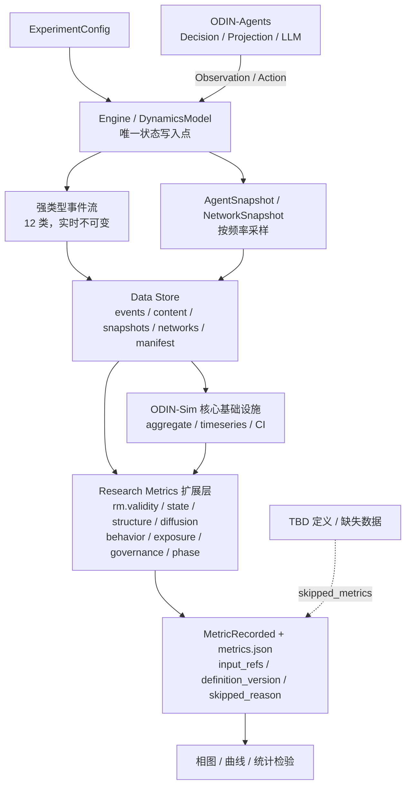

# Metric → Data Mapping v1.0

**ODIN Experiment Specification v1.0 · 配套文档（任务第七部分，最重要）**

| 项 | 内容 |
|---|---|
| 状态 | 待研究者评审 |
| 日期 | 2026-11-08 |
| 主规范 | [`experiment-specification-v1.md`](experiment-specification-v1.md) |
| 依据 | 《实验指标体系 v2》（odin-agents 项目提供的外部研究资料） |
| 本次边界 | 仅文档；未修改 `src/`，未新增依赖，未运行仿真或测试 |

> 本表的唯一目的：**确保 75 个指标中每一个都有数据来源；没有数据来源的，明确标出缺什么。** 不允许出现「定义了指标、却没有采集路径」的行。

---

## 1. 列约定

| 列 | 约定 |
|---|---|
| `Metric` | `metric_id`，与主规范第 2 章字典一一对应 |
| `Required Data` | `data-schema.md` 中的数据对象 ID；`*` 表示对象内特定字段 |
| `Required Events` | `event-schema.md` 中的事件类型；`—` 表示由快照/轨迹推导，无需新事件 |
| `Collection Frequency` | 严格服从 v2：3A 每 k 轮 / 3B 事件驱动 / 3C 每轮全量 / 3D 每轮全量；其他层标注「工程推导」 |
| `Computation Module` | 研究指标扩展层模块名（**规格，未实现**），前缀 `rm.` = research metrics |
| `Validation Test` | 主规范第 13 章测试编号 |
| `Data Status` | 见 §2 |

---

## 2. Data Status 枚举

| 状态 | 含义 |
|---|---|
| `SUPPORTED` | 现有产物/配置已充分支持该对象的记录（不等于指标公式已确定） |
| `PARTIAL` | 原始数据已落盘，但科学定义 TBD 或需补少量字段 |
| `Missing Data` | 计算所需原始数据在当前产物中完全不存在 |
| `Required New Event` | 需在事件体系中新增事件类型或 payload 字段 |
| `Required Agent Capability` | 需 ODIN-Agents 侧能力（投影器、人格、意图、LLM 元数据） |
| `Required Simulation Capability` | 需 ODIN-Sim 侧新能力（边表持久化、逐步驱动、推荐分发、N 扫描、双对照组、配对零模型） |

> 组合状态用 `+` 连接。所有 `Missing Data` / `Required *` 均为**当前仓库事实判定**，不是实现承诺。

---

## 3. 完整映射表（75 行）

### Layer 1｜效度指标

| Metric | Required Data | Required Events | Collection Frequency | Computation Module | Validation Test | Data Status |
|---|---|---|---|---|---|---|
| `V-Π` | `ProjectionRecord`, `HumanAnnotationRecord`, `ExperimentMetadata.model_metadata` | —（仿真外部校准流程导入） | 工程推导：投影器版本变更时 / 每批重测 | `rm.validity.projector_icc` | T-L1/1, T-L1/2 | `Missing Data` + `Required Agent Capability` |
| `V-bias` | `AgentSnapshot.opinion_true`, `AgentSnapshot.opinion_projected`, `IsolationProbeRecord`, `ExperimentMetadata.initial_opinion_distribution` | `AgentDecisionMade`（probe 子类型） | 工程推导：任何交互之前的隔离探针 | `rm.validity.isolation_bias` | T-L1/3 | `Missing Data` + `Required Agent Capability` + `Required New Event` |
| `V-zero` | `ExperimentMetadata`, `NetworkSnapshot`, `AgentSnapshot`, `SweepResult.phase_diagram` | —（成对扫描派生） | 工程推导：每参数点成对运行 | `rm.validity.zero_model` | T-L1/4 | `Required Simulation Capability` |
| `V-persona-convergence` | `AgentSnapshot.persona_vector`, `AgentSnapshot.opinion_true`, `ProjectionRecord` | `AgentStateChanged` | 工程推导：每轮全量（与 AgentSnapshot 同频） | `rm.validity.persona_convergence` | T-L1/5 | `Missing Data` + `Required Agent Capability` + `Required New Event` |
| `V-micro-macro-gap` | `DecisionRecord`, `AgentSnapshot`, `StateTransitionRecord`, L2 指标产物 | `AgentDecisionMade`, `OpinionChanged` | 工程推导：每轮全量（记录），实验结束后分析 | `rm.validity.micro_macro` | T-L1/5 | `Required New Event` + `Required Agent Capability` |
| `V-fluency-fallacy` | `ContentRecord.text`, `ProjectionRecord`, `HumanAnnotationRecord` | `ContentCreated` | 工程推导：校准/抽检阶段 | `rm.validity.fluency` | T-L1/5 | `Missing Data` + `Required New Event` |
| `V-physics-washing` | `ExperimentMetadata`, L5 全部指标, `SweepResult` | `MetricRecorded` | 工程推导：每次宣称相变前检查 | `rm.validity.physics_washing` | T-L5/6 | `Required Simulation Capability` |
| `V-model-drift` | `ExperimentMetadata.model_metadata`, `DecisionRecord.llm_call_metadata` | `AgentDecisionMade` | 工程推导：每次 LLM 调用 + 实验级快照 | `rm.validity.model_drift` | T-L1/6 | `Missing Data` + `Required Agent Capability` + `Required New Event` |

### Layer 2｜状态层

| Metric | Required Data | Required Events | Collection Frequency | Computation Module | Validation Test | Data Status |
|---|---|---|---|---|---|---|
| `M0-D` | `AgentSnapshot.opinion_true`, `trajectory.npz` | — | 工程推导：每轮全量（可事后重算） | `rm.state.pairwise_distance` | T-L2/1, T-L2/2 | `PARTIAL`（范数定义 TBD，Q-01/Q-42） |
| `M1-BC` | `AgentSnapshot.opinion_true`, `trajectory.npz` | — | 工程推导：每轮全量 | `rm.state.bimodality` | T-L2/3 | `PARTIAL`（BC 公式 TBD，Q-01） |
| `M2-K` | `AgentSnapshot.opinion_true`, `trajectory.npz`, `ExperimentMetadata.opinion_dynamics_config` | — | 工程推导：每轮全量 | `rm.state.clusters` | T-L2/4, T-L2/5 | `PARTIAL`（聚类算法 TBD，Q-02） |
| `M3-S1` | `M2-K` 簇标签, `AgentSnapshot.opinion_true` | — | 与 M2-K 同频 | `rm.state.largest_cluster` | T-L2/5, T-L2/6 | `PARTIAL`（依赖 M2-K 的 TBD，Q-03） |
| `M4-Daff` | `AgentSnapshot.affect_state`, `ContentRecord.sentiment`, `community_partition_result`, `HumanAnnotationRecord` | `ContentCreated`, `OpinionChanged` | 工程推导：每轮全量；原始文本实时留存 | `rm.state.affective_distance` | T-L2/7 | `Missing Data` + `Required New Event` + `Required Agent Capability` |
| `M5-rho-obs` | `AgentSnapshot.opinion_true`, `ExperimentMetadata.initial_opinion_distribution` | — | 工程推导：每轮全量 | `rm.state.issue_correlation` | T-L2/8 | `PARTIAL`（系数类型 TBD，Q-05） |
| `M6-NODEdiff` | TBD（v2 未指明） | — | TBD | `rm.state.node_diff`（占位，不得实现） | T-L2/9 | `Missing Data`（定义 TBD，Q-06） |
| `M7-NODEconv` | TBD（v2 未指明） | — | TBD | `rm.state.node_conv`（占位，不得实现） | T-L2/9 | `Missing Data`（定义 TBD，Q-06） |
| `M8-NodeSD` | `AgentSnapshot.opinion_true`, 分类节点集合 S, `trajectory.npz` | — | 终态（可事后重算） | `rm.state.nodesd` | T-L2/10 | `PARTIAL`（S 定义 TBD，Q-06） |
| `M9-NODEclus` | TBD（v2 未指明） | — | TBD | `rm.state.node_clus`（占位，不得实现） | T-L2/9 | `Missing Data`（定义 TBD，Q-06） |
| `M10-phase-consensus` | `M1-BC`, `M2-K`, `M3-S1`, `M0-D`, `ExperimentMetadata` | `MetricRecorded` + 机制证据事件 | 终态判定（中间可记录相区轨迹） | `rm.state.phase_label` | T-L2/11 | `PARTIAL`（判据 TBD；且机制证据字段需 `Required New Event`） |
| `M11-phase-critical` | `M1-BC`, `M2-K`, `M3-S1`, `P-chi`, `P-binder` | `MetricRecorded` | 终态判定 | `rm.state.phase_label` | T-L2/11, T-L5/6 | `PARTIAL`（判据 TBD，Q-07/Q-43） |
| `M12-phase-deep-polarization` | `M1-BC`, `M2-K`, `M3-S1`, `M0-D` | `MetricRecorded` | 终态判定 | `rm.state.phase_label` | T-L2/11 | `PARTIAL`（判据 TBD，Q-07） |

### Layer 3A｜结构组

> 全部 8 项的共同前置：`Network` 当前在运行时存在（`src/odin_sim/model/protocol.py` 的 `src/dst/deg`），但**产物只落 `network_hash` 字符串**，边表不可重建 → 统一标记 `Missing Data` + `Required Simulation Capability`。

| Metric | Required Data | Required Events | Collection Frequency | Computation Module | Validation Test | Data Status |
|---|---|---|---|---|---|---|
| `3A-Q` | `NetworkSnapshot(potential)`, `community_partition_result` | `NetworkEdgeAdded`, `NetworkEdgeRemoved` | **3A：每 k 轮采样**（k 待定 Q-37） | `rm.structure.modularity` | T-3A/1, T-3A/2 | `Missing Data` + `Required Simulation Capability` + `Required New Event` |
| `3A-assortativity` | `NetworkSnapshot(potential)`, `AgentSnapshot.group_label`, `community_partition_result` | `NetworkEdgeAdded`, `NetworkEdgeRemoved` | 3A：每 k 轮采样 | `rm.structure.assortativity` | T-3A/3 | `Missing Data` + `Required Simulation Capability` + `Required New Event` |
| `3A-homophily` | `NetworkSnapshot(potential)`, `AgentSnapshot.group_label` | `NetworkEdgeAdded`, `NetworkEdgeRemoved` | 3A：每 k 轮采样 | `rm.structure.homophily` | T-3A/4 | `Missing Data` + `Required Simulation Capability` + `Required New Event` |
| `3A-community-count` | `NetworkSnapshot(potential)`, `community_partition_result` | `NetworkEdgeAdded`, `NetworkEdgeRemoved` | 3A：每 k 轮采样 | `rm.structure.communities` | T-3A/1, T-3A/5 | `Missing Data` + `Required Simulation Capability` + `Required New Event` |
| `3A-cross-edge-ratio` | `NetworkSnapshot(potential)`, `community_partition_result` | `NetworkEdgeAdded`, `NetworkEdgeRemoved` | 3A：每 k 轮采样 | `rm.structure.cross_edge_ratio` | T-3A/4, T-3A/5 | `Missing Data` + `Required Simulation Capability` + `Required New Event`（`topology/model.py` 有 `extra.cross_edge_ratio` 但未持久化） |
| `3A-APL` | `NetworkSnapshot(potential)` | `NetworkEdgeAdded`, `NetworkEdgeRemoved` | 3A：每 k 轮采样 | `rm.structure.avg_path_length` | T-3A/6, T-3A/7 | `Missing Data` + `Required Simulation Capability` + `Required New Event` |
| `3A-degree-dist` | `NetworkSnapshot(potential)` | `NetworkEdgeAdded`, `NetworkEdgeRemoved` | 3A：每 k 轮采样 | `rm.structure.degree_distribution` | T-3A/8 | `Missing Data` + `Required Simulation Capability` + `Required New Event` |
| `3A-neighbor-opinion-corr` | `NetworkSnapshot(potential)`, `AgentSnapshot.opinion_true` | `NetworkEdgeAdded`, `OpinionChanged` | 3A：每 k 轮采样（边表与意见必须同 tick） | `rm.structure.neighbor_correlation` | T-3A/9 | `Missing Data` + `Required Simulation Capability` + `Required New Event` |

### Layer 3B｜扩散组

| Metric | Required Data | Required Events | Collection Frequency | Computation Module | Validation Test | Data Status |
|---|---|---|---|---|---|---|
| `3B-cascade-size` | `ContentRecord`, `InteractionEvent(reshare)`, `ExposureEvent` | `ContentCreated`, `ContentPublished`, `InteractionCreated` | **3B：事件驱动，每条内容独立记录** | `rm.diffusion.cascade` | T-3B/1, T-3B/9 | `Missing Data` + `Required New Event` |
| `3B-depth` | `ContentRecord`, `InteractionEvent(reshare)` | `ContentCreated`, `InteractionCreated` | 3B：事件驱动 | `rm.diffusion.cascade` | T-3B/1, T-3B/7 | `Missing Data` + `Required New Event` |
| `3B-width` | `ContentRecord`, `InteractionEvent(reshare)` | `ContentCreated`, `InteractionCreated` | 3B：事件驱动 | `rm.diffusion.cascade` | T-3B/1 | `Missing Data` + `Required New Event` |
| `3B-amplification` | `ContentRecord`, `ExposureEvent`, `InteractionEvent(reshare)` | `ContentPublished`, `ContentExposed`, `InteractionCreated` | 3B：事件驱动 | `rm.diffusion.amplification`（口径未锁定前禁止实现） | T-3B/2, T-3B/3 | `Missing Data` + `Required New Event`（**且 Q-16 阻塞**） |
| `3B-giant-cluster-threshold` | M2-K 簇尺寸分布, 参数扫描结果, `ExperimentMetadata` | `MetricRecorded` | 工程推导：每参数点 + N 序列 | `rm.diffusion.giant_cluster` | T-3B/4, T-3B/5 | `Missing Data` + `Required Simulation Capability` |
| `3B-audience-structure` | `ExposureEvent`, `ContentRecord`, `community_partition_result`, `NetworkSnapshot` | `ContentExposed`, `ContentPublished` | 3B：事件驱动；社区划分按 3A 每 k 轮对齐 | `rm.diffusion.audience` | T-3B/6 | `Missing Data` + `Required New Event` + `Required Simulation Capability` |

### Layer 3C｜行为 / 参与组

| Metric | Required Data | Required Events | Collection Frequency | Computation Module | Validation Test | Data Status |
|---|---|---|---|---|---|---|
| `3C-post` | `InteractionEvent`, `ContentRecord`, `DecisionRecord` | `InteractionCreated`, `ContentCreated`, `AgentDecisionMade` | **3C：每轮全量** | `rm.behavior.action_counts` | T-3C/1, T-3C/2 | `Missing Data` + `Required New Event` |
| `3C-noop` | `InteractionEvent`, `DecisionRecord`, `ExposureEvent` | `InteractionCreated`, `AgentDecisionMade`, `ContentExposed` | 3C：每轮全量（显式 noop） | `rm.behavior.action_counts` | T-3C/1, T-3C/3 | `Missing Data` + `Required New Event` |
| `3C-comment` | `InteractionEvent`, `ContentRecord`, `DecisionRecord` | `InteractionCreated`, `AgentDecisionMade` | 3C：每轮全量 | `rm.behavior.action_counts` | T-3C/1, T-3C/2 | `Missing Data` + `Required New Event` |
| `3C-like` | `InteractionEvent`, `DecisionRecord` | `InteractionCreated`, `AgentDecisionMade` | 3C：每轮全量 | `rm.behavior.action_counts` | T-3C/1, T-3C/4 | `Missing Data` + `Required New Event` |
| `3C-reshare` | `InteractionEvent`, `ContentRecord`, `DecisionRecord` | `InteractionCreated`, `ContentCreated` | 3C：每轮全量（与 3B 共用事件，不重复落盘） | `rm.behavior.action_counts` | T-3C/1, T-3B/1 | `Missing Data` + `Required New Event` |
| `3C-action-split` | `InteractionEvent`, `ExposureEvent`, `DecisionRecord` | `InteractionCreated`, `ContentExposed` | 3C：每轮全量 | `rm.behavior.action_split` | T-3C/2, T-3D/7 | `Missing Data` + `Required New Event` |
| `3C-pagerank` | `InteractionEvent`, `NetworkSnapshot(interaction)` | `InteractionCreated` | 3C：每轮全量 | `rm.behavior.centrality` | T-3C/5 | `Missing Data` + `Required New Event` + `Required Simulation Capability` |
| `3C-betweenness` | `InteractionEvent`, `NetworkSnapshot(interaction)` | `InteractionCreated` | 3C：每轮全量 | `rm.behavior.centrality` | T-3C/5 | `Missing Data` + `Required New Event` |
| `3C-in-degree` | `InteractionEvent` | `InteractionCreated` | 3C：每轮全量 | `rm.behavior.centrality` | T-3C/5, T-3C/6 | `Missing Data` + `Required New Event` |
| `3C-out-degree` | `InteractionEvent` | `InteractionCreated` | 3C：每轮全量 | `rm.behavior.centrality` | T-3C/5, T-3C/6 | `Missing Data` + `Required New Event` |
| `3C-sentiment` | `ContentRecord.text/sentiment`, `ProjectionRecord`, `HumanAnnotationRecord` | `ContentCreated` | 3C：每轮全量；文本实时留存，标注可事后算 | `rm.behavior.sentiment` | T-3C/7 | `Missing Data` + `Required New Event` + `Required Agent Capability` |
| `3C-activity-duration` | `InteractionEvent`, `ExposureEvent`, `AgentSnapshot.session_id` | `InteractionCreated`, `ContentExposed` | 3C：每轮全量 | `rm.behavior.activity` | T-3C/8 | `Missing Data` + `Required New Event` |
| `3C-engagement-volume` | `ExposureEvent`, `InteractionEvent`, `ContentRecord` | `ContentExposed`, `InteractionCreated` | 3C：每轮全量（曝光过程量实时） | `rm.behavior.engagement` | T-3C/9 | `Missing Data` + `Required New Event` |
| `3C-engagement-rate` | `InteractionEvent`, `ExposureEvent` | `InteractionCreated`, `ContentExposed` | 3C：每轮全量 | `rm.behavior.engagement` | T-3C/4, T-3C/9, T-3C/10 | `Missing Data` + `Required New Event` |
| `3C-external-validity` | `StateTransitionRecord`, `AgentSnapshot`, `InteractionEvent`, 3C 中心性/情感/活动指标 | `OpinionChanged`, `InteractionCreated` | 3C：每轮全量（记录）；实验后分析 | `rm.behavior.external_validity` | T-3C/11 | `Missing Data` + `Required New Event` + `Required Agent Capability` |

### Layer 3D｜暴露-影响分离组

> 全部 7 项受 v2「暴露是过程量，事后无法重建」约束：事件必须实时落盘。

| Metric | Required Data | Required Events | Collection Frequency | Computation Module | Validation Test | Data Status |
|---|---|---|---|---|---|---|
| `3D-potential-network` | `NetworkSnapshot(potential)`, `ExperimentMetadata.recommendation_policy` | `NetworkEdgeAdded`, `NetworkEdgeRemoved` | **3D：每轮全量** | `rm.exposure.networks` | T-3D/1 | `Missing Data` + `Required Simulation Capability` + `Required New Event` |
| `3D-exposure-network` | `ExposureEvent`, `ContentRecord`, `DecisionRecord`, `NetworkSnapshot(exposure)` | `ContentExposed`, `ExposureSelected`, `ContentPublished` | 3D：每轮全量（事件实时） | `rm.exposure.networks` | T-3D/2, T-3D/7 | `Missing Data` + `Required New Event` |
| `3D-influence-network` | `StateTransitionRecord`, `InfluenceRecord`, `ExposureEvent`, `DecisionRecord` | `OpinionChanged`, `AgentStateChanged`, `ContentExposed` | 证据事件实时；网络事后构建 | `rm.exposure.inference` | T-3D/3, T-3D/4 | `Missing Data` + `Required New Event` + `Required Agent Capability` |
| `3D-E-ij` | `NetworkSnapshot(potential)`→S, `ExposureEvent`/分发日志→A, `ExposureEvent` 计数→U, `ContentRecord` | `ContentPublished`, `ContentExposed`, `NetworkEdgeAdded` | 3D：每轮全量 | `rm.exposure.decomposition` | T-3D/2, T-3D/5 | `Missing Data` + `Required New Event` + `Required Simulation Capability` |
| `3D-delta-E` | `3D-E-ij` 三分量（两组条件）, `ExperimentMetadata.recommendation_policy` | `ContentPublished`, `ContentExposed`（两组条件） | 3D：每轮全量（原始量）；分解事后算 | `rm.exposure.decomposition` | T-3D/2, T-3D/6 | `Missing Data` + `Required Simulation Capability` + `Required New Event`（成对条件） |
| `3D-selective-exposure` | `ExposureEvent`, `DecisionRecord`, `AgentSnapshot.opinion_true`, `ContentRecord` | `ExposureSelected`, `ContentExposed`, `AgentDecisionMade` | 3D：每轮全量（**选择事件不可事后重建**） | `rm.exposure.selectivity` | T-3D/7, T-3D/8 | `Missing Data` + `Required New Event` + `Required Agent Capability` |
| `3D-network-overlap` | 三张 `NetworkSnapshot` | `NetworkEdgeAdded`, `ContentExposed`, `OpinionChanged`（用于构建） | 3D：每轮全量 | `rm.exposure.overlap` | T-3D/1, T-3D/9 | `Missing Data` + `Required Simulation Capability` + `Required New Event` |

### Layer 4｜治理层

| Metric | Required Data | Required Events | Collection Frequency | Computation Module | Validation Test | Data Status |
|---|---|---|---|---|---|---|
| `G-pi` | `ExperimentMetadata.intervention_config` | `InterventionApplied` | 干预事件驱动 + 实验级快照 | `rm.governance.config` | T-L4/1, T-L4/2 | `Missing Data` + `Required New Event` + `Required Simulation Capability` |
| `G-Cost1` | `InteractionEvent`, `ContentRecord` | `InteractionCreated`, `ContentCreated` | 复用 3C：每轮全量（不重复落盘） | `rm.governance.costs` | T-L4/3 | `Missing Data` + `Required New Event` |
| `G-Cost2` | `ContentRecord`, `HumanAnnotationRecord`, `AgentSnapshot.belief_state` | `ContentCreated` | 标注可事后算；文本实时留存 | `rm.governance.costs` | T-L4/4 | `Missing Data` + `Required New Event` + `Required Agent Capability`（+ 外部 ground truth） |
| `G-Cost3` | `ContentRecord`, `ExposureEvent`, `AgentSnapshot.opinion_true`, `community_partition_result` | `ContentExposed`, `ContentCreated` | 3D：每轮全量 | `rm.governance.costs` | T-L4/5 | `Missing Data` + `Required New Event` + `Required Simulation Capability` |
| `G-L1` | L2 序参量, 配对对照运行 | `MetricRecorded`, `InterventionApplied` | 与所依赖状态层同频 | `rm.governance.effectiveness` | T-L4/6, T-L4/7 | `Required Simulation Capability`（双组配对）+ 阈值未锁定（Q-33） |
| `G-L2` | `ExperimentMetadata.model_metadata/network_topology`, 序参量, 两个对照组 | `MetricRecorded`, `InterventionApplied` | 跨底座/拓扑/攻击策略成组实验 | `rm.governance.robustness` | T-L4/8, T-L4/9 | `Required Simulation Capability` + `Required Agent Capability` |
| `G-L3` | `G-Cost1/2/3` | `MetricRecorded` | 与三个 Cost 同频 | `rm.governance.cost_gate` | T-L4/10, T-L4/3~5 | `Missing Data` + `Required New Event`（**且 X 未定义 Q-28/Q-33**） |

### Layer 5｜相变层

| Metric | Required Data | Required Events | Collection Frequency | Computation Module | Validation Test | Data Status |
|---|---|---|---|---|---|---|
| `P-chi` | L2 序参量时序, 参数扫描结果, `ExperimentMetadata.random_seed` | `MetricRecorded` | 工程推导：每参数点 × 每种子 | `rm.phase.susceptibility` | T-L5/1, T-L5/6 | `Required Simulation Capability`（多种子 + 参数扫描） |
| `P-binder` | L2 序参量时序, N 序列扫描 | `MetricRecorded` | 工程推导：每 (参数点, N) | `rm.phase.binder` | T-L5/2, T-L5/6 | `Required Simulation Capability`（**N 扫描缺失，Q-44**） |
| `P-Tconv` | L2 序参量时序, `StateTransitionRecord`, `ExperimentMetadata.simulation_steps` | `OpinionChanged`, `MetricRecorded` | 工程推导：每轮全量 | `rm.phase.convergence_time` | T-L5/3, T-L5/4 | `Required Simulation Capability` |
| `P-data-collapse` | N 序列与参数扫描结果, L2 序参量, 临界点估计 | `MetricRecorded` | 工程推导：每 (参数点, N) | `rm.phase.data_collapse` | T-L5/5, T-L5/6 | `Required Simulation Capability`（N 扫描缺失） |
| `P-hysteresis` | 正向 / 反向扫描结果, `ExperimentMetadata` | `MetricRecorded` | 工程推导：每参数点（双向） | `rm.phase.hysteresis` | T-L5/6, T-L5/7 | `Required Simulation Capability`（正反扫描路径缺失） |
| `P-ctrl-epsilon` | `ExperimentMetadata.opinion_dynamics_config` | — | 实验级快照 + 每扫描点 | `rm.phase.control_params` | T-L5/8 | `SUPPORTED`（现有 `param_overrides` 可承载） |
| `P-ctrl-rho` | `ExperimentMetadata.initial_opinion_distribution` | — | 实验级快照 | `rm.phase.control_params` | T-L5/8, T-L2/8 | `SUPPORTED`（须与 `M5-rho-obs` 分列） |
| `P-ctrl-d` | `ExperimentMetadata.opinion_dynamics_config` | — | 实验级快照 | `rm.phase.control_params` | T-L5/8 | `SUPPORTED`（`ModelCapabilities.multi_dim` 已声明） |
| `P-ctrl-pAI` | `ExperimentMetadata.agent_population_config` | `AgentDecisionMade`（类型标记） | 实验级快照 + 每扫描点 | `rm.phase.control_params` | T-L5/8, T-L1/4 | `Missing Data` + `Required Agent Capability` |
| `P-ctrl-alpha` | `ExperimentMetadata.recommendation_policy` | `ContentPublished` | 实验级快照 + 每分发 | `rm.phase.control_params` | T-L5/8, T-L4/2 | `Missing Data` + `Required Simulation Capability`（**符号冲突 Q-31**） |
| `P-ctrl-T` | `ExperimentMetadata.model_metadata`, `DecisionRecord.llm_call_metadata` | `AgentDecisionMade` | 实验级快照 + 每次 LLM 调用 | `rm.phase.control_params` | T-L5/8, T-L1/6 | `Missing Data` + `Required Agent Capability` |

---

## 4. 统计与结论

### 4.1 覆盖与状态分布

| 项 | 数量 | 占比 |
|---|---|---|
| 映射表总行数 | **75** | 100% |
| 与主规范 `metric_id` 一一对应 | 75 | 100%（无缺、无重、无悬空引用） |
| 每行都有 `Required Data` | 75 | 100%（TBD 项显式写「TBD（v2 未指明）」并标 `Missing Data`） |
| 每行都有 `Validation Test` | 75 | 100% |
| `SUPPORTED` | 3 | 4.0% |
| `PARTIAL` | 9 | 12.0% |
| 含四类缺口标记 | 63 | 84.0% |

### 4.2 四类缺口汇总

| 缺口类型 | 涉及行数（可重叠） | 最小新增内容 |
|---|---|---|
| `Missing Data` | 58 | `ContentRecord`、`ExposureEvent`、`InteractionEvent`、`DecisionRecord`、`StateTransitionRecord`、`InfluenceRecord`、`NetworkSnapshot`（边表）、`agent_population_config`、`recommendation_policy`、`model_metadata` |
| `Required New Event` | 45 | 12 类强类型事件中的 10 类为现有系统所无；尤其 `ContentExposed`、`ExposureSelected`、`AgentDecisionMade`、`OpinionChanged`、`InterventionApplied` |
| `Required Agent Capability` | 16 | Text Projection Adapter、人格向量、行为意图序列化、LLM 调用元数据、事实/情感标注能力 |
| `Required Simulation Capability` | 26 | 网络边表持久化、三网络构建、逐步驱动（并存）、推荐分发候选集记录、`population_size` 扫描轴、双对照组、正反扫描路径、零模型配对 |

### 4.3 数据流总图

### 4.4 必须遵守的三条红线（来自 v2，映射到本表）

1. **3B 与状态层是两套独立证据**：本表中 `3B-*` 的 `Required Events` 不含 `OpinionChanged`；`M*` 的 `Required Events` 不含 `InteractionCreated`。禁止把转发事件直接映射成意见变化（T-3B/9）。
2. **三网络不得合并**：`3D-*` 三行分别指向三张 `NetworkSnapshot`；影响网络的 `Required Data` 必须含 `InfluenceRecord.evidence_refs`，且 T-3D/4 断言「仅相关/时序不生成边」。
3. **暴露与选择过程必须实时记录**：`3D-exposure-network`、`3D-selective-exposure`、`3D-E-ij` 的事件列含 `ContentExposed` / `ExposureSelected`，且标注「事后无法重建」。

---

*文档结束 · 状态：待研究者评审 · 未进行任何代码实现*
