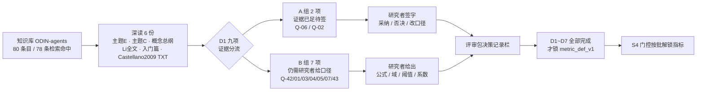

# S0-D1 证据核对稿（Evidence Review · Batch D1）

**状态**：S0 证据核对完成 · **等待研究者拍板** · 非定义锁定稿
**日期**：2026-11-08
**上游**：《实验指标体系 v2》、`experiment-specification-v1.md` §14（Q-01~Q-44）、`review-checklist-v1.md` §2（D1~D7）
**本轮范围**：S0 决策批次 **D1（意见空间与状态层基础，9 项）** 的资料证据核对；**2026-11-08 增补**：研究者提供的 BC 公式外部候选文档核查（登记为 F-5）
**资料来源**：知识库「ODIN-agents」（条目名见 §1；不写本机路径，沿用 `docs/README.md` 的路径纪律）；外部候选文档见 §1.4

> **本文件的性质**：只登记「资料里有什么、原文怎么写、与 v2 有何差异、还缺什么」，**不新增任何科学定义、不锁定任何阈值、不改写 v2 口径、不修改 `src/`、不解锁任何代码指标**。
> 「资料里有」≠「规格已锁」。任何一条从证据变成 `metric_def_v1` 的定义，都必须经研究者书面签字。

---

## 0. 一页结论

**能解一部分，不能全解。** 这批资料补的是**文献事实与既有项目口径**，而 S0 要拍的是**本项目选哪套口径、锁哪个值**——后者是规格决策，资料里没有、也不替研究者决定。

| 结论 | 内容 |
|---|---|
| D1 阻塞面 | 从「9 项全部无口径」收敛为 **2 项证据已足待签 + 7 项仍需研究者给口径** |
| 最大变化 | **Q-06 从硬阻塞变为可定稿**：Li 2025 全文（21 页作者稿）在库，Methods 给出 Eq(5)–(10) |
| 必须纠正 | v2 引用纪律「Li 2025 仅有摘要、方法细节不可展开」**已过时**；上一轮给 Q-42 的工程默认 `[-1,1]^d / d=1 / L1` **作废** |
| **本轮增补（F-5）** | 研究者提供 **BC 公式外部候选文档**：数学推导与数值经独立复算全部通过，但自带 5 项限制（5/9 三义、相区口径冲突、跨项目参数、哨兵/值域缺陷、引用等级）→ **Q-01 的「公式缺口」收敛为「有候选待签字」，「口径缺口」反而扩大** |
| **本轮确认（F-6）** | 研究者明确确认工程侧对 **v2「如何描述一个系统极化」的框架理解**（五现象分别测、三种定义先对齐、四元组并列报、三类终态与相区作分类判读、报共识须报机制）。**属设计意图确认，不是 Q-01/Q-07 口径签字**，不解锁任何指标 |
| 仍未解决 | **BC 公式候选是否采纳 + 5/9 角色裁决**；意见空间域三选一；相区阈值；ρ_obs 系数类型 |
| S4 门控 | 保持全有全无，`metric_def_version = metric_def_unset`，75 个指标继续全部 `skipped_metrics` |

---

## 1. 资料清单与证据边界

### 1.1 本次**深读**的 6 份（逐段核对，可引章节号）

| # | 知识库条目名 | 类型 | 本文件简称 | 与 D1 的关系 |
|---|---|---|---|---|
| 1 | `06_主题E_极化干预与复杂系统.md` | MD，标记「✅ 已核原文」 | **主题E** | §8 变量清单、§9 方程与限制、§10 前置验证、§4 治理/相变 |
| 2 | `04_主题C_经典意见动力学.md` | MD，标记「✅ 已核原文」 | **主题C** | §2.4 HK、§2.5 Lorenz 2007、§2.8 Flache 三定义、§5.3 范数限制 |
| 3 | `01_概念总纲_意见动力学_社会网络_生成式Agent_相变与极化消解.md` | MD | **概念总纲** | §5 相变机理、§5.2 HK 实测锚点、§6.3 相区、§6.4 伦理 |
| 4 | `Modeling the impact of large language models on opinion dynamics-A simulation-based study. Engineering Applications of AI.pdf` | PDF，**21 页作者稿**，内页题名 *Quantifying the Impact of Large Language Models on Collective Opinion Dynamics*（Chao Li, Xing Su, Haoying Han, Cong Xue, Chunmo Zheng, Chao Fan） | **Li 全文** | Methods Eq(1)–(10)、七控制参数、100 次重复 |
| 5 | `入门篇`（笔记「从一句人话变成意见坐标、观点分数」相关笔记另列） | 笔记 / Note | **入门篇** | 意见空间 `[0,1]`、BC 判据、HK 510 次扫描、相变四工具 |
| 6 | `10_Castellano2009_StatPhysSocialDynamics.txt` | TXT（arXiv:0710.3256v2 全文抽取，约 49.9 万字符） | **Castellano 2009 TXT** | 定向检索 BC / bimodality / 5/9 / skewness / kurtosis |

> Castellano 2009 TXT 体量过大，本次为**定向关键词检索**而非逐行通读；检索结论仅限「所列关键词是否出现」，不对全文内容作总结。

### 1.2 仅核**命中清单**、未逐份深读

知识库检索返回 **78 条命中**（80 个条目）。以下条目的**存在与类型**已确认，但**正文未逐份深读**，本文件不据其下任何结论：

- `Piao2026_..._arXiv2501.05171v2_fulltext.html`（×2）、`Levy2021_SocialMediaNewsPolarization_AER.pdf`（×2）、`Bail2018_OpposingViews_PNAS.pdf`、`bail-et-al-2018-...pdf`、`Piccardi2025_RerankingPartisanAnimosity_Science.pdf`、`Chuang2024_..._NAACL.pdf`、`09_LaGatta2026_HT26_fulltext.html`、`Lorenz2007_BoundedConfidence_Survey_arXiv0707.1762.pdf`（×2）、`Flache2017_ModelsOfSocialInfluence_JASSS.html`、`HegselmannKrause2002_...pdf`（×3）、`Parsegov2015_...pdf`、`Emergence of polarization in networks of LLM agents.pdf`
- `_未获取_Li2025_EAAI.md`（×2）、`_未获取_Tessler2024_Science.md`、`_未获取_Santos2021_PNAS.md` 等说明卡

> **本节是 §7 引用等级重估的边界**：只能说「全文在库、可回原文核」，不能说「已核原文、数值可用」。

### 1.3 本次未做的事

未逐份深读其余 PDF/HTML；未运行仿真；未改 `src/`；未新增依赖；未把任何建议阈值升级为已验证标准；未在 `review-checklist-v1.md` 的决策记录栏代填任何结论。

### 1.4 本轮增补核查的外部候选文档（非知识库条目）

| 项 | 内容 |
|---|---|
| 文档 | 《双峰系数 BC：公式、推导与 ODIN 项目口径》v1.0（2026-11-08），文件名 `双峰系数BC_公式与推导_2026-11-08.md` |
| 来源 | **研究者本轮直接提供**，不在知识库「ODIN-agents」80 条目内 |
| 核查方式 | ① 全文 456 行通读；② 用 numpy 独立实现逐表复算公式与数值（未依赖其运行时）；③ 逐行核对其引用的 ODIN-Agents `sim/metrics.py` 与 `spec/*.yaml` 是否属实；④ 与 v2 §第二层、主规范 `M1-BC`、本稿 Q-01 栏对照 |
| 登记位置 | **F-5**（§2）、Q-01 栏更新（§3）、差异登记 D-9（§4）、决策面 §6、状态关系 §8 |
| 边界 | 该文档自称「说明性派生文档，不改动任何既有口径」；本稿同样**只登记、不采纳、不裁决**。其外部文献 DOI/页码未联网核验 |

> §1.2 的「未逐份深读」边界不变：Lorenz 2007 / Flache 2017 全文仍未深读，**F-5 不替代对该两文的定向复核**。

---

## 2. 六项必须先登记的事实（含一处更正）

### F-1｜Li 2025 全文在库 → v2 引用纪律过时

| 项 | 内容 |
|---|---|
| v2 原文（「引用纪律」） | 「Li 2025（EAAI）知识库中仅有摘要与部分指标定义，方法细节不可展开」 |
| 主规范 §1.5 / §14 Q-06 | 据此把 `NODEdiff / NODEconv / NODEclus` 记为「定义不可得」 |
| 实际 | 知识库有 **21 页作者稿 PDF**，含完整 Methods；Eq(5)–(10) 给出四项指标的公式与口径，另有 Eq(8)(9) 聚类距离定义 |
| 佐证 | 清单中另有 `_未获取_Li2025_EAAI.md` 说明卡 ×2 —— v2 写作时依据的是说明卡，PDF 为后来入库 |
| 影响 | **Q-06 从「硬阻塞 / 不可展开」降为「证据已足待签」**；v2 引用纪律条目需研究者裁定是否出勘误（工程侧不改 v2） |
| 注意 | PDF 文件名题名与内页题名不一致（*Modeling the impact…* vs *Quantifying the Impact…*），作者一致；**正式期刊版是否同版未核**，涉及 Eq(7) 的分母问题（见 F-3） |

### F-2｜上一轮 Q-42 工程默认作废

| 来源 | 意见空间 |
|---|---|
| 上一轮我给的默认（**作废**） | `x ∈ [-1,1]^d`、`d=1` 起步、范数 L1 |
| 主题E §8.1 | `x_i(t) ∈ [0,1]^d`，`d=2 起步`，来源标「研究规格锁定」 |
| 主题E §9.2 完整方程 | `x_i(t) ∈ [0,1]^d`；邻居条件 `‖x_j − x_i‖_p ≤ ε_i`（范数未指定具体 p） |
| 入门篇 §一 | `x_i(t)` 取值 `[0,1]`（标量：0 完全反对 / 0.5 中立 / 1 完全支持） |
| Li 全文 Methods | `x_i(t) ∈ [-1,1]`（−1 极负面 / +1 极正面） |
| 主题E §9.3 / 主题C §5.3 | **「多维 + ε 截断没有标准形式，欧氏 / L∞ / 马氏距离给出不同结果，至少报两种」** |

→ 上一轮把 Li 原文的 `[-1,1]` 误当项目规格，且 `d=1`、`L1` 均无出处。**本文件不指定新默认**，只登记三个候选与「至少报两种范数」的约束，交研究者三选一。

### F-3｜更正：Eq(7) 的 `/S` 判断（上一轮误判）

上一轮我说「v2 的 NodeSD 公式漏了归一化，原文 Eq(7) 是 `Σ_s√[…/(n−1)] / S`」。**核对原文后此判断不成立**，更正如下：

| 公式 | Li 全文 Methods 可得文本 | 是否显式除以 S |
|---|---|---|
| Eq(5) `NODE_diff` | `Σ_{s∈S} Σ_{i=1..n} (x_i(T)−x_i(0)) / (S·n)` | 是（`/Sn`） |
| Eq(6) `NODE_conv` | `Σ_{s∈S} (t | ∀i, |x_i(t)−x_i(t−1)| ≤ τ) / S` | 是（`/S`） |
| **Eq(7) `NODE_SD`** | `Σ_{s∈S} √[ Σ_i (x_i(T)−x̄(T))² / (n−1) ]` | **否**：可得文本中只有分子 `Σ_{s∈S}`，无 `{S}` 分母 |
| Eq(10) `NODE_clus` | `Σ_{s∈S} (m | ∀p, dist(p,p+1) ≤ δ) / S` | 是（`/S`） |

- v2 第二层转写为 `NodeSD = Σ_{s∈S}√[Σ_i(x_i(T)−x̄(T))²/(n−1)]`，**与可得文本一致，并未「漏写」**。
- 真正的问题是 **Eq(7) 与其余三式的量纲不一致**（其它三式都是「100 次重复的均值」，Eq(7) 在可得文本里是「求和」）。成因可能是作者稿排版遗漏或 PDF→LaTeX 提取丢失，**未对照正式期刊版，不下定论**。
- 因此 Q-06 中新增一个需研究者裁定的子项：**是否按 Eq(5)/(6)/(10) 的一致性为 Eq(7) 补 `/S`**，或照录作者稿/正式版原文。工程侧不自行补。

### F-4｜新发现：`BC` 缩写冲突（第三个符号命名空间问题）

Castellano 2009 TXT 定向检索到唯一一处 `(BC)`：

> 「…this realistic aspect of human communications is called **bounded confidence (BC)**; in the literature it is expressed by introducing a real number ε…」

- 该文中 `BC` = **有界信任**，不是「双峰系数（bimodality coefficient）」。
- v2 / 主题E §8.6 / 入门篇的 `BC` = **双峰系数**。两者同名异义。
- 同文定向检索 `bimodality` / `bimodal` / `skewness` / `kurtosis` / `5/9` / `Sarle` **均为 0 处**。
- 这条应并入 **Q-31 符号命名空间隔离**登记（现有登记已含：v2 `τ`=目标节点 / `κ`=话术策略 / `α`=推荐个性化 vs G3 `tau`=预热步数 / `kappa`=跨维耦合 / `alpha`=说服学习率；另加 Li Eq(6) `τ=0.005` 收敛阈值，以及 v2 规则三 `D`=平均两两距离 / 第五层 `d`=维度数 / 架构方案 `D`=维度数）。

### F-5｜BC 公式外部候选已核查：数学可用，口径未闭合

| 项 | 内容 |
|---|---|
| 来源 | 《双峰系数 BC：公式、推导与 ODIN 项目口径》v1.0（2026-11-08），**研究者本轮提供的外部说明性派生文档**，非知识库「ODIN-agents」条目（详见 §1.4） |
| 文档自述边界 | 「只解释 BC 是什么、公式从哪来、在本课题怎么用」，**不改动任何既有口径**；权威仍是 v2、`spec/` 四文件、`sim/metrics.py`；不做阈值重标、不改代码 |
| 性质 | **外部文献补充**（SAS 1990 / Knapp 2007 / Pfister 2013 / Freeman & Dale 2013 / Hartigan 1985 / Pearson 1894 等），**不是 v2 出处「主题E」的原文展开** → 引用等级需研究者裁定（Q-39 / 主规范 §1.5） |

**公式候选（该文档 §2 / §3；本文件只登记，不采纳）**

| 形式 | 表达式 |
|---|---|
| 总体式 | `BC = (γ₁²+1)/β₂ = (β₁+1)/(γ₂+3)`，`β₂` 为**非超额** Pearson 峰度 |
| 样本式（SAS / Sarle，`n>3`） | `BC = (g₁²+1) / (g₂ + 3(n−1)²/((n−2)(n−3)))`，`g₂` 为**超额**峰度 |
| 有限样本项 | `C(n) = 3 + 3(3n−5)/((n−2)(n−3)) > 3`，单调降到 3；`n→∞` 样本式回退总体式 |
| 5/9 来源 | 均匀分布 `β₂=9/5` → `BC=5/9≈0.5556`，**非实验标定值**；由 `E[(Z²−γ₁Z−1)²]≥0` 得 `β₂≥β₁+1`，BC 是该不等式两边之比 |
| ≈1.0 的解释 | 两点分布取等号；两等权高斯峰令 `t=σ²/a²`，`BC=(1+t)²/(1+6t+3t²)`，`t→0` 极限为 1；`BC=5/9` 对应 `t=(√15−3)/3≈0.291`（峰间距 ≈3.71 个峰内标准差） |

**独立复算结果（本轮，未改任何代码）**：用 numpy 独立实现 BC 后逐表复算——`C(n)` 8 个值、该文档 §5.1 七个形状（`0.3360 / 0.5483 / 0.6130 / 0.9911 / 0.9972 / 0.5844`）、§5.2 七个 `n`、§7.1 手算 `0.99105`、§3.4 与 §3.5 的解析式及 `t≈0.291` **全部吻合**；Pearson 不等式展开与等号条件逐项正确。该文档 §3.5「实算」列因未公开样本构造与种子**无法逐位复现**（`t=10` 时文档 `0.3264` vs 解析 `0.3352` vs 本轮复算 `0.3367`），**不宜写进测试期望值**。另逐行核对其引用的 `sim/metrics.py:20–33`、`:109–110`、`:136`、`spec/default.yaml:35/176`、`spec/grid.yaml:56`、`spec/schema.yaml:112`，**均真实存在且内容与文档一致**，故其 §4.3 登记的冲突属实。

**五项限制（决定「能不能直接用」）**

| # | 限制 | 实证 |
|---|---|---|
| L-1 | **口径未闭合**：文档自带一处未裁决冲突（§4.3） | `sim/metrics.py:136` 相区判定 `K>=2 and (BC>5/9 or K>=3)` 与 `spec/default.yaml:176 five_ninths_role: trigger_only` 冲突；文档自述「需研究者裁决，改 spec 会使 `spec_hash` 变化、旧结果不可比」。正落在 **Q-01（5/9 用法）与 Q-07（相区判定）** |
| L-2 | **5/9 出现三种互斥用法** | v2 第二层「`>5/9≈0.555` **判双峰**」（结果层判据）／ODIN-Agents spec「**只作投放触发线**」（`grid.yaml:56`，`references_criteria: false`）／代码「**深极化相判据**」（结果层）。Q-01 待拍板项④由二选一变**三选一** |
| L-3 | **跨项目参数冲突，但域差异对 BC 无害** | 文档侧 `[-1,1]^d`、`N=500, d=3`；主题E §8.1/§9.2 为 `[0,1]^d, d=2 起步`、概念总纲 HK 基线 `N=1000`。**BC 对仿射变换不变**（本轮实测 `[0,1]→[-1,1]` 差 `−2.22e−16`），故意见域之争不影响 BC 数值；但 `C(n)` 依赖 `n` → **跨 N 的 BC 绝对值不可比**（该文档 §5.2 自证），`d` 影响逐维 BC 维数与 `ρ_obs` 对数。须随 Q-42 / Q-01 一并锁 |
| L-4 | **两处照抄会出错** | ① 三个哨兵 `return 0.0`：方差≈0 恰是「全体共识 `K=1`」，返回 0 会被读成「极不双峰」；S4 门控要求显式 `skipped_metrics`（该文档 §7.3 亦建议按缺失处理，但现行实现未改）。② **§0「值域 `(0,1]`、`BC=1` 当且仅当两点分布」是总体式结论**；样本式因 `C(n)>3` 恒严格 `<1`（实测 `n=1000` 两点 `0.9911`，可由 `g₂+C(n) ≥ g₁²+1+(C(n)−3)` 严格证明）→ 若按 `BC=1` 写 `T-L2/3` 期望值，测试必失败。另 B3 未关闭：未校正矩比 `g₁/g₂` 与 SAS 的 `C(n)` 偏差校正**不配套** |
| L-5 | **引用等级与统计地位** | 公式来自 v2 未列的外部文献；本轮只核数学自洽与代码一致性，**未联网核 DOI/页码**。该文档 §3.6「BC 无抽样分布、不给 p 值、推断放在种子层 ATE」与主规范 §1.6 统计规范兼容，可作 `limitations` 素材；但「是否允许引入新参考源」须研究者确认 |

**对 Q-01 的影响**：从「已核材料中公式完全缺失」收敛为「**已有完整外部候选 + 5/9 与 ≈1.0 的数学解释（由证明支持，不再是推断）**」，但**口径缺口反而扩大**（5/9 三义、相区冲突）。Q-01 **仍留在评审包表 B**；未签字前**不写入 `M1-BC.mathematical_definition`、不改 `src/`、不解锁任何指标**。

### F-6｜研究者确认：v2 描述系统极化的框架（意图确认，非口径签字）

| 项 | 内容 |
|---|---|
| 时间 / 形式 | 2026-11-08，研究者在 S0-D1 对话中明确回复「你理解的对」 |
| 确认对象 | 工程侧对《实验指标体系 v2》「如何描述一个系统的极化」的框架理解 |
| 性质 | **设计意图的书面确认**。不是 Q-01 / Q-07 / Q-43 的科学口径签字，**不构成决策记录栏结论** |

**已确认的框架（五点）**

| # | v2 依据 | 已确认的工程理解 |
|---|---|---|
| 1 | §使用前必读 规则一 | 极化**不是一个指标**，是意见分歧 / 碎片化 / 双极化 / 议题极化 / 情感极化**五个不同现象**；意见分布、网络社区、群体间情感距离**分别测量**，禁止合成单一「极化指数」 |
| 2 | §使用前必读 规则二 | 极化至少**三种互不等价定义**（双峰化 / 簇间距离扩大 / 簇内同质化），可给出相反结论；跨条件比较前必须对齐 `definition_id`（主规范 R-2） |
| 3 | §使用前必读 规则三 | **分歧 ≠ 极化**，`D` 只作分歧度量，禁止作为双极化证据（主规范 R-3） |
| 4 | §第二层 | 描述顺序 = **L1 效度准入 → 四元组 `M=(BC,K,S₁,D_aff)` + `M₅` 与 3A 网络社区线并列报、分别判 → 归入三类终态与相区标签**。三类终态 = 共识/集中、双峰极化、多群碎片化（`K=1 / 2 / 更大`）；相区 = 共识相 ←→ 临界区 ←→ 深极化相。**判读是分类，不是连续分数** |
| 5 | §第二层「必须写进方法的坑」／§两条写进 methods 的声明／§第四层 | 报共识必须**同时报达成机制**（主规范 `consensus_mechanism_evidence`，缺则 `incomplete`）；3B 扩散与 `M₁–M₄` 是两套**独立证据**，分别报告并显式检验耦合；「**并非所有极化都该消解**」 |

**同时校正的一处工程侧口头概括**：此前把「3A–3D 统称为机制解释层」说窄了。按规则一，3A 的模块度 / 同配 / 同质性 / 社区数本身就是「网络社区」这条**描述**测量线；3D 是「看到 ≠ 被改变」的分离前提；只有 **3B** 被 v2 methods 声明 2 明确划为与状态层并列的独立证据。主规范 `M4-Daff.limitations` 已有对应约束（群体划分口径须与 3A 模块度对齐）。

**对 S0 的约束（倾向性理解，不构成裁决）**

| 影响 | 说明 |
|---|---|
| Q-01 | 支持「`5/9` 属**结果层判据**、不应降为投放触发线」的倾向，但**三选一仍未拍板**；BC 公式候选采纳与否、样本式口径、`n`/`d` 仍待签字 |
| Q-07 / Q-43 | 相区判据须兼容 R-2 的 `definition_id`，且不得由单一指标（如 `BC>5/9`）直接定相区；阈值仍无 |
| Q-01 多维处理 | BC 作为系统级判据，不应任意取第 0 维代表整个系统；须随 Q-42 锁 `d` 与降维/综合规则 |

> **边界**：本项只登记「理解正确」这一事实。**未填写任何决策记录栏、未修改主规范任何 `mathematical_definition`、未改 `src/`、未解锁任何指标**；`metric_def_unset` / `s0_completed=false` / 75 指标全 `skipped_metrics` 保持不变。D2–D7 讨论以本框架为共同前提；若研究者后续给出不同表述，以新表述修订本项。

---

## 3. D1 九项逐项证据

> 每项固定四栏：**v2 口径 → 证据原文（含章节）→ 证据能推到哪一步 → 仍需研究者拍板**。
> 「§」后为知识库文档内部章节号，非主规范章节。

### Q-42｜意见空间域、`D` 维度语义、范数 · 阻塞

| 栏 | 内容 |
|---|---|
| v2 口径 | 规则三 `D = 2/(N(N−1))·Σ_{i<j}|x_i−x_j|`（平均两两距离）；第五层控制参数 `d`=维度数；全文未给意见空间域 |
| 证据 | 主题E §8.1 `x_i(t)∈[0,1]^d, d=2 起步`（标「研究规格锁定」）；§9.2 同域 + `‖·‖_p ≤ ε_i`；§8.4 `d∈{1,2,3}`；§9.3「欧氏/L∞/马氏至少报两种」；入门篇 `x∈[0,1]`；Li Methods `x∈[-1,1]`；主题C §2.7 `x∈R^{Nd}`（Parsegov 骨架）、§5.3 至少两种范数 |
| 能推到 | 三个互斥候选已齐；「多维必须至少报两种范数」是**项目级硬约束**（主题E/主题C 两处独立写明）；`D` / `d` / `δ` 的同名异义需登记 |
| 仍需拍板 | ① 三选一：`[0,1]^d, d=2`（项目规格）／`[0,1]` 标量（入门篇）／`[-1,1]`（Li）；② 范数组合与是否分维度报向量；③ `D` / `d` 符号隔离方案；④ 与 `architecture-v1.md` Q-R1 是否一并锁定 |

### Q-01｜BC 公式与判据 · 阻塞

| 栏 | 内容 |
|---|---|
| v2 口径 | `M₁ = BC`：「分布双峰程度，`>5/9≈0.555` 判双峰」；「本课题 HK 基线中，BC 在两簇平台期恰 ≈1.0」；出处栏写「主题E」 |
| 证据 | 主题E §8.6 同样只给 `>5/9≈0.555 判双峰`，**无公式**；入门篇 §四同样只给判据，无公式；概念总纲 §5.2 明确 `BC≈1.0` 是**本项目实测锚点**——「N=1000、μ=0.5、ε∈[0.05,0.30] 步长 0.005×10 种子共 510 次运行，共识→两极转变点 ε≈0.215–0.225，簇数序列 1→2→3→多…**双峰系数 BC 在两簇平台期恰≈1.0**。V1 复现 PASS」；概念总纲 §2.2 / 主题C §2.8 引用 Flache 2017「双峰化 / 簇间距离 / 簇内同质化」三定义 |
| 能推到 | **两个数值不矛盾且各有身份**：`5/9` 是「判双峰」的均匀基线阈值（主题E §8.6 称本项目 M₁），`≈1.0` 是本项目 HK 基线两簇平台期的**实测锚点**（概念总纲 §5.2）。上一轮「这是推断」的判断**现有证据**。**F-5 补上数学证明**：`≈1.0` 是两峰混合 `t→0` 的两点分布极限、`5/9` 是均匀分布 `β₂=9/5` 的理论值，两者不矛盾不再是推断。检索命中概念总纲含 `bimodality coefficient` 字样，但仅作术语列举，无公式 |
| 外部候选（F-5） | 研究者提供外部文档，给出 Sarle BC 总体式 / 样本式 / `C(n)` / 5/9 推导 / 两峰混合解析式；**独立复算全部通过**。**属 v2 未列的外部文献，引用等级待裁定**；自带 5 项限制（L-1~L-5），其中 5/9 三义、相区口径冲突、样本式值域 `<1` 直接扩大本项待拍板面 |
| 仍需拍板 | ① **是否采纳该外部候选公式**（采纳／否决／改口径）；若采纳须指定总体式还是样本式、矩的偏差校正口径（B3）；② **5/9 角色三选一**（v2 判据／投放触发线／相区判据，或分列并存）；③ 多维处理（逐维 + 主维取法／全维向量／降维；现行实现取第 0 维有任意性且 `BC_dims` 未落盘）；④ 两个数值分别作「判据」与「验收锚点」还是别的用法；⑤ 规则三 `D` 的范数与 BC 所用距离是否一致；⑥ `n` / `d` 锁定值（跨 N 不可比） |
| 缺口确认 | 已核 6 份材料中：Li 全文 `bimod`/`BC`/`skewness`/`kurtosis`/`5/9` **均为 0 处**；Castellano 2009 TXT 定向检索 `bimodality`/`bimodal`/`skewness`/`kurtosis`/`5/9`/`Sarle` **均为 0 处**，`BC` 唯一一处指 bounded confidence（F-4）。**未深读** Lorenz 2007 / Flache 2017 全文，是否含 BC 公式仍列为定向复核项，**F-5 不替代该复核**，本文件不断言「全库无」 |

### Q-02｜K 的聚类算法与稳态窗口 · 阻塞

| 栏 | 内容 |
|---|---|
| v2 口径 | 「K=1 共识，K=2 极化，越大越碎片化，值域 [0,n]」；引用「Li 2025（EAAI）说明」 |
| 证据 | **Li 全文 Methods 给出完整可复用口径**：终态 `x_i(T)` 各自成簇 → **single-linkage 层次聚类** → **Manhattan 距离** Eq(8) `dist_ij=|x_i(T)−x_j(T)|` → 合并距离 Eq(9) `min` → **切树高 δ=0.2**（「one tenth of the value range of x_i(t)」，即 `[-1,1]` 宽度 2 的 1/10）→ Eq(10) `NODE_clus = Σ_{s∈S}(m|∀p, dist(p,p+1)≤δ)/S`，**100 次仿真取均值**；并明确「a value of 2 indicates … polarized, a value of 1 indicates … consensus」。主题C §2.4 HK 标定 `N=625, ε=0.01 时恰好 38 簇`；概念总纲 §5.2 簇数序列 `1→2→3→多`；主题C §2.5（Lorenz 2007）**「分岔图对终止准则敏感，收敛判据不同，簇数曲线会移动」** |
| 能推到 | 算法、距离、切树高、重复次数、K=1/2 语义**全部有出处**；稳态窗口/终止准则的重要性有明确警告 |
| 仍需拍板 | ① **v2 的 K（全体稳态簇数）是否等同 Li 的 `NODEclus`（按 NIN/NINL/NIL 三类节点分别算、100 次平均的簇数）**——两者语义不同，这是本项最关键的确认；② δ 是否随意见空间域重算（若选 `[0,1]`，值域宽度 1 → δ 应为 0.1 而非 0.2）；③ 稳态窗口 / 终止准则（依赖 Q-42 与 D7-Q36）；④ 最小簇尺寸是否设阈值 |

### Q-03｜S₁ 是否与 K 共用簇划分 · 阻塞

| 栏 | 内容 |
|---|---|
| v2 口径 | `M₃ = S₁ 最大簇占比`，仅一句「最大簇占全体比例」 |
| 证据 | 主题E §8.6 同样只列名称与用途；**已核 6 份材料中无「S₁ 与 K 共用划分」的项目级决定**；Li 全文有 `NODEclus` 的簇划分但无 `S₁` 指标 |
| 能推到 | 只能登记工程常识（不共用则两者不可比），**资料不提供项目口径** |
| 仍需拍板 | 是否共用同一簇划分；簇标签是否随 `metric_def_version` 版本化。**属项目级表示决策，资料无解** |

### Q-04｜D_aff 量表点数与群体划分 · 阻塞

| 栏 | 内容 |
|---|---|
| v2 口径 | `M₄ = D_aff 情感温度计距离`（「群体间情感距离」）；配套统计规范「量表精度 ≥11 点（建议值）」；第四层 `情感极化 ↓≥0.3 SD`（建议值，需锁定） |
| 证据 | 主题E §8.6 同名；**主题E §2.6** 记 Piccardi 2025（Science 390:6776, N=1256）「降权使外群体感受升温约 **2 度（0–100 温度计）**」，但该行标 **○ 二手，具体数值需回原文核**；概念总纲 §6.4 用同一事实作参与度/说服力权衡依据；概念总纲 §5.5「议题极化（BC、簇间距）与情感极化（温度计）可以脱钩，需要各自的序参量」 |
| 能推到 | 「情感温度计」是 0–100 量表的**文献用法线索**，与 v2 的「≥11 点」不是同一精度口径；且 evidence 等级为二手 |
| 仍需拍板 | ① 量表点数（≥11 点 / 0–10 / 0–100 / 其它）；② 群体划分来源（agent 先验属性 / 3A 社区划分——**依赖 D3-Q12** / 其它）；③ 「群体间距离」定义（组均值差 / 分布距离 Wasserstein·JS / 其它）。**D1 拍板不等于终局，需 D3 复核** |

### Q-05｜ρ_obs 系数类型与议题对 · 阻塞

| 栏 | 内容 |
|---|---|
| v2 口径 | `M₅ = ρ_obs 议题间实测相关`（「多维对齐度 / 议题间实际相关系数」）；第五层 `ρ` 是**控制参数**（议题相关） |
| 证据 | 主题E §8.6 同名；主题E §8.2 给 `C` = 议题依赖矩阵 `d×d`（标定来源 ANES / 信念网络）；主题C §2.7 Parsegov 的 `C` 代数骨架；主题C §4 提到「C 需要多议题前后测的相关结构」；**无 Pearson/Spearman 之选** |
| 能推到 | 可确认 `ρ_obs` 是**实测相关**（区别于配置里的控制参数 `ρ`），且 `d=1` 时无议题对可言；这是又一个同名异义，应并入 Q-31 |
| 仍需拍板 | ① Pearson / Spearman / 偏相关；② 议题对构成（`d(d−1)/2` 全组合 / 仅上三角 / 指定对）；③ `d=1` 时是 skip 还是返回 `null`；④ 系数与配置 `ρ` 是否需前缀隔离 |

### Q-06｜NODE* 四项定义与作用域 · 阻塞 → **证据已足待签**

| 栏 | 内容 |
|---|---|
| v2 口径 | 只给 `NodeSD = Σ_{s∈S}√[Σ_i(x_i(T)−x̄(T))²/(n−1)]`；另三项 `NODEdiff / NODEconv / NODEclus` **仅有名称**；「Li 2025 仅有摘要，方法细节不可展开」 |
| 证据 | **Li 全文 Methods 四项齐全**（逐式见 §4 差异登记表）：Eq(5) `NODEdiff`、Eq(6) `NODEconv`（`τ=0.005`）、Eq(7) `NODESD`、Eq(10) `NODEclus`；Eq(8)(9) 给聚类距离；文字明确定义 `S`=仿真次数、`n`=**该类别**节点数、`x̄(T)`=**该类别**终值均值，以及三类节点 `NIN / NINL / NIL`；`x∈[-1,1]`；100 次重复；七个控制参数 `N, T, ε, pro_NIN, pro_NINL, pro_NIL, x_LLM` |
| 能推到 | **四项定义可从资料定稿**；`S`/`n`/`x̄(T)` 作用域已明确；`τ=0.005` 是收敛阈值（第三个 `τ`）；δ=0.2 与值域绑定 |
| 仍需拍板 | ① **F-1**：是否出 v2 引用纪律勘误、允许展开方法细节；② **F-3**：Eq(7) 是否补 `/S`；③ 四项是「按节点类别分别算」还是「全体算」；④ 是否四项全部指标化（v2 标「可选」），或沿用 v2 只保留 `NodeSD`；⑤ δ 随意见空间域重算问题（与 Q-02 联动） |

### Q-07｜三相判定变量、阈值、稳态窗口 · 阻塞

| 栏 | 内容 |
|---|---|
| v2 口径 | 仅一行「共识相 ←→ 临界区 ←→ 深极化相」 |
| 证据 | **概念总纲 §6.3** 给定性边界（原文标【建议】且自注「目前没有直接文献验证」）：深极化相「簇间距离远大于 ε，跨群体信息根本无法进入置信区间，结构干预无效」；临界区附近「系统磁化率最大，微小扰动即可产生大位移」；共识相「干预无必要甚至可能有害」。**主题E §7.1** 机制图同样把三相并列；**主题E §4.2** 给 χ/Binder/有限尺寸标定/EWS 四类工具；**主题E §8.4** 给控制参数网格（ε `{.1,.15,.2,.25,.3}`、d `{1,2,3}`、ρ `{0,.3,.6,.9}`、p_AI `{0,.05,.1,.2,.3,.5}`、α `{0,.5,1.0}`、T 固定 1.0、N `{100,300,1000,3000}`）；**概念总纲 §5.2 / 入门篇** 给 HK 锚点 ε≈0.215–0.225 与簇数序列；**入门篇** 明写「HK 的临界阈值不是普适常数，依赖初始条件、群体规模和具体设定」 |
| 能推到 | 相的**定性语义**、可用的判定工具、参数网格、一个**纯 HK 基线锚点**（不是 LLM 场景阈值） |
| 仍需拍板 | ① 判定变量组合；② **全部相区阈值**（资料明确没有）；③ 稳态窗口 / 终止准则；④ HK 锚点是否可作为 LLM 场景的验收锚点（资料否，「不是普适常数」）；⑤ 若选择「不锁阈值、只输出四元组轨迹 + 人工标注」，需签字确认 `M10~M12` 继续 skip。**依赖 D7-Q36** |

### Q-43｜两层「临界区」是否同一判据 · 高

| 栏 | 内容 |
|---|---|
| v2 口径 | 第二层相区含「临界区」；第五层用 χ/Binder 峰定位临界点；未说明关系 |
| 证据 | 概念总纲 §5.6 把 χ 峰/Binder 交点作为**参数临界点定位**手段；概念总纲 §6.3 把「临界区附近磁化率最大」作为**状态相区**特征；主题E §4.2 两者并列于「识别临界变化」；**无一处明说「同一判据」或「必须分开」** |
| 能推到 | 只能确认「资料同时存在两种用法」，不能确认它们等同 |
| 仍需拍板 | 同一判据 / 分开判据 / 前者由后者导出；若同一，会改写 D7-Q36 的口径。**资料无项目级决定** |

---

## 4. 与 v2 的差异登记（需研究者裁定，工程侧不改 v2）

| # | v2 写法 | 资料实际 | 类型 | 建议处置 |
|---|---|---|---|---|
| D-1 | 「Li 2025 知识库仅有摘要与部分指标定义，方法细节不可展开」 | 21 页作者稿全文在库，Eq(5)–(10) 齐全 | **引用纪律过时** | 出勘误；Q-06 解锁；`_未获取_Li2025_EAAI.md` 说明卡保留为历史记录 |
| D-2 | `NodeSD = Σ_{s∈S}√[…/(n−1)]` | Li Eq(7) 可得文本同为求和、无 `/S`；Eq(5)(6)(10) 均有 `/S` | **原文内部不一致** | 研究者裁定是否补 `/S`；工程侧不自行补 |
| D-3 | K 值域 `[0,n]`，引用 Li 2025 说明 | Li `NODEclus` 是「按三类节点分别算、100 次平均的簇数」，δ=0.2 绑定 `[-1,1]` 值域 | **语义可能不等同** | Q-02 需明确「采用 / 不采用 Li 口径」 |
| D-4 | 「量表精度 ≥11 点」（建议值） | 主题E §2.6 文献用 0–100 温度计（二手） | **精度口径不同** | Q-04 明确量表；不得把 0–100 当已验证标准 |
| D-5 | 「BC 出处：主题E」 | 主题E §8.6 只给 `>5/9` 判据，无公式；`≈1.0` 锚点实际出自概念总纲 §5.2；外部候选文档（F-5）另引 SAS / Knapp / Pfister 等 v2 未列文献 | **出处不完整 + 新参考源** | 补出处；公式已有外部候选（F-5），**采纳与否及引用等级待签字** |
| D-6 | 控制参数 `d`=维度数；规则三 `D`=平均两两距离 | 主题E §8.4 用 `d`=维度数，架构方案用 `D`=维度数，Li 用 `δ`=切树高 | **符号同名异义** | 并入 Q-31 命名空间隔离 |
| D-7 | 「每参数点重复 100 次（Li 2025 口径）或 ≥10–25 次」 | Li 全文确为 100 次；主题E §10.3 为「每点 ≥10 种子，报均值与 CI」 | **两个项目内部数值并存** | D7-Q27/Q38 裁定；均为建议值，不自动锁定 |
| D-8 | 「巨簇幂律 −3.5±0.3 为 Holme & Newman 参照值」 | 主题E §4.3/概念总纲均提示「有限 N 陡峭 ≠ 相变」 | 一致，无差异 | 保留（仅登记已核对） |
| D-9 | v2 第二层「`>5/9≈0.555` **判双峰**」（结果层判据） | ODIN-Agents `spec/default.yaml:176` 记 `five_ninths_role: trigger_only`（**只作投放触发线**，非结果判据）；但 `sim/metrics.py:136` 相区判定仍写 `BC>5/9`（结果层） | **跨项目口径不一致 + 他项目内部冲突**（F-5 L-1/L-2） | Q-01 裁决 5/9 角色、Q-07 裁决相区判据；**工程侧不改 v2、不改他项目 spec 与代码** |

> **纪律**：以上 9 条全部是「提请裁定」，**不是**对 v2 的修订。v2 是本任务的唯一研究依据，工程侧无权改写。

---

## 5. Q-31 符号命名空间隔离：新增登记项

| 符号 | 出处 A | 出处 B | 冲突 |
|---|---|---|---|
| `τ` | v2 第四层 = 目标节点 | G3 baseline `tau` = 预热步数；**Li Eq(6) `τ=0.005` = 收敛判定阈值** | 三处同名异义（原登记 2 处，现补 1 处） |
| `κ` / `α` | v2 第四层 = 话术策略 / 推荐个性化 | G3 `kappa` = 跨维耦合、`alpha` = 说服学习率 | 已登记 |
| `D` / `d` / `δ` | v2 规则三 `D` = 平均两两距离；第五层 `d` = 维度数；架构方案 `D` = 维度数；Li `δ` = 切树高 0.2 | 主题E §8.4 `d` = 维度数网格 | **新增**：三处同名异义 + 大小写区分不可靠 |
| `BC` | v2/主题E/入门篇 = 双峰系数 | Castellano 2009 = **bounded confidence** | **新增**（F-4） |
| `ρ` / `ρ_obs` | v2 第五层 `ρ` = 控制参数（议题相关） | v2 第二层 `ρ_obs` = 实测相关系数 | **新增**：同名前缀、语义不同 |

---

## 6. 证据分流后的 D1 决策面

| 组 | Q | 数量 | 含义 | 评审包中的处理 |
|---|---|---|---|---|
| **A 证据已足待签** | Q-06、Q-02 | 2 | 公式/算法/参数在资料中齐全，研究者只需**签字采纳、否决或改口径**，不需自己造定义 | 移到 `review-checklist-v1.md` §2 D1 表 A |
| **B 仍需研究者给口径** | Q-42、Q-01、Q-03、Q-04、Q-05、Q-07、Q-43 | 7 | 资料给候选、给边界、或完全无项目级决定，必须由研究者**给出公式 / 域 / 阈值 / 系数** | 移到 `review-checklist-v1.md` §2 D1 表 B |

**真正还需要研究者「从无到有给出」的，收敛为四类**：

1. **BC 公式候选采纳与否 + 5/9 角色裁决**（Q-01；外部候选见 **F-5**，数学已复算通过但口径未闭合；Lorenz 2007 / Flache 2017 仍可定向复核）
2. **意见空间域与范数三选一**（Q-42，附「至少报两种范数」约束）
3. **K 是否采用 Li `NODEclus` 口径 + Eq(7) 是否补 `/S`**（Q-02 / Q-06，联动 Q-42 的 δ 重算）
4. **相区阈值 / 稳态窗口 / ρ_obs 系数类型 / S₁ 共用划分 / Q-43 判据关系**（Q-07、Q-05、Q-03、Q-43）

> 其余各项多数可从资料定稿，但**「资料里有」不等于「规格已锁」**，仍需逐条签字。
> **F-5 不改变分组**：Q-01 仍属表 B（公式有候选，但「是否采纳」与 5/9 角色是新的拍板项），表 A=2 / 表 B=7 不变。

---

## 7. 对 D2–D7 的资料支持概览（仅清单级，不代为定稿）

| 批次 | 已确认可得的资料 | 对阻塞的帮助 | 边界 |
|---|---|---|---|
| D2 效度 | 主题E §10.2 前置验证通过标准（V-Π `ICC≥0.7` + 人工子集 `≥0.8`；V-bias；V-zero；**V-repro** 同配置重跑 `ICC≥0.9`）；Chuang 2024 NAACL 全文与 `_text_Chuang2024.txt` 在库 | 通过标准可回原文核；但达标线仍标「建议，需在规格中锁定」 | 未逐份深读 Chuang 全文 |
| D3 结构 | `Piao2026_..._arXiv2501.05171v2_fulltext.html` ×2 在库 | Q-12 先验划分（左右阵营 + 中立按连接强度分配）可回原文核 | v2 已注明「正式版 PDF 未获取」 |
| D4 扩散 | Levy 2021 ×2、Bail 2018 ×2、Piccardi 2025、Lorenz 2007 ×2、Castellano 2009（PDF×2 + TXT）在库 | 3B 口径与 −3.5±0.3 参照值可回原文核 | Q-16「转发放大系数」v2 自注**知识库无出处，需自定**，资料明确不给 |
| D5 暴露 | Levy 2021 AER 全文在库（检索命中「the following formula」） | `E_ij = S·A·U` 与 ΔE 分解的实体映射有原文可核 | 未深读，不能断言公式细节 |
| D6 治理 | 主题E §4.1 三层判据表头明写**「达标线【建议，需在规格中锁定】」**；概念总纲 §6.4 给副作用与伦理边界（参与度代价、说服力—准确性权衡、操纵风险、「并非所有极化都该消解」） | 伦理边界有依据 | **资料明确拒绝替研究者锁阈值** |
| D7 相变 | 概念总纲 §5.6 检测手段表：`χ` 记为 `N·Var(|m|`（可得文本右括号截断）、`Binder U = 1 − ⟨m⁴⟩/(3⟨m²⟩²)`、`T_conv` 收敛时间、数据坍缩；主题E §8.4 给 `N∈{100,300,1000,3000}` 与全部控制参数网格；§10.3「每点 ≥10 种子，报均值与 CI」；主题C §2.5 Lorenz 2007「终止准则敏感」 | Q-36 / Q-38 / Q-44 基本有底 | χ 公式文本截断需核 PDF；`T_conv` / 数据坍缩在表中**只有用途、无公式** |

**Q-39（引用等级）**：v2 标「二手转述」的 Piccardi 2025 / Levy 2021 / Bail 2018 / Piao 2026 全文均在库，引用等级**具备整体重估条件**；但需逐份回原文核具体数值后才能升级，本文件只登记「全文可得」，不升级任何引用等级。

---

## 8. 与工程实现的状态关系（防止误读）

| 项 | 当前状态 |
|---|---|
| `review-checklist-v1.md` 签署栏 | 仍为 4 项全空 |
| 44 项决策记录栏 | 仍为 44 项全空；**本文件不代填** |
| `metric_def_version` | `metric_def_unset` → `definitions_locked = False` |
| manifest `s0_completed` | `false` |
| S1–S5 工程链路 | 已落盘并跑通冒烟（4 运行 / 704 事件 / 三条分离零违规 / 重放哈希一致）；**75 个指标全部 `skipped_metrics`** |
| 43 条 TBD 数学定义 | 仍为 TBD；未补写公式、未锁定阈值 |
| 外部 BC 公式候选（F-5） | 已核查登记；**未采纳、未写入 `M1-BC.mathematical_definition`、未改任何配置或代码** |
| v2 描述框架理解（F-6） | **研究者已确认理解正确**；仅登记为设计意图，44 项决策记录栏仍全空，未据此裁决 Q-01 / Q-07 / Q-43 |
| `src/` / 依赖 / 测试结果 | 本轮未改动、未新增依赖、未运行项目仿真或 pytest（仅做独立数值复算与文件核对） |

> **S0 门控是全有全无**：D1 单独拍板不会解锁任何代码指标；`metric_def_v1` 需 D1~D7 全部完成才锁。若研究者要按批解锁，需在 S4 门控增加按 `metric_id` 的定义版本表（纯工程改动，须另行授权）。

---

## 9. 下一步

1. 研究者按 `review-checklist-v1.md` §2 D1 的 **表 A（2 项）/ 表 B（7 项）** 逐条签字；格式见该文档 §3（6 项必填，缺项视为未回答）。
2. **Q-01 已有外部公式候选（F-5）**：研究者须先裁决「采纳／否决／改口径」与 5/9 角色三选一；若不采纳，可指定「定向复核 Lorenz 2007 / Flache 2017 全文」后再决。**候选不等于签字，不得据此写 `mathematical_definition`**。
3. D1 结论中涉及 Q-04（依赖 D3-Q12）、Q-07（依赖 D7-Q36）、Q-02/Q-06（依赖 Q-42）的，需在决策记录里标注「待复核」。
4. D1 完成后按 `继续 D2` 推进下一批；D1~D7 全部完成 → 锁 `metric_def_v1` → 才进入指标解锁。

---

**本文件结束。未经研究者书面签字，不构成任何科学定义的确认。**
