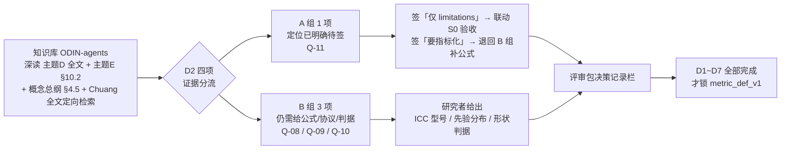

# S0-D2 证据核对稿（Evidence Review · Batch D2）

**状态**：S0 证据核对完成 · **等待研究者拍板** · 非定义锁定稿
**日期**：2026-11-08
**上游**：《实验指标体系 v2》§第一层 / §落地最小采集表 / §文献出处与引用纪律；`experiment-specification-v1.md` §4（L1 八项定义）、§14（Q-08~Q-11）；`review-checklist-v1.md` §2（D2）
**衔接**：`s0-evidence-D1.md` §9 第 4 条「D1 完成后按继续 D2 推进下一批」；该稿 **F-6（v2 描述框架理解确认）** 为本批次共同前提。
**本轮范围**：S0 决策批次 **D2（效度准入门槛，4 项 / 2 阻塞）** 的资料证据核对。
**资料来源**：知识库「ODIN-agents」条目（名称见 §1）；沿用 `docs/README.md` 的路径纪律，不写本机绝对路径。
**编号约定**：F / D 编号**跨文件连续** —— 事实接 D1 稿 F-6 → 本稿 **F-7~F-11**；与 v2 的差异接 D1 稿 D-9 → 本稿 **D-10~D-13**。

> **本文件的性质**：只登记「资料里有什么、原文怎么写、与 v2 有何差异、还缺什么」，**不新增任何科学定义、不锁定任何阈值、不改写 v2 口径、不修改 `src/`、不解锁任何代码指标**。
> 「资料里有」≠「规格已锁」；「外部文献有公式」≠「本项目采纳」。任何一条从证据变成 `metric_def_v1` 的定义，都必须经研究者书面签字。

---

## 0. 一页结论

**D2 的资料面比 D1 更薄，但有两处结构性发现。** 效度层的通过标准在 v2 与项目资料里几乎逐字一致、可核到原文；但 **ICC 型号、先验分布形式、「形状可比」判据三项在全部已核资料中均无项目级决定，且无可用外部先例**。同时发现 v2 与项目资料在「前置验证项数」和「模型版本漂移的处置方式」上不一致。

| 结论 | 内容 |
|---|---|
| D2 决策面 | 从「4 项全部无口径」收敛为 **1 项定位已明确待签（Q-11）+ 3 项仍需研究者给口径（Q-08 / Q-09 / Q-10）** |
| 最空的一项 | **Q-08（ICC）**：型号、重测次数、评分者数量、文本抽样在 v2 / 主题D / 主题E / 概念总纲 / Chuang 全文**均无**；主题D §8 自承「投影器 Π 的信度几乎没有被报告过」 |
| 最容易误采纳 | **Q-09**：Chuang 全文有 `B = mean(F_T)`、`D = std(F_T)` 明确公式，但那是**终态分布**度量，v2 的 `V-bias` 是**交互前隔离先验偏离**度量，语义不等同（F-7）→ 只登记为外部候选，不写进定义 |
| 结构性发现 1 | **V-repro 在 v2 缺席**：主题E §10.2 列 4 项前置验证（含「同配置重跑 `ICC ≥ 0.9`」），主题D §7.3 与 v2 §落地最小采集表只列 3 项；主题E §10.1 自身又写「三项通过」（F-8 / D-10 / D-11） |
| 结构性发现 2 | **Q-11 的资料倾向明确**：v2 §第一层与概念总纲 §4.5 都把五项效度风险定位为「写 limitations 时直接引用 / 必须写进 limitations」；但五项的主要出处 Taillandier 2026 在主题D §1 标为「无全文、二手」（F-9） |
| 引用冲突 | 概念总纲 §3 记 Chuang 2024 为「EMNLP，64 议题 / 9 因子」，全文实为 NAACL Findings 2024、15 topics、三类、5 点量表、无「9 factor」（F-11 / D-13） |
| 门控 | 保持全有全无：`metric_def_unset` / `s0_completed=false` / 75 指标全 `skipped_metrics`；**D2 单独签字不解锁任何指标** |

---

## 1. 资料清单与证据边界

### 1.1 本批次深读（逐段核对，可引章节号）

| 条目 | 核对范围 |
|---|---|
| `05_主题D_LLMAgent社会仿真.md` | §1 资料清单、§3.2 / §3.5 / §3.6、§4 横向对照表、§5 Q4/Q5、§7.2 / §7.3 / §7.4 / §7.5、§8 缺口、§9 引用注意 |
| `06_主题E_极化干预与复杂系统.md` | §4.3 三种最容易犯的误判、§10.1 三阶段、§10.2 前置验证、§10.3 / §10.4 |
| `01_概念总纲_意见动力学_社会网络_生成式Agent_相变与极化消解.md` | §3 信念网络表、§4.5 效度风险、§5.6 相变检测手段、附录术语表 |
| `Chuang2024_SimulatingOpinionDynamicsLLMAgents_NAACL.pdf` / `_text_Chuang2024.txt` | 摘要、§3 Experimental Settings、§4 Results（表 1–4 与 B/D 定义）、附录 L 人工标注、参考文献 |
| 《实验指标体系 v2》 | §第一层表、§第一层「为什么这一层必须放在最前面」、§落地最小采集表（效度 3 个）、§文献出处与引用纪律 |

### 1.2 定向检索但未逐段深读

- Chuang 2024 全文（约 8.9 万字符）按 `ICC / intraclass / test-retest / reliability / projection / bias (B) / diversity / confirmation bias / 15 topics / 9 factor / ANES / prior` 抽取上下文，**未逐段通读**。命中数：`intraclass` 0、`test-retest` 0、`projection` 0、`9 factor` 0、`ANES` 0；`ICC` 3 处均为正文子串噪声、非统计量用法；`bias (B)` 10、`diversity` 20、`15 topics` 5、`confirmation bias` 39。
- 知识库两次检索命中清单（78 / 71 条）仅确认条目存在与类型，**未逐份深读**。

### 1.3 本批次未做的事

- **未核 Taillandier et al. 2026 原文**：主题D §1 标「无全文、二手（效度批判框架）」；概念总纲 §4.5 的五项定义属二手转述（关联 Q-39）。
- 未核 Lorenz et al. 2021 原文（Chuang 的 B/D 公式所引），未核任何 ICC 统计学文献（知识库内无相关条目）。
- 未运行项目仿真；工程侧全量测试收口另见 `s1-s5-implementation-report.md`，**不作为本稿的科学证据**。
- 未代填任何决策记录栏、未改主规范 `mathematical_definition`、未改 `src/`。

---

## 2. 本批次登记的事实（F-7~F-11）

### F-7｜Chuang 2024 全文可得：给了 B/D 公式，但没有投影器信度

- 原文（NAACL Findings 2024, pp.3326–3346）§4 明确：`Bias (B) = mean(F_T)`、`Diversity (D) = std(F_T)`，`F_T` 为**最终时刻意见分布**；两式转引自 **Lorenz et al. 2021**。表 1–4 给出 `None / Weak / Strong` 三档确认偏误下 B、D 的均值 ± 标准误。
- 实验设定：**15 topics**（science / history / common sense 三类）、意见 **5 点离散 `−2…+2`**、`N=10`（大网络实验 `N=20`）、`gpt-3.5-turbo-16k` 温度 0.7、确认偏误注入三档、`true / false framing`、cumulative / reflective 两种记忆策略。
- 附录 L：**3 名独立人工标注者**、随机抽 20 tweets + 20 responses、一致率 100%，用于估计幻觉率 15%。该一致率是 **agreement rate，不是 ICC**；标注对象是「是否含系统外信息」，不是投影器输出。
- **定向检索结论**：全文无 `intraclass` / `test-retest` / `projection`，`ICC` 命中均非统计量。→ **Chuang 全文不提供 ICC 型号、重测协议或投影器信度口径**。
- **对 Q-09 的意义**：B/D 度量的是**终态分布**，v2 的 `V-bias` 要求的是「单独询问时意见分布与先验一致」的**交互前基线偏离**。二者测量对象与时间点不同，**不能把 `B = mean(F_T)` 直接搬作偏置量公式**。仅登记为外部候选，采纳与否由研究者裁定。

### F-8｜前置验证项数在项目内部不一致

| 出处 | 项数 | 内容 |
|---|---|---|
| v2 §第一层表 / §落地最小采集表 | 3 | `V-Π`、`V-bias`、`V-zero`（「效度（3 个）」） |
| 主题D §7.3 | 3 | 同上，通过标准措辞逐字对应 |
| 主题E §10.2 | **4** | 增列 **`V-repro`**：记录模型版本、prompt 哈希、温度、seed；同配置重跑 `ICC ≥ 0.9` |
| 主题E §10.1 M2 验收 | 3 | 「V-Π、V-bias、V-zero 三项通过」——**同文档 §10.1 与 §10.2 自相不一致** |

→ `ICC ≥ 0.9`（同配置重跑复现）与 `ICC ≥ 0.7`（投影器重测信度）是**两个不同对象的两个建议值**，不得混用；两者均标「建议，需在规格中锁定」。主题D §7.4 另给复现字段清单：temperature、top_p、seed、prompt 哈希、模型版本号。

### F-9｜五项效度风险在资料中的定位是 limitations，且主出处为二手

- v2 §第一层：「**配套的效度风险指标**（**写 limitations 时直接引用**）：平均人格收敛、微观—宏观效度鸿沟、流畅性谬误、物理洗白、模型版本漂移」。
- 概念总纲 §4.5：「效度风险（**必须写进任何基于此的论文的 limitations**）」逐条给定义，术语表标出处 **Taillandier et al. 2026**。
- 主题D §1 资料清单：`Taillandier et al. 2026, arXiv:2507.19364` 状态为「**无全文、二手（效度批判框架）**」。
- 主题D §5 Q5 给「平均人格收敛」一条**可操作检测线索**：定期测 Agent 间语义距离，若持续下降而意见分布不变，说明是「平均人格」而非真共识。→ 是检测思路，**不是公式 / 阈值 / 判定规则**。
- 主规范 §4 已把这五项做成 5 个 `metric_id`（`V-persona-convergence` / `V-micro-macro-gap` / `V-fluency-fallacy` / `V-physics-washing` / `V-model-drift`），`mathematical_definition` 全部 TBD；其中 `V-physics-washing` 有「相变四要素 + 六项判断标准」的清单式口径，是五项里最接近可计算的一项，但仍未给公式。

### F-10｜隔离基线协议与零模型对照有原文方法论依据，但都不含判定公式

- 主题D §3.6（Brockers et al. 2026）明确 **isolation control**：在让 Agent 互相交流之前，先单独询问每个 Agent，测出它的**先验意见与偏置**；所有后续「交互效应」都要减去这个基线，「不做这一步，结论不可解释」。主题D §5 Q5 把「必须有隔离基线」列为三条硬约束之首。
- 主题D §3.5（Chuang）：偏误注入必须显式作为实验因子，注入后才出现碎片化；v2 §第一层同义转述。
- 主题D §5「零模型对照」：把 LLM 节点替换为「行为参数完全相同但用规则实现的假 Agent」，看相图是否一致；一致 → 效应来自行为参数，不一致 → 来自语义内容、需进一步定位。主题D H-D1 是可证伪假设；主题E §10.1 M0 已有纯 HK 相图基线（ε_c≈0.215–0.225）。
- → **Q-09 得到「协议原则」、Q-10 得到「配对实验设计」，但二者都没有「先验分布形式 / 偏置量公式 / 形状可比判据」**。

### F-11｜概念总纲对 Chuang 2024 的记法与全文不一致

| 项 | 概念总纲 §3 信念网络表 | Chuang 全文 / 主题D §3.5 / v2 |
|---|---|---|
| 会议 / 出处 | EMNLP | NAACL Findings 2024, pp.3326–3346 |
| 议题结构 | 64 议题 / 9 因子 | 15 topics（science / history / common sense），全文无「9 factor」 |
| 意见表示 | 信念网络潜因子 | 5 点离散 `−2…+2` + 文本推文 |

→ 可能是**两篇不同的 Chuang 2024 文献**（另一篇为 EMNLP 信念网络 / 硅采样方向），也可能是条目笔误。工程侧不裁定；Q-39 引用等级重估前需先核清指向（D-13）。

---

## 3. D2 四项逐项证据

### Q-08｜ICC 型号与重测协议 · 阻塞

| 项 | 内容 |
|---|---|
| v2 原文要求 | 「同一文本重复投影 `ICC ≥ 0.7`；人工标注子集一致率 `≥ 0.8`」；失败对策「换投影方案 A→B→C」 |
| 资料能给的 | 投影层三方案（主题D §5 Q4：A 锚点对比评分 / B 结构化 JSON `−1..1` / C 微调回归头）；规模线索（主题D §7.5 与主题E §10.4 第 3 周：「Π 最小版（锚点对比），20 Agent 单议题 → 重测信度报告」）；复现字段清单（主题D §7.4）；外部人工标注先例 3 人 / 40 样本（Chuang 附录 L，**非投影器、非 ICC**） |
| **仍缺（需拍板）** | **ICC 型号**（`ICC(1,1)` / `ICC(2,1)` / `ICC(3,k)`）、重测次数、评分者数量、文本抽样量与分层、「一致率」的统计量定义（percent agreement / Krippendorff α / Cohen κ）、`≥0.7` 与 `≥0.8` 是否锁定为规格值、A/B/C 采用哪套投影方案 |
| 边界 | 主题D §8 自承「**投影器 Π 的信度几乎没有被报告过**」；主题E §4.1 与 v2 §引用纪律均标「达标线【建议，需在规格中锁定」；全部已核资料**无 ICC 型号先例** |
| 分流 | **表 B**（比 D1 的 Q-01 更空：Q-01 至少有 F-5 外部公式候选，Q-08 连候选都没有） |

### Q-09｜V-bias 先验分布与偏置量 · 阻塞

| 项 | 内容 |
|---|---|
| v2 原文要求 | 「单独询问时 Agent 意见分布与先验一致；偏置量可测量」；失败对策「换底座或改 prompt」 |
| 资料能给的 | 隔离询问的**协议原则**（F-10，Brockers / 主题D §5 Q5）；偏误注入的三档操作化先例（Chuang `None/Weak/Strong` + true/false framing）；偏置量**外部候选公式** `B=mean(F_T)` / `D=std(F_T)`（F-7，转引 Lorenz 2021）；初始分布候选（主题D §3.2 记 Piao 的 5 级离散 `[0.1,0.2,0.4,0.2,0.1]` 近高斯）；`b_i` 求真偏置 `∈[0,1]`（主题E §8.2 / 概念总纲 §4.4，是**参数**不是先验分布） |
| **仍缺（需拍板）** | 「**先验**」的分布形式（离散 / 连续、参数、来源）、「与先验一致」的检验或距离度量、**偏置量公式**（是否采用 Chuang B/D；若采用，如何把终态量改写为基线量）、隔离询问协议的具体实现（无网络 / 无历史 / 单次询问是否足够）、`bias_injection_config` 的因子水平 |
| 边界 | Chuang B/D 与 v2 V-bias **语义不等同**（F-7）；Piao 的初始分布是他项目设定，不能自动当本项目先验 |
| 分流 | **表 B** |

### Q-10｜V-zero「相图形状可比」判据 · 高

| 项 | 内容 |
|---|---|
| v2 原文要求 | 「规则节点与 LLM 节点相图可比（**至少形状可比**）」；失败对策「说明 LLM 节点带来额外机制，需单列」 |
| 资料能给的 | **配对实验设计**（F-10：参数相同的规则假 Agent 替换 LLM 节点；主题D H-D1 可证伪假设）；零模型侧已有纯 HK 相图基线（主题E §10.1 M0，ε_c≈0.215–0.225）；三种误判的警示（主题E §4.3：crossover 当相变 / 外部冲击当内生临界 / 测量误差当动力学）；相变工具清单（概念总纲 §5.6：χ、Binder U、T_conv、数据坍缩、迟滞 + EWS 四项） |
| **仍缺（需拍板）** | 「形状可比」的**判据**（曲线相似度度量 / 极值点位置容差 / 相区边界一致性 / 临界点偏移容差）、参数网格与种子配对规则、跨种子聚合方式、不可比时的判定阈值 |
| 边界 | 概念总纲 §5.6 的工具**未被任何资料指派给 V-zero**，且 χ 公式在可得文本中右括号截断、`T_conv` / 数据坍缩只有用途无公式（D1 稿 §7 已登记，属 D7-Q36） |
| 分流 | **表 B** |

### Q-11｜五项效度风险：指标化 or 仅 limitations · 高

| 项 | 内容 |
|---|---|
| v2 原文要求 | 「**配套的效度风险指标**（写 limitations 时直接引用）」——措辞本身同时含「指标」与「limitations」两种指向 |
| 资料能给的 | v2 §第一层 + 概念总纲 §4.5 **两处独立明确定位为 limitations**（F-9）；五项逐条定义与术语出处（概念总纲 §4.5 / 附录术语表，Taillandier 2026，**二手**）；「平均人格收敛」一条检测线索（主题D §5 Q5）；`V-physics-washing` 的四要素 + 六项判断标准清单 |
| **仍缺（需拍板）** | 「指标化」还是「仅 limitations 清单」**二选一**；若指标化，5 项各自需给公式 / 输入 / 阈值 / 验证用例；若仅 limitations，是否仍保留 5 个 `metric_id` 及其在 75 指标清单中的位置 |
| 重要联动 | 评审包 §5 S0 验收允许「43 条完全 TBD 减为 0，**或逐条标注『不指标化』并写明理由**」→ Q-11 若签「仅 limitations」，正好对应这 5 条的合法收敛路径。**工程侧不代为标注** |
| 分流 | **表 A（定位已明确待签）**；若签「要指标化」，立即退回表 B 并需补 5 项公式 |

> **表 A 的边界**：Q-11 的「证据已足」指的是**定位证据**（资料两处独立明说 limitations），不是公式证据。签字只能是「确认仅 limitations / 否决并给指标化口径」，不构成任何 `mathematical_definition` 的填充。

---

## 4. 与 v2 的差异登记（D-10~D-13，需研究者裁定）

| # | v2 写法 | 资料实际 | 类型 | 建议处置 |
|---|---|---|---|---|
| D-10 | §第一层 3 项 + §落地最小采集表「效度（3 个）」，无 `V-repro` | 主题E §10.2 列 **4 项前置验证**，含「同配置重跑 `ICC ≥ 0.9`」；主题D §7.3 仍为 3 项；主题E §10.1 又写「三项通过」 | **项目内部项数不一致 + v2 缺项** | 裁定是否把复现性验证纳入 L1；若纳入需给 `metric_id` 与 Q-08 分开的 ICC 口径 |
| D-11 | 「模型版本漂移」列为**写 limitations 的效度风险** | 主题E 把可复现列为**前置验证项**（`V-repro`，有通过标准）；主题D §7.4 列为「记录完整」的工程纪律 | **同一现象两种处置** | Q-11 与 D7-Q41 联动裁定；工程侧不改 v2 |
| D-12 | 「量表精度 `≥11 点`」（建议值） | 主题D §7.2 建议 **5 点**（与 Piao / Ohagi 对齐）；主题E §2.6 文献用 **0–100 温度计**；Chuang 全文 5 点 `−2…+2` | **三套以上口径并存**（D1 稿 D-4 的扩展） | 并入 D1-Q04 / D7-Q38 统一裁定；不得把任一套当已验证标准 |
| D-13 | v2 §第一层引「Chuang et al. 2024」求真偏置结论，未标会议与议题数 | 概念总纲 §3 记「EMNLP，64 议题 / 9 因子」；Chuang 全文实为 NAACL Findings 2024、15 topics、无 9 因子（F-11） | **引用指向冲突 / 可能为两篇文献** | Q-39 引用等级重估前先核清指向；工程侧不改任何引用标注 |

> **纪律**：以上 4 条全部是「提请裁定」，**不是**对 v2 的修订。v2 是本任务唯一研究依据，工程侧无权改写。

---

## 5. 跨批依赖与联动

| 本批 Q | 依赖 / 被依赖 | 说明 |
|---|---|---|
| Q-08 | ↔ D1-Q04、D7-Q38 | 量表精度与「`≥11 点` vs float 意见向量」影响人工标注子集设计；`ICC≥0.8` 与 `≥0.7` 均属建议值 |
| Q-09 | ↔ D1-Q42、D6-Q31、D7-Q40 | 先验分布形式依赖意见空间域；`b_i` / `bias_injection_config` 需符号隔离；隔离探针需 ODIN-Agents 接口契约 |
| Q-10 | ↔ D1-Q07、D7-Q36 | 相区阈值与相变五工具是否复用作「形状可比」判据；主题E §4.3 三种误判是硬约束 |
| Q-11 | ↔ S0 验收（评审包 §5） | 签「仅 limitations」→ 5 个 `metric_id` 可逐条标注「不指标化 + 理由」，是 43 条 TBD 的合法收敛路径之一 |
| `V-repro`（D-10） | ↔ D6-Q35、D7-Q41 | 多底座版本冻结与复现等级定义（`bitwise` / `statistical` / `not_reproducible`） |

---

## 6. 证据分流后的 D2 决策面

| 组 | Q | 数量 | 含义 | 评审包中的处理 |
|---|---|---|---|---|
| **A 定位已明确待签** | Q-11 | 1（1 高） | v2 与概念总纲两处独立把五项风险定位为 limitations；研究者只需签「确认仅 limitations / 否决并给指标化口径」 | 移到 `review-checklist-v1.md` §2 D2 表 A |
| **B 仍需研究者给口径** | Q-08、Q-09、Q-10 | 3（2 阻塞 + 1 高） | 资料给通过标准、协议原则、配对设计或外部候选公式，但**不给型号 / 分布 / 判据** | 移到 `review-checklist-v1.md` §2 D2 表 B |

**真正还需要研究者「从无到有给出」的，收敛为三类**：

1. **ICC 型号 + 重测协议 + 人工一致率统计量**（Q-08，无外部先例）
2. **先验分布形式 + 偏置量公式**（Q-09；Chuang B/D 是终态量，需裁定是否改写采用）
3. **「形状可比」判据**（Q-10；χ/Binder 等工具是否复用需与 D7-Q36 联裁）

> **Q-11 的条件分支**：签「仅 limitations」不产生公式；签「要指标化」则本项立即退回表 B，且需一次性给 5 项公式 / 输入 / 阈值 / 验证用例。
> **「候选 ≠ 签字」**：F-7 的 B/D 公式、Chuang 的三档注入、Piao 的初始分布、主题D 的 5 点量表全部只是候选，未写入任何 `mathematical_definition`。
> **门控提醒**：`metric_def_v1` 需 D1~D7 全部完成才锁；当前 75 个指标继续全部 `skipped_metrics`，D2 签字不改变此状态。

---

## 7. 与工程实现的状态关系（防止误读）

| 项 | 当前状态 |
|---|---|
| `review-checklist-v1.md` 签署栏 | 仍为 4 项全空 |
| 44 项决策记录栏 | 仍为 **44 项全空**；本文件不代填 |
| `metric_def_version` | `metric_def_unset` → `definitions_locked = False` |
| manifest `s0_completed` | `false` |
| S1–S5 工程链路 | 已落盘；**全量 `pytest -q` 本轮已收口转绿**（见 `s1-s5-implementation-report.md`），并修复 2 个真实缺陷 |
| 75 个指标 | 全部 `skipped_metrics`；43 条 TBD 数学定义未补写、阈值未锁定 |
| 本批次与 `src/` 的关系 | D2 为纯文档核对；本轮对 `src/` 的 2 处修改属**工程缺陷修复**，与 Q-08~Q-11 的科学口径无关，不改变门控 |
| F-6 框架确认 | 仍是 D2–D7 的共同前提，**不构成任何 Q 的口径签字** |

> **S0 门控是全有全无**：D1 或 D2 单独拍板都不会解锁任何代码指标。若研究者要按批解锁，需在 S4 门控增加按 `metric_id` 的定义版本表（纯工程改动，须另行授权）。

---

## 8. 下一步

1. 研究者按 `review-checklist-v1.md` §2 D2 的 **表 A（1 项）/ 表 B（3 项）** 逐条签字；格式见该文档 §3（6 项必填，缺项视为未回答）。
2. **Q-11 优先**：这是 D2 唯一可即时签字项；若签「仅 limitations」，请在决策记录里明确 5 个 `metric_id` 在 75 清单中的保留 / 注销方式，供 S0 验收使用。
3. **Q-09 的 B/D 候选**需先裁决「终态量能否改写为基线量」；未书面采纳前不得写进 `V-bias.mathematical_definition`。
4. D-10 / D-11 的 `V-repro` 去留，请与 D7-Q41 一并裁定，避免 L1 与 D7 出现两个冲突的 ICC 口径。
5. D-13 的 Chuang 引用指向，请在 Q-39 引用等级重估前核清。
6. D2 完成后按 `继续 D3` 推进下一批；D1~D7 全部完成 → 锁 `metric_def_v1` → 才进入指标解锁。

## 9. 后续增补与更正指向（2026-11-08 追加）

> 本节为**追加记录**，不回改上文 F-7~F-11 / D-10~D-13 的历史结论，以保留证据演进轨迹。完整重构见 **`validity-layer-v2.md`**（效度层重构稿 v2），该稿登记 **F-12~F-21 / D-14~D-18**，编号与本稿连续。

| 本稿原结论 | 后续增补后的状态 | 新稿位置 |
|---|---|---|
| F-9：Taillandier 2026「无全文、二手」 | **收录状态已过时**：arXiv:2507.19364v4 全文公开，Frontiers in AI 2026-10-30 接收（DOI 10.3389/frai.2026.1988865）；四项风险为一手术语，第五项「模型版本漂移」在该文无独立定义 | `validity-layer-v2.md` F-12 / D-18 |
| Q-08：「全部已核资料无 ICC 型号先例」「连候选都没有」 | **知识库内仍无，但外部统计学方法学有完整选型框架**（Shrout–Fleiss 1979 / Koo–Li 2016），且知识库内另有一份本稿未用的投影器专文；Cheng 2025 原文标注协议与本稿所引 C 级笔记数据不符 | F-17 / F-18 / F-19 / §4.1 |
| Q-09：「只有协议原则、无公式」 | 补入 **Brockers 2026 偏置四分解方程与隔离询问操作化**（正常/否定双框架、token 期望与熵、prompt 不进上下文）；与 Chuang 终态 B/D 不等同的判断**不变**（F-7） | F-16 / §4.2 |
| Q-10：「只有配对设计」 | 补入 **Taillandier distribution-matched null model + TOST 等效性检验**候选；Piao 2026 全文确认无零模型对照 / 无相图比较；「统计等效 ≠ 形状可比」需裁定 | F-15 / F-20 / D-17 / §4.3 |
| Q-11：「资料倾向 limitations」 | 原文实为**结构性局限 + 概念性诊断双轨**；签「仅 limitations」仍合法，但需知悉被放弃的诊断工具（PAS / DHI / FF_AUC 等，且论文声明其为概念性提议、非实证估计） | F-13 / F-14 / D-16 / §4.4 |
| D-12 量表精度三套口径 | v2「`≥11 点`」可定位到 **Bai 2025 的 101 点量表**（理由：预期效应小需更细分辨率）；**出处已定位，口径仍未裁定** | F-21 |

**新增结构性发现**：v2 隐含单一「外部文本投影器 Π」，但资料并存「结构化自报」（Piao 2026）与「token 分布期望 + 熵」（Brockers 2026）两条不等价路线（D-14）；「一致率」与 ICC 分属分类 / 连续两族统计量（D-15）。**投影技术路线须先于 Q-08 的 ICC 型号裁定**。

**证据分级新增**：`validity-layer-v2.md` §2 建立 A/B/C/D 四级证据源与硬规则（C 级问答笔记不得作公式或阈值依据）；本稿 §1.2 所记「未逐段深读」的资料边界不变。

**状态不变**：44 项决策记录栏仍 0/44 全空；D2 表 A=1 / 表 B=3；`metric_def_unset`、75 指标全 `skipped_metrics`、43 条 TBD 全部不变；新稿对 `src/` 零改动。

---

**本文件结束。未经研究者书面签字，不构成任何科学定义的确认。**
