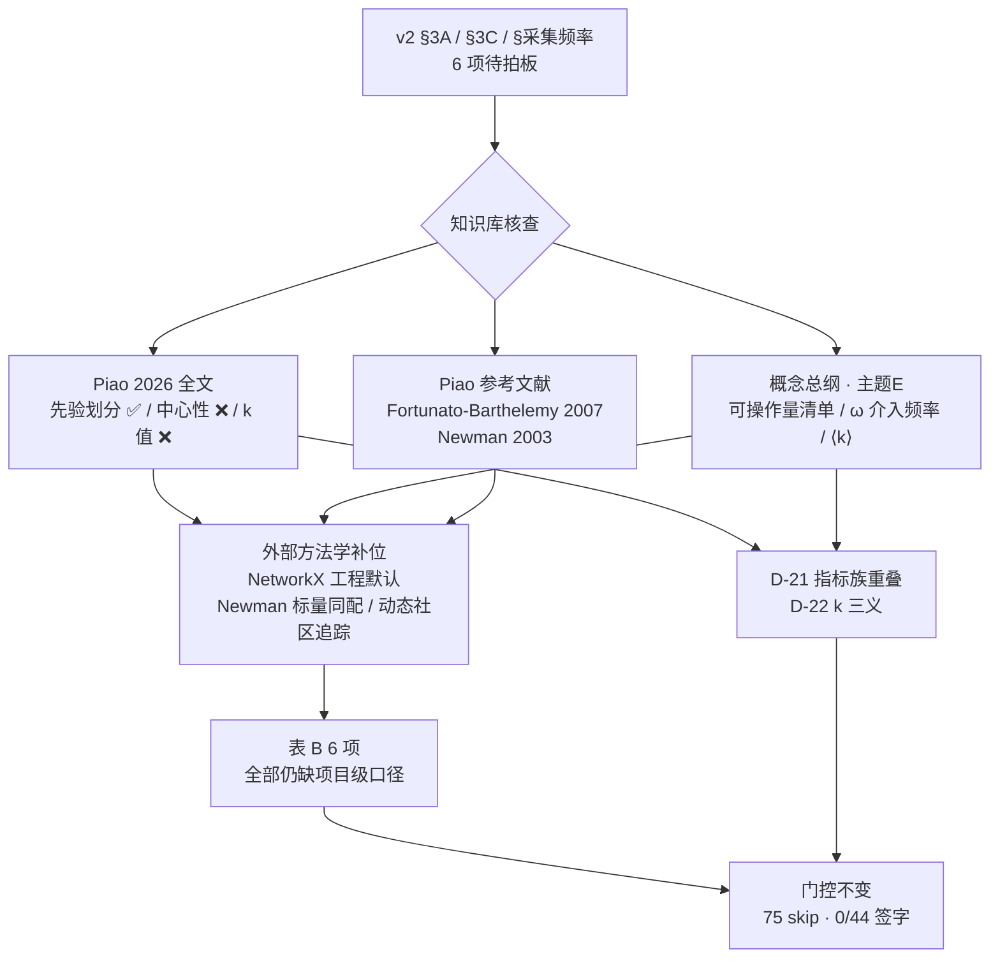

# S0-D3 证据核对稿（网络结构与社区口径）

**状态**：S0-D3 证据核对完成 · **待研究者逐条拍板** · 非定义锁定稿
**日期**：2026-11-08
**上游**：《实验指标体系 v2》§3A / §3B / §3C / §采集频率 / §两条写进 methods 的必要声明；`experiment-specification-v1.md` §2.5（3A 八项）、§2.7（3C 中心性四项）、§14（Q-12~Q-19、Q-37）；`review-checklist-v1.md` §2 D3
**衔接**：`s0-evidence-D1.md`（F-1~F-6 / D-1~D-9）→ `s0-evidence-D2.md`（F-7~F-11 / D-10~D-13）→ `validity-layer-v2.md`（F-12~F-21 / D-14~D-18；**§11 追加 F-22~F-23 / D-19~D-20**）→ **本稿（F-24~F-31 / D-21~D-25）**，编号跨四稿连续
**本轮范围**：重读知识库「ODIN-agents」Piao 2026 全文（定向检索社区划分、拓扑、中心性、采样）、概念总纲与主题E 证据缓存，并在知识库无先例处补做外部方法学 / 工程文档核查
**资料来源**：知识库条目名、外部期刊 / 预印本 / 工具文档（见 §2），沿用 `docs/README.md` 路径纪律，不写本机绝对路径

> **本文件的性质与硬边界**
> 1. 只做三件事：**登记证据、给出外部候选口径、按证据充分度分流 D3 六项**。
> 2. **不新增任何科学定义、不锁定任何阈值、不改写 v2 口径、不修改 `src/`、不解锁任何代码指标**。
> 3. 本稿出现的所有外部公式 / 默认参数均为**外部候选登记**（与 F-5 对 BC 公式、F-14 对 Taillandier 诊断指标的处理一致），不构成对 `mathematical_definition` 的填充。
> 4. 「资料里有」≠「规格已锁」；「工具库有默认值」≠「本项目采纳」。任何一条从候选变成 `metric_def_v1` 的定义，都必须经研究者书面签字。
> 5. **不改 75 个 `metric_id`、不改 43 条 TBD、不改 44 项决策记录栏（仍 0/44 全空）**。
> 6. `validity-layer-v2.md` §11 的投影路线评估（推荐 ① C 主 + 合成真值锚）**仍是候选，研究者未签字**；本稿不引用它作为任何 D3 结论的前提。

---

## 0. 一页结论

**D3 是 44 项里第一批「六项全部需要研究者给口径」的批次**：知识库主要文献对 3A/3C 的实现细节覆盖极薄，外部工程方法学反而相当完整，但**外部默认值不能自动充当本项目规格**。

| 项 | 本轮结论 |
|---|---|
| 分流 | **表 A 0 项 / 表 B 6 项**（Q-12 / Q-13 / Q-14 / Q-18 / Q-19 / Q-37）。Q-19 虽有三项外部默认值可核，但「互动图时间窗口」无任何先例，整体留表 B |
| 登记 | **F-24~F-31 八项事实**、**D-21~D-25 五条差异**，编号跨四稿连续 |
| 证据更正 | v2 §3A 引「Piao 2026 的有效做法」为**先验划分**，Piao 全文核实一致；但 Piao 全文**无 PageRank / betweenness / 阻尼因子 / 时间窗口 / 每 k 轮采样**，3C 四项中心性在项目主要文献中零先例 |
| 结构性发现 ① | v2 把「同配系数」与「邻居意见相关指数」并列为两个独立指标，但 Newman 2003 的**标量属性同配系数就是边两端属性的 Pearson 相关** → 两者可能是同一公式的不同属性版本（D-21），**提请裁定，不改字典** |
| 结构性发现 ② | 字母 `k` 在本项目有三义：v2「3A 每 k 轮采样」/ 主题E §8.5 `ω` 介入频率「每 k 轮」/ 概念总纲 §3.2 平均度 `⟨k⟩` → Q-37 的配置命名存在冲突（D-22，与 Q-31 符号冲突同族） |
| 最薄的一项 | **Q-18**（跨 tick 社区身份对齐）：v2 / Piao / 概念总纲全部无口径；外部动态社区「两阶段识别 + 节点重叠匹配」是候选，未采纳 |
| 门控 | **完全不变**：`metric_def_unset` / `definitions_locked=False` / `s0_completed=false` / 75 指标全 `skipped_metrics` / 43 条 TBD |

---

## 1. 资料清单与证据等级

沿用 `validity-layer-v2.md` §2 的 A/B/C/D 分级，**C 级不得作公式或阈值依据**。

| 级 | 本轮资料 | 用途 |
|---|---|---|
| **A** | `Piao2026_NetworksOfLLMAgents_arXiv2501.05171v2_fulltext.html`（知识库全文，定向检索）；Fortunato & Barthelemy 2007 *PNAS* 104(1):36–41（Piao 参考文献所引）；Newman 2003 *Phys Rev E* 67:026126（同上）；Newman & Girvan 2004 *Phys Rev E* 69:026113；Brandes 2001 / Freeman 1977；Page et al. 1999；NetworkX 3.7 官方文档（`average_shortest_path_length` / `pagerank` / `betweenness_centrality` / `numeric_assortativity_coefficient`） | 可登记**外部候选公式、协议、默认参数、异常处理口径** |
| **B** | `01_概念总纲`（§3.2 拓扑表 / §3.3 三个角色 / §8.2 术语表）、`06_主题E`（§8.5 干预变量 / §8.4 控制参数网格）、`05_主题D`、`07_重点人类实验专题` | 可登记**章节级出处与方法论约束**，涉及数值须回 A 级核 |
| **C** | 知识库问答笔记类（如《关于干预方法、介入策略、Agent 治理手段》） | **仅作线索**；F-18 已实证 C 级数据可与 A 级原文不符，不进候选栏 |
| **D** | v2 与项目自设口径（「每 k 轮采样」「构建有向图」「≥11 点」等） | 全部保持「建议值 · 需在规格中锁定」，不得升格为科学标准 |

> **本轮未核全文的外部条目**：动态社区追踪（arXiv:1903.07784 及 Palla 等 CPM 演化工作）只核到检索摘要级，按 Q-39 引用纪律标为**待重估**，仅作线索登记。

---

## 2. D3 六项证据卡

> 每张卡的「外部候选」栏都是**登记**，不是采纳；「仍缺」栏保持开放。分流结论见 §6。

### 2.1 Q-12｜社区划分口径 · 阻塞

| 层 | 资料能给的 | 出处 / 等级 | 仍缺 |
|---|---|---|---|
| v2 硬声明 | 「模块度与同配系数依赖社区划分口径。Piao 用的是**按左右阵营 + 中立按连接强度分配**的先验划分，与 Louvain 等算法输出**不可直接比较**；跨研究对比前必须对齐划分方式」 | v2 §两条写进 methods 的必要声明 1（D） | 「不可直接比较」已写死，但**并用时如何标注、对齐方式**未给 |
| Piao 原文核实 | *"non-neutral agents are naturally partitioned into left and right communities, while neutral agents are further assigned based on stronger connections to either group. By computing the modularity score according to this partition, we can assess the strength of division between opposing communities and how they are interconnected."* | Piao 2026 全文（A / F-24） | 原文**未给**中立节点「连接强度」的度量、阈值与并列时裁决规则 |
| 第三条候选 | 概念总纲 §3.2 把 **SBM 社区（块模型，块内/块间连边概率）**列为拓扑生成方式，可「直接控制同配性与回音室强度」 | 概念总纲（B / F-30） | SBM 是**生成式先验社区**，与算法发现社区、阵营先验社区是三种不同对象，未裁定是否并列 |
| 外部方法学 | Fortunato & Barthelemy 2007「Resolution limit in community detection」在 **Piao 参考文献中已引**；Newman & Girvan 2004 给模块度定义；Blondel 2008（Louvain）为模块度优化启发式 | A（F-27） | 分辨率极限意味着算法划分的社区数随网络规模变化 → **与项目 N∈{100,300,1000,3000} 扫描直接相关**，但项目无对应处理口径 |

**边界**：v2 已把路线定位写死，但「允许并用 / 标注方式 / 跨研究对齐」仍是项目级决定；且 Q-04（D1）明确「群体划分来源待 D3-Q12 复核」，本项签字会回写 D1 结论。**分流：表 B**。

### 2.2 Q-13｜平均路径长度 · 高

| 项 | 外部候选 | 出处 / 等级 | 语义差 |
|---|---|---|---|
| v2 口径 | 「任意两节点的平均跳数」 | v2 §3A（D） | 未说不连通对、未说有向、未说是否最大连通分量 |
| Piao 先例 | WS 小世界 `p=0.001` 初始化，报 **normalized** clustering coefficient `0.99` 与 **normalized average path length `0.71`**；全文仅此一处路径长度 | Piao 全文 / 概念总纲 §3.2（A+B / F-26） | **归一化值与绝对平均跳数不可比**（D-23）；且只在初始化阶段，非逐 tick 时序 |
| 工程默认 | NetworkX 3.7 `average_shortest_path_length(G, weight=None, method=None)`：公式对全部有序对 `d(s,t)` 求平均；**`NetworkXError` if G is not connected**；3.0 起**有向图非强连通也抛异常**；官方示例的替代做法是**对每个连通分量分别计算**；`weight` 支持 | NetworkX 官方文档（A / F-29） | 「按分量分别算」与「只在最大连通分量算」是**两个不同量**，官方只给前者 |
| 替代族 | 全局效率（harmonic mean of shortest paths）可在不连通图上定义 | 外部方法学线索（A，未核全文） | 与 v2「平均跳数」不是同一统计量 |

**仍缺**：不连通对是「忽略 / 记 ∞ / 判 incomplete」三选一；是否只在最大连通分量；有向最短路口径（强连通 vs 弱连通）；是否照 Piao 报归一化值；`weight` 用哪条边属性。**分流：表 B**。

### 2.3 Q-14｜邻居意见相关 · 高

| 项 | 资料能给的 | 出处 / 等级 | 仍缺 |
|---|---|---|---|
| v2 口径 | 「相邻节点意见的相关性」→ 用途「局部趋同」；**无公式** | v2 §3A（D） | 系数类型、加权、零模型、多维 `d≥2` 时的处理 |
| 项目内清单 | 概念总纲 §3.2 把「邻居意见相关指数」列为**可操作量清单中的一项**，只列名，无定义；§8.2 只给「同配系数＝度相近/属性相近节点相连的程度」的文字解释 | 概念总纲（B / F-30） | 无计算口径 |
| 外部候选 | Newman 2003 的**标量属性同配系数**：边两端数值属性的 Pearson 相关系数；NetworkX `numeric_assortativity_coefficient` 实现其 Eq.(21)，并明确 *"the Pearson correlation coefficient of the specified (scalar valued) attribute across edges"* | Newman 2003 / NetworkX 文档（A / F-28） | 该系数与 v2 已单列的「同配系数」**可能重复**（D-21）；且 Pearson 只适用标量，`opinion_true[D]` 为向量 |
| 零模型 | 概念总纲 §3.3 引 Santos 2021：仅按结构相似性推荐连边即可制造「无意回音室」，说明**观察到的意见相关不等于意见驱动的同配** | 概念总纲（B） | 是否必须配零模型对照、用哪个零模型（与 Q-10 / D-17 联裁） |

**边界**：若直接把 Newman 标量同配搬进 `3A-neighbor-opinion-corr`，需先裁定它与 `3A-assortativity` 的分工，以及 `d≥2` 时是逐维算还是用范数聚合（与 Q-42 联动）。**分流：表 B**。

### 2.4 Q-18｜受众结构与 3A 社区划分跨 tick 对齐 · 中

| 项 | 资料能给的 | 出处 / 等级 | 仍缺 |
|---|---|---|---|
| v2 口径 | 「受众结构＝扩散覆盖的社区构成（单社区内 vs 跨社区）」，与 3A 联用；**无跨 tick 对齐规则** | v2 §3B（D） | 社区身份是否跨 tick 稳定、标签如何继承 |
| 结构事实 | Piao 全文：网络**自组织演化**（初始 WS → 入度幂律尾、top20 平均入度 9.38 ≈ 均值 2.35 倍），且动态改变网络（随机 / 静态网络替换是干预条件） | Piao 全文（A / F-25） | 静态社区标签会在演化中失效，**但项目无重算 / 对齐协议** |
| 外部候选 | 动态社区追踪的两阶段法（每个时间戳独立识别 → 基于相似度度量配对追踪）；相对节点重叠匹配（公共节点数 / 两社区总节点数）；平滑性假设下的增量式识别 | 外部检索摘要级（**引用等级待 Q-39 重估**，见 §1） | 全是候选，**未采纳**；且项目未定「社区数是否固定」 |
| 工程约束 | 3D 暴露是**每轮全量且事后无法重建**；3A 是**每 k 轮采样** | v2 §采集频率（D / D-25） | 若 `k>1`，3A 快照与 3D 每轮数据的时间对齐口径未定 |

**分流：表 B**（六项里证据最薄的一项）。

### 2.5 Q-19｜中心性四项参数 · 高

| 参数 | 外部工程默认 | 出处 / 等级 | 仍缺 |
|---|---|---|---|
| PageRank 阻尼 | `alpha=0.85`（默认），`weight='weight'`，`max_iter=100`，`tol=1e-06`；dangling 节点按 personalization 向量分配出边；无向图会转成双向有向图 | NetworkX 3.7 `pagerank`（A / F-29）；原始出处 Page et al. 1999 | 是否锁定 `0.85`，还是按本项目扫描；`dangling` 策略 |
| 介数归一化 | `normalized=True`；有向图除以 `(n−1)(n−2)`、无向图除以 `(n−1)(n−2)/2`（`endpoints=False`）；`weight` 解释为**距离**且必须 > 0；可用 `k` 抽样近似（`seed` 控制） | NetworkX 3.7 `betweenness_centrality`（A / F-29）；Brandes 2001 / Freeman 1977 | 归一化分子方向、加权语义、是否用近似 `k` |
| 加权方案 | NetworkX 三函数均支持 `weight` 边属性，但**没有指定本项目该用哪条边属性**（曝光次数 / 互动次数 / 影响强度？） | NetworkX 文档（A） | 与三网络分离（潜在 / 曝光 / 影响）中哪张图、哪条权重对应 |
| 互动图时间窗口 | **Piao 全文无 PageRank / betweenness / 阻尼 / 时间窗口任何命中**；知识库其他条目亦无 | Piao 全文（A / F-25） | **完全无先例**：累积图 / 滑动窗口 / 逐 tick 快照，窗口长度与衰减均未定 |

**边界**：v2 §3C 明确「构建**有向图**，边代表互动（评论、点赞、转发）」，而 3A 的 APL / 模块度 / 同配在外部口径下多按无向图定义 → 同一份 `NetworkSnapshot` 若同时服务 3A 与 3C，需显式分图（D-24）。**分流：表 B**（时间窗口无先例，不能整项进表 A）。

### 2.6 Q-37｜3A 采样间隔 `k` · 高

| 项 | 资料能给的 | 出处 / 等级 | 仍缺 |
|---|---|---|---|
| v2 口径 | 「3A：每 k 轮采样」，**k 值未给** | v2 §采集频率（D） | k 的数值、是否随 N / 扫描点变化 |
| 主题E | §8.5 干预变量 `ω` = 介入频率「**每 k 轮**」；§8.4 控制参数网格 N∈{100,300,1000,3000}、每点 ≥10 种子 | 主题E（B / F-31） | 与 3A 的 k **同名异义**（D-22） |
| 概念总纲 | §3.2 拓扑表用 `⟨k⟩` 表示**平均度** | 概念总纲（B / F-31） | 第三个 k |
| Piao | self-expression 阶段 *"performed at every timestep"*；**无「每 k 轮」抽样口径** | Piao 全文（A / F-25） | 项目内主要文献无先例 |
| 工程侧 | 3B 事件驱动 / 3C 每轮全量 / 3D 每轮全量；三者与 3A 的 k 构成四种频率 | v2 §采集频率（D） | k>1 时 3A 与 3D 的时间对齐（与 Q-18 联动，D-25） |

**边界**：这是**纯项目级决定**，资料只能给「别用同一个字母」的工程提醒，不能给数值。配置项建议命名隔离（如 `sampling_interval_k` / `intervention_frequency_omega` / `mean_degree`），属工程候选，须另行授权才改配置。**分流：表 B**。

---

## 3. 本轮新增事实（F-24~F-31）

### F-24｜Piao 2026 的社区划分是先验划分，不是算法输出
- 原文（Results / SI 3.3 附近）：*"In our case, non-neutral agents are naturally partitioned into left and right communities, while neutral agents are further assigned based on stronger connections to either group. By computing the modularity score according to this partition, we can assess the strength of division between opposing communities and how they are interconnected."*
- → v2 §3A「Piao 2026 的有效做法」与 §methods 声明 1 的转写**与原文一致**，可标为 A 级已核。
- 但原文**未给**「中立节点连接强度」的度量、阈值、并列裁决规则；v2 亦未补。

### F-25｜Piao 全文无中心性四参数、无每 k 轮采样，且网络自组织演化
- 定向检索 PageRank / betweenness / damping / centrality / time window / every k round：**除 in-degree 分布外零命中**；`average path` 仅 1 处（初始化归一化值）。
- 有 WS `p=0.001` 初始化、自组织后入度幂律尾、top20 平均入度 `9.38`（≈均值 `2.35` 倍）、随机/静态网络替换作干预。
- → 3C 四项中心性（PageRank / 介数 / 入度 / 出度）在**项目主要文献中无可抄参数**；3A「每 k 轮」亦无先例。Piao 的 self-expression 是 **per timestep**。
- → 网络是时变的，静态社区标签会失效（Q-18 的直接依据）。

### F-26｜Piao 只报「归一化」平均路径长度 0.71
- 原文：WS 初始化 *"exhibits a relatively weak small-world property, characterized by a normalized clustering coefficient of 0.99 and a normalized average path length of 0.71"*；概念总纲 §3.2 转写一致。
- → 与 v2 §3A「任意两节点的平均跳数」（绝对量）**不是同一口径**（D-23），不可直接当本项目基线；且该值只在初始化阶段，非逐 tick 时序。

### F-27｜Piao 参考文献内含 Q-12 / Q-14 的 A 级理论锚
- 全文参考文献可核：**Fortunato & Barthelemy 2007**, *Resolution limit in community detection*, PNAS 104(1):36–41；**Newman 2003**, *Mixing patterns in networks*, Phys Rev E 67:026126。
- → 知识库内并非「完全没有社区发现 / 同配方法学」，只是**正文未展开**。分辨率极限与本项目 N∈{100,300,1000,3000} 扫描直接相关（社区数可能随 N 变），须研究者裁定是否纳入 Q-12。

### F-28｜Newman 2003 标量属性同配系数 = 边两端属性的 Pearson 相关
- NetworkX `numeric_assortativity_coefficient` 文档明确：*"This computes Eq. (21) in Ref. [Newman 2003], which is the Pearson correlation coefficient of the specified (scalar valued) attribute across edges."*；MathWorld / 相关文献给出 `r = [tr(e) − ‖e²‖] / [1 − ‖e²‖]` 的类别版本与标量版本。
- → 与 v2 §3A「邻居意见相关指数（相邻节点意见的相关性）」在数学上同族；**与 v2 单列的「同配系数」可能重复**（D-21）。
- 限制：Pearson 只适用标量；`opinion_true[D]` 为向量（Q-42 未锁），多维时须先裁定逐维 / 范数 / 投影。

### F-29｜NetworkX 3.7 给 Q-13 / Q-19 完整外部工程默认（均非本项目决定）
| 函数 | 可核默认 / 行为 |
|---|---|
| `average_shortest_path_length` | 对全部有序对 `d(s,t)` 平均；`NetworkXError` if not connected；3.0 起有向图非强连通亦抛错；官方示例按 `connected_components` **分别**计算；`weight` 支持 |
| `pagerank` | `alpha=0.85`，`weight='weight'`，`max_iter=100`，`tol=1e-06`，`dangling` 按 personalization 处理；无向图转双向有向图 |
| `betweenness_centrality` | `normalized=True`，`weight=None`，`k=None`，`endpoints=False`；有向除以 `(n−1)(n−2)`、无向除以 `(n−1)(n−2)/2`；`weight` 解释为距离且须 > 0；`k` 抽样近似 |
- → 三项都是**工程实现默认**，不是科学阈值；本稿只登记，不写进任何 `mathematical_definition`。

### F-30｜概念总纲给第三条社区路线，但「邻居意见相关」只在清单里
- §3.2 拓扑表列 ER / WS / BA / **SBM 社区（块模型）** / 真实平台图；SBM「直接控制同配性与回音室强度」。
- §3.2 末尾「可操作量：度分布、模块度 Q、同配系数、平均路径长度、社区数、跨社区边比例、**邻居意见相关指数**」——**只列名，无定义**；§8.2 术语表对同配系数也只有文字解释。
- → Q-12 实际有**三条**不等价社区来源（阵营先验 / 算法发现 / 生成式先验），v2 只写了前两条；Q-14 在项目内无计算口径。

### F-31｜字母 `k` 在本项目至少三义（Q-37 的配置命名风险）
| 出处 | 写法 | 含义 |
|---|---|---|
| v2 §采集频率 / Q-37 | 「3A：**每 k 轮**采样」 | 结构组采样间隔 |
| 主题E §8.5 干预变量 | `ω` = 介入频率「**每 k 轮**」 | 治理干预频率 |
| 概念总纲 §3.2 拓扑表 | `⟨k⟩` | 平均度 |
- → 三者同名异义，与工作记忆已登记的 **Q-31 符号冲突**（τ / κ / α / D / d / ρ / BC）同族；若配置里都写成 `k`，会静默串值。属**工程命名候选**，须另行授权才改配置。

---

## 4. 与 v2 / 项目资料的差异登记（D-21~D-25，需研究者裁定）

| # | v2 / 既有写法 | 资料实际 | 类型 | 建议处置 |
|---|---|---|---|---|
| D-21 | §3A 把「同配系数」与「邻居意见相关指数」并列为两个独立指标（主规范对应 `3A-assortativity` 与 `3A-neighbor-opinion-corr` 两个 `metric_id`） | Newman 2003 标量同配系数就是**边两端数值属性的 Pearson 相关**，与「相邻节点意见的相关性」在数学上同族（F-28） | **指标族重叠** | 裁定二者是「同一公式不同属性」「一个按度一个按意见」还是「其中一个注销」；**本稿不改 75 个 `metric_id`** |
| D-22 | v2「3A：每 k 轮采样」 | 主题E §8.5 `ω`「每 k 轮」、概念总纲 §3.2 `⟨k⟩` 平均度，三处同名异义（F-31） | **配置符号冲突** | Q-37 一并裁定命名隔离；与 Q-31 联裁 |
| D-23 | §3A「平均路径长度＝任意两节点的平均跳数」 | Piao 报的是**归一化** `0.71`（初始化阶段）；NetworkX 对不连通图直接抛 `NetworkXError`（F-26 / F-29） | **量纲与异常处理缺失** | 裁定绝对 vs 归一化、不连通对处理、有向口径；不得把 `0.71` 当本项目基线 |
| D-24 | §3C 明确「构建**有向图**，边代表互动」；§3A 的 APL / 模块度 / 同配未声明图方向 | 外部方法学对有向 / 无向的归一化与连通性要求不同（F-29）；三网络分离已有潜在 / 曝光 / 影响三类，但**没有 3A vs 3C 的图口径分离** | **同一快照服务两套口径** | 裁定 3A 用无向投影还是同一有向图；若分图，须写明两份 `NetworkSnapshot` 的派生关系与落盘方式 |
| D-25 | v2 无「跨 tick 社区身份对齐」规则；3A 每 k 轮、3D 每轮全量 | 外部动态社区用「两阶段识别 + 节点重叠匹配」，项目内全无先例；Piao 网络自组织演化使静态标签失效（F-25） | **时间维度口径缺口** | 与 Q-18 / Q-37 联裁：社区标签是否重算、如何继承、`k>1` 时 3A 与 3D 的时间对齐 |

> **纪律**：以上 5 条全部是「提请裁定」，**不是**对 v2 的修订。v2 是本任务唯一研究依据，工程侧无权改写。

---

## 5. 证据分流建议（表 A 0 项 / 表 B 6 项）

### 表 A｜可即时签字（**0 项**）

**本批没有即时签字项。** D1 表 A 2 项、D2 表 A 1 项，到 D3 归零，原因是结构性的：3A/3C 的**公式与参数在知识库主要文献里几乎不出现**，能补位的全是外部工程默认或方法学候选，而「工具库默认值」按 D-4 纪律**不等于**项目规格。Q-19 最接近表 A（阻尼 `0.85`、归一化 `True`、`weight` 默认三项可核），但「互动图时间窗口」在 Piao 全文与知识库其他条目**零命中**，整项无法一次签完，故整体留表 B。

> 这不是「证据不足到无法推进」，而是「**证据齐了，但每一条都需要研究者做一个项目级选择**」。

### 表 B｜仍需研究者给口径（6 项，1 阻塞 + 4 高 + 1 中）

| Q | 级别 | 已有候选（不采纳） | 必须拍板 | 解锁 |
|---|---|---|---|---|
| Q-12 | 阻塞 | 阵营先验划分（Piao / v2）、Louvain 等算法划分、SBM 生成式先验、分辨率极限（Fortunato-Barthelemy 2007） | 是否允许并用 / 标注规则 / 跨研究对齐方式 / 中立节点「连接强度」度量 / 与 N 扫描的联动 | 3A 全组、`3B-audience-structure`、D1-Q04 群体划分 |
| Q-13 | 高 | NetworkX 按连通分量分别算、Piao 归一化 `0.71`、全局效率族 | 不连通对处理（忽略 / ∞ / incomplete）/ 最大连通分量与否 / 有向强连通口径 / 绝对 vs 归一化 / `weight` | `3A-APL` |
| Q-14 | 高 | Newman 2003 标量同配 Pearson、Santos 2021 无意回音室零模型线索 | 系数类型 / 是否加权 / 零模型 / `d≥2` 逐维还是范数 / **与 `3A-assortativity` 的分工（D-21）** | `3A-neighbor-opinion-corr` |
| Q-18 | 中 | 两阶段识别 + 节点重叠匹配、平滑性增量识别（**引用等级待 Q-39 重估**） | 社区标签是否跨 tick 重算 / 身份继承 / 社区数是否固定 / 3A 与 3D 时间对齐 | `3B-audience-structure` |
| Q-19 | 高 | `alpha=0.85` / `normalized=True` / `weight` 默认（NetworkX 3.7） | 阻尼是否锁定 / 归一化方向 / **用哪条边权重、哪张图** / **互动图时间窗口（完全无先例）** | 3C 四项中心性 |
| Q-37 | 高 | 主题E `ω`「每 k 轮」、Piao per-timestep（均非 3A 采样口径） | `k` 的数值 / 是否随 N 变 / **与 `ω`、`⟨k⟩` 的命名隔离（D-22）** / k>1 时与 3D 对齐 | 3A 全组 `collection_frequency` |

> **跨批依赖**：Q-12 ↔ D1-Q04（群体划分）、D1-Q42（意见域）；Q-14 ↔ Q-42（向量 vs 标量）、Q-10（零模型）；Q-18 ↔ Q-37、Q-19（时间窗口）；D-22 ↔ Q-31（符号命名空间）；D-25 ↔ D7-Q36（相变工具口径）。
> **门控提醒**：D3 单独签字不解锁任何指标；`metric_def_v1` 需 D1~D7 全部完成才锁。

---

## 6. 与既有文档的关系

| 文档 | 本轮动作 |
|---|---|
| `review-checklist-v1.md` | 头部状态与配套文档补入本稿 / `validity-layer-v2.md` §11；§0 使用方式补 D3 说明；**§2 D3 段改为「表 A 0 项 / 表 B 6 项」两栏**，逐项补证据出处；**44 行决策记录栏保持全空** |
| `validity-layer-v2.md` | **追加 §11**：F-22 / F-23（不人工标注约束 + 合成真值锚）、D-19 / D-20、投影路线 ①②③ 对比与推荐、P-1 候选面收窄。**仍为候选，研究者未签字** |
| `s0-evidence-D1.md` / `s0-evidence-D2.md` | **不回改历史结论正文**；本稿只在 §0 / §5 引用其编号体系 |
| `experiment-specification-v1.md` | **本轮零改动**；75 `metric_id` / 43 TBD 不变 |
| `src/` | **本轮零改动**；F-23 与 D-22 引用的都是既有代码 / 配置事实 |
| `s1-s5-implementation-report.md` | 不修订；工程状态与 S0 证据推进相互独立 |

---

## 7. 门控与状态（防止误读）

| 项 | 状态 |
|---|---|
| 44 项决策记录栏 | **0/44，仍全空**；本稿不代填 |
| 阻塞级 | **27 项**，无变化 |
| D3 分流 | 表 A **0 项** / 表 B **6 项**（原 D3 为单表 6 行，本次只改组织与证据出处，不增删 Q） |
| S0 验收 | `s0_completed=false`；43 条 TBD 数学定义未补写、阈值未锁定 |
| `metric_def_version` | `metric_def_unset` → `definitions_locked = False` |
| 75 个指标 | 全部 `skipped_metrics`，只输出 observables |
| 新增公式 / 阈值 | **0 条被采纳**；§2 / §3 全部为外部候选登记 |
| 投影路线（§11） | **未签字**；`走 ①` 只是方向性给定，不是 P-1 / Q-08 的书面结论 |
| F / D 编号 | F-1~F-31、D-1~D-25 跨四稿连续，无重号 |
| 引用等级 | 动态社区追踪类条目仅核到摘要级，**待 Q-39 重估**；C 级笔记不进候选栏 |

> **S0 门控是全有全无**：D1 / D2 / D3 或 `validity-layer-v2.md` §11 的任何单项签认都不会解锁代码指标。

---

## 8. 下一步

1. 研究者按 `review-checklist-v1.md` §2 D1 → D2 → **D3** 顺序逐行填写「决策记录」列；D3 六项全部需给口径，格式见该文档 §3。
2. **优先级建议**：先签 D2 表 A 的 Q-11（44 项里目前唯一可即时签字项），再裁 D3 的 **D-21（指标族重叠）与 D-22（k 三义）**——这两条是跨 Q 的结构性问题，会回写多个配置项。
3. `validity-layer-v2.md` §11 的 P-1 候选面（A 因 F-22 出局、C 主 + B 诊断 + 合成真值锚）**仍待书面签字**；签字前 Q-08 的 ICC 型号无从落地。
4. 本稿完成后按 `继续 D4` 推进平台行为与扩散（7 项，4 阻塞：Q-15 / Q-16 / Q-17 / Q-22 等）；D1~D7 全部完成 → 锁 `metric_def_v1` → 才进入指标解锁。
5. Q-39 引用等级重估时，把动态社区追踪条目与 F-27 的 A 级理论锚一并处理。

---

**本文件结束。未经研究者书面签字，不构成任何科学定义、阈值或技术路线的确认。**
