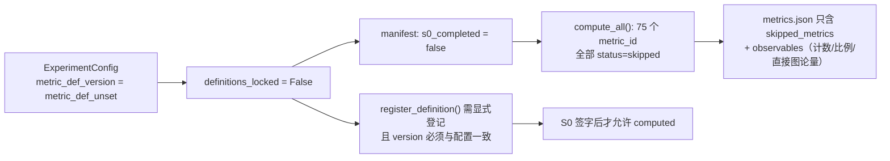

# S1–S5 实现报告（Research Extension · Implementation Report）

**状态**：工程链路已落盘并**全量测试收口**；**S0 定义对齐仍未完成**，75 个指标继续全部 `skipped_metrics`
**日期**：2026-11-08
**授权来源**：研究者于对话中明确「s1-5 按顺序全部完成吧 我给你授权」——解除「禁止改 `src/`」，**但 S0 未授权、科学定义不得由工程侧代填**
**范围**：`src/odin_sim/research/` 独立扩展包 + `storage/manifest.py` 可选字段 + 5 个新增测试文件；**不含**核心 `model/` / `analysis/` / `experiments/` 的重构
**关联文档**：`experiment-specification-v1.md`、`review-checklist-v1.md`、`s0-evidence-D1.md`、`s0-evidence-D2.md`

> **本报告只陈述工程事实与验证结果，不产出任何 v2 指标数值、不锁定任何定义或阈值。**

---

## 0. 一页结论

| 项 | 结果 |
|---|---|
| 架构 | **独立扩展包 + 并存式挂接**，核心层几乎不动；`RunSpec.to_dict()` 与 `run_id` 内容寻址保持不变 |
| 代码量 | 新增 14 个模块 ≈ **3227 行**、5 个测试文件 ≈ **738 行**；`manifest.py` 仅 **+7 行**（默认关闭的可选参数） |
| 全量测试 | **`pytest -q`：277 tests / 0 failures / 0 errors / 24 skipped / 44.1 s**（JUnit 报告实测） |
| 本轮修复 | 收口时发现并修复 **2 个真实工程缺陷**（主实验轨丢失、配置回显缺输入溯源），见 §5 |
| 冒烟 | 4 条运行 / 704 条事件 / 300 条 `skipped_metrics` / 三条分离零违规 / 事件重放哈希逐字符一致 |
| 门控 | `metric_def_unset` → `definitions_locked=False` → manifest `s0_completed=false` → **75 指标全 skip**，只输出可观测量 |
| 未解锁 | 43 条 TBD 数学定义、44 项决策记录栏（**0/44 书面签字**）、任何达标线 |
| 环境噪声 | pytest 退出时临时目录清理被本机安全策略拦截，产生 atexit 告警；**不影响测试结果**（JUnit 0 failures / 0 errors） |

---

## 1. 架构决策：为什么是「独立包 + 并存挂接」

| 约束 | 做法 |
|---|---|
| `RunSpec.to_dict()` 决定 `run_id`；任何顶层键变动都会破坏既有 G3 指纹回归 | 研究层维度放 `ExperimentConfig`（研究扩展包内），**不注入**核心 `RunRequest` / `SweepSpec` |
| `DynamicsModel` 为整段轨迹型 `run(request)->RunOutput`，`stepwise=False` | 新增并存式 `stepwise` 执行路径，**不替换**整段轨迹模型；内核不可用时不伪造事件（测试 `test_trajectory_model_does_not_fabricate_events` 覆盖） |
| manifest 既要自描述研究实验，又不能改既有 payload | `write_manifest(..., research=None)`：**缺省 `None` 时完全不写入该键**，既有 manifest 逐字节不变；只有研究实验显式传入才附加 |
| Q-31 符号同名异义（v2 `τ/κ/α` vs G3 `tau/kappa/alpha`） | 研究配置使用 `gov_*` / `rec_*` / `ctrl_*` 前缀隔离，不覆盖核心符号 |
| 分层纪律（核心层零反向依赖） | `research/` 单向依赖核心层；`api/` 不 import `ui/`；核心层不 import `research/` |

---

## 2. 交付文件清单

### 2.1 新增模块（`src/odin_sim/research/`）

| 行数 | 文件 | 职责 |
|---:|---|---|
| 53 | `__init__.py` | 扩展包导出与边界说明 |
| 359 | `config.py` | `ExperimentConfig`、`DefinitionVersion`、指纹、前缀隔离、`population_sizes` 扫描轴 |
| 320 | `records.py` | 9 类数据对象 + 三条分离校验 |
| 347 | `events.py` | 12 类强类型事件与 `EventDraft` |
| 130 | `recorder.py` | 事件落盘 / 回放哈希 |
| 340 | `networks.py` | 潜在 / 曝光 / 影响 / 互动四张图与基础图论量 |
| 145 | `stepwise.py` | 并存式逐步执行路径 |
| 371 | `synthetic.py` | 纯 numpy 端到端合成模型（**仅验证载体，不含研究结论**） |
| 92 | `metrics/definitions.py` | 由主规范**脚本化提取**的 75 个 `metric_id` 与 TBD 状态（**勿手改**） |
| 143 | `metrics/compute.py` | 只产 `observables`，不冠 v2 指标名、不做达标判定 |
| 225 | `metrics/__init__.py` | `DefinitionRegistry` / `MetricInput` / `MetricOutcome` / `compute_all` / 门控逻辑 |
| 173 | `stats.py` | 统计检验（Mann-Whitney U、FDR、Cohen's d、BF01 等） |
| 149 | `governance.py` | 双对照组、多底座、正反扫描、N 序列、确定性 `run_key` |
| 380 | `pipeline.py` | 端到端实验 pipeline 与 manifest 自描述 |

### 2.2 新增测试（`tests/unit/`）

| 行数 | 文件 |
|---:|---|
| 143 | `test_research_config.py` |
| 153 | `test_research_events.py` |
| 173 | `test_research_networks_metrics.py` |
| 156 | `test_research_pipeline.py` |
| 113 | `test_research_stats_governance.py` |

### 2.3 既有文件改动

| 文件 | 改动 |
|---|---|
| `src/odin_sim/storage/manifest.py` | **+7 行**：新增 `research: Mapping \| None = None` 可选参数；仅非 `None` 时才写入 payload |

> 未新增任何依赖；`pyproject.toml` / `uv.lock` 未改动；未改动 `web/`、`configs/`、`results/`。

---

## 3. 门控链路（S0 未完成时的硬规则）

- `DefinitionRegistry` **默认空**；示例定义（`M0-D`、`P-ctrl-epsilon`，`example-v0`）只在测试显式 `load_examples=True` 时加载，**不进入默认注册表**。
- 被 skip 时 `MetricOutcome.value` 必须为 `None`；阈值未锁定时不产生 `pass/fail` 布尔字段。
- `metrics/definitions.py` 从主规范脚本化生成，`TBD_METRIC_IDS` 与 43 条 TBD 保持一致。

---

## 4. 验证结果

| 验证 | 命令 / 方式 | 结果 |
|---|---|---|
| 全量单元 / 回归测试 | `./.venv/Scripts/python.exe -m pytest -q` | **277 tests，0 failures，0 errors，24 skipped，44.1 s** |
| 测试统计来源 | `--junitxml` 报告解析 | `tests=277 errors=0 failures=0 skipped=24` |
| 端到端冒烟 | `run_research_experiment(cfg, out_root=..., echo=True)` + `verify_run_replay(rd)` | 4 运行 / 704 事件 / 300 skipped / 三条分离零违规 / 重放哈希一致 |
| G3 指纹回归 | `T-REPRO/1` 等既有回归（含在全量 277 内） | **通过**；`research=None` 时 manifest 逐字节不变 |
| 三条分离 | 真实观点 vs 投影观点、行为意图 vs 执行行为、三网络 | 零违规，且可从事件回放重建 |

> **关于 24 个 skipped**：为既有测试的条件跳过（内核/可选依赖不可用等），非本轮新增失败；新增 5 个 research 测试文件全部执行并通过。
> **关于环境噪声**：pytest 退出阶段清理历史 `--basetemp` 目录时，本机安全策略对批量删除抛出 `SAFE_DELETE_BULK_CONFIRM_REQUIRED`，atexit 回调出现 `SystemExit`。该告警发生在测试会话结束**之后**，JUnit 报告已完整写出且为 0 failures / 0 errors。使用独立 `--basetemp` 可规避。

---

## 5. 本轮收口时修复的 2 个工程缺陷

上一轮写完测试后全量 `pytest -q` 被中断，本轮首次收口暴露 2 个失败，均已修复并复验通过。

| # | 失败测试 | 根因 | 修法 | 文件 |
|---|---|---|---|---|
| 1 | `test_control_groups_and_hysteresis_pairs` | `expand_research_runs()` 直接用 `list(config.control_groups)`，当配置显式声明两个对照组时**未补 `main` 主轨**，导致主实验组不产出任何运行、正反扫描只配出 2 对（期望 3 对） | 改为调用 `expand_control_groups(config)`，与该函数「保留 main 主轨」的口径统一 | `src/odin_sim/research/governance.py` |
| 2 | `test_registered_definitions_produce_values_only_when_locked` | 示例定义 `P-ctrl-epsilon` 的 `required_inputs=()`，computed 结果的 `input_refs` 为空，违反 S4「每个指标须有 input_refs」的可追溯要求 | `MetricInput.has()` 支持内置键 `"config"`（恒可用），示例定义改 `required_inputs=("config",)`；配置回显类指标的输入即配置本身 | `src/odin_sim/research/metrics/__init__.py` |

> 两处均为**工程缺陷修复**，不涉及任何 v2 指标口径、公式或阈值，不改变门控状态；修复后全量测试 0 failures。

---

## 6. 工程状态与 S0 的关系（防止误读）

| 项 | 状态 |
|---|---|
| S0 书面签字 | **0 / 44**；D1 表 A=2 / 表 B=7，D2 表 A=1 / 表 B=3，决策记录栏全空 |
| `metric_def_version` | `metric_def_unset` |
| `definitions_locked` / `s0_completed` | `False` / `false` |
| 75 个指标 | 全部 `skipped_metrics`；43 条 `mathematical_definition` 仍 TBD |
| 达标线 | 全部保持「建议值 · 未锁定」 |
| BC 公式外部候选（F-5） | 已核查登记，**未采纳**、未写入 `M1-BC.mathematical_definition` |
| F-6 框架确认 | 研究者确认理解正确，**非口径签字** |
| D2 证据稿（F-7~F-11 / D-10~D-13） | 已落文档，Chuang `B/D` 公式等均只作外部候选 |
| 工程是否已「完成」 | **是（本授权范围内）**；但工程完成 ≠ 指标可用，S4 门控仍全有全无 |

> **评审包签署栏仍未回填口头授权**：`review-checklist-v1.md` §6 已补说明，指向本报告作为授权与工程状态的事实记录。

---

## 7. 未完成 / 明确边界

1. S0 未授权由工程侧代填：44 项决策记录仍待研究者逐条签字（格式见评审包 §3，6 项必填）。
2. D3–D7 尚未做 D1/D2 那样的逐项证据核对；D1 稿 §7 仅给清单级概览。
3. 未实现任何「按批解锁指标」机制；若研究者要按批解锁，需在 S4 门控增加按 `metric_id` 的定义版本表（纯工程改动，须另行授权）。
4. `synthetic.py` 是验证载体，其轨迹与数值**不构成研究结论**，不得写入论文或测试期望值。
5. 未产出任何 v2 指标数值、未跑任何真实 LLM 调用、未新增外部标注数据。

---

## 8. 下一步

1. 研究者按 `review-checklist-v1.md` 逐条签字；优先 D2 表 A 的 Q-11（唯一可即时签字项）。
2. 继续 `D3` 证据核对（网络结构与社区口径，Q-12 等 6 项）。
3. D1~D7 全部完成 → 锁 `metric_def_v1` → 才进入 `register_definition()` 与指标解锁。
4. 若需复现本报告的测试结论：使用项目虚拟环境执行 `./.venv/Scripts/python.exe -m pytest -q --basetemp=<独立临时目录>`。

---

**本文件结束。工程验证结论不构成任何科学定义的确认。**
