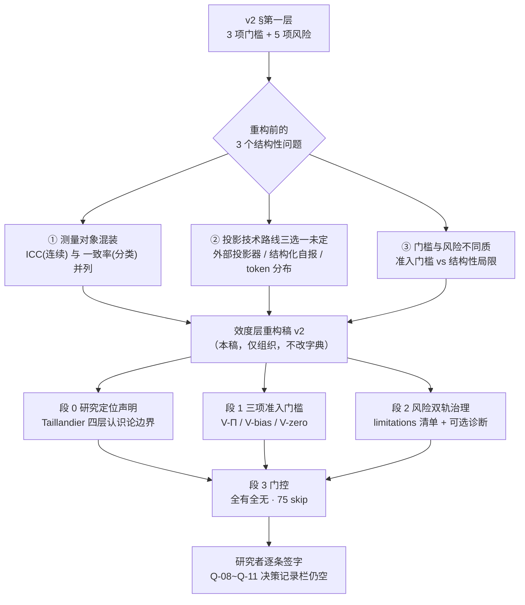

# 效度层重构稿 v2（Validity Layer Restructure · Draft）

**状态**：S0-D2 补充证据核对完成 · **结构重构草案** · **等待研究者拍板** · 非定义锁定稿
**日期**：2026-11-08
**上游**：《实验指标体系 v2》§第一层、§文献出处与引用纪律；`experiment-specification-v1.md` §2.4（L1 八项定义）、§14（Q-08~Q-11）；`review-checklist-v1.md` §2 D2
**衔接**：`s0-evidence-D1.md`（F-1~F-6 / D-1~D-9）→ `s0-evidence-D2.md`（F-7~F-11 / D-10~D-13）→ **本稿（F-12~F-21 / D-14~D-18）**，编号跨三稿连续
**本轮范围**：重读知识库「ODIN-agents」全部 80 条目录与效度相关全文，并在资料不足处做外部文献检索；据此**重构效度层的组织方式**
**资料来源**：知识库条目名（见 §2）、外部期刊 / 预印本（arXiv / DOI 见 §5），沿用 `docs/README.md` 路径纪律，不写本机绝对路径

> **本文件的性质与硬边界**
> 1. 只做三件事：**登记证据、给出可选方法学口径、重排效度层的组织结构**。
> 2. **不新增任何科学定义、不锁定任何阈值、不改写 v2 口径、不修改 `src/`、不解锁任何代码指标**。
> 3. 本稿出现的所有外部公式均为**外部候选登记**（与 D1 稿 F-5 对 BC 公式的处理一致），不构成对 `mathematical_definition` 的填充。
> 4. 「资料里有」≠「规格已锁」；「论文提了指标」≠「本项目采纳」。任何一条从候选变成 `metric_def_v1` 的定义，都必须经研究者书面签字。
> 5. **不改 75 个 `metric_id`、不改 43 条 TBD、不改 44 项决策记录栏（仍 0/44 全空）**。

---

## 0. 一页结论

**效度层的资料面不是「空」，而是「散且未分层」。** 本轮把 7 类资料按证据等级重排后，D2 的 4 项待拍板从「3 项连候选都没有」收敛为「**4 项都有外部方法学候选，但没有一项有项目级决定**」；同时发现 3 个必须在拍板前先解决的结构性问题，以及 D2 证据稿的 3 处结论需要更正。

| 项 | 本轮结论 |
|---|---|
| 重构动作 | 把 L1 从「8 个平铺指标」重排为 **段 0 研究定位声明 / 段 1 三项准入门槛 / 段 2 效度风险双轨治理 / 段 3 门控**；**指标字典本身不动** |
| 最关键的单个决策点 | **Q-08 之前必须先选投影技术路线**：v2 隐含「外部文本投影器 Π」，但资料里并存「结构化自报」（Piao 2026 明确不用外部分类器）与「token 分布期望 + 熵」（Brockers 2026）两条不等价路线，ICC 只对其中部分成立 |
| 最大的证据更正 | **Taillandier 2026 全文公开可得且已被期刊接收**：D2 的 F-9「无全文、二手」已过时；五项风险中四项为该文一手术语，第五项「模型版本漂移」在该文**无独立定义** |
| 最需要警惕的证据风险 | 知识库问答笔记《从一句人话变成意见坐标、观点分数》所记 Cheng 数据（49.0%/84.4%、κ=0.31/0.67/0.86、1200 条）**与原文不符**；原文只用 percent agreement 与 Cohen κ，全文无 ICC → 二手笔记不得作公式或阈值依据（F-18 / §2 C 级规则） |
| Q-08 变化 | 从「连 ICC 型号候选都没有」→「有 Shrout–Fleiss / Koo–Li 型号选择框架 + Cheng 标注协议 + κ/α 分族规则」，但**型号、次数、抽样、阈值锁定仍需研究者给** |
| Q-09 变化 | 从「只有协议原则」→「有 Brockers 2026 的完整偏置四分解方程与隔离询问操作化」，且明确与 Chuang 的终态 B/D **不等价**（沿用 F-7 判断） |
| Q-10 变化 | 从「只有配对设计」→「有 Taillandier 的 distribution-matched null model + TOST 等效性检验候选」；但**统计等效 ≠ 形状可比**，语义差需裁定（D-17） |
| Q-11 变化 | 从「资料倾向 limitations」→「原文同时给结构性局限定位与概念性诊断指标」，**不是二选一而是双轨**；论文明确这些指标是诊断提议、不是有效性证书 |
| 门控 | **完全不变**：`metric_def_unset` / `definitions_locked=False` / `s0_completed=false` / 75 指标全 `skipped_metrics` / 43 条 TBD |

---

## 1. 为什么必须重构：3 个结构性问题

### 1.1 测量对象混装

v2 §第一层 V-Π 的通过标准是「同一文本重复投影 `ICC ≥ 0.7`；人工标注子集一致率 `≥ 0.8`」。外部方法学把这两者分属两族（F-19）：

| 输出类型 | 适用统计量 | 典型先例 |
|---|---|---|
| 连续 / 有序数值评分 | ICC（Shrout–Fleiss 六形式 / Koo–Li 十形式） | 临床重测信度 |
| 离散类别标签 | percent agreement、Cohen κ、Krippendorff α | Cheng 2025 §7.1 §10.1（F-18） |
| 分布层匹配 | 分布距离 / 相关 / 等效性检验 | Argyle 2023 algorithmic fidelity、Taillandier TOST |

→ 「一致率」在 v2 中**未定义统计量**，把它与 ICC 并列成一条通过标准，会让 `V-Π` 的 `mathematical_definition` 无法写成单一式子。这不是资料缺失，是**口径结构缺失**。

### 1.2 投影技术路线三选一未定

v2 默认存在「文本 → 数字」的投影器 Π，但知识库内至少三条互不等价的路线并存（F-17）：

| 路线 | 代表 | 输出 | 重测信度的检验对象 | 是否需要人工标注 |
|---|---|---|---|---|
| A 外部投影器 | Chuang 2024（Flan-T5-XXL 五点分类器）、本课题方案 A/B/C | 离散/连续意见分 | 分类器对同一文本的重复输出 | 是（校准集） |
| B 结构化自报 | Piao 2026（JSON `tendency`，**明确不用外部分类器**） | 5 类 → `k∈{−2..2}` | Agent 自报的一致性、self-inconsistency | 否 |
| C token 分布 | Brockers 2026（期望值 `x(t)` + Shannon 熵 `H(t)`，正负框架双询问） | 连续值 + 不确定度 | 同一 prompt 的分布稳定性 | 否 |

→ 若选 B 或 C，「投影器 Π 重测信度」这个指标名本身就需要重新解释；**这个决定只能由研究者给**，工程侧不代选。

### 1.3 三项门槛与五项风险不同质

主规范 §2.4 把 8 个 `metric_id` 平铺在同一 `L1-validity` 层。但 Taillandier 2026 原文（F-12/F-13）的框架把风险定位为**结构性局限 + 多层验证对象**，而不是与准入门槛同族的通过/不通过指标；且第五项「模型版本漂移」在该文无独立定义。Bai / Hruschka / Brockers 的「效度链」项目解读文档（07 专题 §0、§4.3）也把微观—宏观落差描述为**证据层级的落差**，不是一个可算的标量。

→ 重构为「段 1 准入门槛」与「段 2 风险治理」两段，**只改组织、不改 8 个 `metric_id` 的字段**。

### 1.4 对 `s0-evidence-D2.md` 的更正清单

| D2 原结论 | 本轮更正 | 依据 |
|---|---|---|
| F-9：Taillandier 2026「无全文、二手（效度批判框架）」 | **已过时**：arXiv:2507.19364v4 全文公开，且 Frontiers in AI 2026-10-30 接收（DOI 10.3389/frai.2026.1988865）。知识库「无全文」状态与外部可得性不一致 | F-12 / D-18 |
| Q-08：「全部已核资料无 ICC 型号先例」「连候选都没有」 | **资料内仍无，但外部方法学有完整选型框架**；且知识库内已有一份未用的投影器专文与 Cheng 标注协议 | F-17 / F-18 / F-19 |
| Q-11：「签仅 limitations 正好对应验收路径」 | 仍成立，但**原文不是纯 limitations**：同时给出 PAS / DHI / FF_AUC 等概念性诊断提议，并明确「不是实证估计、不是有效性证书」。签「仅 limitations」依然合法，但需知道被放弃的是什么 | F-13 / F-14 / D-16 |

> 更正只以本稿 §5–§7 登记，**不回改 D2 稿的历史结论正文**，仅在 D2 稿追加 §9 指向本稿，保留证据演进轨迹。

---

## 2. 证据源分级（本轮新增方法）

| 级 | 定义 | 本轮实例 | 可作什么依据 |
|---|---|---|---|
| **A** | 期刊 / 会议正式全文或可核原文 | Taillandier 2026（arXiv v4 + Frontiers 已接收）、Brockers 2026（Nat Commun 17:10077）、Piao 2026（Nat Commun / arXiv 2501.05171v2）、Chuang 2024（NAACL Findings）、Bai 2025（Nat Commun 16:6037）、Cheng 2025（arXiv 2510.01395）、Koo & Li 2016 / Shrout & Fleiss 1979 | 可登记**外部候选公式、协议、统计量选型框架** |
| **B** | 知识库内标「已核原文」的项目解读文档 | `05_主题D`、`06_主题E`、`01_概念总纲`、`07_重点人类实验专题_三篇关键证据与设计含义`（§0 自称三篇均已核原文） | 可登记**章节级出处与方法论约束**，涉及具体数值时须回 A 级核 |
| **C** | 知识库问答 / 自动生成笔记 | 《从一句人话变成意见坐标、观点分数》、《关于干预方法、介入策略、Agent 治理手段》 | **仅作线索**。本轮已实证 C 级数据与 A 级原文不符（F-18），**不得据以写公式、阈值或引用数值** |
| **D** | v2 与项目自设口径 | 「`ICC ≥ 0.7`」「一致率 `≥ 0.8`」「`≥ 11 点`」「`ICC ≥ 0.9`」 | 全部保持「建议值 · 需在规格中锁定」，不得升格为科学标准 |

> **硬规则**：本稿所有数字（0.7 / 0.8 / 0.9 / κ=0.70 / 85% / 101 点等）都带出处与等级标注；**A 级数字也不等于本项目采纳**。C 级数据一律不进 §4 决策卡的候选栏。

---

## 3. 重构后的效度层结构

**约束**：下表只做「组织映射」，**不新增、不删除、不重命任何 `metric_id`，不改动主规范 §2.4 任一 yaml 字段**。

| 段 | 作用 | 对应对象 | 性质 |
|---|---|---|---|
| **段 0** 研究定位声明 | 先声明本课题落在哪一层研究用途，决定后续判据严格度 | 新增**非指标**声明位（不产生 `metric_id`） | Taillandier §1 四层边界（F-13）；对应 v2 §第一层失败对策「说明 LLM 节点带来额外机制，需单列」 |
| **段 1** 三项准入门槛 | 通过 / 不通过，不过则后续层不可信 | `V-Π`、`V-bias`、`V-zero` | v2 §第一层表；准入门槛 |
| **段 2** 效度风险双轨 | 轨 ① limitations 清单；轨 ② 可选概念性诊断 | `V-persona-convergence`、`V-micro-macro-gap`、`V-fluency-fallacy`、`V-physics-washing`、`V-model-drift` | Q-11 二选一（或双轨并存，见 §4.4） |
| **段 2 附** 复现性候选 | `V-repro` 在 v2 缺席、主题E §10.2 有第 4 项 | 关联 D-10 / D-11 / D7-Q41 | **仍为待裁定差异，不新增 `metric_id`** |
| **段 3** 门控 | 全有全无 | `metric_def_unset` → `definitions_locked=False` → `s0_completed=false` → 75 `skipped_metrics` | **不变** |

### 3.1 段 0 的四层认识论边界（外部候选，不代选）

| 层 | Taillandier §1 定位 | 对效度判据的含义 |
|---|---|---|
| ① 互动环境 / 严肃游戏 | High Operational Value | 叙事合理性优先，效度要求最低 |
| ② 探索式建模 | Conditionally Defensible | 需满足最低清单：种子间定性模式稳定性、prompt 改写不变性、跨模型可移植性、经验解耦 / 可证伪性 |
| ③ 解释 / 确认性研究 | Restricted to Theory-Driven Hybrids | 需多层经验证伪 + 相对 minimal non-generative heuristics 的可证解释增益 |
| ④ 精确定量点预测 | Methodologically Unsupported | 现方法学保证之外 |

> **本课题定位由研究者给**。工程侧观察：v2 §第一层要求「相图形状可比」、§第五层要求「相变四要素」，措辞更接近 ③ 而非 ②；但这只是**观察**，不是定位结论。

---

## 4. Q-08 ~ Q-11 决策卡（重构后）

> 每张卡的「外部候选」栏都是**登记**，不是采纳；「仍需拍板」栏保持开放。分流结论**不变**：Q-11 表 A（1 项）、Q-08/09/10 表 B（3 项）。

### 4.1 Q-08｜V-Π：技术路线 → 统计量 → 协议（三层选择）· 阻塞

**前置决策（新增）**：先选 §1.2 的 A / B / C 路线，再谈 ICC 型号。

| 层 | 外部候选 | 出处 / 等级 | 仍缺 |
|---|---|---|---|
| 技术路线 | A 外部投影器（本课题方案 A 锚点对比 / B 结构化 JSON / C 微调回归头；Chuang 用 Flan-T5-XXL 五点分类）；B 结构化自报（Piao JSON `tendency`）；C token 分布期望 + 熵（Brockers） | 主题D §5 Q4（B）/ Chuang 全文 §3（A）/ Piao Methods M1（A）/ Brockers §3（A + 07 专题 B） | **选哪条**、以及选 B/C 时 `V-Π` 指标名如何解释 |
| 统计量 | Shrout & Fleiss 1979 六形式 `ICC(1,1)…ICC(3,k)`；Koo & Li 2016 十形式 + 三问选型（是否同一批评分者 / 评分者是否随机样本 / 单次还是 k 次平均）；**分类标签改用 Cohen κ / Krippendorff α** | 外部统计学方法学（A） | **型号**、绝对一致 vs 一致性、单次 vs 平均、是否报 95% CI 下界 |
| 协议 | Cheng 2025 §7.1：2 名专家、每标签分层抽 100 条（50 标 0 + 50 标 1）、报 percent agreement 与 κ；§10.1：2 名标注者、800 对、四分类 → 主分析只用二分类，因细粒度不可靠。Chuang 附录 L：3 人 / 40 条、agreement rate（非 ICC） | Cheng 2025（A）/ Chuang 2024（A）/ D2 稿 F-7（B） | **重测次数、评分者数量、文本抽样量与分层、人工「一致率」的统计量定义** |
| 阈值语义 | Koo & Li 2016 阈值带 `<0.5 poor / 0.5–0.75 moderate / 0.75–0.9 good / >0.9 excellent` → v2 的 `0.7` 落 moderate 上沿、主题E 的 `0.9` 落 excellent 边界 | 外部统计学方法学（A） | `≥0.7` / `≥0.8` / `≥0.9` **是否锁定为规格值**，以及三者分别对应哪个对象（D2 稿 F-8） |
| 粒度 | Cheng 2025 §6.1.2：二分类可靠、四分类中 implicit/neutral 不可靠；Bai 2025 §1.3：101 点量表因「预期效应小，需更细分辨率」 | Cheng 2025（A）/ Bai 2025（A）/ D-12 | 与 D1-Q04 / D7-Q38 一并裁定量表精度 |

**边界**：投影器专文自承「投影器 Π 的信度几乎没有被报告过」（主题D §8，B 级）；C 级笔记的 κ 数值不得引用（F-18）。**分流：表 B**。

### 4.2 Q-09｜V-bias：隔离基线协议 + 偏置分解候选 · 阻塞

| 项 | 外部候选 | 出处 / 等级 | 仍缺 |
|---|---|---|---|
| 隔离协议 | 交互前单独询问；**正常框架 + 否定框架各问一次**；取响应 token 分布期望 `x(t)` 与 Shannon 熵 `H(t)`；**引出用的 prompt 不保留在上下文**，因而不污染后续动力学；噪声 `σ_i(t)=ε·H_i(t)+σ_0,k` | Brockers 2026（A，07 专题 §3.3/§3.4 B 级解读） | 本项目是否照搬双框架询问、无网络/无历史/单次是否足够 |
| 偏置分解 | `Δx_i = μ_interact + μ_bias + 噪声`，其中 `μ_bias` 拆 `β_topic`（话题 attractor）+ `β_agree`（附和，attractor 固定在 +2）+ `β_anchor`（只作用第二发言者），各项带 `e^{−t/τ}`；分层贝叶斯拟合 + 消融 | Brockers 2026 §3.4（A） | 是否把「偏置量」定义为某一 β 或组合；网络版邻居项需重定义（原文 dyadic N=2） |
| 零转移基线 | Piao 2026 Methods M2/M5：同意见两两配对、一轮交流后测意见转移矩阵，以**理想单位阵**为零转移基线，转移矩阵与单位阵距离 = `self-inconsistency rate` | Piao 2026（A） | 是否作为 `V-bias` 的第二判据（与 Brockers 路线并行还是二选一） |
| 注入因子 | Chuang 2024 `None / Weak / Strong` 三档确认偏误 + `true/false framing`；Piao 初始 near-Gaussian 5 档 | Chuang 2024 / Piao 2026（A）；主题D §3.2（B） | `bias_injection_config` 的因子水平 |
| 明确不可搬 | Chuang `B=mean(F_T)` / `D=std(F_T)` 是**终态分布量**，v2 的 `V-bias` 是**交互前基线偏离** | D2 稿 F-7 | — |

**边界**：「先验」的分布形式、「与先验一致」的检验 / 距离度量、偏置量公式在全部资料中**仍无项目级决定**；Piao 的 near-Gaussian 是他项目设定，不能自动当本项目先验。**分流：表 B**。

### 4.3 Q-10｜V-zero：「形状可比」→ 等效性检验候选 · 高

| 取向 | 外部候选 | 出处 / 等级 | 语义差 |
|---|---|---|---|
| 配对设计 | 相同参数网格 / 拓扑 / 种子下，规则节点与 LLM 节点成对运行；零模型侧已有纯 HK 相图基线 ε_c≈0.215–0.225 | 主题D §5 H-D1、主题E §10.1（B） | 项目自定义 |
| 等效性检验 | **distribution-matched null model 𝒩1**：保留同一宏观交互拓扑，把生成式 LLM 认知引擎换成「静态微观选择概率按 LLM 边际分布匹配」的非交互 Agent；宏观模式用 **TOST 双单侧检验**判统计等效，等效边界按**种子间方差**先验标定 | Taillandier 2026 §4.1（A） | 「统计等效」判的是**生成式交互是否有额外解释力**，与 v2 的「相图形状可比」不是同一命题（D-17） |
| 可证伪工具 | 概念总纲 §5.6 的 χ / Binder U / T_conv / 数据坍缩 / 迟滞；主题E §4.3 三种误判警示 | 概念总纲、主题E（B） | **未被任何资料指派给 `V-zero`**，且 χ 公式在可得文本中截断（D1 稿 §7，D7-Q36） |
| 明确缺口 | Piao 2026 全文**无**规则 ABM 零模型对照、**无**相图或相变比较；其对照是 identity matrix、随机/静态网络替换、干预 control/treatment | Piao 2026（A，F-20） | 项目文献内部确实无「形状可比」先例 |

**仍缺**：曲线相似度度量 / 极值点位置容差 / 相区边界一致性 / 临界点偏移容差、参数网格与种子配对规则、跨种子聚合方式、不可比阈值；以及**「等效」能否充当「形状可比」**这一语义裁定。**分流：表 B**。

### 4.4 Q-11｜五项风险：双轨治理 · 高

| # | v2 风险项 | Taillandier 原文定位 | 该文可计算诊断候选 | 论文自设限定 |
|---|---|---|---|---|
| 1 | 平均人格收敛 | 一手术语 `Average Persona Convergence`；含 Replicant Effect / Generative Exaggeration | `DHI(t)=1−Var(X_t)/Var(X_0)`、`PAS`、`τ_1/2(PAS)`、POM 多模式复现 | DHI 维度特定；PAS 只测 persona 保真、**不测与真人的对应** |
| 2 | 微观—宏观效度鸿沟 | 论文**核心框架**：LLM 层 → Agent 层 → 交互层 → 宏观层四层传播 | 层间部署 `PAS` / `DHI` / TOST；`α, λ, ρ(G), d_t` 放大—收缩区制 | 明说「structured diagnostic heuristic」；指标是**概念性诊断提议，非本文实证估计** |
| 3 | 流畅性谬误 | 一手术语 `Fluency Fallacy`，定义为**评估者辨别失败** | `FF_AUC = 1 − AUC(S_plausibility → V_causal)`；`AUC≈0.5` 等于随机、`<0.5` 系统性误导 | 另需三项结构防护（叙事痕迹消融 / 确定性账本 / 对抗反事实审计） |
| 4 | 物理洗白 | 一手术语 `physics washing`，§5.4 列为 central open challenge | **无专门公式 / 阈值** | 靠多层经验证伪 + 相对 minimal heuristics 的解释增益；环境层严谨不能替行为层背书 |
| 5 | 模型版本漂移 | **无独立命名定义**；只作为 reproducibility / sensitivity / stochastic drift 的局限 | 无专门指标；清单式：model version、sampling settings、seeds、prompt paraphrasing、cross-model portability、小扰动纵向一致性 | 明确是 limitation 与计算约束（Table 2 举 `1000+ runs` 为算力约束例，非阈值） |

> **关键结论（F-14）**：论文的立场**不是**「只写 limitations」，也不是「五项都可算指标」，而是「**结构性局限需多层验证治理 + 概念性诊断作辅助**」。因此 Q-11 的二选一应理解为**「本项目选择哪条治理轨」**，而不是「资料支持哪一边」。
>
> **决策分叉（仍全部为空）**：
> - 签 **仅 limitations** → 5 个 `metric_id` 按评审包 §5「逐条标注不指标化 + 理由」合法收敛；需同时确认 75 清单中的保留 / 注销方式，并知悉放弃了哪些诊断工具。
> - 签 **指标化** → 退回表 B，需一次性给 5 项公式 / 输入 / 阈值 / 验证用例；且第 4、5 项在原文**没有公式可抄**，必须自造定义。
> - 签 **双轨并存** → 新增第三种写法，需在决策记录中明确「轨 ② 诊断结果是否进入指标数值输出」，并与 S4 门控「43 条 TBD 收敛」路径对齐。
>
> **分流：表 A（定位已明确待签）**；签字仍不填充任何 `mathematical_definition`。

---

## 5. 本轮新增事实（F-12~F-21）

### F-12｜Taillandier 2026 全文可得，且已被期刊接收
- 题名 *From the Fluency Fallacy to the Micro-to-Macro Validity Gap: Opportunities and Pitfalls of LLMs in Social Simulation*，作者 Taillandier, Zucker, Grignard, Gaudou, Quang Huynh, Kong, Drogoul；**arXiv:2507.19364v4** 提供 HTML 全文；**Frontiers in Artificial Intelligence** 2026-09-04 收稿、**2026-10-30 接收**，DOI `10.3389/frai.2026.1988865`。
- 概念总纲 §4.5 五大风险中的 **平均人格收敛、微观—宏观效度鸿沟、流畅性谬误、物理洗白** 四项均为该文一手术语（Abstract / §4.2 / §4 / §5.4）。
- **第五项「模型版本漂移」在该文无独立命名定义或专门指标**，只在 §3.2.2 / §3.3.3 / §4.6 / §4.7 作为 model version、stochastic drift、reproducibility、sensitivity、longitudinal path-dependency 的局限被处理。
- → 主题D §1「无全文、二手」是该知识库**当时的收录状态**，不是文献本身不可得；引用等级需按 Q-39 重估（D-18）。

### F-13｜四层认识论边界 + 四个多层验证对象
- 论文 §1 给四层边界：互动环境/严肃游戏（高价值）→ 探索式建模（有条件可辩护）→ 解释/确认性研究（限 theory-driven hybrids）→ 精确定量点预测（方法学不支持）。
- 探索式建模最低清单：**种子间定性模式稳定性、prompt 改写不变性、跨模型可移植性、经验解耦/可证伪性**。
- 多层验证四对象（Abstract / §1）：environmental dynamics、individual behavior/decisions、interactions between model components、aggregate outcomes。
- → 与主题E §10.2 `V-repro`、D6-Q35 多底座、D7-Q41 复现等级在语义上同源，但**资料未把两者关联过**，关联与否由研究者裁定。

### F-14｜论文给了可计算诊断候选，但明确其只是「概念性诊断提议」
- §4.1 原话：这些量与协议是 *"conceptual diagnostic proposals to guide future experimental validation, rather than empirical estimates computed within this review"*；四层框架在给定区制外是 *"structured diagnostic heuristic"*。
- 候选清单：`PAS=(1−R_refusal)(1−R_frame-break)·R_adherence|valid`、`DHI(t)=1−Var(X_t)/Var(X_0)`、`FF_AUC=1−AUC(S→V)`、`τ_1/2(PAS)`、`α/λ/ρ(G)/d_t`、TOST null-model ablation。
- Table 2 注：hybrid 设计方向 *"may improve epistemic control … but do not by themselves establish the validity"*。
- → **「论文有公式」≠「可直接搬进 `mathematical_definition`」**：这些公式未经本文实证估计，也未经本项目验证；处理等级等同于 D1 稿 F-5 的 BC 外部候选。

### F-15｜TOST distribution-matched null model 是 V-zero 最接近的外部候选
- §4.1：构造 𝒩1（同一宏观交互拓扑，生成式认知引擎换成静态、按 LLM 边际分布匹配的非交互 Agent），宏观模式用 TOST 判统计等效，等效边界按种子间方差先验标定；等效则提示「生成式交互无可识别的额外因果解释力」。
- 与 v2 §第一层 `V-zero`「规则节点与 LLM 节点相图可比（至少形状可比）」在设计上高度平行，但**判据性质不同**：一个是宏观模式的统计等效，一个是相图几何形状。语义能否互换需裁定（D-17）。
- 与 07 专题 §1.5 / 主规范 §1.6 的 BF01「主动证明等价」、Taillandier 的 TOST 同属**等效性检验族**，但检验对象与假设方向不同，不得混用。

### F-16｜Brockers 2026 提供 Q-09 目前最完整的外部候选
- 07 专题 §3（标 ✅ 已核原文）与 `_text_Brockers2026.txt` 可得：6 模型 × 12 议题（4 类）× 5 初始意见 × 25 重复、5 轮 dyadic；每轮正常/否定框架双询问、token 分布期望 `x(t)` 与熵 `H(t)`；`σ_i(t)=ε·H_i(t)+σ_0,k`；偏置四分解（`β_topic / β_agree / β_anchor` 加 `μ_interact`，均带 `e^{−t/τ}`）；引出用 prompt 不进上下文。
- 结论：**话题偏置主导、交互项第二**；否定框架暴露附和偏置；响应熵预测后续意见变化方差。
- → 对 v2 §第一层「偏误注入是实验因子，不是背景设定」给出可操作的分解式外部候选；但原文是 N=2 dyadic、无人类对照，网络版需重定义邻居项。

### F-17｜投影技术路线至少三条，v2 只隐含其中一条
- A 外部投影器：Chuang 2024 的 Flan-T5-XXL 五点分类（prompt 明确正负端，`−2..+2`）；本课题方案 A 锚点对比 / B 结构化 JSON / C 微调回归头（主题D §5 Q4）。
- B 结构化自报：Piao 2026 Methods M1 原文 *"we do not rely on an external classifier … we prompt the agents to self-report"*，返回 JSON `tendency` + `reasons`，五类映射 `k∈{−2,−1,0,1,2}`。
- C token 分布：Brockers 2026 期望值 + 熵，正负框架双询问。
- 《从一句人话变成意见坐标、观点分数》另列第 5 类「语义嵌入 + 降维」（Argyle 2023 2D 语义空间、Cheng 链路），输出是坐标不是意见分，**不作 `V-Π` 候选**。
- → Q-08 的 ICC 选型必须先有路线决定（D-14）。

### F-18｜知识库问答笔记的 Cheng 数据与原文不符（证据质量硬发现）
| 项 | C 级笔记所记 | Cheng 2025 原文（arXiv 2510.01395） |
|---|---|---|
| 分层样本 | 「1,200 条」「100 条（50/50）」 | §7.1：两名专家、每个 label 分层抽 **100 条**（50 标 0 + 50 标 1）；§10.1：**800 对**（4 标签 × 100 × 2 数据集）；§6.1.1 PAS 数据集 **388 句** |
| 一致率 | 49.0% / 84.4% | §7.1：专家间 **86%**（mentions other）/ **85%**（considers other perspective）；人机 **87%/85%** 与 **85%/94%**；§6.1.1 **85%** |
| Cohen κ | 0.31 / 0.67 / 0.70 / 0.86 | 可见原文只报 **κ=0.70**（两个 label 各一次）；人机一致率未报 κ |
| ICC | 未提 | **全文可见部分无 ICC / intraclass correlation** |
| 粒度结论 | 「四分类 κ 0.31 勉强、二分类 0.67–0.86」 | §6.1.2：二分类 0/1 高度可靠，四分类中 implicit(2)/neutral(3) 不可靠，主分析排除 2/3——**定性结论方向一致，具体数值不符** |

- → C 级笔记的方向性结论可参考，**具体数值不得引用**；本稿 §4.1 只采用 A 级原文可核数据。此发现同时支持 v2 §文献出处与引用纪律「禁止引用含具体系数的中文二手解读」。

### F-19｜ICC 型号与分族规则有成熟外部方法学（Q-08 的选型框架）
- Shrout & Fleiss 1979 六形式 `ICC(1,1)/(1,k)/(2,1)/(2,k)/(3,1)/(3,k)`；Koo & Li 2016 十形式 + 三问选型（同一批评分者？评分者是否随机样本？单次还是 k 次平均？）；**必须报模型、单位、点估计、95% CI、样本数、评分者数**，且以 **CI 下界**作保守判读。
- 分族：**连续/有序评分 → ICC**；**离散类别 → Cohen κ / Krippendorff α**；Pearson r 不是一致性统计量。固定评分者的重测常用 `ICC(3,1)`（一致性），跨评分者泛化常用 `ICC(2,1)`（绝对一致）——**这是外部惯例，不是本项目决定**。
- Koo & Li 阈值带 `<0.5 / 0.5–0.75 / 0.75–0.9 / >0.9`（poor/moderate/good/excellent）→ v2 的 `≥0.7`、主题E 的 `≥0.9` 可外部定位，但**两者对象不同**（投影器重测 vs 同配置重跑复现，D2 稿 F-8），且都仍是建议值。
- 该框架来自外部统计学文献，**知识库内无对应条目**，属本轮外部检索补齐。

### F-20｜Piao 2026 补齐「零模型对照」缺口的反证与复现清单
- 全文（arXiv 2501.05171v2）**无** isolation/no-interaction baseline、**无** rule-based ABM 零模型对照、**无** phase diagram / 相变比较；其对照为 M5 理想单位阵、随机/静态网络替换、干预 control/treatment。
- 有 pairwise 同意见配对偏置评估（M2）与 `self-inconsistency rate`（转移矩阵与单位阵距离，M5）；有 self-regulation 双重检查（M3）。
- 复现稳健性清单：跨模型 GPT-4o / ChatGLM / Llama-3（SI 3.5）、温度（SI 3.8）、初始网络与初始意见分布（SI 3.9）、议题（SI 3.10）；5 点 near-Gaussian 初始、N=1000（个体实验 100）、WS 小世界 rewiring p=0.001。
- → Q-10 的「形状可比」在项目内主要文献中确无先例；Piao 的跨条件清单可作 `V-repro` / D7-Q41 的外部候选，但**不等于复现性通过标准**。

### F-21｜量表精度与效度锚的外部依据
- Bai 2025 §1.3：**101 点**量表，作者明确理由是「预期效应很小，需要更细的分辨率」；Cronbach α=.95/.96；`BF01=24.57/22.74` 主动证明 LLM 与人类消息等效。07 专题 §5 硬约束第 8 条据此写「必须用足够细的量表（≥11 点）」→ **为 v2「≥11 点」提供了出处**（D-12 的口径冲突可定位，不可裁定）。
- 07 专题 §4.3 三层证据落差表：微观有真人证据（Bai/Salvi/Hackenburg/Hruschka）、介观仅间接、宏观几乎无 → 为 `V-micro-macro-gap` 提供**分层证据表**，是一张 qualitative 落差表而非公式。
- Argyle 2023（*Political Analysis* 31(3):337–351）提出 `algorithmic fidelity` 与四项检验（社会科学图灵测试、backward continuity、forward continuity、pattern correspondence）；Park et al. 的 1000 人访谈 grounding 以「人自身两周后重测」为上限；Bisbee 2024 / Santurkar 2023 给出反例（distributional flattening、群体 misalignment）。→ 为 `V-Π` / `V-bias` 提供**分布层 vs 个体层**效度背景；本轮仅核到外部检索摘要级，**未核全文，引用等级待 Q-39 重估**。

---

## 6. 与 v2 的差异登记（D-14~D-18，需研究者裁定）

| # | v2 写法 | 资料实际 | 类型 | 建议处置 |
|---|---|---|---|---|
| D-14 | §第一层 `V-Π`「投影器重测信度」隐含**单一外部文本投影器** | Piao 2026 明确不用外部分类器（结构化自报）；Brockers 2026 用 token 分布期望 + 熵；Chuang 2024 用外部分类器（F-17） | **架构性口径冲突**：三条路线的测量对象不同 | Q-08 前先裁路线；若选 B/C，须说明 `V-Π` 指标名与 `input_data` 是否仍成立 |
| D-15 | 「人工标注子集一致率 `≥ 0.8`」未定义统计量 | 外部方法学中 ICC 属连续/有序评分族，一致率 / κ / α 属分类族；Cheng 2025 与 Chuang 2024 均用 percent agreement 或 κ（F-18 / F-19） | **统计量混装** | 裁定「一致率」是 percent agreement / Cohen κ / Krippendorff α 中哪一种，及是否与 ICC 拆成两个子判据 |
| D-16 | 「配套的效度风险**指标**」五项并列，主规范做成 5 个 `metric_id` | Taillandier 原文：四项为一手术语、第五项「模型版本漂移」无独立定义；整体定位为结构性局限 + 概念性诊断，非同质指标（F-12 / F-14） | **五项非同质 + 主出处定位差异** | Q-11 一并裁定；若指标化，第 4/5 项需自造定义（原文无公式可抄） |
| D-17 | `V-zero`「规则节点与 LLM 节点相图可比（**至少形状可比**）」 | Taillandier 提供的是 distribution-matched null model + **TOST 统计等效**；Piao 2026 全文无相图 / 零模型对照（F-15 / F-20） | **「形状可比」与「统计等效」语义不等价** | 裁定两者能否互换，或需另立几何判据；与 D7-Q36 相变工具联裁 |
| D-18 | §第一层引用 Taillandier 系效度批判框架（v2 未标注版本状态） | 知识库记「无全文、二手」；外部实为 arXiv v4 全文 + 2026-10-30 期刊接收（F-12） | **收录状态与文献可得性不一致 / 引用等级需重估** | Q-39 引用等级重估时更新；工程侧不改任何引用标注 |

> **纪律**：以上 5 条全部是「提请裁定」，**不是**对 v2 的修订。v2 是本任务唯一研究依据，工程侧无权改写。

---

## 7. 与 D2 证据稿 / 评审包的关系

| 文档 | 本轮动作 |
|---|---|
| `s0-evidence-D2.md` | 追加 §9「后续增补与更正指向」，**保留 F-7~F-11 / D-10~D-13 原文不动**；本稿 §1.4 的 3 条更正只在此登记 |
| `review-checklist-v1.md` | 头部状态与配套文档补入本稿；§2 D2 的三段引言更新为「表 B 已有外部候选、仍待裁定」；**表 A / 表 B 的 Q 归属、级别、决策记录栏全空状态不变** |
| `experiment-specification-v1.md` | 仅在 §2.4 标题下加一行**导航注记**指向本稿；**8 个 yaml 指标块一字不动**，75 `metric_id` / 43 TBD 不变 |
| `src/` | **本轮零改动** |
| S1–S5 实现报告 | 不修订；工程状态与本次效度重构相互独立 |

---

## 8. 门控与状态（防止误读）

| 项 | 状态 |
|---|---|
| 44 项决策记录栏 | **0/44，仍全空**；本稿不代填 |
| 阻塞级 | **27 项**，无变化 |
| D2 分流 | 表 A **1 项（Q-11）** / 表 B **3 项（Q-08 / Q-09 / Q-10）**，无变化 |
| S0 验收 | `s0_completed=false`；43 条 TBD 数学定义未补写、阈值未锁定 |
| `metric_def_version` | `metric_def_unset` → `definitions_locked = False` |
| 75 个指标 | 全部 `skipped_metrics`，只输出 observables |
| 新增公式 | **0 条被采纳**；§4 / §5 全部为外部候选登记 |
| 段 0 研究定位声明 | **未设定**，待研究者给 |
| F / D 编号 | F-1~F-21、D-1~D-18 跨三稿连续，无重号 |

> **S0 门控是全有全无**：D1、D2 或本稿的任何单项签认都不会解锁代码指标。若研究者要按批解锁，需在 S4 门控增加按 `metric_id` 的定义版本表（纯工程改动，须另行授权）。

---

## 9. 待研究者拍板（本稿不代填）

| # | 决策点 | 为什么在前 | 决策记录 |
|---|---|---|---|
| P-1 | **投影技术路线 A / B / C** | 决定 `V-Π` 是否存在、ICC 是否适用（D-14） | |
| P-2 | Q-08：ICC 型号 + 重测协议 + 「一致率」统计量 + 阈值是否锁定 | 阻塞 | |
| P-3 | Q-09：先验分布形式 + 偏置量口径（Brockers 四分解 / Piao 单位阵 / 自造） | 阻塞 | |
| P-4 | Q-10：「形状可比」判据，及 TOST 等效性能否充当（D-17） | 高 | |
| P-5 | Q-11：仅 limitations / 指标化 / **双轨并存** | 高；签仅 limitations 时请注明 5 个 `metric_id` 的保留或注销方式 | |
| P-6 | 段 0 研究定位落在 Taillandier 四层边界的哪一层 | 决定后续判据严格度 | |
| P-7 | D-18：Taillandier 引用等级重估（与 Q-39 联动） | 引用纪律 | |
| P-8 | `V-repro` 去留（D-10 / D-11 与 D7-Q41 联裁） | 避免 L1 与 D7 出现两个冲突 ICC 口径 | |

> 以上 8 项均为**待拍板**，不是本稿结论；`review-checklist-v1.md` 的 44 行决策记录栏仍保持空白。

---

## 10. 下一步

1. 先拍 **P-1（投影路线）**，再拍 Q-08；否则 ICC 选型无从落地。
2. **Q-11 仍是唯一可即时签字项**（表 A），但签字前请先看 §4.4 的双轨说明：签「仅 limitations」意味着放弃 PAS / DHI / FF_AUC 等诊断工具，需确认这是有意的取舍。
3. P-6 的段 0 定位若选 ③（解释/确认性研究），Q-10 的判据严格度应相应提高；若选 ②（探索式建模），Taillandier 的四项最低清单可作前置条件候选。
4. D-18 / Q-39 引用等级重估时，把 Taillandier 从「二手」上调为「A 级全文可得」；知识库 C 级笔记按 F-18 降级为线索。
5. 本稿完成后按 `继续 D3` 推进网络结构与社区口径；D1~D7 全部完成 → 锁 `metric_def_v1` → 才进入指标解锁。

---

## 11. 投影技术路线评估（研究者约束「不人工标注」下的裁定支持稿）

> **本节性质**：只登记研究者给定约束、工程事实与候选路线评估，**不是 P-1 签字**。`review-checklist-v1.md` 的 44 行决策记录栏仍 **0/44 全空**；本节不新增科学定义、不锁定阈值、不修改 `src/`、不解锁任何指标。
> **衔接**：F-22~F-23 / D-19~D-20，编号跨 D1 稿、D2 稿、本稿连续。

### 11.1 F-22｜研究者给定约束：不人工标注

- 研究者明确「不人工标注」。据此 §1.2 的**路线 A（外部投影器 + 人工校准集）从 P-1 候选面出局**；B / C 为剩余候选。
- 该约束是**方向性给定**，不是 S0 书面签字：工程侧据此收窄候选面，但**不填任何决策记录栏**。
- 连带影响：v2 §第一层 `V-Π` 的「人工标注子集一致率 ≥ 0.8」失去原义；**D-15 的处置从「裁定统计量是 percent agreement / κ / α」扩展为「重解释为对已知真值的恢复一致率 / 作废」二选一**，须研究者书面裁定，工程侧不代改。
- 澄清：A ≠ 大规模标注。Cheng 2025 §7.1 为每标签分层 100 条、Chuang 2024 附录 L 为 3 人 × 40 条。若「不人工标注」指的是标注工程成本而非原则性约束，A 仍可复议；本节按**原则性约束**处理。

### 11.2 F-23｜仿真侧自带已知真值，可作零人工标注的校准锚

| 证据 | 出处 | 事实 |
|---|---|---|
| 真值由引擎持有 | `data-schema.md` §S-1；主规范 §7 | `opinion_true[D]` 是**引擎持有的状态真值**；`opinion_projected[D]` 是文本投影推断值；二者之差是 `V-Π` / `V-bias` 的观测对象，**禁止回填** |
| 代码已实现分离 | `src/odin_sim/research/synthetic.py` L322–324 | `true = (float(self.opinion[i]),)`；`projected = (round(true[0] + 0.01, 6),)`，确定性偏置、带 `projector_id` / `projector_version`，分离且可追溯 |
| 已有零标注误差观测 | `src/odin_sim/research/metrics/compute.py` L103–108 | 已输出 observable `projection_abs_bias_mean`（终态投影值与真值平均绝对偏差） |
| 重测批次字段已在 | `data-schema.md` `ProjectionRecord` | `projected_value[D]`、`confidence`、`retest_batch_id` 均已定义 |

- **校准集构造（候选）**：注入已知 `opinion_true` → Agent 依该状态生成文本 → C 路线 token 分布期望值投影回来 → 「投影值 vs 已知真值」构成校准对。零人工、样本量可任意放大、可扫值域与维度网格。
- 比人类标注更干净：人对「意见坐标」本身没有客观真值，人工一致率只测标注者之间的一致性，不测与真值的偏差。
- **边界**：当前 `synthetic.py` 的投影是确定性加偏置，**尚未接真实 LLM 文本投影**。F-23 登记的是**架构可用性**，不是「已实现 `V-Π`」；任何数值仍属 observables。

### 11.3 三条路对本研究目标的适配

| 研究目标 | ① C 主 + 合成锚 | ② C 纯无锚 + 段 0 落 ② | ③ 恢复 A 小样本校准 |
|---|---|---|---|
| 核心命题「LLM 节点是否带来额外机制」 | **直接可判**（通道干净，差异可归责） | 弱，差异来源不可分 | 无关，不回答这一问 |
| `V-zero` 相图可比 / 迟滞 / 有限尺寸标定 | **可比** | 可比但噪声不可控 | 可比但噪声不可控 |
| S-1「不把投影误差误当意见变化」 | **有已知真值可校验** | 无 | 无 |
| `V-bias` 隔离先验偏离 | **先验＝注入分布，直接算** | 只能报观测漂移 | 只能报观测漂移 |
| 结论可外推到真实人群 | 否 | 否 | 有限 |
| S0 现状（0/44）下的可启动性 | **骨架已在**（见 F-23） | 可 | 需新建标注体系、标注者、标签口径（Q-20 仍 TBD） |

### 11.4 推荐与理由（供裁定，不是结论）

**推荐 ①：C 作主 `opinion_projected[D]`，B 降为独立自洽性诊断通道，叠加合成真值锚；段 0 落 Taillandier ② 探索式建模。**

1. 本项目是**机制对比型**课题，不是人群代表性课题。v2 §第一层 `V-zero` 失败对策原文「说明 LLM 节点带来额外机制，需单列」表明设计本身就容许、甚至期待 LLM 与规则节点不同；③ 买到的「人机对应」是本项目**不主张**的那一层，且完全不解决「BC 虚高是量化伪影还是真实双峰」这类会直接毁掉结论的问题 —— **买错了东西，不是买少了**。
2. ② 无法区分「投影器漂移」与「Agent 真改了立场」，`V-bias` 归不了责；对要报相图、迟滞、有限尺寸标定的课题是硬伤，不是写进 limitations 即可了事的小缺口。
3. 三条路**分层而非互斥**：① 打底 → ② 是 ① 失效时的降级 → ③ 仅在要外推人群或段 0 落 ③ 时**叠加**，不是替代。

### 11.5 边界与可验证的失效条件

| # | 边界 |
|---|---|
| 1 | 合成真值锚 **≠ 人机对齐**（D-20）；不得写「真实人群也会这样」 |
| 2 | **段 0 必须落 ②**；不许借 ① 把结论包装成 ③ 解释性研究。v2 中「相变四要素」等 ③ 式措辞需相应降级为探索性表述 —— 属**口径变更，须书面裁定** |
| 3 | 接真实 LLM 后若 `opinion_true` 与生成文本脱钩，合成锚失效 → 退回 ② 并在 limitations 明示。此为**可验证的失效检查**，不是盲选 |
| 4 | 「一致率 ≥ 0.8」不自动作废，但须在「重解释为对已知真值的恢复一致率」与「作废」之间裁定（D-15） |
| 5 | C 路线自身代价不因本推荐消失：需 logprobs、双框架 ×2、token 分布 ≠ 信念分布（D-19）、跨 tokenizer 不可比 |

### 11.6 新增差异（D-19 / D-20，提请裁定）

| # | v2 / 既有写法 | 资料或工程实际 | 类型 | 建议处置 |
|---|---|---|---|---|
| D-19 | `V-Π` 隐含「文本 → 意见」为直接测量 | Brockers 2026 的 token 分布期望是**下一 token 分布**，不是信念分布；期望值是 prompt 框架下的引出量表（F-16 / F-17） | **语义层级差** | 裁定「期望值可否充当意见投影值」；不得直接写入 `mathematical_definition` |
| D-20 | 段 0 若落 ③ 解释性研究需人机锚 | 合成真值锚只验证「引擎状态 → 文本 → 投影」通道读得回，不验证 Agent 行为对应真人（F-23） | **证据类型差** | 与 P-6 段 0 定位、结论外推边界一并裁定 |

### 11.7 P-1 候选面收窄（不代填）

| 项 | 收窄前 | 收窄后 |
|---|---|---|
| 路线 | A / B / C 三选一 | **A 因 F-22 出局**；推荐组合「C 主 + B 诊断 + 合成真值锚」；B 单独路线不推荐（§1.2 前三环结构性断开） |
| 仍开放 | — | Q-08 的 ICC 型号 / 重测协议 / 「一致率」重解释或作废；Q-10 的 D-17 语义裁定；P-6 段 0 定位；D-19 / D-20 |
| 决策记录栏 | 全空 | **仍全空**；本节为裁定支持稿，不是签字 |

### 11.8 工程落点（候选，本轮未实施）

- 校准批次配置 `injected_truth_config`（值域网格 / `d` / 重复次数 / prompt 改写变体）→ 接 `ProjectionRecord.retest_batch_id`；
- 复用已有 `projection_abs_bias_mean`，扩为按维度 / 值域分层的恢复误差与重测 ICC，**仍只算 observables，不进指标数值**；
- 引出事件记 `frame` / `probe_prompt_hash` / `in_context=false`；B 自报保留为独立 `AgentSelfReport` 通道，不写 `opinion_projected`；
- 降级开关 `projection_degraded_reason`（底座不给 logprobs 时退 B），**两通道结果禁止合并比较**。

### 11.9 门控状态（防止误读）

| 项 | 状态 |
|---|---|
| 44 项决策记录栏 | **0/44，仍全空**；本节不代填，P-1 未签字 |
| 阻塞级 | **27 项**，无变化 |
| `metric_def_version` | `metric_def_unset` → `definitions_locked = False` |
| 75 个指标 | 全部 `skipped_metrics`，只输出 observables |
| 43 条 TBD | 未补写；本节新增公式 **0 条采纳** |
| `src/` | **本轮零改动**；F-23 引用的是既有代码事实，未修改代码 |
| F / D 编号 | F-1~F-23、D-1~D-20 跨三稿连续，无重号 |

---

**本文件结束。未经研究者书面签字，不构成任何科学定义、阈值或技术路线的确认。**
